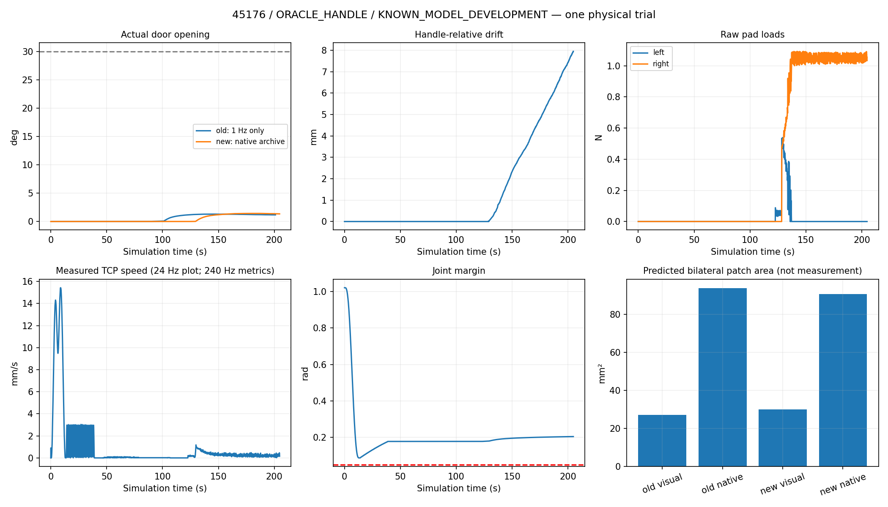

# 45176: correct-handle grasp PASS, 30° opening FAIL

**One normal-closed-start physical trial reached 1.429023°, not 30°.** It then receded to 1.351082° while slipping. The owner stopped the stalled experiment cooperatively; the same scene survived through full export, and the finished actor exited normally. No retry, release, regrasp, base movement, scene stitching or physics change occurred.

**ORACLE_HANDLE / KNOWN_MODEL_DEVELOPMENT.** Handle `original-46`; GT geometry and dynamic articulation feedback remain. This is not a second solved cross-object door skill.

| Result | Previous Oracle episode | New single trial |
|---|---:|---:|
| Correct-handle / valid grasp | PASS | PASS |
| Maximum actual opening | 1.306967° at **1 Hz**; exact peak unknown | **1.429023° at 240 Hz** |
| ≥30° | FAIL | **FAIL** |
| Relative position drift | 10.073 mm at last sampled state | 7.959 mm maximum |
| Relative orientation drift | Unknown | 1.1859° maximum |
| Raw pad-load peaks L/R | Lower bounds ≥0.469 / ≥1.092 N | 0.732 / 1.136 N |
| TCP speed all / after valid grasp | Exact peaks unknown | 15.516 / 1.320 mm/s |
| Minimum measured joint margin all / loaded | Exact minima unknown | 0.08660 / 0.17914 rad |
| Saved native observations / physics records | 0 / 0; SIGINT lost buffer | **49,145 / 49,145** |
| Simulation / actor wall time | Last live 200.996 s / 943.570 s | 204.771 s / 976.599 s |

Different sampling and time after grasp prevent claims that the small maximum-angle difference or lower endpoint drift demonstrate improved robustness. Pregrasp excursion (0.028376°) is uncredited; opening gain after valid grasp was 1.405259°.

The original likely failure was ineffective bilateral transmission: 93.1% of saved opening samples had zero left load, despite a feasible 30° IK plan. The old rank counted two first distal contacts, not stable support. Native convex hulls fill the visual bow-handle rear gap. **Old raw contact points/normals, exact speed/load maxima and loss intervals are unavailable; none were reconstructed as measurements.**

The only new skill changes are shared geometric scoring and its isolated planner: bilateral pad-footprint surface support/flatness, closing and hinge-opening alignment, both visual/native meshes, pad-depth-derived insertion and small wrist alternatives, section-diverse candidate coverage, and original approach/collision/IK checks. No runtime gate was added. Within 251.31 s of offline search, it selected section −0.3, insertion −5.0111 mm, roll 180°, pitch 0° at the prior station. Score rose modestly from 0.09250 to 0.09967; minimum planning margin was 0.08665 rad. The stronger central patch candidate covered only 9°, and inherited reachability-first ranking preferred the nominal 30° lower-section plan. **That prediction failed physically.**

The new raw stream pinpoints the divergence. Valid grasp at 128.6292 s had filtered loads 0.53353/0.52185 N. Positive contact points were at pad-local **y≈0**, the front edge of the −10.022…0 mm pad interval; normals were oblique by **8.48°/5.78°**. These solver points support poor seating; they do not measure a continuous pressure patch. Left load first vanished at **0.65347°** and remained continuously zero from **0.78783°** for **67.625 s**. Positive-load duty was **10.35% left / 100% right**. Door progress plateaued/receded while drift grew. There was no both-pad contact-report absence interval.

Bias-compensated commanded-joint FK tracked actual TCP within **46.0 μm / 0.00541°**. Thus the arm followed its commands while the grasp slipped. No existing collision, force, speed or joint protection triggered. The stop was the owner's observed transmission failure, **not a mechanical limit or diagnostic veto**. Closure continuity remained correct: 928 unilateral updates, zero command reopenings.

The exact `ee14128` runner/controllers/limits were reused unchanged (`a1d6d3a…`, closure `b522bcef…`, trajectory `669c4601…`, opening `08131e64…`). The frozen 45415 plan still passed offline original checks with 0.12236 rad margin; no 45415 physical retest occurred. Audit: **11,258 frozen files and 623 prior archive files unchanged**.

The next concrete blocker is load retention at oblique front-edge contacts. A later shared ranking should model a common physical closing configuration and actual interior/opposed supporting planes, rather than independent ray coverage plus nominal range. If native rear filling prevents suitable seating, report the collision-representation limitation; do not silently change colliders. **No further tuning or trial followed this failure.**

Complete 240 Hz data, raw contacts, sensor mapping and continuous video (204.7667 s; 8× preview separate) are preserved on server/local storage. Full source hashes, executable proof, exact plans, metrics and [archive verification](LOCAL_ARCHIVE_VERIFICATION.json) accompany this report. [Detailed analysis](DETAILS.md) records evidence limits, source dependencies and paths. Pretrial publication: `3fe7cd1`; actual actor PID 3524627 exited after export, return code 0.

