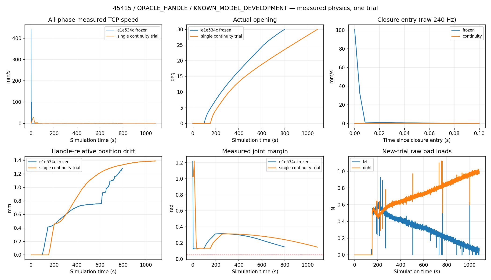

# 45415 pre-contact continuity: one physical PASS

**Both specified pre-contact velocity spikes were reduced, and the correct-handle grasp still opened the actual door to 30.0000267°.** Exactly one independent normal-closed-start physical trial was executed. No retries, release, regrasp, base movement, scene restart, attachment, artificial object actuation or parameter tuning occurred.

Classification: **ORACLE_HANDLE / KNOWN_MODEL_DEVELOPMENT**. GT handle geometry, hinge/collision geometry and dynamic articulation/moving-body feedback remain execution inputs. This is not autonomous or GT-free manipulation.

| Measured quantity | Frozen `e1e534c` | Single new trial |
|---|---:|---:|
| PREGRASP peak TCP speed | 441.113 mm/s | **27.357 mm/s** |
| First SLOW_CLOSE-entry TCP speed | 100.785 mm/s | **0.017440 mm/s** |
| All-phase peak TCP speed | 441.113 mm/s | **27.357 mm/s** |
| Peak after valid grasp | 1.315 mm/s | **0.747 mm/s** |
| Correct handle / bilateral grasp | PASS | **PASS, `original-40`** |
| Maximum actual opening after valid grasp | 30.000082° | **30.000027°** |
| Maximum handle-relative position drift | 1.280 mm | 1.391 mm |
| Maximum handle-relative rotation drift | 0.408° | 0.444° |
| Minimum measured joint margin, all / after grasp | 0.12236 / 0.13015 rad | 0.12236 / 0.13179 rad |
| Peak raw left / right pad load | 0.969 / 1.252 N | 0.952 / 1.223 N |
| Aperture-command reopening events | 0 | **0** |
| Simulation duration | 797.129 s | 1083.392 s |
| Actor wall duration, including initialization/export | 3472.339 s | 4874.592 s |

The PREGRASP maximum is a broad fast section in the middle of the initial joint-space segment, not a one-sample handover artifact. Neighboring archived speeds are approximately 441 mm/s; Pinocchio's Jacobian predicts 439.095 mm/s from the recorded commands. The original cubic clock constrained joint rates but allowed this Cartesian speed. The repair keeps the same joint segments and endpoints, using a rest-to-rest quintic clock whose duration accounts for the TCP tangent. Nominal command speeds are 30 mm/s in free-space pregrasp and 3 mm/s in approach; these are trajectory-generation settings, not new measured-state gates. Physics/control sampling remains 240 Hz.

The independent SLOW_CLOSE spike is a real position/velocity handover impulse. Measured-state IK replaced the gravity-deflected position-command equilibrium, and its approximately 0.000713 rad offset became a one-step velocity feedforward. The repair retains the command-minus-feedback offset acquired at this handover and continues to seed IK from actual feedback. It changes neither JawCenteredClosure nor Pink opening logic.

Offline verification found a maximum independent URDF/Pinocchio FK matrix difference of 6.66e-16 and Jacobian/central-difference discrepancy of 1.51e-10. Simulator TCP versus measured-joint FK differed by at most 0.398 μm in the sampled archive. Command replay verifies exact saved endpoints, zero endpoint velocity/acceleration, consistent timestep parametrization and continuity of the repaired handover. Cooperative-marker and SIGINT export fixtures restored every value losslessly. These checks consumed zero physical trials; the results above are from subsequent real contact physics.

Physical contact began at simulation time 146.9417 s. FORCE_HOLD/GRASP_VERIFIED occurred at 152.3125 s, with filtered left/right loads 0.52666/0.52566 N. The verified aperture repair executed 828 unilateral-centering updates with zero command reopenings. The original opening controller then reached 30°. Peak contact-phase speed including closure/centering was 1.013 mm/s; the entire pre-contact closure interval peaked at 0.137 mm/s. No existing loaded-speed, collision, force or joint protection triggered; first execution divergence is null.

This does **not** eliminate all grasp drift or load asymmetry: position drift rose slightly versus the frozen result, and single-pad zero-load reports remain visible in raw telemetry. No interval had both pad/handle contact reports absent after verified grasp. The trial supports preservation of safe physical task completion, not repeated-trial robustness. It is also not a speed-optimization result: pregrasp/approach deliberately increased from approximately 4.90 to 61.44 simulation seconds, and total duration increased. The opening controller is byte-identical, but this new physical grasp produced a different progress history.

The actual actor loaded `scripts/run_oracle_door_precontact_continuity.py` (SHA-256 `a1d6d3a053928249c211c4c15b4361c82fe52a37d7e51876e5a9a30502dfa261`) and `precontact_trajectory.py` (`669c46014c11f939e1367d25c1200652a47b4a48332c996b222cd15392d49d9a`). Closure hash remains `b522bcef…`; Pink opening excerpt remains `08131e64…`. Full hashes, the exact station/plans and runtime provenance are alongside this report. Pretrial source and offline evidence were published in `0a42418` before launch.

All 260,014 observations and 260,014 native physics records, plus 21,691 closure-command records, exported without telemetry issues. Continuous video covers 1083.3667 s; `summary_20x.mp4` is an explicitly accelerated preview. Raw streams, sensor/contact conversion metadata and video are preserved at `/data1/home/rangeryx/fr3_real2sim_known_whole_20261007/results/45415_precontact_continuity_20261011/physical_01`, with a hash-verified local archive recorded in `LOCAL_ARCHIVE_VERIFICATION.json`. GitHub contains source, exact plans/configuration, compact metrics, provenance and the comparison figure; raw archives remain on the server and local workspace.

The finished actor PID 3407738 exited normally after export (return code 0). The preservation audit checked 11,251 frozen files and all 596 files in the prior 45415 archive: zero changes. **The single-trial round is complete; no further physical trial was started.**

