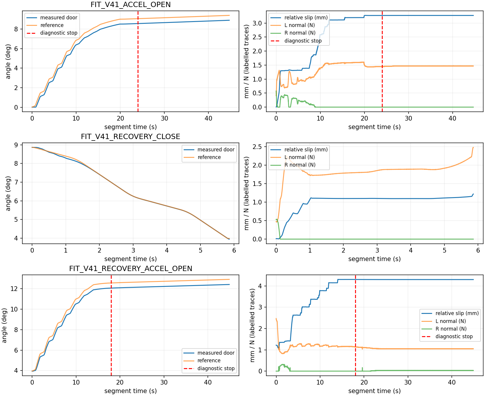

# V4.2 — adaptive duration and measured-state continuation

Reference: `a2ea768`. Engineering validation only; **no full Agent research episode was launched**. The original V4.1 outcomes remain unchanged.

## Outcome

The active Agent and panel primitives no longer inherit a 45-second segment ceiling. Native contact testing demonstrated a safe partial action followed by a complete, preapproved closing trajectory from its **measured** endpoint. The same grasp then opened to **13.0816°**. Guarded release and collision-checked parking completed before deliberate safety-fault injection.

This is a recorded, automatically generated RGB-D **engineering fixture**, not a new fresh-perception or independent dynamics experiment. Its grasp differs from V4.1's Agent-selected grasps; its contact success does not establish that their retention problem is solved.

## V4.1 diagnosis from archived 240 Hz measurements

| Quantity | First opening, final 10 s | Successful closing | Recovery opening, final 10 s |
|---|---:|---:|---:|
| Median absolute door speed, °/s | 0.01653 | 0.82123 | 0.01285 |
| Median reference lead, ° | 0.49991 | −0.00307 | 0.49993 |
| Actual TCP angular lead over door, ° | 0.43766 | −0.13419 | 0.43509 |
| Command/native TCP position error P95, mm | 0.40372 | 0.62608 | 0.37008 |
| Relative slip P95, mm | 3.27226 | 1.13482 | 4.29635 |
| Median aperture tracking error, mm | 0.88998 | 1.13529 | 0.65342 |
| Mean L/R normal load, N | 1.471 / 0 | 1.848 / 0.0076 | 1.048 / 0.0304 |
| Mean compensated hinge effort, N·m | +0.03831 | −0.03961 | +0.03830 |

Measured FK agrees with native TCP within approximately **0.001 mm P95**. Native arm command error is around 0.0046 rad, without a new late tracking divergence. Failed openings consume the existing half-degree reference allowance while the actual TCP advances relative to the door. The old detector compares **new slip growth** with progress; it misses the long tail after slip plateaus.

The evidence primarily supports direction-dependent contact transmission/compliance, with possible contact migration. Arm tracking and aperture compliance contribute but do not alone explain the difference: closing transmits well despite comparable tracking error and greater aperture error. Missing positive pad-normal reports cannot prove separation. Compact V4.1 records do not preserve full point/normal histories, so pad migration versus compliant contact cannot be uniquely separated. No grasp score, pose, effort or physics change is justified here.

Replaying the new full-cycle transmission monitor on these **actual archived measurements** identifies opening degradation at **24.0 s** and **18.0 s**, instead of 44.71/44.88 s timeouts. Closing is not flagged. Those are counterfactual offline stop times, not rerun physical outcomes.

## Shared changes

- `interaction_runtime/segments.py`: nominal timing integrates the unchanged ProgressClock using displacement, perpendicular hinge radius, requested velocity program and acceleration limits. The initial horizon includes existing lookahead recovery and complete program cycles; healthy measured progress can extend it within finite episode resources. There is no implicit segment `max_sim_s`. Explicit owner/engineering ceilings remain supported.
- Live ETA is reported separately. Initial stiction/compliance makes a single-window ETA unreliable; it is **not** an early-stop rule. True episode resources and exit reserves remain authoritative.
- Default episode resources are 2400 wall seconds / 1800 simulation seconds, with 180 wall seconds / 60 simulation seconds reserved for the original guarded exit. An earlier launcher deadline wins. Execution-level checks block new work when the reserve is reached, while allowing checked deceleration, release, separation and parking. They never bypass a safety latch.
- Transmission monitoring integrates requested versus actual travel across whole speed-program cycles. Two consecutive cycles with <10% transmission and ≥90% consumption of the unchanged 0.5° lead diagnose sustained degradation, including near the endpoint. These are recoverable diagnostic settings, not force thresholds or grasp-admission gates. The old three-window slip signal is retained but requires exhausted tracking allowance before stopping; slow initial loading alone is insufficient. Neither detector requires bilateral symmetry.
- Results distinguish `TARGET_REACHED`, `SAFE_PARTIAL_PROGRESS`, `TRANSMISSION_FAILURE`, `SAFETY_STOP`, and `BUDGET_EXHAUSTED`. Success is checked against the requested measured angle **after deceleration and settling**. The existing safe-parking stationary duration/cell (0.3 s / 0.025 rad) is reused for measured stop observations; it is not a new hard safety gate.
- A successor can opt into `continue_after=["SAFE_PARTIAL_PROGRESS"]`. Stable stopped contact, remaining resources, and the entire current-state hinge arc are checked with existing IK, joint limits and scene collisions. Failure or hard-stop results cannot continue loaded. No Agent wait occurs in unstable contact.
- Interrupted FIT uses only predeclared, moving, transmission-qualified prefixes with segment-local filtering support. Its failed action status remains visible. Incomplete VALIDATION is always excluded. V3.1 mathematics and filtering are unchanged.
- `rgbd/pregrasp`, `pregrasp_001`, … are allocated atomically. Each retains its calibration and correction metadata; the root correction file is only a latest-result convenience. Repeated acquisitions no longer overwrite pixels. The full Agent entry now hashes the actual wrist-input and command-protocol sources too.

The frozen `progress.py` still contains its historical planning helper for reproducible offline replay. **Active execution and action validation explicitly import the new module**; there is no runtime fallback to that helper. The ProgressClock class/file is byte-identical to the reference.

## Short native contact regression

All tests used the native xArm7/G1, finite drives, original colliders, F/T interface and 240 Hz physics. No object joint commands, attachments, pose corrections or force increases were used.

| Final contact sequence | Requested angle | Measured endpoint | Result | Simulation duration |
|---|---:|---:|---|---:|
| Normal opening | 0.8° | 0.82159° | TARGET_REACHED | 1.9583 s |
| Deliberate finite engineering interruption | 1.8° | 1.53530° | SAFE_PARTIAL_PROGRESS; **not success** | 2.1375 s |
| Preapproved reverse from actual endpoint | 0.3° | 0.28484° | TARGET_REACHED; complete declared VALIDATION | 3.0250 s |
| Subsequent normal opening | 13° | 13.08158° | TARGET_REACHED | 8.6375 s |

The second action deliberately declares a **2.2 s engineering ceiling** to exercise partial continuation; this is not a production default. Its measured transmission ratio is 0.940. The successor is replanned from **1.53530°**, not the unachieved 1.8° target. The last opening's transmission ratio is 0.981; its tracking-limited flag is frequently set, demonstrating why that flag alone must not be interpreted as contact failure.

Contact-sequence peaks: **12.077 mm/s TCP**, **0.7865 mm cumulative handle-relative slip**, **1.3505 / 1.2375 N L/R pad loads**. Minimum joint margin across the run: **0.94658 rad**. All F/T samples valid; numeric export has no issues; every numeric chunk hash verifies. No unexpected manipulation safety stop occurred.

The complete short-run acquisition/contact/exit/safety test consumed **135.546 simulated seconds / 329.641 wall seconds**, including initialization and cleanup; storage **13.51 MB**. This is not an equivalent-throughput comparison with an Agent/SAM3 research episode.

Two earlier engineering failures are preserved:

| Run | Finding | Actual gain | Termination | Wall time / storage |
|---|---|---:|---|---:|
| `native_contact_00` | Old slip-growth stop misclassified very slow initial loading; lead only ~0.041° | 0.01296° | TRANSMISSION_FAILURE; safe park | 309.21 s / 11.85 MB |
| `native_contact_01` | Single-window ETA extrapolation stopped too early during loading | 0.01538° | SAFE_PARTIAL_PROGRESS; undeclared successor correctly rejected; safe park | 305.28 s / 11.92 MB |

They were not retried as research outcomes. Their shared software causes were corrected before the normal-speed contract regression. The extreme low-speed *contact* scenario was not subsequently claimed successful.

## Safety, data isolation and source checks

- Original force, velocity, acceleration, collision, joint and actuator policy files are byte-identical. Native caps read back as **50/50/30/30/30/20/20 N·m** for the arm; G1 master cap **2.64569 N·m**, unchanged. Caps are not motor-output measurements.
- Invalid joint/velocity commands and a real native collider route are rejected before physics advances.
- A known **4.2 N tool-only** test load continues for 48 steps (measured wrist peak 4.468 N). A known **11 N tool-only** load triggers `EMERGENCY_WRIST_FORCE` after six steps (10.196 N measured). No load is applied to the object; fault samples are not identification data. Parking is verified **before** this intentional emergency.
- Deterministic healthy motion completes after **111.313 s**, nominal 111.317 s. Frozen transmission stops at **3.0 s**, including a target closer than the lead allowance. Force/collision/joint/effort fault injections and mode-history continuity pass.
- The actual production asynchronous worker recovers known synthetic parameters from qualified prefixes; mutating all validation measurements leaves FIT parameters/covariance unchanged. Worker latency is approximately one second. No incomplete validation is admitted.
- Twelve concurrent repeated checkpoint allocations preserve distinct directories and old pixels.

See `DETERMINISTIC.json`, `SAFETY_PROTOCOL_REGRESSION.json`, `ADAPTIVE_WORKER.json`, `ACTIVE_ENTRY_AUDIT.json`, and the native derived summaries. The separate final-version robot-only check (`NATIVE_03.json`) completes an actuator-executed free-space arc in **46.3583 s** (nominal 45.3917 s), then reverses in **7.9542 s**. Frozen virtual feedback produces `TRANSMISSION_FAILURE` with protected deceleration in **3.3083 s**. These angles are virtual free-space coordinates, **not door motion or new contact-loss evidence**. After deliberately exhausting the work budget at an unloaded boundary, new motion is rejected before physics, while collision-checked parking still executes. Total wall time: **137.802 s**; private storage: **6.94 MB**.

## Next independent experiment — prepared, not launched

`configs/probing_v42_plan.json` specifies fresh Agent wrist perception and automatic grasping; acceleration-rich FIT, overlapping different-speed reverse FIT; then a **complete, separately declared VALIDATION** within the actually supported measured range. Optional large-angle exploration comes afterward. Endpoints are resolved and declared before each execution, with nominal duration and remaining resources checked. Recovery uses the existing guarded unload/reobserve/regrasp lifecycle. No fixed 13° requirement or historical grasp is supplied.

Known hinge/dynamic state, registered station, simulated wrist mounting, ideal load cell and approximate actuators remain explicit dependencies. This round validates execution contracts, **not new independent I/b/C accuracy**. A new research episode remains necessary, and is deliberately not run here.

## Evidence and cleanup

Only code, this report, derived metrics/figure and hashes are public. Raw numeric streams, RGB-D, geometry and clips remain private under `/data1/home/rangeryx/fr3_real2sim_known_whole_20261007/results/adaptive_probing_v42_20261019/`. No raw archive or release upload is created. All four owned actors are exported and closed sequentially (including the two unsuccessful engineering tests). Total private test storage is **44.22 MB**. `CLEANUP_AND_SOURCE_AUDIT.json` confirms no owned actor remains and all final native-loaded sources match. The contact test core functions (rotation, current-state successor planning, acquisition and safe exit) are AST-identical to the final implementation; the subsequent execution-level reserve guard is tested in the robot-only run. Final source hashes are in `FINAL_SOURCE_HASHES.json`.
