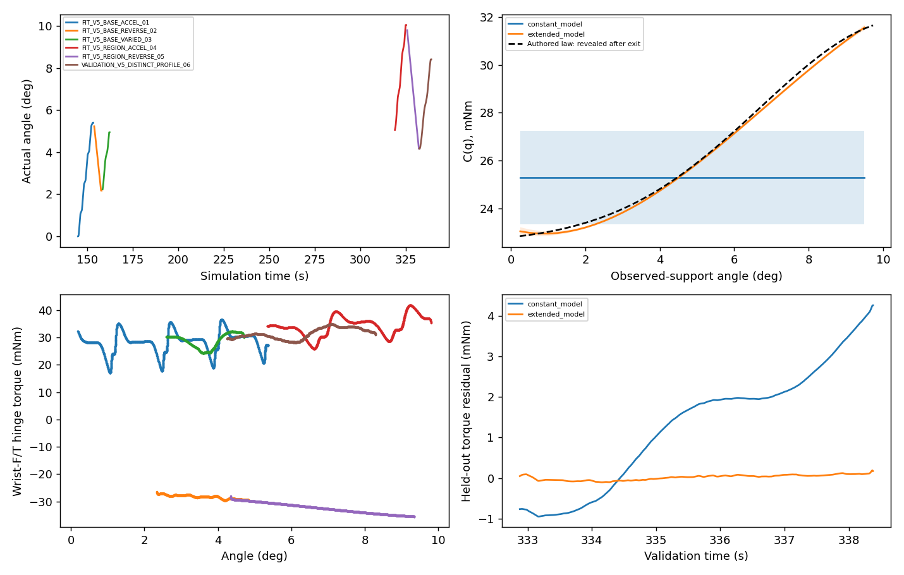

# V5 — Agentic angle-dependent passive resistance

**PASS within this one blind simulated development episode and its observed range.** Fresh Agent-selected wrist observations, two automatic handle acquisitions, informative forward/reverse FIT and a fully completed independent VALIDATION revealed meaningful angle dependence. The smooth model improved held-out torque, angle and velocity prediction over the constant model. No valid-episode retry, controller tuning or hidden-truth model selection occurred.

Reference: frozen V4.5 `79d93bb`. V5 source/configuration commitment **`55f7ec8`** was committed and pushed before launch. Raw RGB-D, wrist F/T, telemetry, object/robot geometry and event video remain private.

## What changed, and what stayed frozen

Only new V5 adapters and numerical modules were added. `RuntimeV5` activates the existing `xarm_ft_v1_scene.install_native_law` in the pre-physics seam. It changes **native static/dynamic DOF friction properties** according to the private passive law, preserving the imported viscous coefficient. There are no object effort/position commands during interaction, external object torques, new colliders or robot/gripper dynamics changes. There were **360 backend readbacks**, maximum property error **1.12×10⁻⁹ N·m**. Dissipation remains `C(q)|qd| + b qd² ≥ 0`.

The V4.4 observed-geometry candidate fallback, current-state full execution checks, adaptive progress, original closure/one-second hold, recovery/parking and phase-aware protections are inherited unchanged. All **45 registered source checks** still matched during execution; the final provenance includes 47 source/configuration entries. No engineering fixture, saved successful grasp or archived viewpoint supplied this episode.

The versioned worker reuses V3.1's exact segment-local wrench, gravity/inertia compensation and common SG121 pipeline. Each angle feature is **`K(B_j(q) sign(native_qd))`**, not a basis evaluated on smoothed angle or the sign of smoothed velocity. Tool inertia is compensated once. Constant C remains the unchanged V3.1 baseline. Alternatives are nonnegative quadratic/cubic Bernstein controls on the prior 0–20° domain, with fixed second-difference regularization candidates. Complete FIT-trajectory CV selected cubic degree 3, smoothness `1e-4`; VALIDATION cannot choose degree, regularization, parameters or uncertainty.

Offline checks recovered a known smooth law, selected the constant model for zero amplitude, reproduced the archived V4.5 constant result exactly, and preserved FIT parameters/covariance/selection when validation measurements were mutated. Native-property checks before launch used a tensor-interface mock; actual native application was independently verified during the single episode. These are distinct evidence types.

## Actual Agent decisions and physical motion

Codex inspected actual fresh RGB, SAM3 overlays, metric depth, local clouds, semantic uncertainty and both automatic G1 plan boards. The initial detection failed; the first adjustment detected a high-score but top-clipped handle. The Agent widened/raised the view, then requested a complementary side view: full measured length **295.90 mm**, including **7,830 newly measured voxels**. Unknown rear surfaces remained unknown.

The first automatic family was `[section=0, insertion=0, roll=0, pitch=0]`. After three baseline FIT trajectories, guarded release and verified unloaded parking, Codex inspected load/aperture/slip/wrist-wrench and model-residual plots. It observed left-dominant normal reports, informational warnings and **2.15 mm** accumulated relative translation, alongside angle-related residuals. Initial FIT-only CV improved **0.839 → 0.205 mN·m**, but cubic conditioning was **1503** and angles beyond 5.36° were unobserved.

The Agent chose the 10° opportunity over 15°: information-gain surrogate **8.12** versus **2.46** for 6°, with less untested travel/cost than 15°. This is an excitation surrogate, not collision certification, calibrated uncertainty or a success probability. The final wrist adjustment independently measured **295.81 mm** of handle at the actual 4.94° door state. Fresh automatic planning selected family `[-0.3,0,0,0]`, with complete current-state validation. This intentional second acquisition enabled an unloaded Agent decision; it was **not recovery from a failed first attempt**. No unexpected recovery was needed.

| Predeclared segment | Target | Actual endpoint | Actual post-acquisition segment travel | Sim time | Outcome |
|---|---:|---:|---:|---:|---|
| Acceleration-rich baseline FIT | 5.4° | 5.403° | +5.390° | 8.896 s | TARGET_REACHED |
| Reverse baseline FIT, different speed | 2.2° | 2.172° | −3.232° | 4.600 s | TARGET_REACHED |
| Varied-speed overlapping baseline FIT | 4.9° | 4.944° | +2.772° | 4.400 s | TARGET_REACHED |
| Regional acceleration-rich FIT | 10.0° | 10.048° | +5.067° | 6.725 s | TARGET_REACHED |
| Regional reverse FIT | 4.2° | 4.170° | −5.878° | 7.250 s | TARGET_REACHED |
| Independent distinct-profile VALIDATION | 8.4° | 8.416° | +4.246° | 6.508 s | TARGET_REACHED |

Maximum recorded angle **10.049°**; total useful opening/closing travel **17.475° / 9.110°**. Both acquisitions passed the original bilateral verification and one-second hold. Six fresh wrist observations, four actual Agent-selected adjustments, two planned acquisitions and two guarded releases occurred in one continuous scene. No object reset, teleport, artificial actuation or physical retry. All six interaction records are contiguous **240 Hz**.

FIT included measured acceleration RMS **0.02410 / 0.01866 rad/s²** in the two acceleration-rich openings, varying-speed opening and reverse velocity RMS approximately **0.0141–0.0165 rad/s** over overlapping angles. The extended regressor had rank **6**, scaled condition **151.17**. These values use actual motion, not commanded excitation.

## Blind identification and independent prediction

Final model selection used five complete FIT trajectories, **244 FIT bins** and **56 held-out bins**. Mean FIT-trajectory CV RMSE improved **2.9756 → 0.1215 mN·m (95.9%)**; every FIT-held-out fold improved. Adding VALIDATION left the selected model, all candidate parameters and their uncertainty **unchanged**, verified against the captured zero-validation-bin snapshot. Six asynchronous updates completed; the online output remains hash-identical after post-hoc evaluation.

| Evaluation | Constant C | Smooth C(q) |
|---|---:|---:|
| Independent torque RMSE | 1.9482 mN·m | **0.06708 mN·m** |
| Free angle RMSE | 0.30213° | **0.04139°** |
| Free velocity RMSE | 0.004777 rad/s | **0.001237 rad/s** |
| Final angle prediction error | +0.83544° | **+0.00074°** |
| C-curve RMSE versus authored law, observed support only | 3.1598 mN·m | **0.14494 mN·m** |

The physical validation completed in full. Primary free prediction covers its reliable interior: **1321 samples / 5.5 s**, one measured initial angle/native velocity, then held-out measured F/T input without future-state correction. Both models use the same input/filter convention; neither predicts future contact force autonomously. SG121 requires **0.2583 s completed-segment lookahead**. Boundary exclusions are predeclared processing rules, not incomplete physical validation. Predictions stayed inside FIT support.

Truth was first accessed at **2026-10-19 05:32:48 UTC**, after `SESSION_COMPLETE`, actor exit, estimator completion and explicit Agent finish. The revealed bytes match precommitted SHA256 `e5df7fba0ec1e520b4e4f97a3611e8d314400b351af5787b86c1e6af9d119841`. Blinding is procedural process/input isolation under a shared account, not adversarial OS security.

| Parameter | Immutable online smooth model | Conditional 1σ | Post-exit authored reference | Relative error |
|---|---:|---:|---:|---:|
| I_eff (kg·m²) | 0.16104163 | 0.00054903 | 0.16130570 | **−0.164%** |
| b (N·m·s/rad) | 0.27650015 | 0.00196375 | 0.26863717 | **+2.927%** |

The authored law was `C(q)=0.02254716 + 0.00936387 exp(-0.5((q−0.18587684)/0.06886325)²)` N·m. Its peak is **10.650°**, width **3.946°**. This peak was **not reached**. Comparison is restricted to measured FIT support **0.237–9.731°**: estimated resistance variation **8.869 mN·m**, authored variation **8.825 mN·m**. For example, estimated C at 1/5/9° is **22.943 / 25.865 / 31.012 mN·m**. Unvisited curve values and uncertainties are null in the export; no precise peak or 10–20° reconstruction is claimed.

Conditional uncertainty is not calibrated total error. Damping differs from the authored reference by about **4 conditional σ**, and low-dimensional curve mismatch also exceeds local statistical bands in places. Those bands exclude model, compensation, solver, contact and model-selection uncertainty. The improvement is supported jointly by blind observed-range curve comparison and independent response prediction, not a statistical interval alone. Authored inertia is **not an independently measured effective PhysX inertia**.

## Safety, cost, evidence and stopping

Maximum loaded TCP speed **10.47 mm/s**, minimum loaded joint margin **0.4400 rad**, maximum relative translation **3.011 mm**. Overall raw pad peaks **2.498 / 1.159 N**; **3275 informational warning samples**, **zero hard-stop samples**. Asymmetric/missing positive normal reports and aperture compliance are retained; missing normal reports do not prove separation and are not complete friction wrenches. No force threshold, preload or actuator setting was increased.

Final guarded release/clearance/parking succeeded: door **8.4163°**, zero pad loads and verified unloaded native-rest parking. Actor **1086310**, estimator and capture workers exited cooperatively; the owned-actor lock is free and no scoped Python process remains. Other users' processes were untouched.

Wall initialization-to-cleanup **2179.996 s / 36.33 min**; **358.97 simulated seconds**, 86152 physics steps and 22126 compact records. Two geometry/planning operations took **237.83 / 222.25 s**, two acquisition/probing/exit operations **399.04 / 398.27 s**. Unloaded Agent inspection/reasoning/communication totaled **636.86 s**; no unstable loaded inference wait. No throughput claim against a different scenario is made.

Episode storage **63.82 MB**: numeric **10.02 MB**, checkpoint RGB-D **24.27 MB**, geometry **5.34 MB**, source/metadata/inspected derived boards **24.09 MB**, optional clip **0.094 MB**. Entire private root including compact post-hoc products/index is approximately **65.57 MB**, below 100 MB. Essential F/T samples are valid; all numeric chunk hashes and unique stored steps verified. The optional event clip is valid **640×480, 15 FPS, 29 frames / 1.933 s**; no continuous video/depth or redundant raw archive. Distinct `pregrasp` / `pregrasp_001` checkpoints survived.

Public artifacts: [metrics](METRICS.json), [Agent decisions](AGENT_DECISIONS.json), [estimated model](ESTIMATED_PHYSICS_MODEL.json), [source hashes](SOURCE_HASHES.json), [evidence integrity/index summary](EVIDENCE_INDEX.json), [revealed configuration](REVEALED_CONFIGURATIONS.json), [offline checks](OFFLINE_CHECK.json). Canonical raw evidence stays on the private experiment server.

This establishes one reusable measured-only angle-resistance update/decision interface and a successful independent prediction test. It remains a known-hinge/state, registered-station, simulated wrist-camera, ideal-load-cell and approximate-actuator development experiment on one object/configuration. No hardware accuracy, population generalization, complete resistance peak, 15–30° capability or complete physics twin is claimed. **The registered episode is finished; no additional trial follows automatically.**
