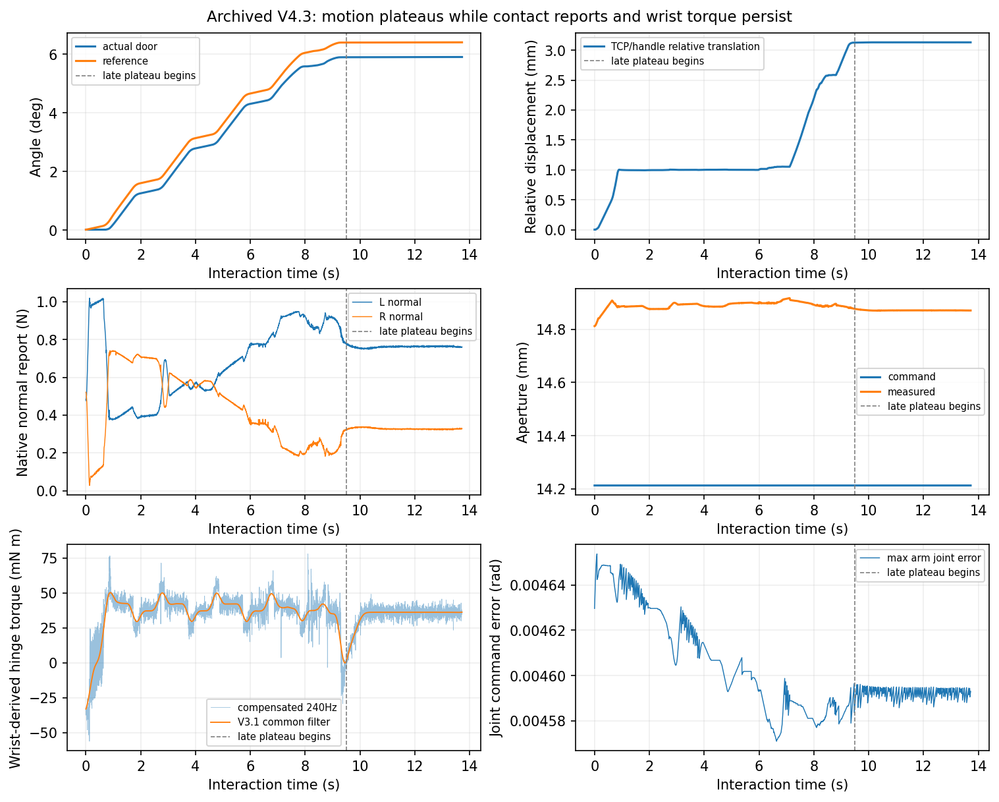
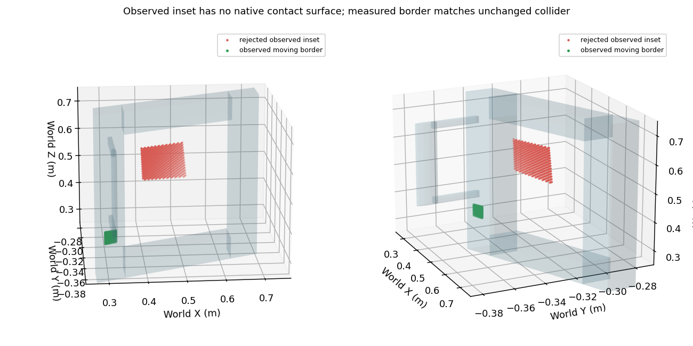
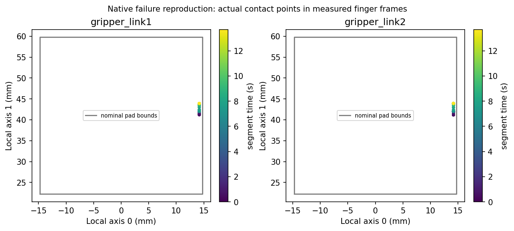

# V4.4 — current-state recovery feasibility and contact diagnosis

Reference: `169263f`. Development/engineering regressions only; no new blind research episode. All raw RGB-D, numeric F/T, native contacts and clips remain private. Original V4.3 results are preserved.

## Archived first divergence

The initial V4.3 grasp physically transmitted opening until approximately 5.90°. At 9.5–13.4 s, median actual hinge speed was only 0.00220°/s and additional travel 0.00761°, while the reference consumed its existing 0.5° lead. TCP/handle relative displacement rose to 3.13 mm. Command-to-measured TCP P95 error remained approximately 0.68 mm; FK/recorded-TCP disagreement stayed below 0.00084 mm. There was no evidence of a new discontinuous arm command.

Both native normal reports persisted through the plateau (mean L/R 0.761/0.328 N, no zero-report gaps). Measured aperture remained near 14.87 mm, with no sudden jaw opening. The full stream retained approximately 0.0342 N·m RMS compensated hinge torque. Thus the previous interpretation of a collapsed wrench is not supported by the full records. Persistent static load, compliance/contact migration and exhausted motion lead are consistent with lost effective transmission; complete separation and a unique friction mechanism are not demonstrated. Compact V4.3 records did not retain full contact-point/normal histories, so exact historical patch migration cannot be reconstructed.

| Window | Median hinge speed | Slip change | Mean L/R normal | Hinge torque RMS |
|---|---:|---:|---:|---:|
| 0–2 s | 0.577°/s | 0.002→0.996 mm | 0.604/0.500 N | 0.03474 N·m |
| 6–8 s | 0.767°/s | 1.005→2.191 mm | 0.860/0.279 N | 0.03929 N·m |
| 9.5–13.4 s | 0.00220°/s | 3.126→3.130 mm | 0.761/0.328 N | 0.03420 N·m |

## Shared corrections

1. Preserve the physical unhealthy-progress stop but classify `ADAPTIVE_HORIZON_WITHOUT_HEALTHY_PROGRESS` as `TRANSMISSION_FAILURE`, separately from actual finite-resource exhaustion. Its interrupted-FIT prefix ends at the last healthy transmission window. No motion, force, lead or collision threshold changes.
2. Keep contact ranking unchanged. Feed the planner the **actual measured articulated configuration**, then validate each ranked candidate's current-state return, full approach, measured released fingers, and original time-parameterized collision/velocity/joint checks. Reject invalid proposals and continue within the existing bounded candidate pool and planning budget. Existing episode-local failed-family exclusion is retained.
3. Expose observed/native panel correspondence diagnostics on refusal. The original 3-mm correspondence tolerance remains unchanged; points are never snapped and unmatched contact is never authorized.
4. Reuse production V3.1 and all existing deterministic manipulation/release/parking primitives. The added contact checkpoints are passive and bounded; essential interaction numbers remain 240 Hz.

Offline, the original recovery proposal reproduces `gripper_link2/original39` collision at the actual opened state. Using unchanged ranking plus current-state checks and existing failed-family memory finds another eligible orientation `[-0.3, 0, 180, 0]`; this offline pose is **not supplied to the fresh online recovery**. A candidate that passed coarse waypoints was also rejected by its actual time-parameterized route, demonstrating why complete execution feasibility matters.

## Panel correspondence

The rejected measured inset patch center was [0.459872, −0.316220, 0.544946] m, normal [0.102933, −0.994688, −0.000059]. Its depth points fit visual `original-36` with median/P90 errors 0.160/0.167 mm. However, `original-36/37` have no authored native collision surfaces. Moving-body `l_2` colliders cover rails `original31–34`, handle `original39` and mounts `original40/41`; the central ray misses them. The nearest moving-rail point distance is at least approximately 49.7 mm. This is a collision-representation/contact-selection limitation, not evidence for a calibration correction.

`SURFACE_DIAGNOSTIC.json` retains the measured camera intrinsics/extrinsics, actual moving-body transform, native collider local transforms/identities and per-surface mismatch quantiles without publishing meshes or raw points.

An Agent-inspected, visible moving-border patch instead matches unchanged `original31`: center-ray mismatch −0.0312 mm under the same 3-mm test. The measured center is [0.315588, −0.337816, 0.316891] m. Generic tool rolls 90/180/270° yield complete offline approach/contact/separation/parking routes; roll 0° correctly rejects a robot self-collision. These are explicitly archived engineering diagnostics, not online camera or grasp targets. No collider was added or changed.

## Native regressions

**PASS for the requested short engineering recovery/reachability regression.** A cached failure fixture is used only to reproduce the initial contact failure. The subsequent successful action uses fresh wrist observations and a newly generated automatic grasp in the same scene. This is not a new blind identification result or a long-range retention claim.

`native_00` reproduced the failure at 5.92315° and 13.725 simulated seconds, labeled `TRANSMISSION_FAILURE`, then guarded-released and parked. Fresh Agent motion recovered a complete 295.8-mm handle observation. Its unloaded 180-s Agent communication deadline expired before recovery planning, so this is an incomplete recovery regression, not a physical recovery failure or PASS. Evidence was exported (24.53 MB); owned actor exited. The bounded infrastructure allowance was amended to 360 s, subordinate to the same episode/exit resource bounds, for the relevant short-chain rerun. No manipulation policy changed.

Passive native-point checkpoints in this **new engineering reproduction**, separately from the unavailable historical V4.3 point records, show both contacts about 0.57 mm inside one lateral pad edge. Their finger-local longitudinal positions migrate approximately 2.71/2.77 mm during opening, while late longitudinal edge margin remains approximately 15.84/15.83 mm. This supports contact migration/compliance during ineffective pulling, without proving that either contact fell off the pad. Bounds are nominal pad geometry; point reports are not measured pressure patches or full tangential wrenches.

Native safety checks in `native_00`: joint-margin and joint-speed commands rejected before advancing physics; native collision route rejected before motion; finite actuator caps read back as [50,50,30,30,30,20,20] N·m and native G1 master 2.64565 N·m. A tool-only 4.2-N calibration load produced 4.468-N wrist peak and continued 48 steps; a separate tool-only 11-N emergency test stopped after six steps at 10.196 N. No force was applied to the object, and these guard samples are excluded from identification. The terminal emergency latch is authoritative; verified unloaded parking is reported **before** that deliberate test.

### Completed fresh recovery (`native_01`)

The same failed initial fixture again stopped at 5.92315°. After guarded release/parking, the Agent inspected three fresh wrist checkpoints: the initial occluded detection failed, an elevated lateral view recovered the full handle, and an opposite lateral view added 6,747 measured voxels. Cumulative extent was 295.89 mm. Actual RGB, SAM3 overlays, metric depth, local clouds, semantic support and later the automatic gripper board were inspected; image hashes and reasons are retained in the decision trace. No archived successful camera or grasp pose supplied the recovery.

Current-state ranking/checking evaluated 11 complete execution proposals. One proposal `[0, −0.009375, 0, 0]` was rejected for a **time-parameterized** `gripper_link2/original39` approach collision, and evaluation continued. The highest-ranked executable candidate was the middle-section family `[0,0,0,0]`, different from the failed `[-0.3,0,0,0]` family. Its complete planned approach/opening minimum joint margin was 0.6450 rad. The original current-state revalidation passed before Agent approval.

| Physical action | Status | Actual endpoint | Actual gain | Simulated duration | Maximum TCP speed | Maximum relative displacement |
|---|---|---:|---:|---:|---:|---:|
| Original failure fixture | TRANSMISSION_FAILURE | 5.92315° | +5.89927° | 13.725 s | 9.62 mm/s | 3.134 mm |
| Fresh recovery, opening FIT | TARGET_REACHED | 8.81867° | +2.90647° | 4.163 s | 10.39 mm/s | 0.617 mm |
| Reverse FIT | TARGET_REACHED | 5.47115° | −3.34752° | 4.804 s | 6.15 mm/s | 0.678 mm |
| Predeclared distinct-profile VALIDATION | TARGET_REACHED | 8.03532° | +2.56417° | 4.454 s | 7.77 mm/s | 0.676 mm |

Recovery acquired bilateral normal reports (0.469/0.542 N) and completed the unchanged one-second hold. Later left positive-normal reports were mostly absent, while actual bidirectional transmission remained healthy. Right-pad peaks were 2.268/2.410/2.198 N across the three segments; measured arm joint margin remained at least 0.65275 rad. There were no manipulation protection stops. This contrasts directly with the original stalled grasp's persistent bilateral reports: normal-report symmetry alone is not a transmission test. Missing positive normals still do not establish physical separation or quantify friction forces.

Both conditional successor arcs were rechecked from measured robot/door state. All four interaction streams are contiguous 240 Hz. The original failure remains failed; only its predeclared, transmission-qualified FIT prefix (ending 10.004 s) is admitted. VALIDATION was declared before execution, completed in full, and excluded from fitting. The unchanged V3.1 worker reported 143 FIT and 35 validation bins, one tool compensation, no hidden dynamics, and 2.16-s final processing latency. Engineering held-out torque RMSE was 0.551 mN·m; reliable-interior free angle RMSE was 0.0905° (3.442 s), while the separately labeled full-segment boundary-sensitivity result was 0.0924° over 4.45 s with unreliable filter/derivative edges included. These do not validate authored inertia or unseen-physics accuracy.

Guarded release and full collision-checked native-rest parking succeeded at actual door angle 8.04961°, zero pad loads, and maximum rest-cell joint error 0.0037035 rad. Agent then explicitly finished; no extra interaction was added. Repeated native guard regressions again rejected joint/velocity/collision faults, continued the 4.2-N tool test (4.746-N measured peak), and stopped the terminal 11-N tool test in six steps at 10.101 N. No emergency was cleared or followed by manipulation.

The completed chain took **1498.05 wall seconds (24.97 minutes), 294.64 simulated seconds**, including failure reproduction, fresh perception/planning, recovery, exit and guards. Automatic grasp ranking/IK took 325.24 s; recorded RGB-D/segmentation/incremental work 72.12 s; the remaining initial re-observation and Agent waits are not all included in that nested sensing timer. Physics/contact callbacks took 322.64 s; numeric state/F/T 117.89 s; safety/collision 45.09 s; buffered recording 61.83 s. Timers are exclusive nested costs, not a complete phase decomposition.

Final private episode footprint including preserved inspection images/annotations is **55.72 MB**; the interrupted first regression is 25.74 MB. Lossless compression of optional generated offline JSON reduced offline artifacts from 90.97 to 14.14 MB; the entire round, including the 13.12-MB failure fixture, occupies about **108.87 MB**. No raw measurement archive was copied or published. The optional event-video output is unusable (48-byte header; recorded camera-frame dimensionality error). Fresh wrist checkpoints, inspected boards, native contact checkpoints and complete essential numerical streams are intact; this report does not claim continuous video evidence.

Both owned actors exited normally; estimator workers were cooperatively joined. The first test's generic runner label `ENGINEERING_COMPLETE` did not mean capability PASS: its preserved Agent result was a bounded stop. The amended runner explicitly distinguishes incomplete chains. Generic production provenance flags also do not describe the initial archived fixture; `ENGINEERING_INPUT_PROVENANCE.json`, the job and runner document that exception rather than presenting it as fresh sensing.

Reproduction: freeze `d69a44c` plus the communication/status-only amendment `4128a32`; run `verify_contact_recovery_v44.py` against the archived terminal state, then the bounded `launch_contact_recovery_v44.py`. `SOURCE_HASHES.json` records 24 matching server files, 18 explicitly present in runtime source metadata, and unchanged baseline hashes for V3.1, its worker, native G1, safety configuration and ProgressClock. `NATIVE_METRICS.json` contains compact action, safety, timing and decision results. Offline plotting/summarizing helpers never enter the active control path.

## Next research preparation

`configs/probing_v44_plan.json` and `scripts/run_informative_probing_v44.py` prepare: informative opening FIT → overlapping different-speed reverse FIT → complete separately declared distinct-profile VALIDATION → optional expansion only after validation. Targets must be declared from measured supported motion before execution. No new hidden configuration or research episode is launched here. Incomplete VALIDATION remains N/A; no retrospective relabeling.

The demonstrated recovery interval is approximately 5.5–8.8°, not proven 15–20° manipulation. Collision-feasible fallback does not guarantee grasp retention across all geometries or longer trajectories. The next independent episode should complete its supported short validation before any expansion; it is prepared, not automatically started.

Known hinge/state, registered station, simulated wrist mount, native collision safety model, ideal wrist load cell and approximate actuators remain explicit dependencies. Normal contacts do not measure friction wrenches or pressure areas. Engineering held-out motion is not independent blind dynamics validation.
