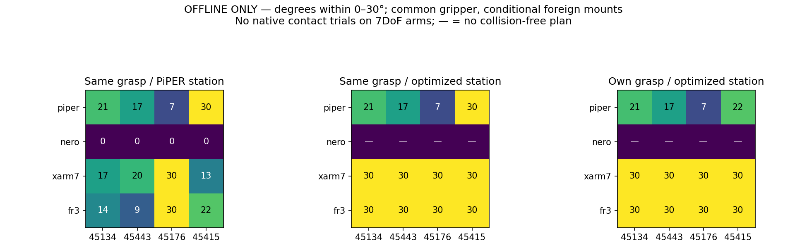
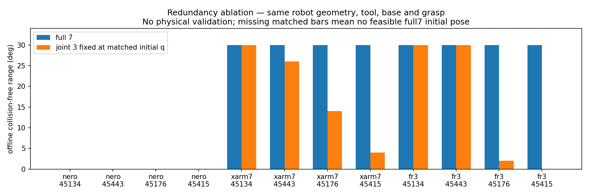

# 6DoF versus 7DoF: bounded cross-robot door study

**ORACLE_HANDLE / KNOWN_MODEL / CROSS_ROBOT_ABLATION. Reference: `81ab4f5`.**

**The offline comparison is complete; the cross-robot physical validation is not.** Sixteen registered robot/object combinations and 44 joint-fixed variants were evaluated. No 7DoF contact episode was launched because the retrieved setup lacks a validated actuator mapping and, for xArm7/FR3, a validated same-PiPER-gripper installation. This follows the explicit instruction not to launch an invalid physical trial. No ideal drive, Panda substitution, other gripper or borrowed PiPER arm gains was used. Contact stability, pad loads, slip, joint tracking and actual opening for these three arms are unmeasured.

The conditional offline result is promising for xArm7/FR3, but **a 7DoF platform advantage is not automatically a redundancy advantage**. Both platforms find 30° paths after selecting their own station. At the original PiPER stations they sometimes perform worse. Several locked-third-joint variants still reach 30°, while others lose range at the same station/grasp. Known reach, limits, mounting and collision representation remain confounds.

## 45134: requested physical comparison

| Robot | DoF | Own planned range | Actual range | Valid physical grasp | Max slip | Min joint margin: plan / actual | ≥30° physical |
|---|---:|---:|---:|---|---:|---:|---|
| PiPER | 6 | 21.0° | 20.906580° (archived) | yes (archived) | 0.494 mm | 0.0500 / 0.04999047 rad | FAIL (archived) |
| NERO | 7 | no plan | NOT RUN | unmeasured | unmeasured | N/A / N/A rad | NOT TESTED |
| xArm7 | 7 | 30.0° | NOT RUN | unmeasured | unmeasured | 0.9112 / N/A rad | NOT TESTED |
| FR3 | 7 | 30.0° | NOT RUN | unmeasured | unmeasured | 0.2670 / N/A rad | NOT TESTED |

PiPER physical evidence is the unchanged previously completed episode at `81ab4f5`, not a new attempt. Foreign planned ranges are conditional on the documented tool transforms and offline official-mesh collision proxies. A 30° plan is not a physical PASS. The three new physical attempt counts are NERO=0, xArm7=0, FR3=0; maximum allowed=one each.

## Common grasp and independently selected plans

| Robot | Asset | Same grasp + PiPER station | Same grasp + selected station | Own grasp + selected station | Own plan minimum approach/arc margin |
|---|---|---:|---:|---:|---:|
| PiPER | 45134 | 21.0° | 21.0° | 21.0° | 0.0500 rad |
| PiPER | 45443 | 17.0° | 17.0° | 17.0° | 0.1281 rad |
| PiPER | 45176 | 7.0° | 7.0° | 7.0° | 0.0556 rad |
| PiPER | 45415 | 30.0° | 30.0° | 22.0° | 0.0500 rad |
| NERO | 45134 | 0.0° | no plan | no plan | N/A |
| NERO | 45443 | 0.0° | no plan | no plan | N/A |
| NERO | 45176 | 0.0° | no plan | no plan | N/A |
| NERO | 45415 | 0.0° | no plan | no plan | N/A |
| xArm7 | 45134 | 17.0° | 30.0° | 30.0° | 0.9112 rad |
| xArm7 | 45443 | 20.0° | 30.0° | 30.0° | 0.4049 rad |
| xArm7 | 45176 | 30.0° | 30.0° | 30.0° | 1.1331 rad |
| xArm7 | 45415 | 13.0° | 30.0° | 30.0° | 0.8957 rad |
| FR3 | 45134 | 14.0° | 30.0° | 30.0° | 0.2670 rad |
| FR3 | 45443 | 9.0° | 30.0° | 30.0° | 0.1437 rad |
| FR3 | 45176 | 30.0° | 30.0° | 30.0° | 0.2670 rad |
| FR3 | 45415 | 22.0° | 30.0° | 30.0° | 0.2670 rad |

For NERO, 0° in the first column means that no collision-free starting configuration was accepted by this checker, not that a physical door was opened by zero degrees. Its recurring `link7–link5` check conflicts with a manufacturer MoveIt exclusion; [collision semantics audit](COLLISION_SEMANTICS_DIAGNOSTIC.json) records this as an integration/representation limitation. No collider or mask was silently disabled. A separately labelled [pure IK diagnostic](PURE_IK_DIAGNOSTIC.json), never used for execution, separates joint-only coverage from this spatial-check blocker. It is not an executable plan.

PiPER 45415 retains 30° with its saved common grasp and station; the automatic contact-utility-ranked search selects a 22° alternative. The old physical 30° success is not changed. This reveals a planner selection/budget tradeoff, not a loss of the frozen controller capability or proof of a smaller robot workspace.

The common grasp is the archived nominal object-relative TCP transform, not a measured slip-corrected pose or a newly hand-tuned template. Object mounting, target and hand geometry are identical for each cross-robot case. Own-grasp results are reported separately because changing grasp section/orientation changes both reachability and expected contact support. The raw [comparison JSON](COMPARISON.json), CSV and per-case `offline/robot/asset/` files include approach feasibility, base x/y/yaw, q paths, TCP targets, contact scores, aperture, margin and the first blocked interval.

## Within-robot redundancy ablation

Joint 3 was fixed at predefined -0.6/0/+0.6 rad. A fourth lock uses the full-seven solution’s initial joint-3 value at the exact same station/grasp, avoiding an initially unmatched configuration. Unreachable predefined values are retained. All variants keep the same robot, tool, base, collision surfaces, joint limits and Pink settings. This is a redundancy approximation, not a PiPER surrogate.

| Robot | Asset | Full 7 | Joint3=-0.6 | Joint3=0 | Joint3=+0.6 | Matched initial Joint3 lock |
|---|---|---:|---:|---:|---:|---:|
| NERO | 45134 | 0° | no initial IK | no initial IK | no initial IK | no feasible full7 start |
| NERO | 45443 | 0° | no initial IK | no initial IK | no initial IK | no feasible full7 start |
| NERO | 45176 | 0° | 0° | 0° | 0° | no feasible full7 start |
| NERO | 45415 | 0° | no initial IK | no initial IK | no initial IK | no feasible full7 start |
| xArm7 | 45134 | 30° | 28° | 29° | 30° | 30° |
| xArm7 | 45443 | 30° | 14° | 30° | 30° | 26° |
| xArm7 | 45176 | 30° | no initial IK | 15° | no initial IK | 14° |
| xArm7 | 45415 | 30° | no initial IK | no initial IK | no initial IK | 4° |
| FR3 | 45134 | 30° | 30° | 30° | 30° | 30° |
| FR3 | 45443 | 30° | no initial IK | no initial IK | 25° | 30° |
| FR3 | 45176 | 30° | no initial IK | 9° | no initial IK | 2° |
| FR3 | 45415 | 30° | no initial IK | no initial IK | no initial IK | 0° |

- On 45134, xArm7 and FR3 both reach 30° with a matched joint-fixed model. The selected full-range solution does not require dynamic use of joint 3; attributing its gain over PiPER solely to DoF count would be unsupported.
- On xArm7 45443, the matched lock reaches 26° while other predefined locks reach 30°. The initial configuration matters; the matched loss is not a proof that every six-joint configuration fails.
- On 45176, the matched locks reach 14° (xArm7) and 2° (FR3), versus full-seven 30°. On 45415 they reach 4°/0°. These show a benefit of allowing joint-3 motion for those selected continuous IK solutions, under the same geometry/station/grasp and inherited checks. They do not prove global six-joint infeasibility or physical grasp stability.
- NERO has no collision-admissible full-seven common-grasp station under the unchanged checker. Its predefined locks are checked at the registered PiPER station and remain initial-IK/self-collision failures. That ablation cannot resolve the redundancy question for NERO until collision semantics/tool integration are validated.

These are bounded solver results: two explicit seed branches, inherited IK residual tolerances and 1° reporting samples. A numerical solve failure is not a proof that no other branch exists. Cases at the 0.05 rad reserve can lose the next interval; their full q, margins and first blocked state are preserved. The zero-degree entries distinguish a valid initial point with no continuation from no admissible start in the JSON.

## Joint/configuration blockers and confounds

| Robot / asset | Own selected-plan ending / closest joint | Reported plan blocker |
|---|---|---|
| PiPER / 45134 | joint4 at -1.6953 rad; smallest ending margin 0.0500 rad | NO_CONTINUOUS_PINK_IK |
| PiPER / 45443 | joint5 at -1.0937 rad; smallest ending margin 0.1281 rad | NO_CONTINUOUS_PINK_IK |
| PiPER / 45176 | joint5 at 1.1661 rad; smallest ending margin 0.0556 rad | NO_CONTINUOUS_PINK_IK |
| PiPER / 45415 | joint5 at -1.1717 rad; smallest ending margin 0.0500 rad | NO_CONTINUOUS_PINK_IK |
| NERO / 45134 | no selected plan | BOUNDED_ORACLE_HANDLE_APPROACH_SEARCH_EXHAUSTED |
| NERO / 45443 | no selected plan | BOUNDED_ORACLE_HANDLE_APPROACH_SEARCH_EXHAUSTED |
| NERO / 45176 | no selected plan | BOUNDED_ORACLE_HANDLE_APPROACH_SEARCH_EXHAUSTED |
| NERO / 45415 | no selected plan | BOUNDED_ORACLE_HANDLE_APPROACH_SEARCH_EXHAUSTED |
| xArm7 / 45134 | joint4 at 0.7322 rad; smallest ending margin 0.9242 rad | target reached; no blocker before 30° |
| xArm7 / 45443 | joint2 at 1.6823 rad; smallest ending margin 0.4121 rad | target reached; no blocker before 30° |
| xArm7 / 45176 | joint4 at 0.9411 rad; smallest ending margin 1.1331 rad | target reached; no blocker before 30° |
| xArm7 / 45415 | joint7 at 5.3874 rad; smallest ending margin 0.8957 rad | target reached; no blocker before 30° |
| FR3 / 45134 | joint4 at -2.6553 rad; smallest ending margin 0.4217 rad | target reached; no blocker before 30° |
| FR3 / 45443 | joint6 at 1.0860 rad; smallest ending margin 0.6462 rad | target reached; no blocker before 30° |
| FR3 / 45176 | joint4 at -2.5648 rad; smallest ending margin 0.5122 rad | target reached; no blocker before 30° |
| FR3 / 45415 | joint6 at 1.3181 rad; smallest ending margin 0.8783 rad | target reached; no blocker before 30° |

A smallest-margin joint is not automatically the cause of `NO_CONTINUOUS_PINK_IK` or collision. The limiting configuration, last admissible q, collision pair and first blocked degree are retained in the detailed files. No partial result is called a mechanical limit. The platform differences include link geometry/reach, joint ranges and velocity limits, home posture, flange offset and an unvalidated foreign tool installation. Comparing min margins alone does not isolate redundancy.

## Models, calibration and physical limits of this study

Official sources are pinned: AgileX `agx_arm_urdf` **983788b58d7eae76511177f768d85877534917fe**; UFACTORY `xarm_ros` **aad7e1611c9c46eb719045414394bfdd42dcb0f8**; Franka `franka_description` **7aeeddc449edf8d62b594f9e36a81da53e7796f9**. The Franka model is FR3, not Panda. FR3 official-to-adapter joint aliases are explicit. Exact frozen PiPER hand links/meshes, inertia, finger travel and contact geometry are retained; NERO’s vendor flange offset and its changed current finger-frame conventions are recorded. xArm7/FR3 coaxial tool transforms are explicitly offline proposals, not mechanically validated mounts. All arm bases use the same existing support height (-0.1 m); x/y/yaw are optimized. Mount/payload feasibility remains unvalidated for foreign arms.

FK and Jacobians were verified independently against the URDF chain (13 configurations per robot); maximum FK position error <7.1e-16 m and Jacobian error <3.2e-10. Reduced-model FK is also checked. FR3 limits and dynamics match the pinned official YAML. Isaac imports find all arm joint names and their USD paths, but no object scene, World or physics step is created. Runtime tensor order/actuator tracking are not claimed from that structural inspection. See [kinematic verification](FK_JACOBIAN_VERIFICATION.json), [source parameter audit](SOURCE_PARAMETER_AUDIT.json), [model manifests](ROBOT_MODELS.json) and [Isaac joint mapping](ISAAC_STRUCTURAL_MAPPING.json).

The [physical model decision](PHYSICAL_MODEL_DECISION.json) documents why three contact trials were not launched:

- NERO imported arm drives have zero stiffness/damping; uniform nominal URDF effort/velocity fields and firmware-dependent torque encoding do not establish a validated servo/actuator model. [Official URDF](https://github.com/agilexrobotics/agx_arm_urdf/blob/983788b58d7eae76511177f768d85877534917fe/nero/urdf/nero_description.urdf), [official firmware interface](https://github.com/agilexrobotics/pyAgxArm/blob/master/docs/nero/firmware_reference.md).
- UFACTORY’s controller configurations are simulation examples; the imported position stiffness is absent, and a mechanically validated PiPER installation is absent. No example PID or copied PiPER gains are silently treated as factory dynamics. [Manufacturer controller scope](https://github.com/xArm-Developer/xarm_ros/blob/aad7e1611c9c46eb719045414394bfdd42dcb0f8/ReadMe.md).
- FR3 motor inertia, gear ratio, K/D and friction metadata are not realized as a complete actuator by this conversion. The old local FR3 plant overrides arm gains to 10000/400, so it is not reused as an accurate manufacturer actuator model; a validated PiPER adapter is also absent. [Official FR3 dynamics](https://github.com/frankarobotics/franka_description/blob/7aeeddc449edf8d62b594f9e36a81da53e7796f9/robots/fr3/dynamics.yaml).

The published adapter covers robot dimensions/names, FK/Pink IK and planning. Foreign-arm low-level contact execution and runtime tensor/gripper mapping have not been physically validated. This is not a completed cross-robot grasp-and-open capability demonstration.

## Archived contact evidence, timing and evidence preservation

| PiPER archived asset | Actual | Max slip | Peak pad loads L/R | Max loaded TCP | Min loaded margin | Sim / wall |
|---|---:|---:|---:|---:|---:|---:|
| 45134 | 20.906580° | 0.494 mm | 0.619/1.188 N | 1.466 mm/s | 0.04999047 rad | 380.2/1948.8 s |
| 45443 | 17.534973° | 0.870 mm | 0.660/0.722 N | 1.528 mm/s | 0.05000763 rad | 371.8/1887.5 s |
| 45176 | 8.068333° | 3.760 mm | 1.090/1.126 N | 1.378 mm/s | 0.04999976 rad | 240.5/1249.6 s |
| 45415 | 30.000027° | 1.391 mm | 0.952/1.223 N | 0.747 mm/s | 0.13179046 rad | 1083.4/5438.2 s |

These 240 Hz streams, videos and actual contact events are the existing frozen four-case data, not observations of a 7DoF robot. Foreign simulation durations, contact loss, pad loads, joint effort/tracking and measured TCP velocity are N/A. Offline compute wall time is in [comparison CSV](OFFLINE_COMPARISON.csv); it is not simulation time or task speed. Same-grasp station search and own-grasp search each have a 300 s ceiling, identical candidate ordering/two-branch budget and deterministic seeds. Searches stop at the first adequate same-grasp station or after finite candidate exhaustion; the own-grasp mode uses the frozen contact utility. This is not global optimum certification.

An engineering pilot exposed duplicate alternate IK seeds and legacy collision-export path assumptions. Its metadata/partial outputs are retained separately under `engineering_*`; those are not additional robot or object outcomes and consumed zero physical attempts. The final 16-case batch uses one frozen implementation/configuration and has sixteen zero process return codes, with no source changes during that batch. No asset-specific tuning occurred.

Full new evidence root on server:

`/data1/home/rangeryx/fr3_real2sim_known_whole_20261007/results/cross_robot_20261012/`

Verified local archive:

`/Users/rangeryx/Documents/ChatGPT/robot in loop real2sim/github_release/fr3-real2sim-piper-mobile-door/engineering_artifacts_20261012/cross_robot/results/`

It contains model-only USD imports, derived URDFs, source/config hashes, all candidate audits, selected q/base/grasp paths, 44 lock variants, native structural mapping and engineering evidence. [Archive verification](LOCAL_ARCHIVE_VERIFICATION.json) checks all 311 archived files. [Final audit](FINAL_AUDIT.json) confirms 11,256 frozen files and all 1,650 previous four-case evidence files are unchanged; all owned Isaac/study processes are closed. Existing contact videos and telemetry: [frozen 81ab4f5 evidence index](../door_transfer4_20261012/EVIDENCE_INDEX.md). No new 7DoF video or contact stream exists.

## Next concrete prerequisite

Validate robot-specific self-collision semantics with the original geometry, a mechanically credible same-PiPER-gripper mount and a sourced actuator/control mapping. Then the already prescribed one 45134 episode per eligible arm can test the physical hypothesis. This round stops here: no fabricated actuator, new guard, physical retry, transfer batch, perception or controller redesign is used to force a conclusion.
