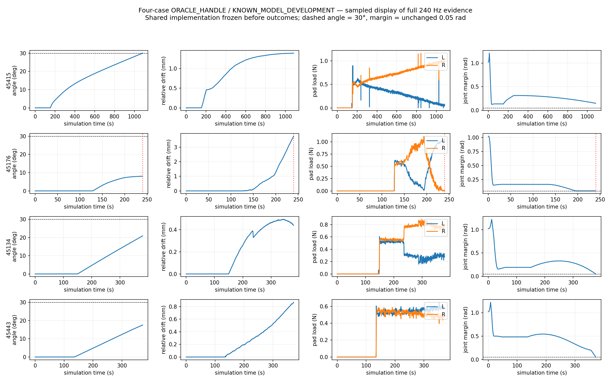

# Shared grasp-and-open development: four registered cases

**ORACLE_HANDLE / KNOWN_MODEL_DEVELOPMENT — 2026-10-12.**

Exactly four independent normally closed physical episodes were executed, with no replacements, retries or tuning between cases. All four selected and physically grasped their registered handles and transmitted measurable door motion. **1/4 reached actual ≥30°.** This is a deliberately small development batch, not a robust success-rate estimate and not a replacement for Benchmark A.

| Asset / handle | Plan interval | Correct first grasp | Effective opening | Max actual | ≥30° | Local correction | Max slip | Sim / wall | Final blocker |
|---|---:|---|---|---:|---|---:|---:|---:|---|
| [45415 / original-40](cases/45415/PHYSICAL_METRICS.json) | 30.0° | yes | 30.000° | 30.000027° | PASS | 0 | 1.391 mm | 1083.4 / 5438.2 s | target reached |
| [45176 / original-46](cases/45176/PHYSICAL_METRICS.json) | 7.0° | yes | 8.060° | 8.068333° | FAIL | 1 | 3.760 mm | 240.5 / 1249.6 s | RuntimeError('LOW_JOINT_MARGIN') |
| [45134 / original-32](cases/45134/PHYSICAL_METRICS.json) | 21.0° | yes | 20.859° | 20.906580° | FAIL | 0 | 0.494 mm | 380.2 / 1948.8 s | RuntimeError('LOW_JOINT_MARGIN') |
| [45443 / original-38](cases/45443/PHYSICAL_METRICS.json) | 17.0° | yes | 17.530° | 17.534973° | FAIL | 0 | 0.870 mm | 371.8 / 1887.5 s | RuntimeError('EXISTING_COMMAND_JOINT_MARGIN') |

Simulation and wall time are separate measurements. Independent scenes ran concurrently on assigned GPUs; these wall times are not a controlled speed comparison. Planning took 300 s maximum per new case, while 45415 reused its saved plan.

The new geometric plans covered only partial opening intervals. Those intervals were not execution caps: physical execution continued toward 30° until the original protections stopped continuation. The three unsuccessful cases reached the selected station/IK branch boundary. This is a candidate/planning limitation under fixed-base, zero-regrasp mode, not evidence of a global hardware or mechanical limit.

## What changed, and what stayed frozen

The one shared update tests both finger pads at the **same pose and common aperture**, across visual triangles and unchanged native collision surfaces. Pad-interior support, normal opposition and known opening-force direction contribute to contact utility. The opening-range multiplier is capped at two, rather than allowing nominal range to overwhelm nearly empty contact support. Original approach/camera/collision/IK checks remain. No per-ID controller branches or hand-tuned success poses were added. The two unused cases were selected by archived geometry/images before planning; [registration and contact sheet](REGISTERED_CASES.json) were published before physical results.

A thin shared entry point compiles the frozen 45415 runner and reuses its closure-continuity repair, pre-contact handover and Pink control primitives. Robot/gripper configuration, oracle handle ROI, articulation geometry, dynamic state provider, target and permitted correction are explicit separate inputs. Visual input is explicitly unsupported by this entry point. GT geometry and dynamic moving-body/joint state remain execution dependencies; this is not autonomous perception or GT-free manipulation.

Actual progress versus increasing relative displacement can hold the opening reference and invoke at most one existing bounded JawCenteredClosure centering target. The initial acquired moving-handle-to-TCP transform and slip reference remain immutable; any commanded correction is a separate logged offset. Single-pad unloading does not itself stop execution. No release, regrasp, base movement, object actuation, attachment or state stitching was used. Original colliders, mounting, masses, friction, gains, efforts, 0.05 rad margin and 5 mm/s loaded TCP protection remain unchanged.

## Diagnosis and transfer

- Archived Benchmark A analysis covered all ten cases: wrong semantic mesh selection on 45176/45203/45244, root contact, failed bilateral closure, four planning failures, and fixed-base workspace limits are distinct mechanisms. Several bow-handle visible rear gaps are erased by native whole-mesh hulls. [Capability/failure matrix](CAPABILITY_MATRIX.md) and [offline audit](BENCHMARK_A_CAPABILITY_AUDIT.json) retain these distinctions.
- Collision representation remains original-v1. A [separately versioned family-wide collision-v2 proposal](COLLISION_V2_PROPOSAL.md) is documented only; it was not combined with this controller experiment.
- 45176 now opens 8.068333° versus 1.429023° in the previous recorded one-trial contact-development attempt. Maximum relative drift is 3.760 mm versus 7.959 mm. One progress-driven correction occurs near 8.068°; reference hold plus a ≈5 μm existing centering step reacquires filtered bilateral contact, then the unchanged margin protection stops the run. This remains a failed 30° task and is not an isolated proof of correction efficacy because grasp/station selection also changed.
- The unused horizontal-handle 45134 and vertical-bar 45443 exhibit stable effective contact transmission, with 0.494/0.870 mm maximum drift and zero correction attempts. Both fail the 30° target at the selected IK branch margin. They demonstrate partial mechanism transfer, not full-task transfer.
- 45415 uses the exact frozen successful plan as a positive regression control. Its result tests compatibility of the shared wrapper/progress policy; it does not validate automatic planning on that asset.

## Measured contact and motion

| Asset | Filtered loads at grasp L/R (N) | Peak raw loads L/R (N) | Max TCP all / after grasp (mm/s) | Min margin after grasp (rad) | Max rotation drift |
|---|---:|---:|---:|---:|---:|
| 45415 | 0.527 / 0.526 | 0.952 / 1.223 | 27.357 / 0.747 | 0.13179046 | 0.444° |
| 45176 | 0.529 / 0.525 | 1.090 / 1.126 | 26.653 / 1.378 | 0.04999976 | 1.292° |
| 45134 | 0.422 / 0.609 | 0.619 / 1.188 | 22.104 / 1.466 | 0.04999047 | 0.054° |
| 45443 | 0.515 / 0.536 | 0.660 / 0.722 | 19.740 / 1.528 | 0.05000763 | 0.063° |

All-phase peaks occur during unloaded pre-grasp motion and are reported rather than hidden. Loaded opening speeds remain below 5 mm/s. The failed measured-margin cases terminate at the first threshold-crossing sample (approximately 0.04999 rad); the command-margin case stops while the measured margin remains approximately 0.05001 rad. No protection was weakened. See per-case terminal q/command q and event logs for the first concrete divergence.

## Evidence and reproducibility

Shared implementation was frozen and pushed before physical outcomes at commit **2226d14** on `codex/piper-door-transfer-four`. [Batch source hashes](BATCH_SOURCE_FREEZE.json), per-case jobs/plans/preflight, active source provenance, sensor definitions, metrics and correction logs are included under `cases/`. The original frozen 45415, 7320/45746 pipelines and Benchmark A outputs are independently hash-audited after execution. [Final audit](FINAL_AUDIT.json), [native buffer/export lifecycle test](EXPORT_LIFECYCLE_VERIFIED.json), [offline progress replay](PROGRESS_REPLAY.json), [registered results JSON](FOUR_CASE_RESULTS.json) and CSV preserve the protocol.

Full evidence remains on the server at:

`/data1/home/rangeryx/fr3_real2sim_known_whole_20261007/results/door_transfer4_20261012/`

A complete lossless archive is also preserved locally at:

`/Users/rangeryx/Documents/ChatGPT/robot in loop real2sim/github_release/fr3-real2sim-piper-mobile-door/engineering_artifacts_20261012/door_transfer4/results/`

Per case, `physical_01/contact_baseline.mp4` is the continuous original video; `summary_20x.mp4` is explicitly accelerated 20× for viewing. Chunked `physics_steps_chunks`, `observations_chunks`, `closure_commands_chunks`, sensor metadata, raw contact points/normals/impulses/collider IDs and actuator state are retained. Exported counts match in-memory buffers. The close camera is occluded in parts of some recordings; the overview inset and raw physics records remain, and no replay render is presented as original execution. Raw telemetry/video are preserved in the archive rather than committing gigabytes to Git.

The lossless archive is not itself committed to GitHub; GitHub includes compact reproducible evidence and the raw archive manifest/path. See [local archive verification](LOCAL_ARCHIVE_VERIFICATION.json).

All four scenes are preserved through final pause/export and then cooperatively closed; actor cleanup evidence is retained. No extra physical attempt is authorized or launched.

## Next engineering action

Prioritize better automatic initial station and continuous IK branch coverage for the entire 30° target while preserving the now-demonstrated contact support. This batch already predicted short intervals; proceeding physically was honest but cannot overcome a fixed-base branch endpoint. Evaluate any bow-handle collision representation revision in a separate environment-only comparison with the same controller. Do not tune 45176 alone or label partial opening as success. The registered batch is closed.
