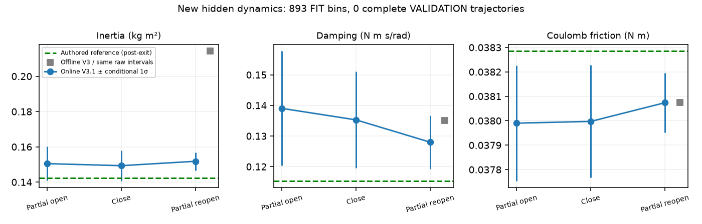

# V4.1 — independent Agentic probing on new cabinet dynamics

**Outcome: INCOMPLETE INDEPENDENT VALIDATION — not PASS.** One fresh continuous Isaac scene reached **12.3965°**, physically closed **4.9105°**, and safely parked. Production V3.1 produced useful blind estimates, but neither planned held-out trajectory was executed: preceding FIT opening actions timed out. Held-out torque and free forward angle/velocity prediction errors are therefore **N/A**, not zero. No FIT trajectory was relabeled as validation.

Reference `aec1458`; estimator `0305095`; registration `f7dfebc`. Scope: **Agent wrist RGB-D / known hinge and dynamic state / registered station / simulated wrist mount / ideal virtual six-axis load cell / approximate actuators**. No new perception, grasp scoring, controller, robot dynamics, gripping authority or safety-policy changes.

## Physical episode and Agent decisions

The actual executable was `scripts/run_informative_probing_v31.py`, with `RuntimeV3` importing the repaired shared `ProgressClock`, perpendicular hinge radius and stopped-state completion logic. The runtime class name does not denote use of the old V3 clock or estimator. Loaded hashes match the frozen sources, including production V3.1 worker; see [source hashes](SOURCE_HASHES.json).

Codex inspected actual new RGB, masks, depth and local clouds. The first view missed the robot-occluded upper handle. An image-derived raised/centered view recovered its full approximately 296 mm extent; an oblique view added an independently measured side patch. Automatic ranking and measured-state return/approach validation then produced the initial grasp. No saved successful pose or GT handle surface supplied it.

After the first timeout, Codex inspected actual contact/motion and F/T-model plots at a verified unloaded parking boundary. The opposite pad's positive normal reports had disappeared, relative drift reached 3.27 mm, and late motion nearly stopped. Codex selected the sole permitted recovery: reobserve the still-open door and automatically select another candidate. Fresh views recovered full handle extent from an initially observed lower 69 mm patch. The unchanged planner excluded the failed family and selected a different insertion candidate; this was not a manually specified offset.

| Operation | Actual measured motion | Simulated execution | Result |
|---|---:|---:|---|
| Initial grasp and original hold | Bilateral acquisition; 1 s hold | Original frozen closure | Acquired |
| Acceleration-rich FIT open, target 12° | 0.0178° → 8.8919° | 44.708 s | Safe timeout; action remains failed |
| Recovery grasp and original hold | Fresh automatic candidate at approximately 8.86°; 1 s hold | One recovery only | Acquired |
| Different-speed FIT close, target 4° | 8.8619° → 3.9514° | 5.863 s | Measured target reached |
| Acceleration-rich FIT reopen, target 13° | 3.9514° → 12.3965° | 44.879 s | Safe timeout; action remains failed |
| Remaining steady FIT / sine VALIDATION | Not executed after preceding timeout | — | Not validation data |
| Observed-panel alternative | Fresh image ROI evaluated | Planning only | No corresponding native moving surface; no push executed |
| Final release/retreat/park | `native_rest`, unloaded | Current-state checked route | Completed |

Maximum angle was 12.396543°. Net controlled opening across the two opening segments was **17.3192°**; net controlled closing was **4.9105°**. The cabinet was never reset between acquisitions. There were two physical grasp attempts, one recovery regrasp, six Agent RGB-D observation checkpoints and three Agent-selected wrist adjustments. No extra physical episode or third grasp was run.

The final panel ROI was chosen from fresh visible panel depth. Its existing native-surface correspondence check rejected it before contact. This is one rejected observed patch, not proof that no possible panel contact exists. With the acquisition budget exhausted and exit time reserved, Codex ended the episode rather than weakening that check or launching more searches. [Compact decision trace](AGENT_TRACE.json).

## Progress clock and contact limitation

The completed closing segment took **5.863 s versus 5.800 s nominal**, with no lead braking and final signed lag −0.0411°. This confirms normal tracking can execute the declared rate without the old 0.05° lag divisor.

Both opening segments eventually reached the existing approximately 0.5° lead cap and braked: limiting fractions were 84.60% and 85.29%; final lags 0.49983° and 0.49988°. Their maximum handle-relative translations were **3.275 and 4.305 mm**. The close segment peaked at 1.218 mm. These are actual contact/tracking limitations, not evidence that the old 5.4× divisor was still active. The recordings do not uniquely isolate pad geometry, compliance and arm tracking; single-pad unloading alone was not used as a veto.

All original phase-aware protections remained active. Maximum measured loaded TCP speed was **11.240 mm/s**, minimum interaction joint margin **0.4460 rad**, peak pad normal loads **2.478/1.146 N**, and HARD-stop sample count **0**. Loads above the historical 2 N number did not automatically terminate the scene. Final parking had zero reported pad loads, verified current-state collision clearance and joint-cell error **0.003713 rad**. A safe timeout/parking is not a successful interaction target.

## Blind online dynamics result

Hidden configuration commitment: `14b0d05e5fd8a4e6efdeb8180599c76924e154a58dcf0dd039f6c75ba44107f0`. Truth was disclosed only after all online decisions ended and both owned actor/launcher processes exited; the commitment and online-model hash were verified.

New seed **547407095**, mass scale **1.1430717174**, positive-density gradient **[0.2945792082, 0.1498838961, 0.0129244317]**, constant passive Coulomb friction and damping, no spring. COM and inertia were generated together using the established positive-density cuboid family. Robot/gripper physics and safety settings were unchanged. This is a scene-generator/estimator input boundary, not a claim that a privileged simulator process cannot access its own scene files.

| Parameter | Authored reference, post-exit | Online V3.1 | Conditional 1σ | Signed reference error |
|---|---:|---:|---:|---:|
| I_eff, kg·m² | 0.14244865 | 0.15180552 | 0.00508974 | +6.57% |
| b, N·m·s/rad | 0.11536562 | 0.12799159 | 0.00877893 | +10.94% |
| C, N·m | 0.03828512 | 0.03807375 | 0.00012106 | −0.55% |

These are errors against the **authored inertia reference**, not an independently verified effective PhysX inertia. Raw wrist six-axis F/T remained primary; consistent SG121 filtering and downstream-tool compensation were unchanged and applied once. No GT torque, hidden mass/inertia or friction entered fitting or Agent choices.

Only predeclared, quality-qualified FIT intervals were used: **424 partial-open +44 complete-close +425 partial-reopen =893 regression bins**. Timeout actions retain `ok=false` and `PREDECLARED_SAFE_INTERRUPTED_FIT`; the complete close is separately labeled. Qualification under current rules does not prove every near-stationary/slipping sample has ideal transmission. No post-hoc trimming was chosen to improve agreement with truth.

Worker updates completed in **3.88 /4.32 /8.13 s**. Final scaled regressor singular values were **[1.3451, 0.3321, 0.04640]**, condition number **28.99**, velocity/sign correlation **0.579**. Valid-region acceleration RMS by segment was **0.01099 /0.01284 /0.01146 rad/s²**; velocity RMS **0.00660 /0.01603 /0.00668 rad/s**. The long near-stationary opening tails reduced usable excitation relative to the commanded profiles. Three coefficients have conditional regressor support, but this is not independent physical validation or calibrated uncertainty. Training torque RMSE **1.628 mN·m** is not a held-out prediction score.

For diagnosis only, frozen V3 numerical functions were applied offline to the **same quality-selected raw intervals**, without relabeling failed actions or changing online V3.1. V3 estimated I=0.214304 (+50.44%), b=0.134998 (+17.02%), C=0.0380749 (−0.55%). Different filtering/direction processing yielded 890 versus 893 bins; this is identical raw interval selection, not identical filtered representations or the legacy complete-action admission rule. No held-out score exists for either version. The inertia comparison supports the filtering repair on new data, but does not fill the missing validation requirement.

## Time, storage and evidence

Total actor wall time including initialization/cleanup was **2,638.33 s (43.97 min)** for **449.55 simulated seconds**. This exceeded the approximate 30–40-minute target; it is not an efficiency PASS. Important costs were Agent file/decision waiting **845.4 s**, grasp ranking/IK **371.1 s**, RGB-D/SAM3/incremental processing **114.3 s**, physics/contact stepping **534.7 s**, state/F/T **189.2 s**, and rendering/video **1.02 s**. The waiting measurement includes operator/tool/polling latency at unloaded boundaries; it was not loaded holding time. Recorded interaction-phase work was 254.6 wall seconds across three probes; only one probe reached its requested target. These timings are not a matched speedup benchmark.

| Private episode category | Bytes |
|---|---:|
| Essential numeric telemetry | 18,341,108 |
| Checkpoint RGB-D | 20,034,111 |
| Final observed geometry | 5,510,703 |
| Minimal clips | 92,827 |
| Sources, metadata and actually inspected diagnostic boards | 16,536,856 |
| Episode total | **60,515,605** |
| Whole task root including derived evaluation/registration | **61,416,708** |

Both totals are below 100 MB. Continuous full-resolution video/depth was disabled. **39,908** unique stored numeric records retain 240 Hz interaction F/T/motion; unloaded intervals use the existing compact policy. All numeric chunk hashes and F/T validity checks passed; no duplicate raw archive was created or published. Original V3/V4 and repaired-clock test results remain intact.

Evidence limitation: the existing fixed `rgbd/pregrasp` filename overwrote the initial pregrasp-refinement checkpoint during recovery. All six Agent observation checkpoints, inspected diagnostic boards and numeric interaction streams remain private; this report does not claim complete retention of both refinement RGB-D captures.

Private root: `results/independent_probing_v41_20261018/episode_00`; its `PRIVATE_EVIDENCE_INDEX.json` contains private file hashes. Public [derived results](RESULTS.json), [registration](REGISTRATION.json), [recovery action declaration](RECOVERY_ACTIONS.json), [preflight](PREFLIGHT.json) and source hashes contain no raw RGB-D, F/T stream or video. Owned PIDs 655822/655825 are absent; no unrelated processes were touched.

## Conclusion and next bottleneck

The repaired runtime enabled real 12.4° opening, substantial reverse motion, feedback-driven regrasp and safe termination on new hidden dynamics. V3.1's authored-reference inertia error was much smaller than frozen V3 on these new recordings. **Independent dynamics validation remains uncompleted**, so no held-out motion accuracy or completed physical twin is claimed.

The next bottleneck is sustaining useful contact transmission long enough to finish the registered held-out trajectory, with the panel-contact representation mismatch treated separately. Preserve this estimator and these failures; resolve that interaction limitation before another independent validation claim. No further tuning or simulation was performed in this round.
