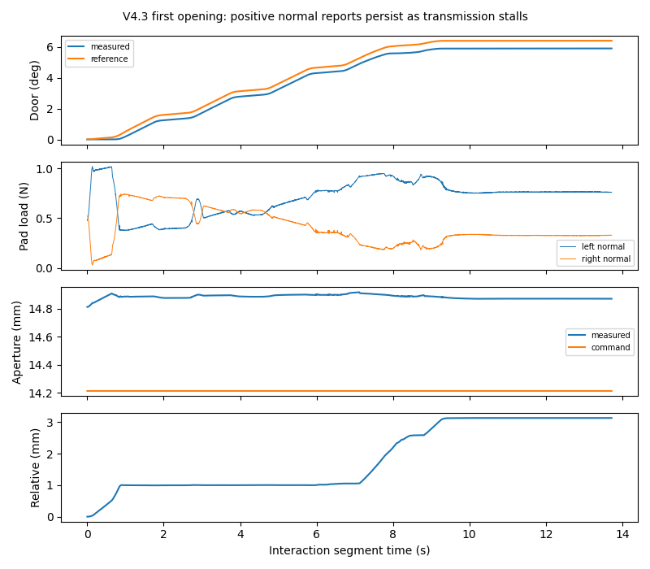

# V4.3 — independent Agentic dynamics identification

**FAIL: no complete independent VALIDATION trajectory.** One fresh, blind 45936 research episode was executed. Fresh wrist perception, automatic bilateral grasp, the original one-second hold, online V3.1 estimation and guarded parking worked. Opening transmission degraded at 5.90°. Reverse FIT and VALIDATION were not executed. Their prediction metrics remain **N/A**.

This is a physical research failure, not an initialization failure. There was no episode retry, object reset, physics change, stronger grip, manual grasp correction or post-outcome controller tuning. The unused recovery acquisition was not counted as a physical failure.

## Frozen configuration and execution

Pre-registration commit: `f06e3ed`, pushed before launch. Configuration commitment:

`ee3ae05c10c03e89f57bd08c30f4f6958068affa8e56f0cf1258a03bd0cea947`

The actual entry was `scripts/run_informative_probing_v31.py`, with `RuntimeV3`, production `OperationsV31`, V4.2 adaptive segments and repaired `ProgressClock`. Registered source hashes matched before launch. Shared manipulation, perception, ranking, actuator, contact physics and estimator mathematics were unchanged from the referenced versions. V4.3 adds the blind launcher, passive online-model capture and post-exit reporting tools only.

Runtime resources were 3000 wall seconds, including 300 seconds reserved for exit; 1500 simulated seconds, including 90 reserved. The independent launcher deadline was 3300 seconds plus cooperative export allowance. Neither the outer deadline nor a blanket 45-second segment limit terminated the interaction. Physics and essential interaction F/T remained 240 Hz. Shared GPUs 6/5 were used without exclusivity.

The seed and authored dynamics were read by the scene generator, not supplied through Agent/controller/estimator observation packets. They were not opened for Agent decisions. Post-hoc truth access occurred at **2026-10-18 18:10:14 UTC**, after normal actor exit and all online decisions. This is interface-level scientific blinding, not OS-level isolation from the simulator that authors the scene.

## Actual Agent decisions and physical outcomes

| Stage | Actual result |
|---|---|
| Initial sensing | Three fresh wrist observations. First supported extent 92.75 mm; two Agent-selected actuator motions exposed approximately 295.92 mm and complementary surfaces. |
| Initial plan | Unchanged automatic scorer selected section fraction −0.3. Both predicted finger contacts were in pad regions; observation-return and approach checks passed. No saved successful grasp. |
| Acquisition / hold | Bilateral verification: L/R 0.452/0.544 N at 0.0256°. Original one-second hold completed. One physical handle acquisition. |
| Acceleration-rich FIT opening | Requested 8°. Actual start 0.0231°, end 5.9002°, post-acquisition gain **5.8771°**. Target not reached. |
| Reverse FIT / independent VALIDATION | Declared before execution as 3° reverse FIT, then distinct sine-profile 6° VALIDATION. Both **not executed** after unstable first action. Optional 12° expansion also not executed. |
| Recovery sensing / planning | Same physical scene, door remained at 5.90°. Initial fresh frame had no SAM3 candidate. Codex inspected the visible lower bar and depth; an elevated view recovered the full handle. A complementary view added 9548 observed voxels. Four Agent-selected view adjustments total. |
| Recovery approach | Automatic alternative section +0.3 planned, but final current-state approach check rejected `gripper_link2` against `original39`. Return route itself was valid. **No second physical grasp.** |
| Panel alternative | Codex inspected fresh wrist RGB and selected a broad panel ROI. Existing planner rejected it: `observed patch has no corresponding current native moving surface`. **No panel push or closing occurred.** |
| Termination | Guarded release/clearance/parking passed. Final door 5.9002°, pads 0/0 N, native-rest joint-cell error 0.00372 rad, measured collision check valid. Actor exited normally. |

The Agent used image/depth cues for viewpoint choice only; an undetected/partial cue was not promoted into grasp geometry. Observation and grasp decisions used measured geometry, with uncertain rear surfaces separate. Recovery did not reuse the initial closed-state grasp. The rejected alternatives do **not** establish that every possible recovery candidate or panel region is infeasible; this bounded episode ended after those selected alternatives failed validation.

The loaded sequence was preapproved at an unloaded boundary. Conditional successors required either target completion or explicitly authorized, stable `SAFE_PARTIAL_PROGRESS` plus measured-state arc checks. The first action was neither; no unstable loaded contact was held while waiting for Codex.

### First physical divergence

Nominal opening duration was 9.108 s; the actual action stopped after 13.725 s, with reference 6.400° and measured angle 5.900°. In the last completed two-second window, motion was only 0.00458° against 1.822° requested travel: transmission ratio **0.00252**, with the existing 0.50° lead consumed. Relative displacement rose to **3.131 mm** while measured torque and door progress collapsed. Positive pad-normal reports mostly persisted; this is not evidence of complete physical separation or a measured friction wrench.

The frozen runtime returned `BUDGET_EXHAUSTED / ADAPTIVE_HORIZON_WITHOUT_HEALTHY_PROGRESS`, safely stopped, `physical_transmission_valid=false`. Preserve that exact status: it was a local unhealthy-progress horizon, **not exhaustion of global resources** (1725 wall seconds were available at segment start). The horizon stopped before the second suspect window could populate `transmission_failure`. This status/diagnostic limitation was not repaired during the experiment.

Loaded TCP peak was **9.593 mm/s**, minimum interaction joint margin **0.4459 rad**. Opening pad peaks were 1.019/0.741 N; all stored-phase peaks 1.019/1.267 N. There were zero recorded load-warning and hard-stop samples. Collision planners rejected the recovery/push proposals before contact. No protection was disabled.

## Actual online identification and independent assessment

The production worker ran successfully, with verified V3.1 source hashes, common SG121 linear filtering and single downstream-tool inertia compensation. One online update was captured before unblinding. It admitted 85 FIT bins from the predeclared interrupted trajectory, with actual bin centers 1.069–9.408 s after segment start. The failed action remains failed. There were **zero VALIDATION bins**.

| Parameter | Online V3.1 | Conditional 1σ | Post-exit authored reference | Signed relative error |
|---|---:|---:|---:|---:|
| Effective hinge inertia, kg·m² | 0.175848 | 0.015665 | 0.168846 | +4.15% |
| Viscous damping, N·m·s/rad | 0.398682 | 0.089524 | 0.283278 | +40.74% |
| Coulomb friction, N·m | 0.034147 | 0.001536 | 0.036048 | −5.27% |

The authored inertia is computed from authored moving-body properties and the hinge reference; it is **not an independently measured effective PhysX inertia**. Post-exit configuration: seed 1900219793, mass scale 1.045693, density gradient [−0.237806, −0.281571, −0.198842], constant resistance, no spring. Configuration hash remained unchanged.

Selected valid samples had acceleration RMS **0.02528 rad/s²**, velocity RMS **0.01406 rad/s**, native velocity P05/P50/P95 0.00167/0.01081/0.02186 rad/s. The binned scaled regressor condition was 23.81, rank 3. However, fitted damping/friction parameter correlation was **−0.9965**; one-direction data do not establish credible independent damping separation. Conditional support flags are regression diagnostics, not verified physical accuracy or calibrated hardware confidence.

Training torque RMSE was 0.003489 N·m. **Independent held-out torque RMSE, forward-angle RMSE and forward-velocity RMSE are N/A.** No incomplete action, retrospective split or training residual was substituted for VALIDATION. The once-initialized free predictor was therefore not assessed. No hidden truth selected filters, model coefficients or FIT samples.

Optional frozen-V3 numerical replay on the identical eligible raw intervals gave I=0.226634 (+34.23%), b=0.382429 (+35.00%), C=0.034486 (−4.33%). This is a post-episode diagnostic, not another online result. Better inertia agreement with V3.1 does not rescue the missing physical validation or inaccurate damping.

## Time, compact evidence and integrity

| Item | Result |
|---|---:|
| Initialization through process cleanup | **1809.05 s / 30.15 min** |
| Simulated duration | 217.41 s / 52,179 physics steps |
| Agent unloaded communication/inspection waits | 722.48 s |
| Two automatic grasp-ranking/IK passes | 461.63 s |
| Physics/contact callbacks | 185.14 s |
| Timed RGB-D/SAM3/incremental geometry calls | 121.99 s |
| Physical attempt including approach, closure and exit | 316.90 s |
| Loaded opening phase accounted time | 29.38 s |
| Worker including process startup | 10.41 s; numerical worker 1.23 s |
| Render/video / export timers | 0.825 s / 0.053 s |
| Entire experiment including post-hoc outputs | **56.04 MB** (decimal) |

Evidence categories: numeric 4.278 MB, checkpoint observations 22.507 MB, geometry 11.114 MB, metadata/source/inspected boards/post-hoc outputs 18.051 MB, event clips 0.088 MB. No duplicate raw archives or full-resolution continuous video. All 3294 interaction records were continuous 240 Hz; 9809 essential/downsampled-unloaded records overall, valid F/T throughout, no recorder issues, all numeric chunk hashes intact. The online model SHA256 remained unchanged after evaluation.

**Optional video limitation:** `record_frame` recorded an `IndexError`; the surviving 640×480 event clip decodes (29 frames, 1.933 s), but event coverage is incomplete. It is not presented as complete video evidence. Fresh RGB-D checkpoints, inspected-image provenance and numerical evidence remain available privately.

See [metrics](METRICS.json), [Agent trace](AGENT_TRACE.json), [frozen sources](FROZEN_SOURCE.json), [pre-registration](PROTOCOL.md), and [private evidence hashes / cleanup](EVIDENCE_INDEX.json) and [entire storage breakdown](STORAGE_FINAL.json). The owned actor and passive capture process exited; other users' processes were untouched. Raw RGB-D, F/T, telemetry and videos were not published.

## Conclusion and next bottleneck

The frozen V3.1 worker produced a real online estimate on unseen dynamics, but **V4.3 did not meet its primary criterion**: no meaningful closing FIT and no complete independent VALIDATION. The immediate blocker was loss of contact transmission, followed by current-state recovery-approach rejection and rejection of the selected observed panel surface. Extending time or accepting a fit as validation would not address these results.

The next general-purpose work should make alternative-contact planning executable under current released-finger/object geometry, including explicit observed-panel/native-surface consistency. Preserve the present failures; do not tune dynamics to the revealed truth. No further episode or controller development was launched in this round.

Remaining controlled dependencies: known hinge/dynamic object state, registered station, native collision model for safety, simulated wrist mounting, ideal virtual load cell and approximate actuators. This is a single development cabinet, not deployed autonomy or a population-level validation.
