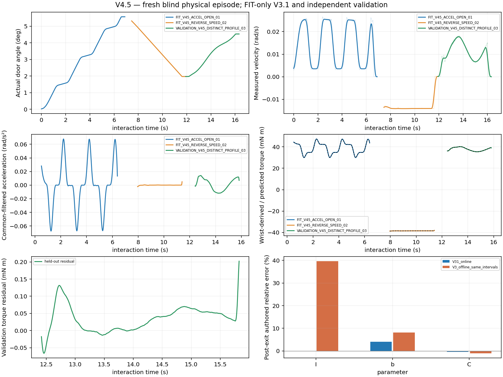

# V4.5 — blind end-to-end Agentic dynamics validation

**PASS for this bounded simulated blind validation**, with the uncertainty and operating-range limits below. One fresh research scene, one automatic physical grasp, no recovery/retry. Complete bidirectional FIT and a separately declared physical VALIDATION trajectory succeeded before truth access. This is not a population success rate, hardware validation or full-range physics twin.

Reference `bcf5dda`; preregistration `b76148b`. Executed the unchanged `scripts/run_informative_probing_v44.py`, V4.4 current-state executable-candidate fallback/adaptive progress contract, and production V3.1 common SG121 with one tool-inertia compensation. No manipulation, perception, actuator, gripper, collision or safety tuning.

## Blindness and actual Agent decisions

One positive-density, physically consistent constant-resistance configuration was generated privately and cryptographically committed before launch. Its SHA256 is `d88bebfb3862dcc1e219a1c3069ebacb8b3966e62333d669301ba57a75c0d91a`. The now-revealed `REVEALED_CONFIGURATIONS.json` matches those exact bytes. Seed **2958019966**, moving-mass scale **0.885633753**, density gradient **[0.191779466, 0.267255310, 0.249200998]**; no spring. Seed and authored dynamics were not read for online actions or fitting. Truth access was recorded at **2026-10-19 04:03:08 UTC**, after actor exit, `SESSION_COMPLETE`, estimator completion and the Agent's explicit finish decision. Blinding is procedural input/process isolation under one simulation account, not an adversarial OS-security guarantee.

The first fresh wrist image had no accepted SAM3 handle and upper-handle self-occlusion. Codex inspected its actual RGB, masks/depth/cloud, selected a closer elevated lateral view from an observed depth cue, then inspected the new full-handle result. An opposite-side view added **6,710 measured voxels**, retaining **295.90 mm** cumulative handle length. Total: three initial wrist checkpoints, two Agent-selected actuator-executed adjustments. Unknown rear geometry remained uncertain. No saved camera/grasp pose, GT handle score or engineering fixture supplied the plan.

Frozen ranking generated an upper-section roll-180° grasp. The roll-0° alternative failed complete timed native collision checking (`gripper_link2/original39`); planning continued and the selected alternative passed the measured-state return and complete approach. Planned minimum joint margin was **0.9904 rad**. Codex inspected the measured geometry/official-G1 plan board before approving execution; near-pad-edge prediction uncertainty was preserved, not converted into a new veto or manual correction.

From the new grasp's **0.425606-m perpendicular hinge radius**, three two-second plateau cycles imply approximately 5.45° ideal travel. The Agent therefore declared 5.5° opening FIT → 2.0° reverse FIT → 4.5° independent sine-profile VALIDATION **before executing any of them**. This prioritized excitation and validation, rather than copying the previous engineering range or attempting 13° first. Original acquisition, one-second hold, finite native actuation and physical contact were reused. Stable successors were rechecked from actual robot/door state; there was no loaded Agent wait.

## Actual physical results

| Segment | Declared target | Actual endpoint | Actual gain | Simulated time | Records | Status |
|---|---:|---:|---:|---:|---:|---|
| Acceleration-rich opening FIT | 5.5° | 5.5681° | +5.5681° | 7.450 s | 1,788 | TARGET_REACHED |
| Different-speed reverse FIT | 2.0° | 1.9718° | −3.5963° | 5.0125 s | 1,203 | TARGET_REACHED |
| Distinct-profile VALIDATION | 4.5° | 4.5324° | +2.5605° | 4.4208 s | 1,061 | TARGET_REACHED |

All interaction streams are contiguous **240 Hz**. Maximum actual opening was **5.5681°**, cumulative opening **8.1286°**, closing **3.5963°**. First grasp verified L/R **0.5165/0.5048 N** and completed the original one-second hold. No release/regrasp occurred between segments. Recovery branch was **not physically triggered**; do not count this as new recovery evidence.

Motion was driven only by native robot–handle contact, without object-joint commands, state resets or artificial object forces. Nominal/actual segment durations were 6.246/7.450, 4.517/5.013 and 3.733/4.421 s; healthy progress did not reproduce the old progress-clock slowdown.

Maximum measured loaded TCP speed was **11.3465 mm/s**, minimum loaded joint margin **1.0034 rad**, maximum handle-relative translation **1.1213 mm**, raw normal pad peaks **1.6371/1.1902 N**. There were **zero load-warning samples and zero hard-stop samples**. Normal-report threshold crossings occurred and are retained; they are neither proof of physical separation nor complete friction-wrench measurements. Transmission remained healthy through all targets.

Guarded release, clearance and collision-checked native-rest parking completed at door angle **4.5324°**, zero pad loads and maximum rest-cell joint error **0.003709 rad**. No optional expansion was added: complete validation and stable FIT-only estimates already met the information objective.

## Identification and independent evaluation

Primary effort is compensated native wrist six-axis F/T, transformed to the known hinge reference; never GT object torque or summed contact normals. Actual measured opening-FIT velocity RMS was **0.01721 rad/s**, acceleration RMS **0.03294 rad/s²**, with velocity P05/P50/P95 **0.00344/0.01485/0.02559 rad/s**. Reverse FIT measured approximately **−0.01411 rad/s** over overlapping angles. The training acceleration variation was not reserved exclusively for validation.

V3.1 used **95 FIT bins** and **35 independent validation bins**, segment-local processing and fixed edge exclusions. Scaled regressor rank was **3**, singular values **[0.44006, 0.25174, 0.01750]**, condition **25.15**. All three effective coefficients had conditional support. The FIT-only snapshot contained zero validation bins; adding validation left parameters and uncertainty unchanged. The asynchronous worker published three updates; no post-truth changes were made to its output.

| Parameter | Post-exit authored reference | Immutable online V3.1 | Conditional 1σ | Relative error |
|---|---:|---:|---:|---:|
| I_eff (kg·m²) | 0.116948271 | 0.116965727 | 0.000400817 | **+0.0149%** |
| b (N·m·s/rad) | 0.340338729 | 0.354059295 | 0.001799719 | **+4.0314%** |
| C (N·m) | 0.033611969 | 0.033455244 | 0.000023421 | **−0.4663%** |

These compare with **authored** inertia/resistance, not an independently measured effective PhysX inertia. The b and C discrepancies are approximately 7.6σ and 6.7σ relative to conditional statistical uncertainty. Those intervals omit calibration, compensation, solver and model bias; total uncertainty is **not calibrated**. The damping bias remains unresolved and was not corrected/clipped to the generating prior or truth. Useful identification does not imply manufacturer-level sensor/actuator fidelity.

The fully completed held-out trajectory was excluded from all parameter/uncertainty fitting. Reliable-interior prediction used one native measured initial angle/velocity and the held-out measured wrist effort, with no subsequent state correction:

- Torque RMSE: **0.04978 mN·m** (common V3.1 evaluation).
- Free angle RMSE: **0.03833°**; final error **+0.05422°**.
- Free velocity RMSE: **0.0005036 rad/s**.
- Reliable prediction interval: **3.4083 s / 819 samples**, inside measured FIT angle support. Common filtering has 0.2583-s completed-segment lookahead; this is not zero-latency prediction.
- Separate full-segment boundary sensitivity: **4.4167 s / 1,061 samples**, angle RMSE **0.02084°**, velocity RMSE **0.001092 rad/s**, including unreliable derivative/filter edges. It is not substituted for the primary result because it looks better.

Frozen V3 replay on identical qualified raw FIT/VALIDATION intervals gave inertia **0.163305439 kg·m² (+39.64%)**, damping error +8.13% and friction error −1.02%. Under the same V3.1 held-out evaluation operator, V3 torque RMSE was **0.39148 mN·m**, versus V3.1's 0.04978. However, V3's short angle RMSE was **0.03350°**, slightly lower than V3.1's 0.03833°; its velocity RMSE was worse (**0.0009138 rad/s**). Do not claim uniform prediction dominance. This short trajectory alone cannot discriminate all incorrect parameter combinations: the blind parameter comparison, excitation and independent response evaluation must be considered jointly.

## Cost, provenance and stopping

Actor initialization-to-cleanup wall time: **1180.24 s (19.67 min)**. Physics: **182.7 simulated seconds**, with native 240-Hz contact fidelity unchanged. Agent image inspection/reasoning/communication waits totaled **345.69 s**, all unloaded. Grasp planning/build took **266.97 s**; the finite acquisition/interaction/guarded-exit operation took **403.46 s**. No expensive engineering rehearsal or second research episode was run.

Post-evaluation episode storage was approximately **44.66 MB**: numeric 4.40 MB; checkpoint observations 12.64 MB; geometry 8.48 MB; source/metadata 19.04 MB; optional clip 0.095 MB. No duplicated numeric formats or raw archives. One early optional camera-frame dimensionality error was logged; the actual event clip is valid **640×480, 15 FPS, 29 frames / 1.933 s**, verified independently. Continuous video is intentionally absent in FAST_DEV. All essential numerical F/T samples are valid, unique, and chunk hashes verified.

Preregistration pins 38 production source/configuration files to `bcf5dda`; 41 executable-registration checks matched on the server. Actual worker loaded `update_probing_v31_model.py` / `V3.1-common-SG2`, with single tool compensation. Only thin launch/evaluation/report adapters were added. `CONFIGURATION_COMMITMENT.json`, exact revealed configuration, `METRICS.json` and `EVIDENCE_INDEX.json` retain reproducibility and private-evidence provenance. No raw RGB-D, wrench arrays, telemetry, geometry assets or video is published.

SSH entry initially reset new connections before authentication, then recovered before launch; this consumed no physical attempt. The only actor and its estimator/capture workers exited cooperatively. No other users' processes were modified. The remaining limits are this one object/configuration, approximately 0–5.57° coverage, ideal virtual load cell, simulated wrist mount, known hinge/state, registered station and approximate actuators. No 10–15°/30° capability or general success-rate claim is made. Further dynamics/uncertainty validation would be a separately authorized episode; this round stops here.
