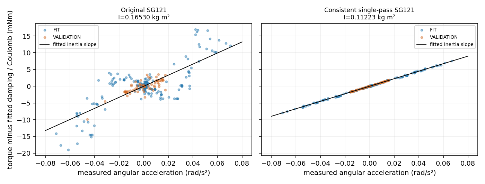

# V3 惯性偏大的离线机制诊断

**结论：主要证据指向辨识数据链的滤波不一致，而非激励不足或 G1 质量写错。** 原实现用平滑后的铰链/工具加速度解释未作对应处理的 F/T，产生加速度相关的系统误差。仅在独立诊断代码中使这些量经过一致算子后，惯性由 **0.165298** 变为 **0.112231 kg·m²**。原 SG121 窗长没有为匹配真值而调整；61/121/181 三种窗口均得到约 0.11223。另一路工具动量积分回归得到 0.11124–0.11132，支持相同解释。

这是 **OFFLINE_DIAGNOSTIC / KNOWN_HINGE_STATE / IDEAL_LOAD_CELL / APPROXIMATE_ACTUATOR_SIMULATION**。没有启动 Isaac、运动机器人、增加交互数据、修改控制器或替换在线估计。原 `b75d5b8` 的代码、V3 估计和物理结果保持不变。接近 authored 参考值是事后评价，**不是已独立测得 PhysX 有效惯性或硬件精度**。

## 1. 数据、复现与评价边界

只读 V3 `episode_01` 的 7 个压缩块、22,119 条唯一记录；四个成功交互段连续 240 Hz，三段 FIT、一整段独立 VALIDATION。首次失败探拉保留但不加入惯性拟合。原估计精确复现到 `1e-10`，包括 I/b/C、304 个 FIT bin 和 0.057855° 原 held-out RMSE。

原复现沿用每端 121 点剔除；诊断对照统一每端 **211 点**，覆盖最长原工具角加速度级联的 120 点支持再加新滤波器 90 点支持。所有导数、平滑、时移、积分和交叉验证均在独立完整段内进行，不跨 FIT/VALIDATION。211 点是离线滤波支持处理，不是执行门限。完整 9.175 s 验证段另报告包含导数边界外推的敏感性结果。

固定数值对照为 61/121/181 窗、±1/2/4/8 点时移、位置/原生速度导数及 0.5/1 s 弱式积分；没有按 authored 参数选择窗口、补偿倍数或候选模型。`POSTHOC.json` 独立读取已经公开的 V3 参考参数，不被诊断估计器导入。完整对照见 [ABLATIONS.md](ABLATIONS.md)、[数值结果](DIAGNOSTICS.json)、[协议](PROTOCOL.json)。

## 2. 完整测量链

| 环节 | 实际实现与核查 |
|---|---|
| 原始测量 | `WristFT.read()` 读取 `get_measured_joint_forces()[metadata.joint_indices[wrist_ft_interface]+1]`；不是电机 effort、GT 门力矩或接触法向力求和。传感器为 flange→G1 的零厚度理想固定接口。 |
| 单位/坐标 | `[Fx,Fy,Fz,Tx,Ty,Tz]`，N / N·m；child joint frame 与 G1 base 原点重合。世界旋转作用于力和矩，再按 `(p_sensor−p_hinge)×F` 平移力矩。铰链 q/qd 为 rad / rad·s⁻¹；角度显示值转 rad 后才求导。 |
| 符号/标定 | `w_world = rotate(raw−bias)`；`w_contact = w_world + w_gravity − w_inertia`。既有独立已知力/矩 commissioning 支持这个作用反作用符号；并非在本轮重新标定。 |
| 工具重力 | 每个下游刚体用 `m*g` 和 COM 力臂；在 sensor 原点求矩，最终转换到 hinge。竖直轴约 `[8.38e−8,8.84e−9,1]`，因此重力轴向投影极小。 |
| 工具惯性 | 7 个下游 G1 刚体，合计 **0.751429578 kg**。`F=m*a_COM`；`M=I_world*alpha + omega×I_world*omega + r×F`。COM 加速度用 SG121 二阶导；旋转增量先 SG0，再 SG1 求角加速度。 |
| 铰链导数 | q 用 SG121/order3 的一阶/二阶导；窗口约 0.504 s。原生 door_dq 另存，可作独立数值对照。 |
| 回归 | 0.1 s 非重叠 bin；非负 ridge，列缩放 `[1,.25,.045]`、ridge=0.001；`tau=I*qdd+b*qd+C*sign(qd)`。V3 不确定度用 FIT-only HAC/iid 较大值，不能覆盖系统补偿偏差。 |
| 时间 | 同一次 `world.step` 后读取 F/T、body pose、q/dq。存储 t=tick/240，段内 dt 偏差 ≤5.4e−14 s。compact 未保留每条独立硬件/求解器时间戳，不能独立证明 PhysX 子步内部的相位一致。 |

变换/平移/投影的随机刚体坐标一致性误差 ≤4.45e−15；这是数学核查，不是新的物理标定。旧 commissioning 的已知 0.05 N·m 力矩测得约 0.04999 N·m，支持单位、符号和接口大体正确，不足以独立界定所有动态误差。参见 [既有传感器定义](../xarm_wrist_ft_id_v0_20261017/SENSOR_CHANNEL_DEFINITION.json)、[本轮解析核查](OFFLINE_CHECKS.json)。

## 3. 每个处理环节的量级

下表使用原 FIT 的相同 304 个 bin。FWL 系数是先从 qdd 投影掉 qd/sign 后，各分量沿剩余加速度方向的等效惯性；它是分解，不是拟合补偿增益。

| 铰链力矩分量 | RMS mN·m | 等效惯性 kg·m² | 在最终链中的符号 |
|---|---:|---:|---|
| 原始 F/T 旋转并移至铰链 | 23.5888 | 0.3099949 | + |
| 传感器 bias | 0.000364 | −0.000000066 | − |
| 工具重力 | 0.0000866 | −0.000000015 | + |
| 工具惯性补偿合计 | 3.22067 | 0.1446933 | − |
| 其中 COM 平移 | 3.20893 | 0.1441620 | − |
| 其中旋转角加速度 | 0.012799 | 0.0005313 | − |
| 陀螺项 | 0.000000473 | 0.0000000012 | − |

因此并不是“大工具惯性可以忽略”：其等效贡献甚至大于门 authored 惯性。工具补偿的动态滤波误差会明显污染门惯性。但 **质量/COM/张量数值本身没有显著错配**：保存的 PhysX 机器人 tensor readback 与 7 个工具体逐一对应，最大质量差 5.8e−9 kg、COM 差 1.13e−9 m、张量元素差 2.43e−10 kg·m²。它们不能解释约 37% 工具补偿比例误差才足够造成的本次偏差。

## 4. 主因：不同通道没有使用同一个动力学算子

SG 的二阶导数相当于对真实加速度施加低通算子 **K₂**，并不等于 SG 的普通零阶平滑 K₀。原代码近似做了：

`a_used = K₂(a)`

`tau_used = tau_object + tau_tool − K₂(tau_tool)`

再让 `tau_used` 回归到 `a_used`。快速变化的物体惯性力矩没有同步衰减；工具惯性也留下 `(Id−K₂)*tau_tool`，两者都可被 I 吸收。单纯缩短 q 的窗口、给原生速度求导，或只把角速度半步对齐，不能完整解决这个问题。

本轮 **single_pass** 只用于诊断：先把 raw-minus-bias-plus-gravity 的世界铰链力矩经过 K₂，再减去已按相同窗口计算的工具惯性，避免工具补偿二次平滑；qd、native-qdd 和 sign regressor 同时经过 K₂。旋转项的既有级联仍保留，其量级远小于平移主项，另由动量弱式校验。

| 处理 | I kg·m² | b N·m·s/rad | C N·m | FIT RMSE mN·m | FIT 段外 CV mN·m | VALIDATION 力矩 RMSE mN·m |
|---|---:|---:|---:|---:|---:|---:|
| 原 V3，121 点边界 | 0.165298 | 0.302645 | 0.017726 | 3.059 | 3.064 | 1.161 |
| 原链，同一 211 点边界 | 0.166824 | 0.291247 | 0.017932 | 3.045 | 3.047 | 1.049 |
| 仅换 native velocity SG121 导数 | 0.158323 | 0.287819 | 0.017994 | 2.352 | 2.365 | 1.019 |
| 一致单次处理，61 | 0.112231 | 0.291046 | 0.017921 | 0.158 | 0.165 | 0.0805 |
| **一致单次处理，121** | **0.112231** | **0.288449** | **0.017957** | **0.0861** | **0.0944** | **0.0681** |
| 一致单次处理，181 | 0.112231 | 0.287004 | 0.017977 | 0.0485 | 0.0593 | 0.0613 |
| 工具动量弱式，0.5 s | 0.111237 | 0.291454 | 0.017911 | 0.136 | 0.143 | 0.0817 |
| 工具动量弱式，1.0 s | 0.111322 | 0.288356 | 0.017953 | 0.0460 | 0.0575 | 0.0641 |

**这些误差位于不同滤波/积分空间，不能把误差下降全部解释成传感器精度提升。** 同一原始补偿目标上的 CV 实际仍偏好接近原链的系数；那个目标本身带有处理偏差，内部交叉验证无法证明物理无偏。本轮不据此发布“最佳新在线模型”，而是用物理一致性和独立数学对照诊断。

工具动量弱式使用固定世界铰链的 `H_tool = Σ(I_world*omega + r_COM×m*v_COM)`，由积分分部得到：

`∫φ*tau_contact = ∫φ*(tau_raw+tau_gravity) + ∫φ'*H_tool`

`∫φ*qdd = ∫φ''*q`，避免直接估计工具二阶导；φ 及其边界项为零。0.5 s 弱式若继续使用原工具补偿，I 为 **0.134251**；改为动量补偿为 **0.111237**；把门加速度项改由 native velocity 积分得到 **0.111679**。这把工具动态补偿和物体导数失配的共同作用，与仅换一个导数的效果区分开了。不同空间的差值不能简单相加为唯一因果百分比。

一致 SG121 的 FIT 留一段结果为 I=0.112158–0.112266；弱式 0.5/1 s 的条件 HAC σ(I) 约 0.000359/0.000181 kg·m²。弱式与单次滤波仍存在约 0.001 kg·m² 方法差异，条件方差不包含这种系统误差，不能当作标定置信区间。

### 量级是否足以解释 47%？

原偏差 0.05311887 kg·m² × 原 qdd RMS 0.02217777 = **1.17806 mN·m**。在原固定 X、固定 304 个 bin 上，一致处理的力矩变化具有 FWL 等效 ΔI=**−0.05415834 kg·m²**，即 **1.20111 mN·m** 的加速度相关量级。足以解释观察到的偏差，而不是仅仅总 RMS 大于所需误差。

这是处理差异的投影，不是一个按真值标定的扣除系数。变化的总 RMS 为 3.30049 mN·m，只有沿加速度独立方向的部分用于上述解释。

### 合成与无接触交叉证据

- 与隐藏参数无关的合成 I/b/C=`0.3/0.4/0.02`，采用记录运动频谱：原不一致链回收 I=**0.365141**；加入工具动态后为 **0.393606**。一致处理分别为 **0.299958 / 0.298516**。无接触变化、未知摩擦或 PhysX 物体惯性都不是产生这个偏差的必要条件。
- 解析正弦：SG121 原链在 0.1/0.5/1/1.5 Hz 的惯性误差约 +0.18/+4.60/+20.07/+52.67%。一致算子的整个固定频率/窗口集合最大误差 **0.02285%**；解析已知工具动量测试恢复 I=0.3000086。它们只核查数学处理，不代替物理证据。
- 两段保存的无正法向接触报告 APPROACH，同一 211 点内部区间：原残差 RMS **3.470 / 2.952 mN·m**，一致处理为 **0.0279 / 0.0717 mN·m**；100 ms bin RMS 从 **3.198 / 3.760** 变为 **0.0247 / 0.0819 mN·m**。这些姿态、开度和速度不等于 loaded 场景，不能称为标定后的载荷噪声下限，但强烈支持动态处理失配。

## 5. 时序、接触与模型替代解释

| 假说 | 支持/反证与量化 | 判断 |
|---|---|---|
| **导数/F/T/工具补偿滤波不一致** | 一致 61–181 窗几乎相同 I；动量法独立收敛；合成和无载记录复现同类错误；约 1.20 mN·m 对应本次 1.18 mN·m。 | **主因，高支持。** |
| 工具质量、COM、张量填错 | native readback 数值相符；重力/bias 轴向量级极小。 | 排除作为本次主要来源；不代表所有工具/传感器动力学都已校准。 |
| 工具 omega 半步错位或陀螺项 | 居中角增量仅改变 I 约 2.7e−6 kg·m²；陀螺项约 4.73e−10 N·m RMS。 | 远不足以解释主偏差。 |
| F/T 与 q 整步时移 | ±1 点时 I≈0.1650–0.1682，相对同边界基线只变约 0.001–0.002；极端 ±8 点才到约 0.1467–0.1751，仍不能消除偏差。 | 小时移可能有残余影响；不是主要解释。独立求解器内时间戳不可恢复。 |
| 接触传递/顺应性/反转 | 相对平移代理可达约 2.16 mm；TCP 径向角与门角差约 0.1–0.26°，不能称为无滑移。原 native-rate 残差与 slip-rate/aperture-rate 多数相关幅度 <0.14。 | 真实存在，但未支持其解释主要 I 偏差。缺逐点接触位置/完整接触 wrench，不能排除小残余。 |
| 常参数模型不足 | 一致链再加入 bias、q·sign、滑移率、开度率、相对角加速度或 pad imbalance，I 仍约 0.1121–0.1123，未产生 0.05 量级变化。附加常偏置在缺少反向 FIT 时与 C 共线，CV 明显恶化。 | 当前没有支持用更复杂物体模型修复本次 I 偏差。非因果 nuisance 结果不冒充独立前向预测。 |
| authored 与真实 PhysX 有效惯性不同 | 原轴/固定关联体坐标复核仅验证 authored 合成值；记录没有独立物体质量矩阵/施加努力响应读回。 | **仍未独立排除**，但解释 47% 不需要该假说。不能把接近 authored 当作独立 PhysX 测量。 |

单 pad 无正法向报告没有被当作接触分离，也没有作为新剔除或停止规则。compact 数据没有逐点位置/法向或完整摩擦锚力，不能从这些记录重建接触迁移或完整压力/力矩；相对运动是运动学代理。见 [接触代理与 nuisance 对照](DIAGNOSTICS.json)。

拟合后残差与拟合加速度接近零是最小二乘的代数性质，**不是无偏证据**。本报告使用固定 X 的 FWL、段外 CV 和部分残差图。原链/一致处理的 FIT 段外 residual–acceleration 相关约 −0.0121/+0.0082；单独把较小 I 放回原有偏力矩目标，会产生正相关而非修复，说明必须修数据链，不能直接手改 I。

图中为减去 FIT 得到的阻尼和库仑项后的**部分残差**，保留惯性斜率；不是已经扣掉 I 后必然正交的全残差。FIT 与整段 VALIDATION 分色，后者未用于拟合。

## 6. 完整独立验证与仍未解决的范围

下面每次预测仅给定一次 native 初始速度/初始角度，此后由实测 F/T 输入自由积分，无后续状态校正。统一输入列使用**原 V3 补偿力矩**，因此仍包含本轮发现的偏差；一致处理自身的 filtered-input 结果另在 JSON 中报告，不与之混算。

| 模型 | 内部时长 s | 内部角 RMSE | 完整 9.175 s 角 RMSE | 完整段末角误差 |
|---|---:|---:|---:|---:|
| 原冻结 V3 | 8.1667 | 0.057855° | 0.122532° | +0.160421° |
| 原链、同一 211 点边界重拟合 | 7.4167 | 0.049304° | 0.161550° | +0.219346° |
| 一致单次 SG121 | 7.4167 | 0.037487° | 0.048119° | +0.019770° |
| 动量弱式 0.5 s | 7.4167 | 0.037415° | 0.051418° | +0.018070° |
| 动量弱式 1 s | 7.4167 | 0.032896° | 0.053621° | +0.006366° |

完整段包含最初/最后导数外推，不是干净的无边界噪声评价；原 0.058° 仍原样保留。不同起点/内部时长会改变 RMSE，不能挑最小值。给定测得 F/T 的状态预测也不是闭环接触力预测。VALIDATION 加速度激励较弱，因此好角度预测本身没有证明惯性准确。

事后 authored 参考 I/b/C=`0.112179565 / 0.276974112 / 0.018081289`：一致 SG121 的误差为 **+0.0458% / +4.143% / −0.685%**；动量弱式 I 仍有约 −0.84% 至 −0.76% 差异。阻尼、接触/求解器残余和实际有效动力学尚未完全分离，**不宣布物理 twin 验证成功**。

## 7. 最小下一步与保存状态

**下一步只修辨识预处理的共同算子**：对传感器力矩、工具动量/惯性和全部动力学回归项保持同一线性处理；工具补偿不可被重复滤波，以积分动量恒等式作独立回归。先用这些已有记录做生产 worker 的版本化离线回归，不需要再跑一次相似物理 episode 来证明主因。不更改控制器、夹力、物理属性或评分，不按 authored 值设置补偿系数。本轮没有实施该生产修复。

若之后要声明 PhysX 有效惯性/亚毫牛米动态精度，仍需要独立记录对象原生质量/惯性与接口时序，或单独验证同频无载惯性响应；不能从本轮接近 authored 的结果直接宣称。

新增只有三个离线脚本、一个图和紧凑报告/数值对照，约 0.3 MB。没有复制 raw telemetry/RGB-D/video、创建备份或新 actor。7 个原始块哈希全部通过，原估计 SHA256=`899cfecd73105c11ed297d4c37a4a6760d5fc9fbcf13c21ef0b71914c0949985`；四个冻结估计源码及 runtime/compact 均与 `b75d5b8`、服务器一致，见 [INPUT_INTEGRITY.json](INPUT_INTEGRITY.json)。

复现：`PYTHONPATH=.:scripts python scripts/diagnose_inertia_bias_v3.py <private V3 episode_01> --output <new output>`；解析核查：`python scripts/verify_inertia_bias_offline.py`；事后比较单独运行 `evaluate_inertia_bias_posthoc.py`。所有输出必须写到新目录。诊断已结束，不自动开展下一轮实验。
