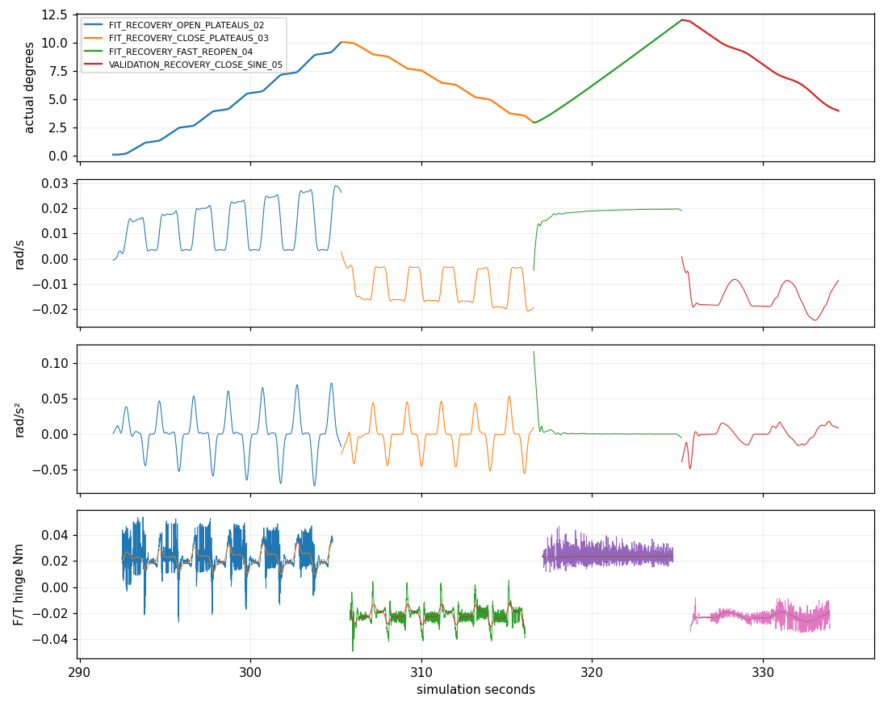

# Informative Probing V3 — 45936

**双向交互与独立激励改进已验证；三参数准确辨识未全部通过。** 本轮有效接触 episode 使用两次自动获取：首次传力失败，唯一恢复成功完成四段运动并安全停车。惯量估计仍有 **47.35%** 的隐藏 authored-reference 误差，不能用较小的条件标准差或较好的运动预测把它宣称为准确惯量。

参考 `6f7b74d`；有效物理执行冻结于 **`c278e2e`**。标签：**AGENT_WRIST_RGBD / KNOWN_HINGE_STATE / IDEAL_LOAD_CELL / APPROXIMATE_ACTUATOR_SIMULATION**。这是一个开发配置，不是总体鲁棒性评估或真实硬件验证。[机器可读结果](RESULT.json) / [预登记与基础设施偏差](REGISTRATION.md)。

## 实际执行与 Agent 决策

Codex 实际查看本轮新腕部 RGB、SAM3、深度、局部点云及增量表面，选择两次实际执行器视点调整，随后停止观察。原评分器自动选中把手中段。第一次双侧获取与原1秒保持通过，但试拉传力差；Codex 查看真实载荷/角度/滑移图后，在已验证无载停车状态批准唯一恢复。失败记忆使原规划器自动选择另一朝向；没有复制历史成功姿态、手调抓点或改评分。

| 动作 | 实际角度 | 结果 |
|---|---:|---|
| 首次获取、1秒保持、试拉 | 0.01366°→0.09000° | 原 `CONTACT_TRANSMISSION_STALL`；相对滑移1.270mm；安全释放停车 |
| 恢复获取、原1秒保持 | 约0.09003° | 双侧获取通过 |
| FIT 段内低/高速开门 | 0.09003°→10.08366° | +9.99363° |
| FIT 段内低/高速关门 | 10.08366°→2.95118° | −7.13247° |
| FIT 较快再开 | 2.95118°→12.04088° | +9.08969° |
| 完整留出、不同正弦变速关门 | 12.04088°→3.98988° | −8.05099°；不进入拟合 |
| 原释放、退让、安全停车 | 最终3.98438° | `native_rest`，当前状态碰撞检查通过、无载 |

峰值实际角度 **12.04555°**；按控制段实测端点累计打开 **19.083°**、关闭 **15.183°**。同一有效 Isaac 场景，没有重置门、拼接状态、直接关节驱动、附着或人工物体力。恢复后四段保持同一把手抓取；未使用面板推动。

Agent 从菜单预批准有限动作块，避免带载等待推理；每段后的数值更新异步完成。查看实际激励/F/T反馈后，Agent决定预算结束、安全停车后导出，未追加实验。

## 瓶颈诊断与共享改动

V2所谓变速开门实测速率P10–P90仅0.01028–0.01068rad/s，速度项与摩擦方向高度相关；该段约99.3%的加速度能量落在121样本边界剔除影响范围。首段/快速验证段也有大量端点激励被剔除。接触滑移与残差存在相关性，但不足以单独证明因果。[V2只读审计](V2_AUDIT.json)。

V3只增加有界参考速度程序：段内1.5–12mm/s平台、0.45s升余弦切换、0.55s平台；较快再开也在FIT中。留出关门采用3.5–10mm/s、3.1s周期的另一程序。原测量进度时钟、Cartesian限幅、Pink、闭合/保持、夹紧力、执行器、物理和保护不变。参考速度/加速度仍受原LOADED 12mm/s、40mm/s²上限约束。

| 实测成功FIT数据，同样分段处理 | V2 | V3 |
|---|---:|---:|
| 100ms拟合bin | 362 | 304 |
| 角加速度RMS，rad/s² | 0.001248 | **0.022178（17.8×）** |
| 角速度RMS，rad/s | 0.009348 | 0.015487 |
| 速度与方向项相关系数 | 0.98972 | **0.87637** |
| 归一化回归条件数 | 72.21 | **25.56** |
| 最小归一化奇异值 | 0.01187 | **0.03080** |

V3开门平台段速度P5–P95为0.00324–0.02624rad/s，关门为−0.01925至−0.00330rad/s。加减速确实发生在段内，不是只增加指令变化或端点运动。投影掉另两列后，I/b敏感度分别提高约16.5×/2.60×；等力矩方差下对应信息约273×/6.76×。**这些是测量回归结构的信息，不是已校准传感器Fisher置信度。** [同口径比较及范围](EXCITATION_COMPARISON.json)。

已修复的NPZ工作器在物理前通过合成参数恢复及整段验证数据变更不影响拟合的回归，并只读回放V2约9.2s；本轮在线各段更新正常返回。列一次解压，分段SG121、完整121边界剔除、100ms非重叠bin；失败传力段保留但不拟合。没有跨FIT/VALIDATION平滑或用隐藏动力学选动作。[离线检查](OFFLINE_CHECKS.json)。

## 参数与独立预测

主输入始终是原生固定接口六轴腕F/T，经偏置、下游工具重力/惯性补偿并移矩到已知铰链。没有用接触冲量总和或GT物体力矩替代。

| 参数 | 候选估计 ± 条件标准差 | 隐藏 authored reference | 相对误差 | 结论 |
|---|---:|---:|---:|---|
| I，kg·m² | 0.165298 ± 0.007924 | 0.112180 | **47.35%** | **准确性未验证，最终模型保留未知标志** |
| b，N·m·s/rad | 0.302645 ± 0.024753 | 0.276974 | 9.27% | 本配置的有效阻尼估计；非硬件校准 |
| C，N·m | 0.017726 ± 0.000384 | 0.018081 | 1.97% | 本配置的有效库仑项估计 |

在线三标准误差诊断给出三个条件显著性标志，但不包含系统偏差。FIT留一段后I仍在0.1629–0.1703附近：**稳定拟合也可能稳定地偏高**。原在线输出完整保留；[最终估计模型](ESTIMATED_MODEL.json)将I标为未知，候选I只用于复现条件运动预测，没有换成隐藏真值。

有效惯量的原生铰链锚点/实测刚体坐标复核与URDF计算差约1.07e−8kg·m²；无网格中间刚体仍使用已知固定URDF变换。该检查排除了大的轴/坐标换算错误，**不是独立PhysX耦合质量矩阵测量**。[复核记录](INERTIA_TRUTH_FRAME_CROSSCHECK.json)。

完整留出关门物理持续9.175s；仅在该段内部处理，前向评估剔除两端各121样本，剩余 **8.167s**：

- 力矩预测RMSE：**0.001161N·m**。
- 独立角度RMSE：**0.05786°**；末端误差 **+0.12666°**；速度RMSE **0.001066rad/s**。
- 只初始化一次实测角度/原生速度，随后用实测F/T输入积分，不跟随实际状态纠正。它是已知输入下的响应预测，不是未来交互力预测。
- 有效FIT bin范围0.129–11.456°；评估实际范围4.315–11.902°，约 **5.35%** 样本略超FIT范围。原在线0–20°先验domain标志不等于训练覆盖。

V2参考角度RMSE约0.402°，但轨迹、速度、方向、范围与处理口径不同，不能把差值当成严格配对的泛化提升。当前留出轨迹的惯性力矩RMS仅约1.16mNm；好的总响应预测没有证明I准确。

## F/T残差与仍未解决的问题

历史0.004644N·m没有作为精确噪声界限或本轮执行门槛。原240Hz无载接近与释放数据分别处理，并按实测线速度≤12mm/s、线加速度≤40mm/s²检查重叠子集：

| 无载阶段 | 原样本补偿后力矩RMS | 100ms bin RMS |
|---|---:|---:|
| 首次接近，全内部 | 8.00mNm | 5.23mNm |
| 恢复接近，全内部 | 12.69mNm | 9.39mNm |
| 恢复接近，线性运动包络重叠子集（182样本） | 3.49mNm | **1.14mNm** |
| 最终释放、腕近静止 | 0.0579mNm | **0.0139mNm** |

开爪接近与闭爪带载、角运动仍不完全匹配；样本少，**这些不是载荷下的校准噪声上界**。不同子集的工具惯性尺度诊断也不一致，不支持直接套一个全局修正倍数。[分工况残差](PHASE_MATCHED_RESIDUALS.json)。

按authored I计算，当前训练惯性力矩RMS约2.49mNm，已经比V2更可观；但动态补偿/导数与力矩处理一致性、接触传递误差及authored–solver有效动力学差异仍未隔离。I偏差不能归咎于“完全没有加速度”，也不能据条件标准差宣称已解决。

**下一步只建议先用现有数据核对动态工具补偿与导数/力矩滤波的一致性，解释I的系统偏差，再决定是否需要短传感器对照；不继续重复类似开门。** 以本轮加速度量级粗算，10%惯量准确度要求与qdd相关的力矩系统误差约在0.25mNm量级；这是离线精度量级分析，不是新的运行阈值。本轮不实施新修正或追加试验。

## 安全、时间、存储与执行偏差

- 原保护保持：最大实测带载TCP速度12.026mm/s；原始pad峰值L/R **1.665/1.356N**；交互最小关节裕度0.632rad（恢复四段至少0.808rad）；硬停止0、载荷信息告警0。首次传力停滞失败保留。
- 部分阶段单侧缺少正法向报告仍发生有效开关门；没有新增持续双侧/对称要求，也不把缺少报告证明为分离。pad法向报告不是完整接触wrench。
- 有效episode **358.754模拟秒 / 1952.573墙钟秒（32.54min）**，平均0.184模拟秒/墙秒。含全部初始化、观察、失败、恢复、退出；按4个有效段约488s/段。没有宣称本轮比V2更快。
- 主要独立计时：初始化141s、两次抓取规划478s、physics/contact343s、状态/F/T137s、渲染/视频0.87s；无载Agent等待397.7s。阶段归属可能沿用上一状态，不能把全部`SAFE_PARK_MOTION`计时解释为纯停车运动。
- 数值记录 **22,119唯一记录**，所有5个交互段连续240Hz，F/T有效、数值导出问题0。另有一次可选事件捕获空帧告警；短事件片约88KB，未影响数值/动作，未录连续全分辨率视频。

| 有效episode私有存储 | 字节 |
|---|---:|
| 240Hz/必需数值 | 10,208,732 |
| checkpoint RGB-D | 15,832,085 |
| 最终几何 | 8,914,405 |
| 小事件片 | 88,173 |
| 源码、配置与派生元数据 | 13,616,758 |
| **合计** | **48,660,153（48.66MB）** |

另保留一个**零抓取的接触前中止 actor**：粗路径检查漏掉窄的`original39`相交，原执行时序检查正确拒绝；排查期间Agent超120s无载等待，安全导出退出，墙钟1348.849s。此后才加入复用原通用停车备选/关节规划器的入场路线输入修复。旧拒绝路线离线经备选通过，V2成功路线仍直接通过；**有效物理episode两条路线均直接通过，备选分支没有新的物理验证**。没有把中止记录算成有效接触尝试或隐去成本。

两actor墙钟合计55.02min；中止证据35.91MB，连同离线诊断整轮目录约 **84.72MB**，均远低于1GB，无原始归档复制/公共Release上传。两个自有actor PID127450/152919均已退出；只使用有足够显存的共享GPU3/5，未要求独占或操作他人进程。[存储及清理证明](INTEGRITY.json)。

策略SHA256：`9ef5bd91047d46b56d3ba61b5bb704272bbd302eccbd14fdb3673e05183a8ee9`；冻结闭合器：`b522bcef78a1191a4a2a5c756c34d11d7df2e22ddaa5f782be61343947a1704c`。完整执行源码hash在[RESULT.json](RESULT.json)。

私有根目录：`/data1/home/rangeryx/fr3_real2sim_known_whole_20261007/results/informative_probing_v3_20261018/`。有效`episode_01/PRIVATE_EVIDENCE_INDEX.json`哈希：`f78503a5631a8d0c68be892641dc56951bbbaeb9f030cc88640f69d680be1667`。RGB-D、数值NPZ、F/T、原始小视频及失败证据未发布。

已知铰链/动态状态、注册站位、模拟腕相机与近似执行器依赖保留。没有未知轴估计、真实硬件、安全认证或完整物理孪生结论。**实验预算完成并停止；不追加评分、控制或物体调试。**
