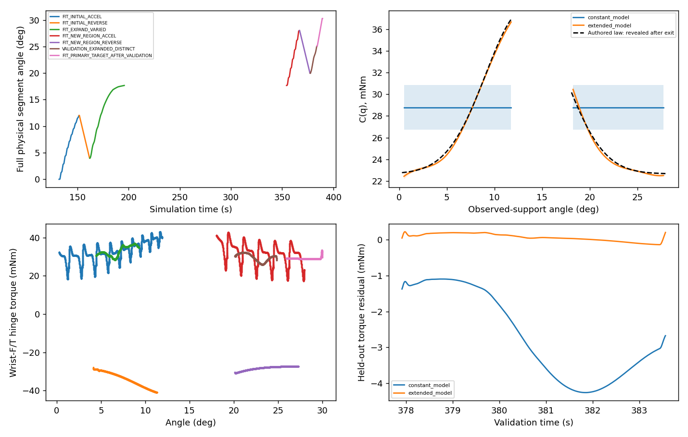

# V6 — large-range probing and two passive RGB-D cameras

**PASS with stated limitations in one blind simulated development episode.** Actual loaded opening reached **30.264°**, overall maximum **30.281°**, with **16.079° total closing segment travel**. Recovery from a genuine transmission failure was followed by expanded-range FIT and a **complete independent 20→25° VALIDATION**, then the optional 30° target. Guarded release and measured, collision-checked parking completed. Fifteen synchronized passive RGB-D pairs cover actual states through 30.281°. No fixed-camera image/depth/geometry influenced any online decision, grasp score, controller or estimator. No hinge reconstruction was performed.

Reference **fe69627**. The actual research implementation/configuration was committed and pushed as **97f9364 before launch**. Its [frozen registration](FROZEN_REGISTRATION.json), [executed source hashes](EXECUTED_SOURCES.json), [blind configuration commitment](CONFIGURATION_COMMITMENT.json), [protocol](PROTOCOL.md), [compact metrics](SUMMARY.json) and [Agent trace](AGENT_TRACE.json) remain available. All 54 registered files still matched after actor exit, before the documented metadata-only repair. Earlier results and frozen baselines are unchanged.

Scope: **CODEX_IN_LOOP / WRIST_RGBD_SAM3 / KNOWN_HINGE_STATE / APPROXIMATE_ACTUATOR_SIMULATION / IDEAL_WRIST_FT**. Registered station, known hinge/state, native collision safety geometry and simulated camera mounting remain dependencies. This is neither hardware validation nor a population success-rate estimate.

## Shared changes and preflight

`RuntimeV6` inherits the V5/V4.4 physical Skill. Only a separate passive camera writer and local resistance worker are activated. Observation, candidate scoring/fallback, closure, one-second hold, Pink, actuator authority, native colliders/physics and phase-aware protections are unchanged. The finite command/acquisition budgets are configuration inputs: up to four acquisitions, four Agent adjustments and 32 commands; only two acquisitions were used.

C(q) uses nonnegative **local cubic B-splines**, with fixed 5/10/15° knot-spacing and regularization alternatives chosen using eligible FIT-trajectory/prefix CV. The numerical domain is −5..50° to allow small closed-state/endpoint excursions; reporting/actions cover 0..45°. This does not stretch V5's global cubic or import its learned curve. SG121 remains common to torque and every regressor, including `K(B_j(q) sign(native_qd))`; downstream tool inertia is compensated once. Constant C remains the frozen V3.1 comparison. VALIDATION never selects a basis, regularizer, coefficient or uncertainty.

Archived-pose **engineering-only** checks found continuous IK to45°, with feasible released exits at20/30°. Both bounded45° exit searches failed; this does not prove no45° exit exists. Those fixtures supplied no live view or grasp. Synthetic checks covered1–42°; the actual asynchronous worker completed in3.82s, and VALIDATION mutation preserved all FIT parameters/covariances/selection. Weak individual edge controls were not perfectly recovered by synthetic tests; identifiable I/b and measured-torque recovery were checked separately.

A short robot-only native check executed278 physics steps with valid F/T and no object contact. Two complementary fixed-camera frusta covered the coarse0–45° envelope. An earlier check was infrastructure-invalid: its test simulation budget was smaller than the exit reserve, and cached camera callback timestamps were zero. The budget was corrected and renderer `ReferenceTime` used. Both records are preserved; neither was a door attempt.

## Fresh Agent perception and contact recovery

Codex inspected actual wrist RGB, SAM3 overlays, metric depth, clouds, semantic uncertainty and both selected G1 plan boards. Initial images in both generations had an upper handle region obscured by the gripper and no accepted mask. The Agent selected elevated views from fresh image/depth evidence, then complementary views. Two positive-side proposals at the opened state failed IK without executing motion; an opposite-side view passed. There were **six Agent observations, four actual Agent-selected adjustments and two additional pregrasp RGB-D checkpoints**. Fixed cameras were never inspected by the manipulation Agent.

The first two useful views retained295.90mm and added9,810 measured voxels in the complementary view. After safe release, current-state recovery views retained295.92mm and added6,656 voxels. Rear uncertainty remained separate from measured contact support. No saved successful pose or GT handle correction was supplied.

The first automatic grasp family was `[-0.3,0,0,0]`. It acquired bilateral contact and held1s, opened12° and closed4°, then lost effective transmission while attempting20°. At17.663°, relative drift reached~6.3mm and transmission ratio fell to0.049 with~0.494° reference lag. This was **SUSTAINED_LOW_TRANSMISSION**, not resource exhaustion or a single-pad veto. Safe unloading and native-rest parking succeeded. Qualified FIT support stopped well before the largest physical angle because the original5mm slip data-quality tag remained active.

Fresh automatic recovery selected **`[+0.3,0,180,0]`**, a different height/orientation generated by the unchanged planner. Current-state full approach and anticipated28/30° exits passed. No hand offsets, grip increase, score changes or object resets occurred. The second physical grasp passed bilateral verification and the original1s hold. Recovery reduced relative motion to mostly<0.7mm, with~1mm at final stopping. Single-pad unloading still occurred; this is not a continuous-bilateral or long-duration stability claim.

| Segment | Target | Actual endpoint | Signed travel | Simulation | Original status |
|---|---:|---:|---:|---:|---|
| 1 FIT_INITIAL_ACCEL | 12° | 12.015° | +12.015° | 19.592 s | TARGET_REACHED |
| 2 FIT_INITIAL_REVERSE | 4° | 3.976° | -8.039° | 10.404 s | TARGET_REACHED |
| 3 FIT_EXPAND_VARIED | 20° | 17.663° | +13.687° | 33.625 s | TRANSMISSION_FAILURE |
| 4 FIT_NEW_REGION_ACCEL | 28° | 28.005° | +10.342° | 12.621 s | TARGET_REACHED |
| 5 FIT_NEW_REGION_REVERSE | 20° | 19.965° | -8.040° | 10.513 s | TARGET_REACHED |
| 6 VALIDATION_EXPANDED_DISTINCT | 25° | 25.078° | +5.113° | 6.650 s | TARGET_REACHED |
| 7 FIT_PRIMARY_TARGET_AFTER_VALIDATION | 30° | 30.264° | +5.186° | 5.358 s | TARGET_REACHED |

The first failure remains a failure. Its predeclared transmitting prefix was quality-qualified, not relabeled as target success. The final30° FIT was predeclared before executing the whole second block and was allowed only after full VALIDATION completion. Both acquisitions used one continuous scene, real native finger contact, fixed base and passive door physics. There were two guarded releases, no panel-push attempt and no third acquisition/episode.

## Blind dynamics validation

Truth was accessed at **2026-10-19T08:14:52.035326+00:00**, after `SESSION_COMPLETE`, all online decisions, worker completion and normal actor exit. Commitment SHA256 **1b2bb257c8f084688db1356cc1885f0b31716d3404dd36e5f995859e92088122** matched. The immutable final online file is **a09b360fbd119f9255b77e9bc23b3f6acee6a15258c7f4bbcd393086728beaf4**. Blinding is procedural input/process separation under one account, not adversarial OS isolation.

Revealed authored reference: effective hinge inertia **0.1400027434kg·m²**, b=**0.3315236595N·m·s/rad**; passive native law `C(q)=0.02265130668 + 0.01520507663 exp(-0.5((q−0.2305060049)/0.07181165076)²)` N·m. Mass scale0.8527998153 with a positive-density redistribution; seed955234022. Native friction property readbacks verified application while retaining viscous damping; no object drive/effort command was used. Authored inertia is **not independently verified effective PhysX inertia**.

Primary evaluation uses the immutable **pre-VALIDATION snapshot**, so optional later FIT cannot improve its reported result:

| Complete held-out trajectory, reliable interior | Constant C | Pre-VALIDATION local C(q) | Final online C(q), extra predeclared FIT |
|---|---:|---:|---:|
| Torque RMSE | 2.92167mN·m | **0.12465mN·m** | 0.07418mN·m |
| Free angle RMSE | 1.28300° | **0.08475°** | 0.04776° |
| Free velocity RMSE | 0.009506rad/s | **0.000433rad/s** | 0.000280rad/s |
| Final angle error | −2.74552° | **+0.10798°** | +0.07872° |

The physical VALIDATION completed all6.650s. Reliable-interior prediction uses1,354 samples /5.6375s, one measured initial angle/velocity and held-out measured compensated wrist effort, with **no future-state correction**. SG121 has0.2583s completed-segment lookahead and declared boundary exclusions. This predicts motion given measured interaction effort; it does not autonomously predict future contact forces.

| Parameter | Pre-VALIDATION estimate ±conditional1σ | Final online estimate ±conditional1σ | Authored reference | Final relative error |
|---|---:|---:|---:|---:|
| I_eff kg·m² | 0.13960449 ±0.00063287 | **0.13968586 ±0.00066711** | 0.14000274 | **−0.226%** |
| b N·m·s/rad | 0.34298855 ±0.00262520 | **0.34071389 ±0.00282706** | 0.33152366 | **+2.772%** |

Final FIT/VALIDATION counts:565/57 bins. Measured acceleration RMS increased from0.02235rad/s² in initial acceleration FIT to **0.03381rad/s²** in the new angular region. New-region opening/reverse velocity RMS was **0.01872 /0.01393rad/s**, with opposite directions over overlapping20–28°. These are actual measurements, not commanded profiles.

**Supported FIT intervals are0.290–11.870° and18.075–29.956°.** Final C(q) RMSE versus authored law is **0.21566mN·m on those intervals only**; primary pre-VALIDATION curve RMSE is0.21810mN·m over its own observed support. The12–18° gap is unknown. The authored resistance peak near13.21° lies in that gap and is **not claimed as measured/reconstructed**. The public figure/export masks the gap; no precise45° curve is claimed.

The primary pre-VALIDATION regressor has rank11 and scaled condition**254.53**. After optional30° FIT, a weak edge control enters the final local regressor: rank12 but scaled condition~**1.05×10⁷**. Individual spline coefficients are not all strongly identifiable. HAC uncertainties are conditional on representation/regularization and exclude compensation, solver, contact and model-selection error. Damping bias is~3.25 conditionalσ; those bands are not calibrated total-error bounds. Held-out response and observed-support accuracy support useful dynamics, not a complete physical twin.

## Passive camera dataset and isolation

Two standalone fixed640×480 pinhole RGB-D sensor prims have separate calibrated extrinsics and complementary oblique viewpoints. Poses are set once. Optical-Z float32 depth is losslessly compressed per pair, RGB is PNG, and no continuous depth/video or full-frame cloud archive is stored. Maximum measured pose deviation was5.62×10⁻⁸m; minimum valid-depth fraction45.87%. Calibration is ideal simulated calibration, not hardware metrology.

**15 pairs /30 RGB frames /30 depth maps**, stored in15 paired NPZ files, cover initial, opening, reverse and terminal states. This table is **evaluation-only** and must not be supplied to the future geometry Agent:

| Pair | Actual state (eval only) | Moving native samples agreeing with either depth | Stationary samples |
|---|---:|---:|---:|
| 0 | 0.000° | 50.6% | 27.8% |
| 1 | 1.004° | 64.1% | 29.3% |
| 2 | 8.505° | 63.6% | 30.6% |
| 3 | 12.015° | 63.4% | 31.0% |
| 4 | 4.513° | 64.9% | 30.0% |
| 5 | 5.516° | 63.6% | 30.2% |
| 6 | 13.017° | 63.9% | 31.1% |
| 7 | 17.663° | 63.5% | 31.6% |
| 8 | 18.665° | 56.3% | 29.2% |
| 9 | 26.165° | 55.4% | 30.8% |
| 10 | 28.005° | 55.0% | 31.2% |
| 11 | 20.503° | 55.5% | 29.4% |
| 12 | 21.506° | 56.5% | 29.6% |
| 13 | 29.011° | 56.5% | 31.6% |
| 14 | 30.281° | 59.4% | 31.8% |

Coverage uses seeded cooked-surface projection and8mm depth agreement, including occlusion. It is a proxy/sample diagnostic, **not area coverage, segmentation, a GT correction or hinge reconstruction**. Both stationary and moving surfaces remain visible. Native/visual proxy differences and hidden surfaces remain limitations.

The acquisition's2µs world/render clock comparison falsely marked14 pairs invalid: `world.current_time` accumulates float32 physics dt while renderer time uses a rational clock. After actor exit, the preserved references were identical within every pair and agreed with240Hz tick time to **0.333ns**; world-clock drift reached20.347µs. The original index is preserved as `acquisition_index.json`; canonical `index.json` and clock calibration were repaired without changing **any of45 raw image/NPZ files**. Mismatched paired references, wrong ticks and stale frames still fail offline regressions. No physical retry was run.

The runtime writer is outside the Agent context and returns no pixels/geometry. Wrist operations inherit their frozen identities. The estimator receives only numeric motion/F/T, tool properties and explicit hinge/bias priors. A package audit found no hinge axis, joint angle, moving-part transform, seed or hidden-dynamics keys. Privileged states live in a separate evaluation sibling. **No fixed-camera image was inspected online, and no fixed-camera data selected an action or entered fitting.**

Current reusable code includes the post-exit clock-index fix and support-interval metadata patch. All candidate parameters, covariance, CV scores and selection remain **bit-identical** on recorded data; only unsupported curve/uncertainty output is null. The original online result and actual97f9364 source remain untouched. [Metadata regression](METADATA_PATCH_REGRESSION.json) and [boundary audit](GEOMETRY_BOUNDARY_AUDIT.json) document these distinctions. V5 offline regression still passes. No additional Isaac run validated the metadata-only patch; recorded clocks and negative cases did.

## Safety, cost and private evidence

Raw pad peaks **2.012 /2.542N**,6,428 informational warning samples, **zero hard-stop samples**. Minimum loaded joint margin **0.3578rad**; sampled all-phase minimum0.1526rad. The normal reports are not pressure areas or complete wrenches, and their absence does not prove separation.

The maximum measured loaded TCP speed was **18.34mm/s**, below the existing30mm/s measured stop guard but above the12mm/s nominal virtual-reference cap. Command-FK speed at that stopping transient was **19.19mm/s**. It occurred after target crossing during guarded joint deceleration, with finite bounded commands; it was **not filtered away** or described as nominal12mm/s motion. This round did not retune the frozen stop controller. See [peak diagnostic](LOADED_SPEED_PEAK_DIAGNOSTIC.json). Reference/actual endpoint overshoot and raw force peaks are retained. These provisional simulation guards are not hardware safety certification.

Wall time including initialization/cleanup **3,117.20s (51.95min)**; simulation **424.03s**. Agent unloaded waits consumed1,257.00s; two physical operation blocks1,024.09s; automatic geometry/planning512.57s. Passive captures cost only **5.71s**. The dominant remaining throughput costs are unloaded Agent latency, planning and the frozen acquisition/exit sequence, not external-camera recording. All interaction records are contiguous240Hz; unloaded data is compacted to10Hz. There are35,644 unique stored samples and no recording issues. Do not interpret decimated unloaded samples as a complete all-phase peak audit.

| Combined private footprint | Size |
|---|---:|
| derived_source_metadata | 34.058 MB |
| passive_RGBD_dataset | 9.753 MB |
| event_video | 0.104 MB |
| numeric_FT_motion | 17.159 MB |
| wrist_RGBD | 22.663 MB |
| **Total at summary export** | **83.737 MB** |

The15-pair dataset is9.75MB. Raw wrist/fixed RGB-D, F/T, telemetry, mesh exports and event video remain private. [Private evidence paths/hashes](PRIVATE_EVIDENCE_INDEX.json) identify the files without publishing them. No raw release/archive was uploaded or copied to a second backup location.

Final measured native-rest parking succeeded at30.2697° with0/0 pad loads. Owned actor1162694, launch/capture/estimation workers and completed engineering actors are closed; the owned lock is free. Other users' processes were not touched. No additional physical episode, object,45° attempt or geometry reconstruction follows this report.

The next separate geometry stage can consume **only `passive_geometry_dataset/`**, excluding this report, the evaluation sibling and hidden-state records. Dynamics follow-up would need qualified12–18° coverage and better-supported local controls, rather than treating the interpolated peak as known.
