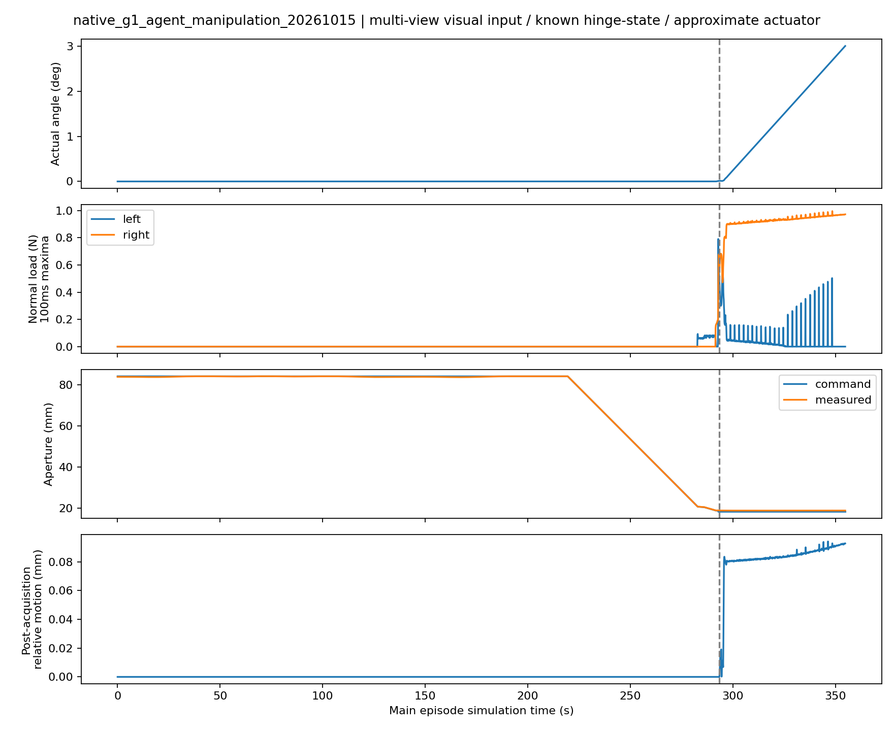

# Agent 腕部感知 → 真实接触短开门：45600 单次开发验证

**完整闭环 PASS。** 一次正常闭门、连续 Isaac 场景中，Codex 查看新鲜腕部 RGB / SAM3 / 深度 / 点云后选择两次观察调整，融合并自动规划，再明确批准执行。机器人经实际关节运动返回，通过原腕部 pregrasp 修正、native G1 抓取和一秒保持，确认抓取后实际净开门 **2.998230°**。最终门角 **3.011507°**，由原 +3° 目标正常结束。

参考 `2c126cd`，物理对照 `dba947d`；新执行接口在物理结果前冻结为 **`edd5bd0`**。标签：**CODEX_AGENT_WRIST / RGBD_SAM3 / KNOWN_HINGE_STATE_COLLISION / APPROXIMATE_ACTUATOR_SIMULATION**。这是 N=1 开发验证，不是鲁棒性、30°、未知铰链、硬件或无人值守 Agent 的成功声明。

## 各阶段实际结果

| 阶段 | 本轮证据 / 结果 |
|---|---|
| 主动感知 | 3 次新腕部观察，2 次 Agent 选择的调整；首帧 partial 不进入抓取几何 |
| 自动融合/规划 | 两有效帧，26,545 点、73,760 个开放测量三角形；原 grasp/IK 规划取得 |
| 明确执行批准 | Codex 实际查看融合图及 native G1 抓姿图后，提交 `execute`；不是自动按分数开抓 |
| 返回与接近 | 本轮路线反向、碰撞检查、原执行器运动；实测状态重新验证接近成功 |
| pregrasp 修正 | 原 wrist common-visible RGB-D：11,864 点；修正 0.836 mm / 0.037°，无 GT 抓姿修正 |
| 双侧抓取确认 | 293.379167 s；门角 0.013277°，过滤载荷左/右 0.465 / 0.540 N |
| 原一秒保持 | **1.004167 s**，未缩短 |
| 抓取后实际净增量 | **2.998230°，达到既有 ≥2° 短传力判据** |
| 原停止原因 | `SHORT_OPENING_TARGET_REACHED`；无释放、regrasp、手动续跑或场景重启 |

净增量 = 确认抓取后的最大实际门角 − `GRASP_VERIFIED` 事件门角，排除抓取前的运动。开门起点为 0.011347°，原控制器目标为起点 +3°；确认抓取后的净增量因此不必恰好等于 3°。旧共享函数仍返回遗留字符串 `SHARED_DOOR_30_DEG_SUCCESS`，**它不是本轮 30° 物理成功**；实际目标、结果和 `full_30_degree_task_success_claim=false` 均明确保留。

## Agent 的真实观察与动作

每个后续视点都在查看对应新 RGB、mask/depth/cloud 和测得 camera/q 后选择，没有读取旧成功相机位姿或抓姿。[完整简短解释和实际结果](AGENT_TRACE.json)保留 inspected-image SHA256。10 个实际查看图像的 hash 全部匹配。

| 新观察 | 实际看到 / 缺失的信息 | Agent 动作与实测结果 |
|---|---|---|
| 0，初始粗 survey | 横杆在画面下方，右端触边；深度可分离杆与面板。SAM3 crop recovery 分数 0.3184，只能作为 partial cue | 请求向新观测中心偏右重新构图、降低相机并保留较宽视野；原 IK/碰撞检查通过 |
| 1，重新构图 | 两端完整入画，SAM3 0.6602；局部截面是朝相机的圆弧，下侧/背面未知 | 请求略低的左斜视；原直接路径通过，所有当前 cue 点在预测 FOV 内 |
| 2，低位斜视 | 完整杆，SAM3 0.4980，增加侧面采样；后面仍不能当实测 | 停止观察，使用两个 accepted 帧融合并调用冻结排名；没有用满四次调整预算 |
| 融合与计划 | 实际查看蓝色测量面片、橙色 rear 假设分离图，以及原 native 手指与新抓姿图 | 明确批准一次物理执行；未用 GT 修正预测误差，也未手动改抓姿 |

实际相机位置（m）：初始 `[0.497767,-0.843297,0.288981]`；重新构图 `[0.707769,-0.820934,0.220041]`；低位斜视 `[0.537865,-0.771541,0.079229]`。link7 固定 optical transform 只安装一次；所有视角由真实 xArm7 执行器运动达到。三个巡看帧中的手指未覆盖目标；原 measured-q self-exclusion 持续使用。最大 camera/FK 平移差 **0.001718 mm** 是理想仿真一致性，不是硬件标定精度。另保存了一份原 pregrasp 新 RGB-D。

## 最小接口变化和执行完整性

- 旧 observation-only 入口、冻结物理 baseline 均未修改。新增薄入口 `run_native_g1_agent_manipulation.py`，在原 JSON 接口上增加 `validate_execution / execute`。
- 离线先检查归档 observation→home→approach 的集成，仅用于检查，不给 live 目标。在线从本轮实测 q 和仍有效的 command 开始，逆行本轮观察路线并连接新计划起点；返回检查 145 个配置，最小余量 0.80327 rad。原接近段检查 93 个配置，通过。
- 实际返回于 **145.495833 s** 完成；重新验证 measured-state approach 后才交回原 initial sequence。没有 `set_joint_positions` 返回、相机独立重定位、物体关节指令、attachment 或外力。
- grasp rank、SAM3 阈值/有效-mask 条件、native G1 位置执行器/预载、closure、Pink、物理参数及原 collision/force/joint/loaded-5-mm/s 保护保持原样。Agent 等待期间暂停 physics；每次等待最多 900 s，超时走原导出流程。
- 13 项实际加载源检查、22 项冻结基线检查一致。原 closure、precontact helper、opening controller、initial sequence hash 与已验证版本一致，见 [PROVENANCE](PROVENANCE.json)。新增后处理脚本未被 actor 导入。

Agent 本轮负责选观察动作和一次执行批准。抓取/接触/开门由原低层 Skill 自动完成；**没有验证 Agent 在线处理接触反馈或未知动态状态的能力**。

## 接触不确定性仍存在

以下 evaluator 均在 actor 退出后运行，没有回流执行。预测是 whole-finger 几何交叉，不是实际力估计，约 0.008 mm 的数值 bracket 也不是物理准确度。

| 同一 pregrasp 视觉修正后目标 | 左首次接触开度 mm | 右首次接触开度 mm |
|---|---:|---:|
| 腕部测量面 + nominal rear 预测 | 17.228 | 17.341 |
| GT native 几何，独立事后诊断 | 20.461 | 17.067 |
| 实际首次正法向接触 | **20.714** | **18.852** |

左指几何预测仍低估约 **3.23 mm**（相对 GT），与实际首次接触相差约 **3.49 mm**。右指接触发生在原 CENTER 已移动 TCP 之后，其差不能直接当固定姿态的感知误差。原闭合阶段从首次接触算起，body-relative TCP 最大变化 **1.024 mm**，包含原 centering，不应算作抓取后 slip。本轮没有增加挤压力或修改 CENTER 来吸收误差。[修正后接触比较](REFINED_CONTACT_COMPARISON.json)。

GT 全表面 2 mm 邻域覆盖：首个 accepted 腕部帧 **46.463%**，融合 **46.470%**，旧 scene-camera multi-view **55.790%**。融合增加点数，完整 GT 覆盖却几乎没增加；不声称补全更准确。保留腕部点的 mean/P95 点到 GT 距离为 **0.143/0.249 mm**，只对应保留的可见子集。rear 仍是假设；成功抓取不证明接触模型已准确。[几何诊断](GEOMETRY_COMPARISON.json)。

## 与 dba947d 的同对象物理对比

| 指标 | 冻结 scene-camera multi-view | 本轮 Agent wrist |
|---|---:|---:|
| 自动视觉抓取 / 原一秒保持 | 成功 / 1.004 s | 成功 / 1.004 s |
| 确认抓取后实际净开门 | 2.999298° | **2.998230°** |
| 抓取后最大相对平移 / 旋转 | 0.101 mm / 0.128° | **0.096 mm / 0.098°** |
| 抓取后最大世界 TCP speed | 1.206 mm/s | **1.208 mm/s** |
| 最大原始 allowed-finger normal load | 0.970 N | **0.996 N** |
| 全程最小实际关节余量 | 1.19198 rad | **0.80444 rad**，含巡看 |
| 主 simulation time | 208.675 s | **354.796 s** |
| actor wall time | 1572.049 s | **2635.555 s（43.93 min）** |

本轮 all-phase TCP 峰值 **29.241 mm/s** 出现在 78.388 s、未接触的返回 PREGRASP；没有隐去该峰值。任何正 allowed normal contact 时的峰值为 **1.208 mm/s**；这一定义不同于原保护内部 loaded 判定，保护本身没有修改。最大 joint command tracking 差 **0.004503 rad**，最大 planned-TCP tracking 残差 **1.173 mm**。

抓取后右指始终有正法向接触；左指报告有间断，最长 **6.396 s**，不能把报告缺失直接等同真 grasp loss。实际门运动持续且相对变化很小；没有新增 continuous-bilateral veto。力/碰撞/速度/关节保护警告或停止事件 **0**，first divergence 为 null。开门阶段原局部修正次数 **0**；释放/regrasp/base move 均 **0**。这些是仿真 normal-only 数据，缺少完整摩擦 wrench，不是硬件安全或部署验证。

## 时间、记录和停止

原生 240 Hz physics 与 observation 各 **85,151** 条，closure command **17,747** 条，时间间隔均匀。raw contacts、raw/filtered pad loads、joint velocities/efforts/reactions、native gripper feedback 在全部 observation 记录中存在。没有用完整性作执行门槛。

| 仿真阶段 | s |
|---|---:|
| 腕部巡看运动和 settle | 71.663 |
| 实际返回和 settle | 73.833 |
| 原 preapproach settle / home→pregrasp / approach | 0.500 / 48.233 / 25.208 |
| 闭合到确认 / 确认后保持 / 短开门 | 73.942 / 1.004 / 60.413 |

wall：巡看运动/settle **345.403 s**，RGB-D/SAM3/预处理 **85.036 s**，原自动 grasp planning **207.485 s**，返回/实测 handoff **364.400 s**，Agent 等待 **338.854 s**（包括传输、可视化、工具调用和调度，不是纯推理时间）。余下为初始化、原接近/闭合/开门及导出。`timing_profile.json` 是既有阶段切换快照，不冒充完整逐阶段 wall profile。本轮没有优化速度，也不能将视频的 simulation-time 时长当作 wall time。

视频 **1280×960 / 30 fps / 10,643 帧 / 354.767 s**，全量解码无错误。PID **2910727** 已正常退出，return code **0**，`/proc` 无该 actor。未触碰其他用户进程，没有要求 GPU 独占。完整 RGB-D、overlay、点云、视频、240 Hz 记录、源快照和 camera/force metadata 私有归档；公开内容只有代码、精简数值/派生曲线、hash 和决策记录。

仍依赖注册 station、粗柜体初始 envelope、已知 hinge/dynamic state、理想机器人/相机标定、原 GT 场景碰撞安全模型及 contact collider identities。GT handle surface 不参与 Agent 观察选择、抓姿生成或 contact scoring。link7 模拟相机的 housing/cable/mass 未新增或验证；actuator 为 approximate simulation。

结论：**在该单次开发实例中，Agent 选视点得到的腕部输入确实支持了完整真实接触短操作，而非只得到 IK 计划。** 观察→执行接口已连通；接触预测、未观测背面、跨对象可靠性和部署能力仍未解决。本轮至此停止，不追加物理试验。

证据：[COMPACT_RESULT](COMPACT_RESULT.json)、[AGENT_TRACE](AGENT_TRACE.json)、[PROVENANCE](PROVENANCE.json)、[预注册协议](PROTOCOL.md)、[私有证据索引](PRIVATE_EVIDENCE_INDEX.json)、[私有归档完整性](PRIVATE_ARCHIVE_INDEX.json)、[关闭记录](OWNED_PROCESS_CLEANUP.json)。

曲线虚线为确认抓取时刻；法向载荷按 100 ms 最大值显示以保留峰值，统计使用全 240 Hz 数据。抓取前 relative-motion 通道的零值未定义，不能理解为此前测得无滑移。
