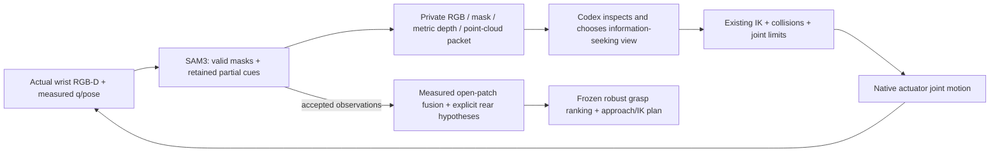

# Codex-in-the-loop 主动腕部观测：一次有限验证

参考 `d2ad962`；正式执行接口在实验前冻结为 `0a68093`。
标签：**CODEX_AGENT_ACTIVE_WRIST / RGBD_SAM3 / KNOWN_HINGE_STATE_COLLISION / APPROXIMATE_ACTUATOR_SIMULATION**。

**同一个正常闭门 Isaac 场景内，Codex 查看真实腕部图像后选择了两次观察调整，把触边的把手恢复为完整入画的有效检测，并取得观测面片融合与自动抓取/IK 计划。** 本轮共 3 次 RGB-D 观测、3 段真实关节运动（含初始位），只使用了 4 次调整预算中的 2 次。**没有执行抓取、关门/开门、释放或 regrasp。** 这是一个开发案例，不是跨对象成功率或物理抓取验证。

## 最小实现与职责

冻结的腕部安装、SAM3 权重/0.25 阈值/有效 mask 规则、native G1 几何与驱动、grasp rank、Pink、物理参数及保护均未修改。

- `infer_sam3_agent_observed.py` 在原过滤之前保存候选 mask、分数、触边情况和 overlay。无有效 mask 时返回观察结果给 Agent；**触边候选仍不允许作为完整抓取几何 seed**。
- `native_g1_agent_observation.py` 提供 `observe / inspect / evaluate_view / move_and_observe / build_geometry / finish`，通过一个 JSON 命令 inbox 保持同一 actor。代码不自动选择下一视角，没有 pixel-border→运动方向规则表。
- Codex 在本次对话通过实际图像查看工具检查每次新 RGB、mask/depth/cloud 观测板和局部点云图，随后提交明确的相机 eye/look target。目标坐标由**新观测的点云中心、轴向、面板法向**加 Agent 选择的观察距离/方向构成，不读取 GT handle、GT crop 或旧成功抓姿。
- 确定性代码只负责投影、原有 IK/碰撞/关节限制检查及原执行器运动。视角不可达是规划结果，不触发销毁场景。
- 融合只使用本轮两个通过原流程的观测。测得开放面片与三种假设 rear 保持分离，unknown 不代表已确认空/实。

初始位仍由原粗柜体 survey initializer 计算；只有这一个初始位预定。之后完全没有继续固定高度/距离扫描。正式场景之前仅用归档图像回放检查 partial-mask 导出，归档图像/坐标不传入 live 观察决策。

## 实际 Observe → Reason → Act → Observe 记录

所有下述解释都在相应新图像被实际查看之后提交；`AGENT_TRACE.json` 保留原始简短解释、缺失信息、目标、预期收益及结果。9 个实际查看图像文件的 SHA256 与 actor 私有证据逐一核对一致，不能将文件名当作图像检查的替代品。

| 观测 | Codex 从实际图像/点云看到的情况 | 决定与期望 | 实际测得结果 |
|---|---|---|---|
| 0：初始位 | 左端/横杆可见，右端触及图像右边界；深度可区分杆与后方面板。机器人指体不遮挡目标 | 将相机移向画面右侧并降低，观察已见杆中心稍偏右处，先补齐构图，不补造端部 | 裁剪恢复候选 **0.3262**，bbox `[668,778,1280,831]`，partial；未进入抓取几何 |
| 1：重新构图 | RGB 中两端都入画；绿色 mask 无触边。局部截面主要是朝向相机的圆弧，下面/背面仍不完整 | 请求左侧、略低于横杆的斜视，预期补充下侧轮廓和安装间隙；先验证 IK/碰撞 | 原图 **0.5703**，bbox `[241,457,997,503]`；原处理保留 **27,110** 点，有效 |
| 2：低位左斜视 | 整根杆仍入画，增加了侧面测点；保留面片仍开放，不能把 rear 当作实测 | 停止继续移动，先融合现有两个有效帧并调用原规划器 | 原图 **0.3945**，bbox `[220,454,941,512]`；原处理保留 **19,878** 点，有效 |
| 融合/计划后 | 实际查看蓝色测量点与橙色 rear 假设的分离图；规划器已返回计划 | 结束有限观察，不为了用满额度继续扫描；随后才允许 GT evaluator | **28,761** 融合点、**88,022** 测量三角形；自动 plan 已取得 |

低斜视的收益是 Agent 在观测前提出的假设，不等于已经证明所有新增信息进入了最终几何。独立评估显示，第二个有效帧对最终保留表面的覆盖增量较小，见下表。

| 观测 | 实际 optical camera 世界位置 m | 主场景时间 s | 来源 |
|---|---|---:|---|
| 0 | `[0.497767, -0.843297, 0.288981]` | 42.900 | 原初始粗 survey，现算 IK，非读取旧成功位姿 |
| 1 | `[0.714461, -0.770222, 0.199497]` | 60.296 | Codex 根据观测 0 请求；原始请求及 q 路径见 trace |
| 2 | `[0.511426, -0.728977, 0.064294]` | 74.083 | Codex 根据观测 1 请求；原始请求及 q 路径见 trace |

观测 1→2 的实测相机 baseline 为 **247.39 mm**，光轴夹角 **30.17°**。不是独立相机重定位：link7 子节点的局部变换只安装一次，所有视角通过 native xArm7 执行器达到。

## 融合、计划与独立 GT 评估

以下 GT 计算全部发生在最终 `finish` 命令、导出和 actor 正常退出之后。GT 及固定参考抓姿没有回流到 Agent 或可执行抓姿。

| 同一定义的指标 | 本轮首个有效腕部帧 | 本轮两个有效腕部帧融合 | 冻结 scene-camera multi-view |
|---|---:|---:|---:|
| 保留/融合点数 | 27,110 | 28,761 | 38,774 |
| 保留点→GT 距离：mean / P95 mm | 0.122 / 0.225 | **0.130 / 0.226** | 0.315 / 0.611 |
| 完整 GT 表面 2 mm 邻域覆盖 | 47.38% | **47.77%** | 55.79% |
| 主轴误差 | 0.0190° | 0.0246° | 0.2654° |
| 沿 GT 轴的观测长度 | 378.065 mm | 378.058 mm | 378.625 mm |

误差是在各自保留的观测子集上计算，**不能据此声称腕部总体优于 scene-camera**：腕部覆盖仍更低，融合相对单帧只增加约 **0.38 个百分点**。原始深度的 GT 可见并集为本轮 **53.21%**、scene-camera **51.80%**，与“保留点邻域覆盖”不是同一个指标。初始 partial 帧未进入融合，且既有处理/可见重叠会限制最终增量；本轮没有继续修改几何处理来追分。

3 次观测中，GT 把手投影与机器人自遮挡轮廓重叠比例均为 0。相机读回与 measured-q FK 的最大位置差为 **0.001574 mm**，属于理想仿真一致性，非硬件标定精度。全图仍有约 8.9% 的机器人 self mask。

自动选择的 grasp：section `+0.3`、insertion `0`、roll/pitch `0°`；均由冻结候选族和评分自动选择，未手调。原 approach/IK 计划覆盖到 **30°**，规划最小 joint margin **1.12485 rad**，使用注册 station/home，未执行 approach、闭合或开门。计划要求从原 home 起步；观测轨迹可作为返回路线的几何依据，但本轮未实际执行返回/抓取验证。

### First-contact 预测仍有局限

下面均为独立几何 evaluator 的 whole-finger first-intersection aperture（mm），不是物理接触实验或完整力估计。使用相同官方 native G1 几何，局部细扫不改变控制器。

| 几何与评估姿态 | observed-only 左/右 | + nominal rear 左/右 | GT/native 几何 左/右 |
|---|---|---|---|
| 冻结 scene 几何，冻结参考姿态 | 17.847 / 17.863 | 17.920 / 17.920 | 21.000 / 16.544 |
| 本轮 wrist 几何，**相同参考姿态，仅事后评估** | 17.872 / 16.705 | 20.132 / 16.858 | 21.000 / 16.544 |
| 本轮 wrist 几何，新自动选择姿态 | 17.124 / 17.284 | **17.260 / 17.309** | **20.582 / 16.914** |

相同参考姿态的 nominal-rear 预测有所接近，但新自动姿态的左指仍低估约 **3.32 mm**。三种 rear 假设在新姿态几乎给出同样结果，却共同存在偏差，**不是经过校准的误差范围/成功概率**。这限制了当前 contact prediction 的可信度；没有用 GT 修正后重新规划，也没有通过物理重试掩盖问题。

## 时间、物理完整性与来源

| 项目 | 实测 |
|---|---:|
| 主场景 simulation time | 74.083 s |
| actor 总 wall time | 1,427.681 s（23.79 min） |
| 正常执行器运动 + 原 settle | 380.824 s wall |
| RGB-D / SAM3 / 原几何预处理 | 57.474 s wall |
| 标准 inspection board 渲染 | 4.062 s wall |
| Codex 回合等待 | 809.624 s wall |
| 2 次 view IK/碰撞评估 | 0.439 s wall |
| 融合 / 抓取规划 | 1.499 / 148.666 s wall |
| 剩余初始化、导出及开销 | 25.094 s wall |

Codex 等待包括图像传输、工具调用、额外局部图生成和对话调度，不是单纯模型推理计时。等待期间 physics 暂停、actor/scene 保留；这不是实时硬件闭环性能测试。视频按 simulation time 记录实际运动，不将等待墙钟压成运动速度。

- 原生 240 Hz physics/observation 各 **17,780** 条，时间间隔均匀；raw contacts、raw/filtered pad loads、joint velocity/effort/reaction、G1 feedback 全部存在。无接触时是空 contact 列表，不是丢数据。
- 闭合调用 **0**；实际门角 **0°**；pad load 峰值 **0 N**。无抓取，slip/loaded-speed/holding 结果不适用。
- 实际最小 joint margin **0.61187 rad**；最大 joint command tracking 差 **0.003882 rad**；最大世界 TCP speed **29.019 mm/s**，全部未加载巡看，原加载 5 mm/s 保护代码未修改。
- 视频 **1280×960 / 30 fps / 2,222 帧 / 74.067 s**，完整解码无错误。
- 22 项冻结源/配置检查、9 项 actor 源检查及 9 个已查看图像 hash 全部一致。原控制器、scoring、effort、gain、collider、物体动力学和保护未更改。
- PID **2293343** 在导出后正常退出，return code 0，无遗留 actor；没有触碰其他用户进程。使用足够空闲显存，不要求 GPU 独占。

观测入口通过受控结束哨兵 `AGENT_OBSERVATION_COMPLETE_NO_MANIPULATION_ATTEMPT` 阻止继续进入旧抓取前缀。旧 `report.json` 的该状态不是模拟器/物理失败；本轮主要结果是 `AGENT_EPISODE_RESULT`、`AGENT_GEOMETRY_PLAN_RESULT` 和 `COMPACT_RESULT`。

## 结论与仍未证明的部分

本轮证明了一个 **Codex 实际看图 → 指出缺失信息 → 请求可验证的腕部视角 → 真实关节运动 → 新观察 → 融合/计划** 的开发闭环，而非另一条写死的扫描序列。接口本身不按 asset ID 分支，但仅验证一个开发对象，尚无跨对象或重复可靠性结论。

仍依赖：注册 station、初始粗柜体包围范围、机器人/相机理想仿真标定、已知 hinge/state，以及现有 GT 场景碰撞模型的安全检查；GT handle 表面不参与观察目标生成或 contact scoring。相机仍为假设的 link7 仿真安装，housing/cable/hardware hand-eye 未验证；actuator 仍是 approximate simulation。

测得面片是有用的部分表面，rear 仍未知；contact prediction 在新姿态有明确偏差。自动计划不等于物理抓取成功。本轮不修改这些限制、不追加运动或抓取。后续可在独立任务中检查已测侧面为何未充分保留，以及已恢复完整 seed 后能否用原 depth-consistent projection 重新利用初始 partial 帧的已见片段；本轮没有实现这些补丁。

## 证据与复现入口

- `AGENT_TRACE.json`：逐步 Observation / interpretation / missing information / request / expected benefit / measured result。
- `COMPACT_RESULT.json`、`GEOMETRY_COMPARISON.json`、`FIXED_REFERENCE_CONTACT_COMPARISON.json`：原始数值定义及对比。
- `WRIST_ROBOT_TRAJECTORIES.json`、`WRIST_CALIBRATION.json`：实际 q 路段、到达 q、时间、camera parent/固定变换；完整 240 Hz 轨迹私有保存。
- `PROVENANCE.json`：执行版本、源/config hashes、已查看图像 hash、GT evaluator 在 actor 退出之后的检查。
- `PRIVATE_EVIDENCE_INDEX.json`、`PRIVATE_ARCHIVE_INDEX.json`：RGB、mask（含被拒绝者）、depth、局部/融合图、完整 video、raw telemetry 的私有位置和 SHA256；不公开这些原始内容。
- `OWNED_PROCESS_CLEANUP.json`、`VIDEO_PROBE.json`：正常退出和视频完整性。

入口：`scripts/run_native_g1_agent_observation.py --job <private job.json>`。actor 的 `agent_commands/NNN.json` 接受经过 Codex 图像检查后的命令；`agent_responses` 返回原 IK/运动/感知结果。这个原型需要当前 Codex 对话保持交互，不是无人值守 Agent 服务，更没有将 Agent 替换为固定几何决策规则。
