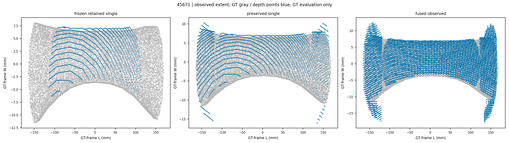
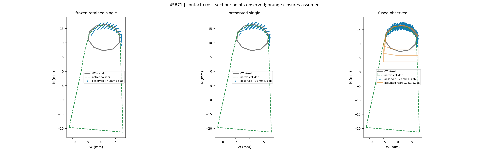
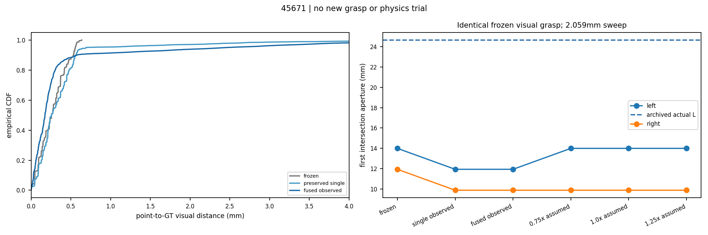
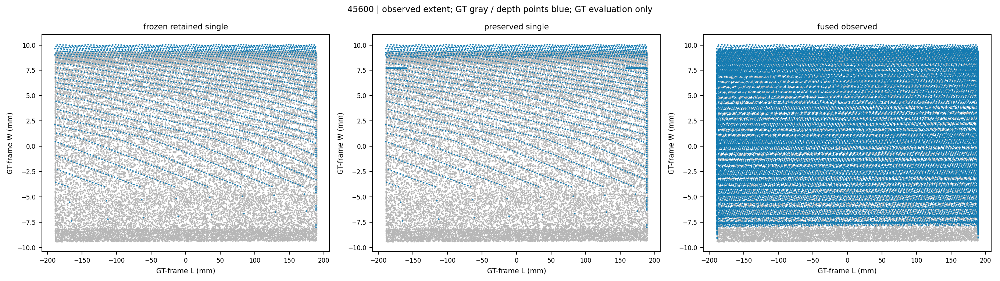
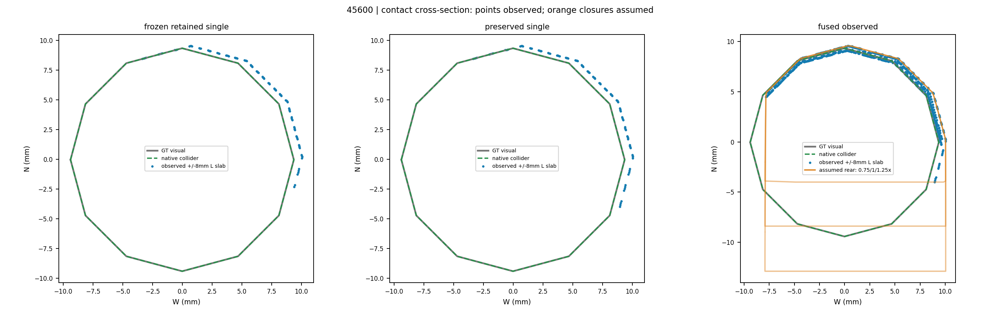
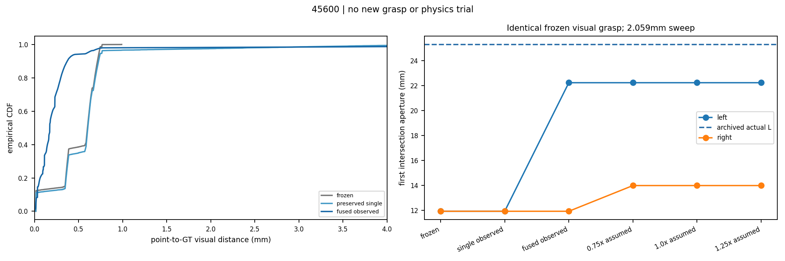
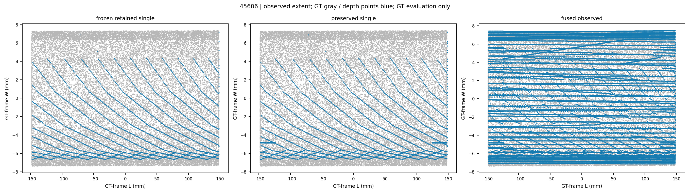
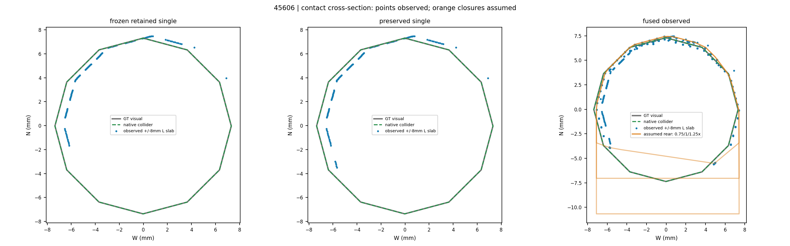
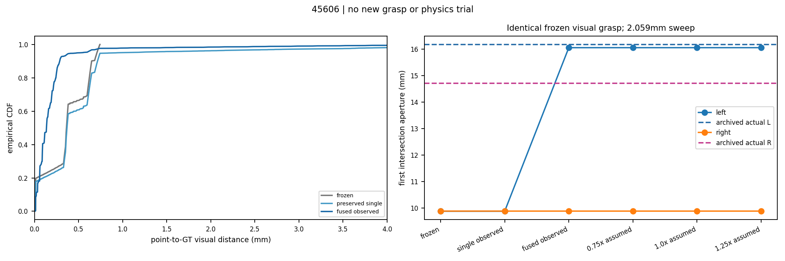

# Calibrated RGB-D contact geometry before VGGT-Ω

**Reference:** `8425f13`. **Scope:** shared xArm7 + native G1 visual geometry development; GT/cooked colliders in a separate offline evaluator only. **Zero new grasp or opening trials.** Frozen Oracle/visual controllers, grasp poses, force/IK settings, object physics, colliders and benchmark results are unchanged. No VGGT model was installed or executed.

## Answers

1. **45671's large visible-end truncation is substantially repaired.** Retained span increases 227.04 → 325.63 mm (GT full span 334.69 mm); coverage of the original depth-visible GT samples increases 53.8% → 94.6%, with P95 point-to-surface error 0.556 → 0.699 mm. This is not perfect segmentation: fused P95 is 2.458 mm and residual end/trim contamination remains.

2. **Multi-view RGB-D improves 45600's first left-contact prediction.** At exactly the archived visual grasp, old loft / preserved single-view patches / fused patches predict **11.94 / 11.94 / 22.23 mm**, versus **25.30 mm** archived physics and **24.29 mm** offline GT geometry. Absolute physics mismatch falls **13.36 → 3.06 mm** (~77%). The residual is not zero; this is a geometric diagnostic, not a new physical grasp success.

3. **Backsides, mounts and occluded surface patches remain partly unknown.** Point fusion never turns an unseen rear into measured geometry. The one 45671 view with no depth-consistent common seed is excluded, without a GT crop or replacement capture. Uncertain rear closures are kept separate and still differ from GT.

4. **Do not add VGGT-Ω as the next repair.** The study already shows useful contact improvement from calibrated metric RGB-D. Remaining blockers include segmentation/visibility and a separate physical collider defect, rather than simply missing camera/depth estimation. A learned prediction cannot measure a fully occluded surface or explain invisible convex-hull fill-in. No head-to-head VGGT performance claim is made.

## Shared change and source boundaries

The old path applies global Otsu foreground separation, removes the lowest 10% of handle heights, and builds a 5–95% longitudinal rectangular loft. Those operations mix a semantic filter, point trimming and hidden-surface assumptions.

The isolated development module now:

- preserves all points in the inherited, observation-derived trusted depth mask, without the extra 10% height or 5–95% length deletion;
- extends **missing longitudinal end intervals only**, using local observed depth layers in 32 seed-axis strips and metric-neighbor continuity in a two-pixel seed neighborhood; existing trustworthy cross-sectional masks are not globally relaxed;
- stores actual depth points and adjacent-pixel triangular patches as open observed support. Neighbor triangles crossing depth discontinuities are omitted using sampling resolution, not GT geometry;
- fuses points with a 0.5 mm voxel mean in the saved calibrated world frame, and retains the union of per-view patches. There is no GT ICP, object-pose correction, watertight surface claim or cross-occlusion triangulation;
- keeps three 0.75/1/1.25× observed-width rear envelopes explicitly **assumed**. They retain observed point support but add hypothetical convex fill; their faces are not called measurements.

Two discarded shared development variants are preserved privately: simple low-height connected growth and local-layer-only replacement restored panel/trim contamination (single-view P95 about 19–33 mm). The final rule limits relaxation to missing end intervals. These are development controls, not a blind held-out evaluation. No asset-ID pose branch or per-object threshold is present.

[Observation-only module](../../../scripts/native_g1_metric_rgbd_geometry.py) accepts depth, camera calibration, SAM-derived seeds and robot self-exclusion only. [The evaluator](../../../scripts/evaluate_native_g1_metric_geometry.py) separately loads GT surfaces, native cooked colliders, archived grasps and archived first contacts. It cannot feed GT corrections back into reconstruction. No selected candidate or executable plan was changed.

## Bounded observations

Initial/pregrasp captures usually use the same camera pose; they were not counted as additional viewpoints. Three new scene-camera views per case were captured at **−55°, 0°, +55°** about an observed panel normal, at 0.7 m standoff and +0.1 m height. Framing comes from observed seeds/depth only. No GT handle crop or instance mask is used.

New-view masks propagate SAM-derived measured world seeds, require common depth consistency, and grow on the observed protrusion. No new SAM3 inference or asset-specific prompt is used for these views. This overlap-based propagation can miss newly exposed surfaces; it is not an Oracle-mask upper bound on fusion quality.

| Case | New calibrated RGB-D views | Used in fusion | Total views including archive | Exclusion |
|---|---:|---:|---:|---|
| 45671 | 3 | 2 | 3 | no common-visible depth seed in −55° view |
| 45600 | 3 | 3 | 4 | none |
| 45606 | 3 | 3 | 4 | none |

All successful captures are 1280×960 optical-Z depth + RGB with saved K, extrinsics and robot state. World time remains identical before/after every new capture. The arm stays in its initialized pose; no approach, closure, opening, object actuation or controller execution follows bootstrap. **These are simulation-only camera relocations, not physically achieved wrist-camera sensing.**

## Observed accuracy and coverage

Distances below are unsigned point-to-GT-visual-surface distances in mm, with no GT registration. “Original-visible coverage” is the fraction of the same initial-view depth-consistent GT samples within 2 mm of a cloud. It differs from the previous report's mask-coverage metric. Full metrics include median/P90, widths, PCA error and all uncertainty samples in [METRICS.json](METRICS.json).

| Case | Representation | Points | Mean / Median / P90 / P95 (mm) | Original-visible coverage | Full observed L (mm) |
|---|---|---:|---:|---:|---:|
| 45671 | Frozen retained single | 1881 | 0.268 / 0.257 / 0.535 / 0.556 | 53.8% | 227.04 |
| 45671 | Preserved single | 3376 | 0.401 / 0.257 / 0.563 / 0.699 | 94.6% | 325.63 |
| 45671 | Fused observed | 21937 | 0.426 / 0.175 / 0.578 / 2.458 | 96.4% | 330.83 |
| 45600 | Frozen retained single | 2514 | 0.496 / 0.601 / 0.715 / 0.733 | 93.3% | 378.02 |
| 45600 | Preserved single | 2794 | 0.583 / 0.605 / 0.727 / 0.765 | 99.3% | 378.02 |
| 45600 | Fused observed | 39245 | 0.300 / 0.173 / 0.372 / 0.601 | 99.7% | 378.62 |
| 45606 | Frozen retained single | 2344 | 0.371 / 0.363 / 0.649 / 0.709 | 94.4% | 295.78 |
| 45606 | Preserved single | 2606 | 0.542 / 0.369 / 0.715 / 0.932 | 99.5% | 295.86 |
| 45606 | Fused observed | 32918 | 0.213 / 0.136 / 0.286 / 0.515 | 100.0% | 296.19 |

45671 end loss is largely repaired without the 19–33 mm P95 contamination of the discarded broad-restoration variants. Nevertheless, its fused result still has residual outliers and a wider-than-handle envelope. It must not be promoted as a uniformly clean segmentation replacement. 45600/45606 fused P95 values improve to **0.601/0.515 mm**, while their original-visible coverage rises to **99.7/100.0%**.

## Contact prediction at identical frozen poses

First contact is the first geometric finger/surface intersection on the unchanged 41-aperture sweep, 84.0 → 1.641 mm (**2.059 mm spacing**). Open observed patches are queried as triangle surfaces; uncertain envelopes as convex pieces. No new grasp search or pose adjustment is run.

| Case | Old loft L / R | Preserved single L / R | Fused observed L / R | GT visual L / R | GT native + cooked fingers L / R | Archived actual L / R |
|---|---:|---:|---:|---:|---:|---:|
| 45671 | 13.99 / 11.94 | 11.94 / 9.88 | 11.94 / 9.88 | 13.99 / 7.82 | 24.29 / 7.82 | 24.66 / — |
| 45600 | 11.94 / 11.94 | 11.94 / 11.94 | 22.23 / 11.94 | 24.29 / 11.94 | 24.29 / 11.94 | 25.30 / — |
| 45606 | 9.88 / 9.88 | 9.88 / 9.88 | 16.05 / 9.88 | 16.05 / 11.94 | 16.05 / 11.94 | 16.18 / 14.71 |

45600's new left prediction is one sweep bin below the GT fixed-pose result. 45606's new left prediction **16.05 mm** nearly matches measured **16.18 mm**, compared with old **9.88 mm**. This second-object improvement supports a shared geometry effect rather than a manually corrected 45600 grasp.

Right-contact interpretation is bounded: 45600/45671 never closed to their predicted right-contact apertures in the archived failures, so “—” is not a calibrated right-side prediction error. Successful 45606 acquired its right contact after the original CENTER moved the TCP; a fixed-pose intersection scan does not model that trajectory, compliance or contact offsets. First positive normal reactions are not stable grasp certificates or complete contact wrenches.

45671's fused visual first-contact prediction still disagrees with **native** physics. The visual model must not be distorted to reproduce invisible collision-proxy fill-in. Its native contact mismatch remains unresolved in this round.

## What is observed, assumed and still missing

The following are separate metrics. “Full-surface cloud coverage” uses a 2 mm nearest-point radius and is sampling-dependent, not a calibrated visible-area measurement. “Occluded in every available view” uses saved-depth projection; raster edges and depth inconsistency are counted separately. Uncovered samples must not all be relabeled as sensor error or fully occluded surface.

| Case | Full GT cloud coverage: old → fused | GT depth-visible in ≥1 view | GT behind depth in every available view | GT depth-front mismatch with no visible match |
|---|---:|---:|---:|
| 45671 | 29.5% → 57.8% | 53.4% | 39.1% | 7.5% |
| 45600 | 39.9% → 55.9% | 53.7% | 38.8% | 7.5% |
| 45606 | 43.9% → 82.3% | 78.1% | 15.7% | 6.3% |

Rear arcs facing the panel, mounting gaps, surfaces outside propagated common overlap, and robot-occluded patches remain partly unobserved. Orange surfaces in the figures are explicit possible rear closures, never measured surfaces. The convex closures can also introduce connecting faces; their uncertainty is not just one scalar thickness error.

Each case uses the executed visual pose plus five existing archived candidate poses. Only the archived visual correction D is applied; no GT transform or new candidate is generated. The same three rear priors are queried for all six poses.

| Case | Maximum L/R first-contact spread across rear priors, over six poses | Changed side predictions / 12 |
|---|---:|---:|
| 45671 | 4.12 mm | 5 / 12 |
| 45600 | 0.00 mm | 0 / 12 |
| 45606 | 0.00 mm | 0 / 12 |

All three selected poses have unchanged first apertures across this particular rear-prior family. That says the first modeled intersection is controlled by front/side support; it **does not certify a correct backside, robust holding, candidate ranking or opening force transmission**. Alternative 45671 poses vary by 4.12 mm. These priors are not confidence bounds and do not span all possible unseen surfaces.

## 45671 collision representation: separate fidelity problem

The frozen native collider convexifies the curved handle/support assembly and fills rear space absent from the visual mesh. Previous evaluation measured native→visual P95 **31.54 mm**. At the frozen pose, visual GT first left contact is **13.99 mm**, but native collider + actual cooked finger predicts **24.29 mm**, close to archived **24.66 mm**. Calibrated image reconstruction cannot observe that artificial fill-in.

This is unsuitable as a precision representation of the graspable handle gap, even if it is a useful coarse collision bound. A future **separate, versioned physics-fidelity comparison** should compare this frozen hull with a handle-family multi-convex representation retaining the original visible gap, under the same controller and physical properties. This branch implements no collider correction, changes no dynamics and rewrites no benchmark result. See the [preserved GT/native diagnosis](../native_g1_gt_observed_diagnostic_20261015/REPORT.md).

## Is VGGT-Ω useful next?

The [official VGGT-Ω implementation](https://github.com/facebookresearch/vggt-omega) predicts camera parameters and depth from images. Here calibrated poses and metric depth already supply those quantities. **Our inference:** a learned model may later help correspondence or weak/missing-depth regions, but it adds a prediction/prior, not an observation of a fully hidden rear, and cannot repair a simulator-only convex fill-in. It was not tested in this study. First retain this calibrated baseline and address residual semantic masks/visibility; any later VGGT comparison should use the same images and distinguish predicted from measured geometry.

## Figures

Gray = GT visual; green dashed = native collider; blue = actual depth points; orange = assumed rear envelopes. Cross-sections use ±8 mm longitudinal slabs. L is GT surface PCA for evaluation; the transverse plot frame uses the observed panel normal orthogonalized to L. Plot-frame extents are in METRICS.json. GT never supplies executable geometry. CDFs show 0–4 mm for readability; full un-clipped statistics above retain outliers.

### 45671







### 45600







### 45606







## Evidence integrity, initialization repairs and stop

One pre-Isaac import failure and two unsuccessful sensor-capture variants are retained privately: (a) paused world.render left the new depth annotator empty; (b) explicit zero-time capture produced depth but the overview's inherited 1 m near clip removed the 0.7 m target. The final geometry-only camera uses .05–3 m clipping, matching the frozen loader's primary-camera setting. No frozen camera or object collider was altered. [NVIDIA's documented zero-time capture API](https://docs.isaacsim.omniverse.nvidia.com/latest/replicator_tutorials/tutorial_replicator_sdg_workflows.html) advances no timeline time when delta_time=0.0.

There were three successful geometry-only scene initializations plus six rejected sensor-capture initializations, not manipulation attempts. Each final new view was captured once after infrastructure repair. No additional view or physical retry was used to improve the geometry score. The final geometry rule was studied offline after capture; the actual view-selection geometry source and actual capture runner snapshots are preserved separately from the final evaluator source.

All 11 frozen source checks and 33 original input hashes match. All 291 original asset geometry files (117/87/87) and previous evaluator dependency hashes also match; see [ASSET_FREEZE_CHECK.json](ASSET_FREEZE_CHECK.json). All successful capture-runner hashes match their actual archived snapshot. All three successful launchers exited with code 0, logs end with Simulation App Shutting Down, and no matching collector remains. A bookkeeping marker placed after app.close did not execute because Isaac exits the interpreter; the published entry writes a close request before calling close. That bookkeeping repair was not rerun.

- [Frozen study configuration](STUDY_SPEC.json).
- [All scalar metrics](METRICS.json).
- [Actual capture provenance, source/input hashes, cleanup and timing](PROVENANCE.json).
- [Bounded capture entry](../../../scripts/capture_native_g1_geometry_views.py).

Private evidence root: `/data1/home/rangeryx/fr3_real2sim_known_whole_20261007/results/native_g1_contact_geometry_study_20261015/`. Fresh RGB/depth/K/extrinsics, robot states, masks, observed meshes, rejected sensor captures, rejected model versions, logs and actual source snapshots remain private. Raw assets/observations/videos are not published. [Private archive index](PRIVATE_ARCHIVE_INDEX.json) contains only its hash/path/size. The original source archive remains pinned by SHA-256 `50174cab70134033449e40498af25d480a452bf777fcd0dba3a721ef2bf5b1f8`.

Reproduce the offline comparison using private saved inputs:

```sh
PYTHONPATH="$PWD/scripts:$PWD" OMP_NUM_THREADS=1 PYTHONNOUSERSITE=1 \
  /data1/home/rangeryx/isaaclab-arena/.venv/bin/python \
  scripts/evaluate_native_g1_metric_geometry.py \
  --archived results/native_g1_visual_reliability_20261015 \
  --study results/native_g1_contact_geometry_study_20261015 \
  --reference-metrics results/native_g1_gt_observed_diagnostic_20261015/METRICS.json \
  --output results/native_g1_contact_geometry_study_20261015/evaluation
```

**Stopped after the bounded geometry study.** The new representation is an offline development result, not an installed or physically validated replacement Skill. Original 4/10, Oracle and visual results are unchanged.
