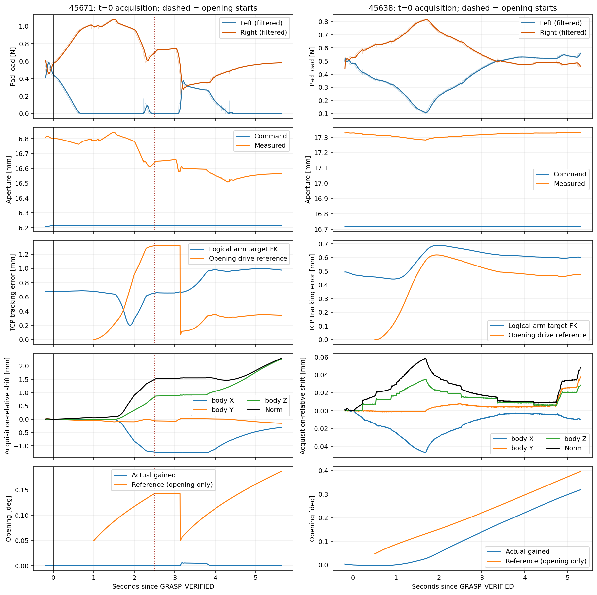
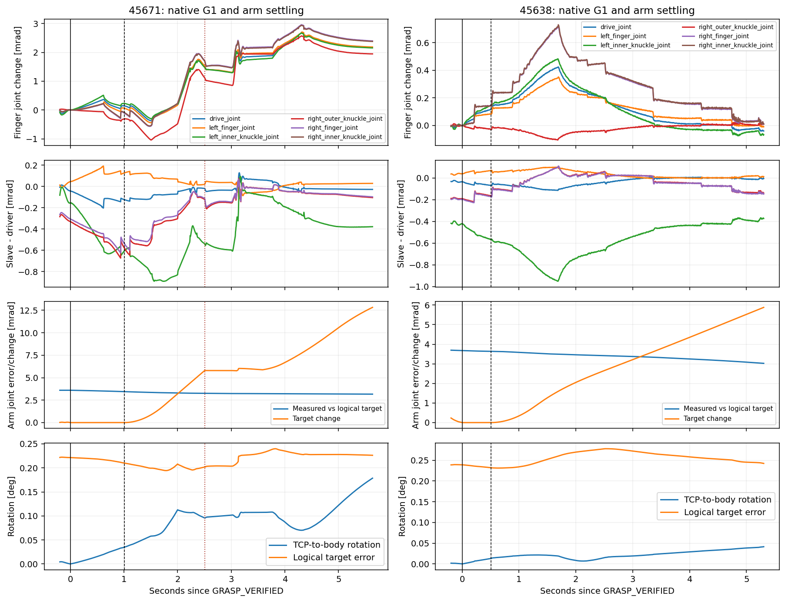
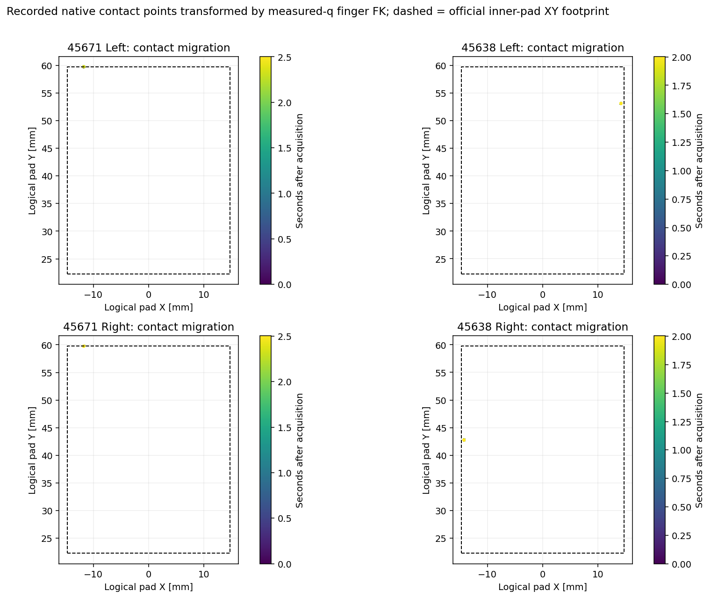
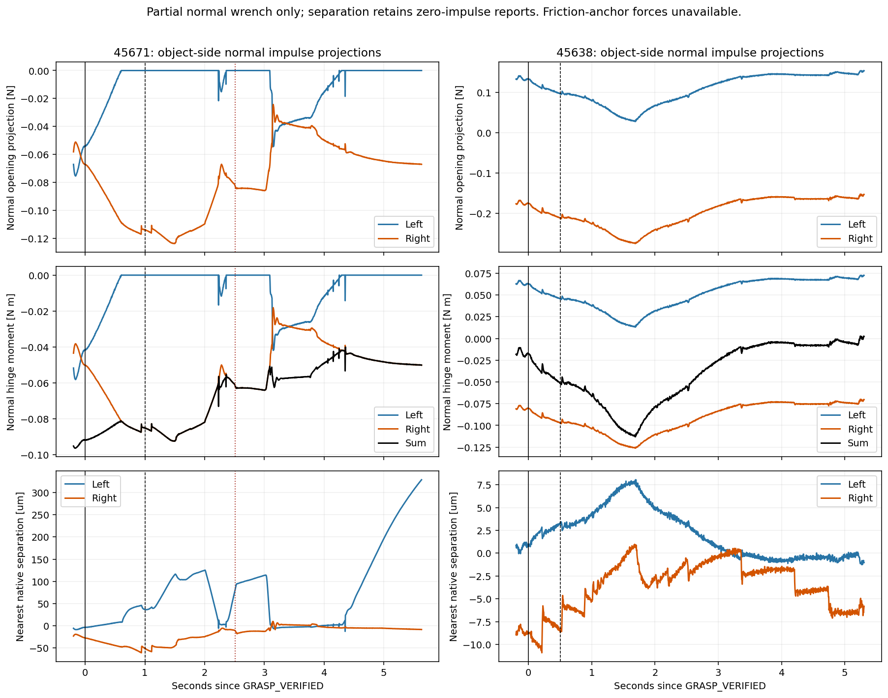

# 45671 post-grasp contact loss: offline diagnosis

**Reference:** `5b10802fc9232e110761a32e49a5cdb47846ce23`. **Label:** ORACLE_HANDLE / KNOWN_MODEL / OFFLINE_CONTACT_MECHANISM_DIAGNOSIS.

**Finding:** the first divergence is loss of left contact during stationary position hold, before opening. The recorded contact manifold places both fingers at the same end edge of their inner pads. Small measured arm/finger settling changes that marginal contact into right-only support. During subsequent pulling, the right contact point travels along the handle collision surface while the door remains essentially closed. This supports a contact-placement/retention problem; it does not demonstrate a new Pink, joint-mapping or gripper-command discontinuity.

**Scope:** existing 240 Hz archives only; zero new Isaac launches or physical trials. No controller, planner, physics, collision, gain, force, or protection changes. Frozen benchmark and grasp-only/short-opening results remain unchanged. Raw contacts, trajectories and videos remain private. Published plots and metrics are derived offline summaries.

## First divergence and subsequent sequence

| Event | Simulation time | Evidence |
|---|---:|---|
| GRASP_VERIFIED | 132.866667 s | Filtered L/R 0.4498/0.5662 N; native instantaneous 0.4328/0.5832 N |
| Hold +0.500 s | 133.366667 s | Native L/R 0.0822/0.8775 N; degradation already present before the extra hold |
| Left native load below existing 0.05 N | 133.404167 s | Gradual unloading, not an opening-speed event |
| Left filtered load below 0.05 N | 133.441667 s | Existing 19-sample arithmetic filter delays the report |
| Terminal left zero-impulse interval starts | 133.479167 s | 0.391667 s continuously absent before opening; an earlier one-step absence also occurs |
| Opening starts | 133.870833 s | Filtered L/R 0/0.9956 N |
| First original transmission stall | 135.375000 s | Approximately 1.500 mm opening-anchor drift, essentially zero joint progress |
| Original local correction | 136.000000 s | About 0.150 mm commanded correction; transient bilateral reacquisition, no durable transmission |
| Final original stop | 138.504167 s | CONTACT_TRANSMISSION_FAILURE_AFTER_ONE_LOCAL_CORRECTION; max actual angle 0.006067° |

## Why contact disappears during hold

Observed facts:

- Jaw target is **constant 16.214523 mm**, with no reopening. Driver angle increases by 0.1435 mrad; measured aperture ends **15.79 µm narrower**, with a 40.39 µm span during hold. Thus the command did not release the handle. Native G1 retains a finite position target; the legacy logical FORCE_HOLD label is **not an independent force servo**.
- Both loaded contact points at acquisition are approximately **pad-local (-11.75, 59.753, -26.003) mm**. Pad Y ends at 59.753202 mm: these are end-edge contacts, within the sub-micrometre FK/recording resolution. Each finger has one positive normal-impulse point per sample at acquisition, not evidence of broad distributed support.
- During hold, those points remain at that edge: pad-local migration is below approximately 0.001 mm. There is **no observed traverse across the pad followed by falling off**. Before disappearing, left contact migrates up to 0.0174 mm in the moving-body frame; right up to 0.0342 mm.
- Actual TCP-to-body motion reaches **0.05619 mm / 0.03462°**. Logical arm position targets are constant; gravity-biased implicit targets vary by only **5.6e-9 rad**. Maximum measured arm joint change is 0.7403 mrad. Logical-target TCP tracking error stays approximately 0.677–0.688 mm rather than jumping. Hold TCP speed peaks at 0.248 mm/s.
- Native signed left separation changes from **-3.87 µm to +36.60 µm**; right from -27.57 to -51.36 µm. Positive separation alone is not a contact/no-contact rule—contact offsets permit impulse at small positive separation. Here it accompanies the actual disappearance of left impulse.
- Offline FK decomposition at the *initial contact location* predicts left recession of **+40.12 µm**: measured arm change contributes +52.49 µm, finger change -12.36 µm. On the right, net recession is -23.75 µm, consistent with increasing compression. These are geometric counterfactuals, **not independent causal interventions or recovered forces**.
- Five slave-driver errors remain below **0.673 mrad**. Successful 45638 reaches 0.951 mrad during early opening. The records show small asymmetric coupling/settling, but do not establish a wrong coupling sign, frozen finger, or gross actuator/mapping failure.

**Interpretation:** finite position holding settles the arm and coupled fingers while a shallow edge-supported grasp has little retention reserve. The observed separation/load transfer is consistent with left normal support unloading and right compression increasing. The records do not identify how much of the settling originates in drive compliance, solver constraint response or unreported friction-anchor forces. A more precise attribution would require a controlled intervention; none was performed here.

[Hold FK decomposition and measured contact normals](plots/05_hold_geometry_normals.png).

## Can the remaining right contact open the hinge?

For each recorded contact, retain collider ordering and use the archived signed robot-side impulse `I`. Object-side normal reaction is `F_n = -I / dt`, `dt = 1/240 s`. With authored world hinge axis `a`, origin `h` and contact point `p`:

`u_open = normalize(a × (p - h))`

`F_open,n = F_n · u_open`

`tau_open,n = a · ((p - h) × F_n)`

Positive means the authored opening direction. Recorded impulses align with the native normals to numerical precision, confirming this is the **normal** contribution. World axes are (0,0,-1) for 45671 and (0,0,+1) for 45638; the handle's long axis is not used as the hinge axis.

| First 1.5 s of opening | 45671 L / R | 45638 L / R |
|---|---:|---:|
| Mean normal opening projection, N | -0.00076 / **-0.10584** | +0.06449 / -0.24141 |
| Mean normal hinge moment, N·m | -0.000585 / **-0.07913** | +0.03044 / -0.11067 |
| Max acquisition-relative TCP drift, mm | **1.4949** | 0.05857 |
| Max actual angle in this window | ~0.0000014° | 0.10560° |

The remaining right normal reaction contributes a **closing**, not opening, moment. Both 45671 contact normals initially have negative opening projections (~-0.125 and -0.115 of normal magnitude). A useful opening wrench would therefore require tangential/friction support that this stream does not record. During the first probe, the right contact point migrates **1.497 mm on the moving-body surface**, while remaining at the finger edge; the actual door stays closed. This is measured relative motion with ineffective transmission, consistent with sliding rather than only commanded-reference lag. Contact-point migration alone does not identify friction-anchor slip. Full attempted opening reaches 2.293 mm acquisition-relative drift and 2.843 mm/s TCP speed, with the existing stop and no protection relaxation.

**Important limitation:** 45638 also opens with a negative *sum* of recorded normal moments early on. Missing friction-anchor forces, object joint resistance and other solver contributions prevent these normal projections from explaining the complete wrench or estimating friction. We cannot claim “negative normal moment proves opening impossible,” calculate a friction coefficient, or infer the exact hinge resistance.

## Successful-case comparison

| Metric | 45671 improved grasp / short opening | 45638 successful native-G1 opening |
|---|---:|---:|
| Actual archived maximum | 0.006067° | **30.000170°** |
| Recorded stationary hold | 1.004 s | 0.504 s |
| Native L/R at acquisition | 0.433 / 0.583 N | 0.486 / 0.523 N |
| L/R after common first 0.5 s | **0.086 / 0.877 N** | 0.354 / 0.631 N |
| Max drift in common first 0.5 s | 0.03110 mm | 0.01620 mm |
| Terminal native left absence in hold | 0.3917 s | None |
| Longitudinal pad-end clearance at acquisition | ~0 / ~0 mm | **6.63 / 16.99 mm** |
| Nearest pad-edge clearance at acquisition | ~0 / ~0 mm | 0.573 / 0.509 mm |
| Early-opening positive contact duty | L 0.0833 / R 1.000 | L 1.000 / R 1.000 |

Different hold durations are a confound; no hypothetical one-second 45638 hold is claimed. Nevertheless, 45671's unloading is already pronounced in the common first 0.5 s. Successful 45638 retains opposing support and shows markedly smaller surface migration during the same opening window. Its eventual 30° success occurs much later, not within this early window.

The native collision representation also differs from visual geometry: acquisition points are approximately 9.10/2.36 mm from the original 45671 visual surface versus 13.88/0.52 mm for 45638, and much closer to their convex hulls. This confirms that visual clearance/support alone is insufficient. **It does not uniquely explain failure**, because the successful comparator also contacts hull surfaces spanning visual gaps. These are nearest-surface diagnostics, not a validation of every cooked PhysX triangle; no collider was altered.

## One recommended shared fix; next experiment only

**Recommend sustained-contact / opening-transmission candidate ranking.** Extend the existing shared contact score to prefer common-aperture support away from the pad end edge that survives small measured settling perturbations, with opening-direction support considered jointly. Evaluate the native collision surface used in execution as well as the visual mesh. This should rank existing candidate families, not add a fatal contact-quality gate, an asset-specific offset, or a new controller.

The present first-contact ranking achieved a bilateral snapshot but selected marginal end-edge support. Increasing clamp force, changing CENTER, or correcting TCP during hold is not justified as the first fix by these records. The small tracking error/settling matters to geometry, but there is no demonstrated discontinuous command or joint-map defect to repair.

**Proposed next experiment, not executed:** after an offline geometry-only ranking comparison and 45638 regression check, freeze one shared ranking update and run one fresh 45671 grasp → unchanged one-second hold → short ~3° opening, retaining original closure, actuator and protections. Compare contact retention, point migration and actual opening to this archive. Do not change collisions or control simultaneously. A ≥2° outcome would establish short transmission only, not full-task robustness.

## Evidence and provenance

- [Compact numerical result](RESULT_SUMMARY.json); [input/chunk hashes and source provenance](INPUT_PROVENANCE.json).
- Plots are available as PNG and matching PDF under `plots/`.
- Private source: `results/native_g1_short_open_20261013/45671_short_01`, 33,241 observations, and `results/native_g1_heldout_20261013/45638/physical_01`, 157,754 observations, under `/data1/home/rangeryx/fr3_real2sim_known_whole_20261007/`.
- New private analysis: `results/native_g1_contact_mechanism_20261013/`, including exact derived contact tables, FK decomposition, analysis sources and input hashes. No raw archive/video is published.
- Per-step post-integration observations are used consistently; pre-step physics poses are not substituted. Finger coordinates use measured-joint FK. Independent recomputation matches archived TCP within 0.000542 mm (45671) / 0.000428 mm (45638).
- Both archived runs loaded closure hash `b522bcef78a1191a4a2a5c756c34d11d7df2e22ddaa5f782be61343947a1704c` and opening-controller hash `284090eb4779b5d188f5c81a2432fbba590fbc05a1d5286d2a5cbc200a991681`. Actual wrappers and configuration hashes are recorded separately.

**Stop:** offline diagnosis complete. No speculative fix implemented and no additional trial launched.
