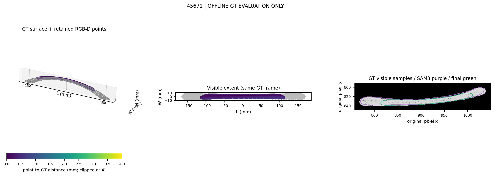
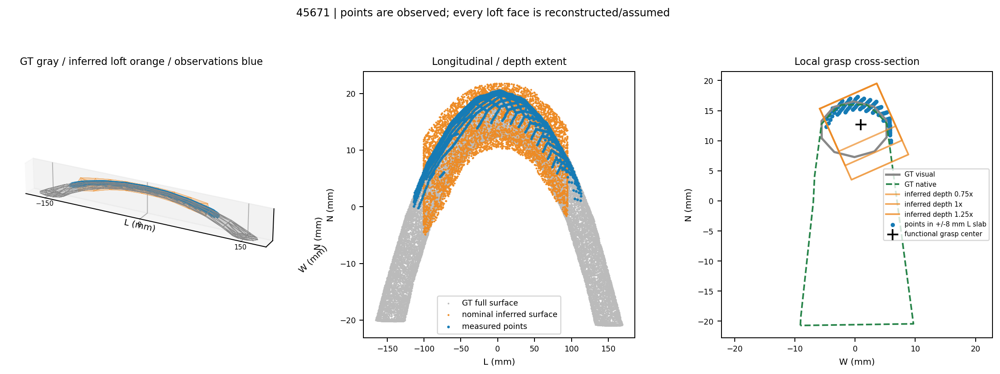
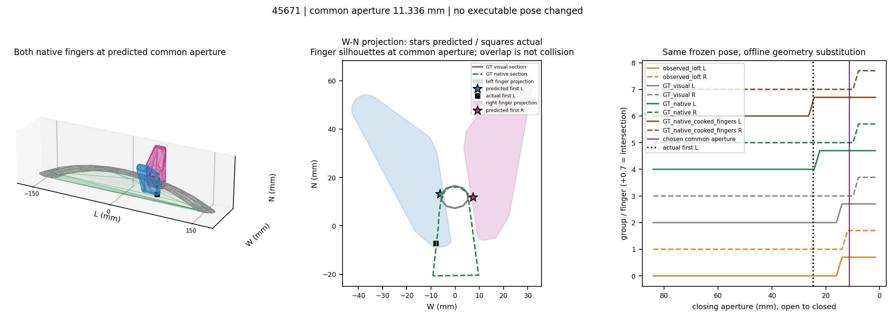
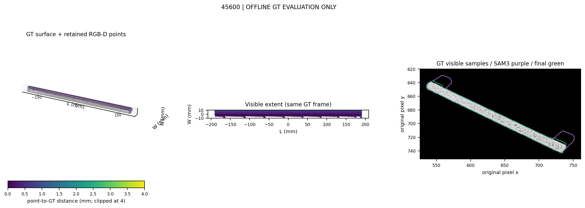
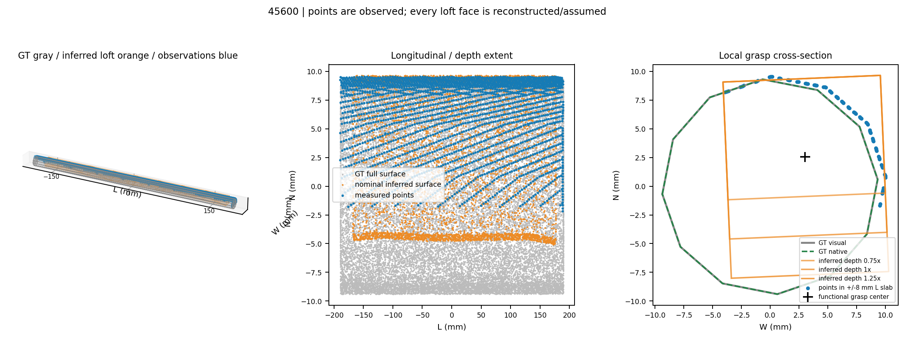
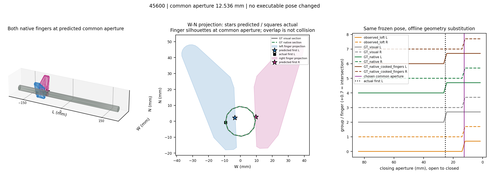
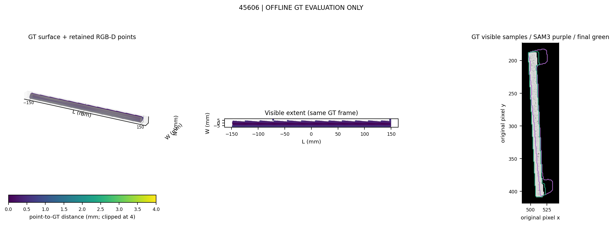
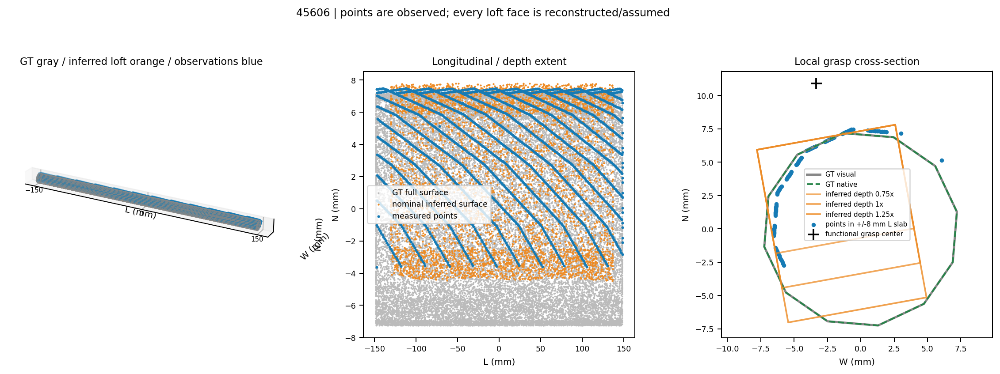
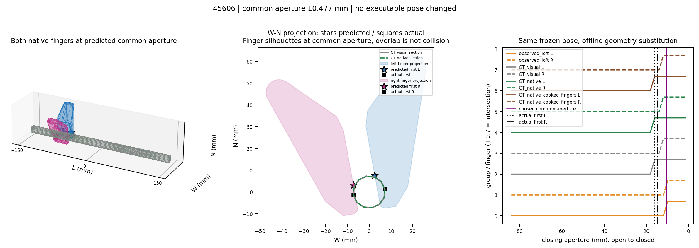

# GT handle versus saved RGB-D: offline geometry diagnosis

**Reference: `ba8d9c1`. OFFLINE_GT_DIAGNOSTIC / xArm7 + native G1 / known-model simulation.**
No Isaac scene or physical episode was launched. No executable grasp, controller, scoring weight, completion prior, collider or safety limit was changed. This report evaluates the already recorded 2026-10-15 visual episodes; it does not replace their results.

**Finding:** the retained visible points are close to the rendered handle, but the surfaces supplied to contact prediction are not necessarily close to the real contact geometry. **C (completion/contact-envelope mismatch)** is best supported for 45600. **45671 is mixed:** B-type visible-region loss in postprocessing, completion mismatch, and a separate rendered-mesh/native-collider discrepancy. 45606 succeeds despite residual completion error. These data do not establish a global calibration defect or an independent FCL implementation defect.

## Visible point geometry

Unsigned point-to-triangle distance to the **GT visual handle surface**, using saved world-frame depth points without registration to GT. Units: mm. These are one-way surface distances, not correspondence errors or evidence that unobserved surfaces were measured.

| Case | Retained points | Mean | Median | P90 | P95 | Retained PCA axis error | Executed estimated axis error |
|---|---:|---:|---:|---:|---:|---:|---:|
| 45671 | 1881 | 0.268 | 0.257 | 0.535 | 0.556 | 0.783° | 0.460° |
| 45600 | 2514 | 0.496 | 0.601 | 0.715 | 0.733 | 0.067° | 0.024° |
| 45606 | 2344 | 0.371 | 0.363 | 0.649 | 0.709 | 0.042° | 0.010° |

Low retained-point error must not hide initial segmentation contamination. The raw SAM3 mask includes panel/background points; depth processing removes most of them. In 45671 it also removes genuine visible handle extent.

| Case | Raw-mask P95 | Final depth-mask P95, before estimator trimming | GT-visible samples covered: raw SAM → final mask |
|---|---:|---:|---:|
| 45671 | 25.214 | 0.561 | 88.7% → 58.3% |
| 45600 | 29.652 | 0.765 | 99.0% → 100.0% |
| 45606 | 34.824 | 0.921 | 62.8% → 100.0% |

All extents below use a **common GT L/W frame**: L is the full handle's surface-PCA axis; W is the transverse panel direction. “GT visible” means samples consistent with saved depth within 2 mm, not the entire occluded handle. Full extents and 5–95% extents are both given so estimator trimming is not confused with sensing accuracy.

| Case | GT full L × W | GT depth-visible L × W | Retained observed full L × W | Retained 5–95% L × W |
|---|---:|---:|---:|---:|
| 45671 | 334.69 × 19.69 | 334.24 × 19.67 | 227.04 × 12.98 | 194.94 × 10.05 |
| 45600 | 378.13 × 18.78 | 378.13 × 18.69 | 378.02 × 18.01 | 344.24 × 13.15 |
| 45606 | 295.93 × 14.50 | 295.93 × 14.29 | 295.78 × 13.24 | 267.28 × 8.39 |

45671 has a 334.24 mm depth-visible GT span. Raw-mask points span 325.63 mm, the final depth mask 240.06 mm, retained points 227.04 mm, and their robust span 194.94 mm. This is visible-region loss in segmentation/depth-layer processing and trimming, not proof of occlusion or sensor noise. In the selected observation, 1/2/4 mm visibility tolerances give final-mask coverage **60.3/58.3/57.5%**, versus raw-mask **92.2/88.7/86.0%**. The coverage loss is not specific to the 2 mm choice.

45600 and 45606 retain the depth-visible length and reach 100% final-mask coverage of depth-consistent GT samples at all three tolerances. The observation-derived crop contains 100% of depth-visible GT samples when used on 45600 and the failed first view of 45671. Thus ROI truncation is not supported as their detection-recovery cause. 45671 still required the archived alternate view; no new SAM3 inference was run here.

## Inferred surfaces are not observed points

The frozen model uses eight loft pieces and backside-depth hypotheses of 0.75/1/1.25 times observed local width. **Every loft face is reconstructed or assumed**, including front interpolation. The plots use blue for actual retained points, orange for inferred surfaces, gray for GT visual geometry, and green for the saved native collision proxy.

For the nominal 1× loft, area-uniform external-surface samples are separated using saved camera depth. “Observed-supported” requires depth consistency within 2 mm and a retained point within 2 mm. “Occluded inferred” is behind saved depth by >2 mm. Neither category turns inferred faces into sensor measurements. Internal joining caps are omitted from these statistics only; execution geometry is unchanged.

| Case | Observed-supported loft Mean / P95 | Occluded inferred Mean / Median / P90 / P95 | In-front-of-depth inferred P95 | Occluded P95 across 0.75/1/1.25× |
|---|---:|---:|---:|---:|
| 45671 | 0.91 / 1.82 | 1.02 / 0.92 / 1.73 / 2.13 | 4.15 | 3.60 / 2.13 / 3.74 |
| 45600 | 0.89 / 2.04 | 3.58 / 3.96 / 5.10 / 5.24 | 4.32 | 7.88 / 5.24 / 5.24 |
| 45606 | 0.50 / 1.27 | 2.80 / 2.96 / 3.79 / 3.91 | 2.62 | 6.42 / 3.91 / 3.32 |

45600 illustrates the distinction: submillimeter measured surface error coexists with a rectangular inferred cross-section that cuts across the rounded GT handle. Hidden depth and side-envelope interpolation both matter; changing depth alone does not repair the whole cross-section. These hidden-region mismatches are **completion errors, not RGB-D sensor errors**.

## Closing/contact predictions at the frozen selected grasp

The selected pose is the recorded **visual** pregrasp-corrected TCP transform. No GT pose correction or alternative candidate is generated. The diagnostic repeats the frozen 41-aperture FCL intersection sweep at that fixed transform (84.0 → 1.641 mm; **2.059 mm grid spacing**), substituting only the evaluated handle surface. The observed-loft first intersections reproduce the saved first-contact predictions for both fingers in all three cases.

| Case | Stored visual first L / R | Offline GT visual L / R | Offline GT native + actual cooked fingers L / R | Archived measured first L / R | Chosen predicted common aperture |
|---|---:|---:|---:|---:|---:|
| 45671 | 13.99 / 11.94 | 13.99 / 7.82 | 24.29 / 7.82 | 24.66 / — | 11.34 |
| 45600 | 11.94 / 11.94 | 24.29 / 11.94 | 24.29 / 11.94 | 25.30 / — | 12.54 |
| 45606 | 9.88 / 9.88 | 16.05 / 11.94 | 16.05 / 11.94 | 16.18 / 14.71 | 10.48 |

“—” means no positive allowed normal contact was recorded on that side, not a missing aperture estimate. L/R are the native left/right fingers. First positive reactions can be very small/transient; they are **whole-finger task-region aggregates**, not measured fingertip pressure areas or proof of stable pad holding. Archived first-contact times: 45671 L **145.050 s**; 45600 L **138.604 s**; 45606 L/R **131.921/139.200 s**. The latter right contact occurs during original CENTER motion.

At the same visual pose, substituting GT contact geometry predicts first left contact within **0.37/1.01/0.12 mm** of the measured aperture for 45671/45600/45606—within the 2.059 mm sweep spacing. This supports a contact-surface mismatch. It does not demonstrate that the GT-substituted grasp would be acquired, and it is not a new executable GT fallback.

Actual physics includes continuous aperture motion, native contact offsets, compliance and the original TCP-centering motion. The fixed-T scan excludes those effects. Consequently, the right-contact discrepancy on successful 45606 cannot by itself establish a coordinate error. Its closure-relative TCP change was 0.85 mm; the failed 45671 closure moved 2.86 mm. These are recorded controller motions, not registration corrections.

### Actual first-contact location on the finger

Archived native finger poses locate the first points on the inner-pad plane (within 0.002 mm in the pre-integration frame). 45671's left first point is only **0.013 mm from the longitudinal pad end**, whereas its saved predicted point was at local y=39.35 mm, about 20.40 mm from that end. The actual first point is y=59.74 mm. This supports a different contact location, not merely a different force reading.

| Case / side | Actual lateral edge margin | Actual longitudinal edge margin |
|---|---:|---:|
| 45671 L | 2.992 mm | 0.013 mm |
| 45600 L | 0.572 mm | 15.419 mm |
| 45606 L / R | 0.573 / 0.573 mm | 7.054 / 7.295 mm |

The successful 45606 also begins near a lateral edge. A small edge distance alone is therefore not a sufficient failure explanation or a new exclusion rule. These are individual contact-point locations, not contact areas or pressure distributions. Finger poses precede the associated physics integration by one native step; that timing limitation is retained in the metrics.

### Separate native-collider discrepancy on 45671

| Case | GT visual → native surface Mean / P95 | Native → GT visual Mean / P95 |
|---|---:|---:|
| 45671 | 1.164 / 5.339 | 10.564 / 31.541 |
| 45600 | 0.000 / 0.000 | 0.000 / 0.000 |
| 45606 | 0.000 / 0.000 | 0.000 / 0.000 |

45671's saved convex collision proxy bridges the curved handle/support region and fills space absent from its visual mesh. At the grasp section it extends behind the visible bar. A rendered-surface match therefore cannot describe this physical collider. Planner-finger + native-handle first left intersection is 22.23 mm; using the actual saved cooked finger changes it to **24.29 mm**, close to measured **24.66 mm**. The actual first contact names handle collider `original35` and the whole left finger. This representation confound is separate from visual completion and must not be hidden in a “sensor error” total.

For 45600 (`original25`) and 45606 (`original24`), visual/native handle surfaces coincide to <0.0001 mm at sampled points. The official planner finger versus cooked finger surface differences have P95 **0.697 mm** in all cases, with cooked vertices lying on the planner hull to numerical precision. This is a small hull simplification, not evidence of a gross flange/frame/sign error; first-contact aperture can still shift one sweep bin on 45671.

### Grasp center relative to GT centerline (descriptive only)

Center = midpoint of the two inner pad-patch centroids at the chosen common aperture, **not the TCP origin**. Local GT centerline = midpoint of the transverse GT section envelope at that longitudinal station. It is an envelope estimate, not a skeleton or one saved Oracle grasp. Global full-handle PCA-line distance is listed separately because it is misleading for curved handles.

| Case | Local W / N offset | Local offset norm | Global PCA-line offset |
|---|---:|---:|---:|
| 45671 | +1.14 / +0.76 | 1.37 | 12.70 |
| 45600 | +3.04 / +2.60 | 4.00 | 3.97 |
| 45606 | -3.32 / +10.95 | 11.44 | 11.41 |

The successful case has the largest local offset because finite pad length, orientation and insertion matter. These quantities do not justify a center-alignment veto or establish a grasp error by themselves.

## Case visualizations and interpretation

In each grasp figure, both full native fingers are displayed at the predicted **same common aperture**. Stars mark the saved visual first-contact predictions at their respective first-contact apertures; black squares mark archived actual first-contact points. They are not simultaneous contacts. The middle panel is a W–N **projection** with a GT cross-section, so silhouette overlap is not a collision claim. The right panel is the fixed-pose intersection sweep; brown uses actual cooked fingers. Geometry axes are mm. Observed-point color is surface distance (display clipped at 4 mm; statistics un-clipped).

### 45671

**Mixed B/C plus native contact-representation mismatch.** Retained visible points are accurate, but the depth-layer/postprocessing removes visible ends and changes the candidate geometry. The nominal loft also approximates the curved cross-section. Most decisively, the native handle proxy has a large invisible fill-in; the offline actual-collider/finger sweep explains the very early left contact. Archived outcome remains no bilateral acquisition; the previous visual success and this regression are not overwritten.







[Full image-coordinate detection/crop context](figures/45671_segmentation.png).

### 45600

**C is best supported.** Recovery crop covers the handle, the final cloud covers the depth-visible span, axis error is small, and visual/native GT surfaces agree. The inferred cross-section predicts symmetric late contacts, whereas both GT surfaces predict an early left contact close to physics. The provided contact envelope is wrong despite good visible points; an independent FCL/contact-prediction coding defect is not established. The data do not isolate a single incorrect thickness scalar.







[Full image-coordinate detection/crop context](figures/45600_segmentation.png).

### 45606

**Successful control with residual C-type model error.** Postprocessing recovers a visible handle missed in part by the raw mask. Inferred surfaces still differ from GT and underpredict first contact, but original closure establishes holding and achieves **+3.005721° after acquisition**. This prevents treating nominal model mismatch, single-pad unloading or a larger center offset as sufficient explanations for failure.







[Full image-coordinate detection/crop context](figures/45606_segmentation.png).

## Limits, provenance and reproduction

This is an offline diagnosis of three paired development cases. One-way point-to-surface error can miss sliding along a long homogeneous handle. Visibility is an approximate saved-depth test with rounded-pixel projection, not GT instance-mask IoU; image edges and rasterization are confounds. GT surface PCA and section-envelope centers are shape-dependent. Surface statistics are not pressure areas or complete contact wrenches. No new success probability, admission threshold or physical result is claimed.

The next input issue suggested by the evidence is preserving visible handle extent while representing uncertainty in the **actual contact envelope**, with the native-collider discrepancy kept separate. This round implements none of those changes and launches no experiment.

- [All scalar metrics and input hashes](METRICS.json). Includes separate raw/seed/final/retained clouds, all three completion hypotheses, visibility sensitivity and both offline finger geometries.
- [Source, asset and input provenance](PROVENANCE.json). All 33 recorded observation/plan/export hashes match; all 11 frozen execution/input modules match their recorded bytes. Previous owned actor/launcher PIDs are absent. No new actor was started.
- [Read-only evaluator](../../../scripts/visualize_native_g1_gt_observed.py). No SimulationApp, planning call, GT correction or controller modification.
- [Preserved physical results](../native_g1_visual_reliability_20261015/REPORT.md). Original ten-door 4/10 and prior Oracle/visual results are unchanged.

Private source: `/data1/home/rangeryx/fr3_real2sim_known_whole_20261007/results/native_g1_visual_reliability_20261015/{45671,45600,45606}/physical_01/`. Saved RGB/depth/K/extrinsics, SAM3 seed/final masks, observed points/loft, visual plan/correction, cooked scene export and complete 240 Hz chunks remain private. No raw archive, video, RGB/depth array or mesh file is published. Only derived figures, compact statistics, hashes and evaluator source are included.

Private archive SHA-256: `50174cab70134033449e40498af25d480a452bf777fcd0dba3a721ef2bf5b1f8`.

Run in the pinned environment (Python/library versions in PROVENANCE.json):

```sh
PYTHONPATH="$PWD/scripts:$PWD" OMP_NUM_THREADS=1 PYTHONNOUSERSITE=1 \
  /data1/home/rangeryx/isaaclab-arena/.venv/bin/python \
  scripts/visualize_native_g1_gt_observed.py \
  --root results/native_g1_visual_reliability_20261015 \
  --output results/native_g1_gt_observed_diagnostic_20261015
```

Fixed evaluation sampling seed: 61; GT surface 30,000 samples; each external loft 8,000 samples. The evaluator never writes to the source results. Figures were visually checked. **Stopped after offline analysis.**
