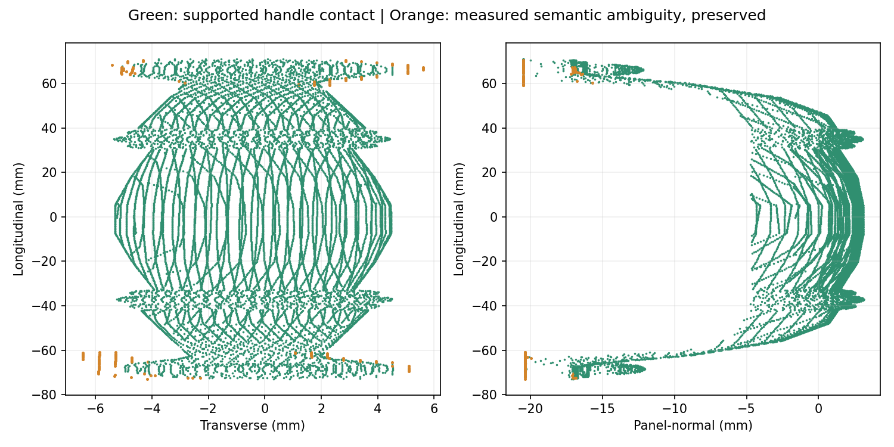

# 腕部增量重建验证：离线几何得到支持，实时激活未完成

参考 `db7ccaa`；成功物理基线 `a47fe09` 保持不变。**本轮完成三例离线对照与共享边界不确定性处理；唯一一次实时 episode 在新视角移动前发生回调绑定错误，未得到新视角增量或最终自动抓取计划。场景已正常导出退出，未重试。**

## 46427：八个点的实际来源

逐像素回查确认，八个 >3 mm 点均来自 `agent_01` 的 `(x=650..652,y=573..576)` 端部区域：只有一个像素在原始 SAM3 seed 内，八个都不在 trusted-body 中，全部已存在于独立 `preserve()` 结果。因此，上轮提到的 trusted-body 旁路不是这八个点的直接来源；实际链路是 **SAM 边界/两像素邻域 → 局部端部扩展 → 相连度量表面 → 累计关联保留**。七个点没有直接的累计投影锚点，但与有锚点的表面相连。

这些点位于支座旁的柜门边框表面，不应把真实弯曲支座整体删除。第一视图投影到 SAM 把手内，但深度差约 10–12 mm，实际被前方把手遮挡，不能当作同一表面的支持；另一视图深度差仅约 0.08–0.18 mm，却在 SAM 轮廓之外，提供了可用的语义反证。局部连续性可以沿支座接触处走到门框，单靠连通不能决定零件归属。八点涉及 14 个实测三角形。

像素坐标、各阶段布尔标记及离线 GT 误差见 [PIXEL_DIAGNOSIS.json](PIXEL_DIAGNOSIS.json)。实际 RGB/深度裁剪保持私有，GT 只用于独立诊断。

## 最小共享处理：保留测量，区分接触支持与归属不确定

新增 `native_g1_incremental_semantics.py`，不改 SAM3、排序权重、候选族、控制器或物理参数。原 trusted-body 保持；对端部/轮廓扩展，使用本视图 SAM 与其他视图的深度一致语义证据。沿用现有 5 mm 深度一致性和两像素轮廓邻域，遮挡、出画或未重叠都不作为反证。

对保留的测量点，接触支持为 `trusted_body OR ((own_SAM OR other_SAM_support) AND NOT other_visible_negative)`。所有实测点和开放三角片仍存入上下文层；归属不确定的边界单独保存，不作为已确认把手接触面，也不宣称是空闲空间。未观测背面仍为原来的显式假设。没有 GT 距离滤波、资产 ID 分支或零离群点执行要求。

46427 的完整 8,245 个融合点及全部 26,728 个实测三角形不变；138 个原始视图样本、涉及 226 个三角形（0.85%）标为归属不确定。其中包含真实支座边界，不全部等同于错误点；它们仍保留在上下文。2,118 个端部扩展样本中，1,980 个仍有接触语义支持。八个诊断点未进入已确认接触层，**这不是删除测量或以 GT“清零”作为通过条件**。

## 三例归档对照

A=`a47fe09` 首帧种子融合；B=`db7ccaa` 增量融合；C=本轮语义不确定性分层。使用完全相同的归档图像、相机位姿、自遮挡排除与注册站位。没有重跑/修改归档 SAM3。

| 对象 | 保留长度 A/B/C (mm) | 融合点数 A/B/C | 可见注册表面覆盖 A/B/C | C 不确定原始样本 | B→C 最终候选位移 |
|---|---:|---:|---:|---:|---:|
| 45936 | 105.15/295.90/295.90 | 8061/23304/23304 | 34.49%/95.20%/95.20% | 0 | 0.000 mm |
| 46427 | 144.00/143.96/143.96 | 8031/8245/8245 | 100.00%/100.00%/100.00% | 138 | 0.000 mm |
| 45600 | 378.12/378.12/378.12 | 26545/30771/30771 | 90.61%/99.91%/99.91% | 0 | 0.000 mm |

三例 B→C 的完整测量点云和全部上下文三角片均逐字节相同，没有丢弃新增区域。各视图新增体素、累计体素和语义状态见 [贡献表](PER_VIEW_CONTRIBUTIONS.csv)。原始输入哈希不变。覆盖率为独立 GT 可见表面上的 2 mm 诊断统计，非执行门槛；体素数不是表面积。

| 对象 | 冻结抓姿：左右首次接触预测 B→C (mm) | 排名分数 A/B/C | 已选候选的 GT 几何接触支持 A/B/C |
|---|---:|---:|---:|
| 45936 | 13.826/14.863，均不变 | 0.07657/0.06820/0.06820 | 0.04965/0.04935/0.04935 |
| 46427 | 9.764/9.813，均不变 | 0.00822/0.00819/0.00819 | 0.01179/0.01178/0.01178 |
| 45600 | 19.713/17.574，均不变 | 0.06156/0.06858/0.06858 | 0.03301/0.04431/0.04431 |

三例冻结抓姿下，开放实测面及三种原背面假设的接触预测均与 B 一致。45936、45600 的评分几何逐字节不变，复用原 B 离线计划并保存哈希证明；46427 使用同一预算重新规划（95.72 s），仍选同一抓姿、同一分数。没有扩大搜索或用 GT 选姿。这些支持值是几何近似，不是压力面积、完整接触力或硬件成功概率。

45600 的约 113.44 mm A→B 候选迁移保留；独立 GT 静态支持指标有所上升，但没有本轮新物理抓取证据。45936 的约 6.61 mm 迁移也保留，其 GT 支持反而略降；左指冻结姿态的观测接触预测仍比 GT 原生碰撞预测低约 1.08 mm。不能用更多点云或更高某项分数推断更稳的抓取。C 解决的是不确定表面的语义地位，没有证明所有接触预测更准确。

已确认接触样本中的 >3 mm GT 尾部为 0，但完整测量层仍保留 46427 的八个诊断点；未要求“零离群点”才允许执行。原生碰撞检查依旧使用既有场景模型，分层不删除真实障碍。全部数值见 [RESULTS.json](RESULTS.json) 与 [离线实质影响核对](OFFLINE_MATERIALITY.json)。

## 唯一一次实时验证：观察成功，动作适配失败

从正常闭门状态启动一个新 Isaac 场景。加载的 23 个冻结源码/配置哈希全部匹配。xArm7 通过原执行器完成初始观察路线，得到新 RGB-D；Codex 实际查看了 RGB、SAM3、深度、局部点云及语义表面图。SAM3 分数 0.472656，无检测恢复。

图像显示下半段把手，上段被夹爪遮挡。尽管掩码未碰图像边界，Codex 没有把它视为完整把手；请求抬高、侧移并重新居中的新观察位：eye `[0.40,-0.94,0.40]`，look `[0.314,-0.335,0.51]` m，来自本次可见点云与图像判断，未读取归档成功视角。原 IK/碰撞验证返回可执行直达路线。

调用 `move_and_observe` 后，在 `actuate` 调用前报 `NameError`：新适配器复制函数时用了模块字典，漏掉旧回调原本绑定的 observation 全局命名空间。没有发送新移动目标；原异常处理暂停并保留场景。随后通过 `finish` 正常导出退出，退出码 0。原 owner 的结束 sentinel 不是真正首个故障；首个故障是回调绑定错误。

| 实时项目 | 实际结果 |
|---|---|
| 新场景 / 实际初始观察路线 | 1 / 1 |
| 新 RGB-D 观察 | 1 |
| Agent 选定移动尝试 / 真正执行 | 1 / 0 |
| 首帧保留几何 | 3,785 点，约 92.75 mm |
| 首帧后的新增表面 | 0（动作未执行） |
| 本次最终自动抓取计划 | 未生成 |
| 抓取 / 开门 / 重启 / 重试 | 全部 0 |
| 仿真时间 / actor 墙时 | 40.546 s / 533.815 s |
| 初始移动 / 感知与 SAM / Agent 等待墙时 | 195.91 / 39.71 / 235.56 s |
| 物理步 / 机器人观测 | 9,731 / 9,731，240 Hz，完整分块导出 |
| 连续仿真视频 | H.264，1280×960，30 fps，1,216 帧，40.533 s |
| 最小关节余量 / 最大指垫载荷 | 1.19198 rad / 0 N；未接触把手 |

结束后才读取实时 GT：首帧注册杆点面均值约 0.182 mm，可见区域覆盖约 99.43%，但整个注册杆表面覆盖仅 17.35%。这说明局部观测准确，不能证明完整把手已恢复。相机 FK 平移差约 0.001315 mm、旋转差约 0.000147°，只说明此模拟挂载的一致性。

真实动作/图像检查来源及错误见 [AGENT_TRACE.json](AGENT_TRACE.json)。完整 RGB-D、视频和 240 Hz 数据保持私有。此次未达到“新观察更新几何并产出计划”的实时成功条件。

## 关闭后修复、来源与边界

actor 退出后，仅将回调绑定改为保留 `previous.move_and_observe.__globals__`，并替换其中的 `observe`。机器人之外的功能检查确认顺序为 `play → actuate → observe → pause`、计数正确。**这是离线接口检查，不是新的 Isaac 验证；本轮没有追加 episode，也没有将修复版标为已成功激活。**

保留 [运行时冻结清单](FROZEN.json) 与 actor 原始源码快照，另存 [修复后源码哈希](FINAL_SOURCE_HASHES.json) 和 [离线回调检查](CALLBACK_OFFLINE_VERIFICATION.json)，不把失败运行的哈希替换成修复后的版本。原 `a47fe09/db7ccaa` 文件、SAM3 阈值、相机挂载、native G1 评分/控制、Pink、物理和安全参数均未改。

仍依赖注册站位、粗柜体包围盒初始化、已知铰链/动态状态、原碰撞模型、模拟腕部标定与近似执行器；不是未知结构自主操作或硬件验证。使用可用共享 GPU，无排他等待、无干预他人进程。

下一步最小验证应是对修复后的同一回调做一次观察闭环检查，不需要继续调整几何或操作控制器。本轮按约束在一次验证后停止。来源：[证据索引](EVIDENCE_INDEX.json)、[实际加载核对](ACTIVE_SOURCE_CHECK.json)、[进程清理](OWNED_PROCESS_CLEANUP.json)。
