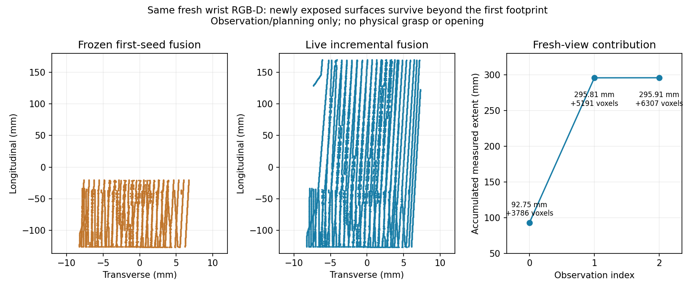
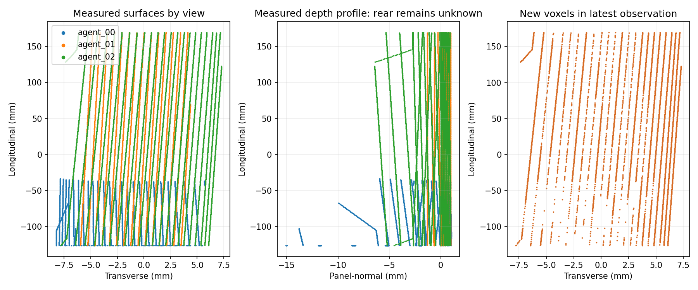
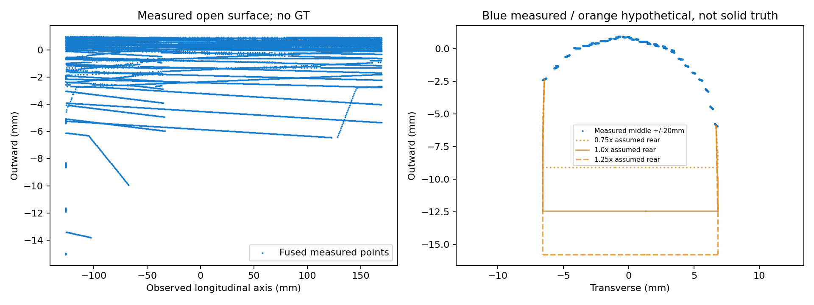

# 45936 增量腕部感知：实时激活完成

**结果：本轮 observation/planning-only PASS。** 一个全新正常闭门 Isaac 场景中，Codex 检查新图像后选择并执行了两次真实腕部观察运动；三帧独立 RGB-D 的新表面进入累计重建，随后生成自动 native-G1 抓取/IK 计划。**未执行抓取、保持或开门，不是物理操作成功。**

Reference `276dda4`；冻结物理基线 `a47fe09`。标签：**CODEX_IN_LOOP / SIMULATED_WRIST_RGBD / KNOWN_HINGE_STATE_COLLISIONS / APPROXIMATE_ACTUATOR_SIMULATION**。

## 1. 修复与实际加载核对

上一轮在新视角运动前失败，原因是克隆 `move_and_observe` 时使用了适配器模块的 globals，丢失原函数依赖 `actuate`。本轮直接使用 `276dda4` 已修复版本：保留原函数 `__globals__`，只替换增量 `observe`。没有再改感知算法或运动控制。

- `verify_incremental_callbacks.py` 通过，合成调用顺序为 play → actuate → observe → pause；这是离线接口验证。
- 生成入口编译通过，检查了 prepare 实际使用的原始运动命名空间及修复后的 observe/build/move 绑定。仅暴露 observe、inspect、evaluate_view、move_and_observe、build_geometry、finish；没有 execute/grasp 操作。finish 保持原有观察完成 sentinel，触发导出及退出。
- **实际 actor 的全部 24 项源码/配置快照匹配本轮冻结哈希。** 修复回调 SHA256：`ce16a2b51e7d8dea18cd16812de008a67b0513f39e248c3f2140e9c1495f67b8`；生成入口 SHA256：`4f3cb1bbf2f85953bfbd065e90cc04666065785acafddb8433d859088c57a7ce`。
- 本轮唯一运行代码修改是 launcher 增加 `--base`、`--frozen` 参数，用独立目录启动；旧失败记录与旧 FROZEN 文件均未覆盖。回调、SAM3、候选评分、控制器、相机安装、碰撞及物理参数保持冻结。
- 初次 wrapper-aware 预检脚本曾检查错命名空间（install_camera 不在外层 wrapper globals）；检查方式修正后通过，无 Isaac 运行受到影响。

详见 [FROZEN.json](FROZEN.json)、[CALLBACK_VERIFICATION.json](CALLBACK_VERIFICATION.json)、[INTERFACE_PREFLIGHT.json](INTERFACE_PREFLIGHT.json)、[LOADED_SOURCE_VERIFICATION.json](LOADED_SOURCE_VERIFICATION.json)、[FINAL_SOURCE_VERIFICATION.json](FINAL_SOURCE_VERIFICATION.json)。

## 2. 实际 Agent 观察与动作

使用当前新图像、SAM3、深度、局部点云及语义分区板做决定；图像 SHA 与理由记录在 [AGENT_TRACE.json](AGENT_TRACE.json)。没有在线加载 GT 把手、历史抓姿或复放历史成功相机路径。

| 观测 | 实际看到的问题/信息 | Agent 决策及实际结果 |
|---|---|---|
| 00，初始位 | 掩码 score 0.5703、未触边，但夹爪遮住把手上段，只观察到下方短段 | 向当前观测把手横向对齐并抬高视角；原 IK/碰撞检查通过，实际执行器运动到位 |
| 01，第一次调整 | score 0.8594；上下端均进入画面，新增上段已出现在累计点云 | 再请求左侧斜视，补充上段侧面；原检查通过，实际运动采集 |
| 02，第二次调整 | score 0.8594；侧面与安装端得到更多实测支持，完整纵向范围仍保留 | 已有足够本轮信息，提前结束观察；运行原自动抓取/IK 规划 |

实际相机位置分别约为 `(0.50195,-0.89437,0.26417)`、`(0.31082,-0.96031,0.46949)`、`(0.17025,-0.91041,0.52025)` m。这些是本轮运动后的测量值，不是复用的预设成功坐标。后两次路由的最小规划关节余量为 0.7011、0.4909 rad。三帧相机位姿均随 link7 运动，底盘不动。FK 相机位姿与渲染测量的最大平移差约 1.315 µm、旋转差 0.000158°；这验证本仿真坐标链一致性，不是硬件标定精度。详见 [CAMERA_CONSISTENCY.json](CAMERA_CONSISTENCY.json)。

## 3. 新表面确实进入累计几何

| 观测 | 该帧保留点数 | 该帧长度 mm | 累计长度 mm | 新增体素 | 累计体素 |
|---|---:|---:|---:|---:|---:|
| 00 | 3,786 | 92.750 | 92.750 | 3,786 | 3,786 |
| 01 | 6,364 | 295.748 | 295.811 | 5,191 | 8,977 |
| 02 | 10,109 | 295.797 | 295.910 | 6,307 | 15,284 |

体素边长 0.5 mm；体素/点数不是压力面积或唯一物理表面积。逐视图点、三角面来源、像素语义来源、新增区域均保存。上段大面积新增点来自 01/02，未被首帧投影范围裁掉。本例三帧都落在原 trusted-body 支持内，语义扩展歧义点为 0；这不是零误差证明或新增通过门槛。未知背面仍单独保留 0.75/1/1.25 倍原宽度假设，不标为实测或确定实体。

## 4. 自动计划与接触预测

原评分/候选族自动选出 `section_fraction=-0.3, insertion=0, roll=0, pitch=0` 的候选；稳健分数 0.07019，名义共同孔径 14.295 mm。接近/开门路径规划覆盖 30°，最低规划余量 0.4206 rad。**这里只生成路径，没有执行返回 home、接近、闭合或开门；不可将规划覆盖称为实际开门。**

相对冻结归档 45936 计划，所选 TCP 平移差 6.613 mm、旋转差 0.031°，section 从 0 变为 −0.3。抓姿仍位于较低、首帧已可见的区域；长度覆盖改善不等于抓取质量已改善。

| 所选固定抓姿的接触诊断 | 左首次孔径 mm | 右首次孔径 mm |
|---|---:|---:|
| 在线原离散扫掠预测 | 13.995 | 13.995 |
| 退出后细化，仅实测表面 | 14.180 | 14.518 |
| 实测 + 原背面假设 | 14.204 | 14.888 |
| GT visual/cooked，仅独立离线评价 | 15.233 | 14.325 |

细化只是离线数值诊断，没有改评分、抓姿或执行孔径。左侧约 1.05 mm 预测差异、背面不确定性和实际接触稳定性仍未物理验证。没有实测首次接触值，因为本轮不闭合夹爪。

## 5. 同一批新图的独立旧新对照

以下 GT 评价在 actor 退出后运行，未进入在线决策、重建、排名或姿态修正。覆盖率使用固定 30k 面积采样与 2 mm 诊断距离，不是执行门槛。

| 方法 | 保留点数 | 沿 GT 轴长度 mm | 可见面覆盖 | 全 GT 面覆盖 | 点面误差均值/P95 mm |
|---|---:|---:|---:|---:|---:|
| 冻结 first-seed，重放同一批新 RGB-D | 6,463 | 105.840 | 38.67% | 22.67% | 0.180 / 0.331 |
| 本轮实时增量融合 | 15,284 | 295.891 | 94.54% | 52.36% | 0.158 / 0.285 |

这复现了旧算法约 105 mm 的信息损失，并验证新实时观测将约 296 mm 可见纵向表面保留下来。全表面覆盖仅约 52%，隐藏区域并未神奇恢复。两种几何在相同所选抓姿的左接触细化预测相同，右侧从 14.791 变为 14.518 mm；不能仅凭覆盖增加声称接触更可靠。

## 6. 时间、证据与清理

- 1 个新鲜闭门场景，0 次重试；3 次观察、2/4 次 Agent 调整、3 条实际机器人路线。0 次抓取、0 次闭合控制调用、0 次开门。
- 仿真运动时长 **70.433 s**；actor 墙钟 **953.271 s（15分53秒）**，owner 统计 950.547 s。
- 实际运动墙钟 333.821 s；采集/SAM3 89.635 s；图像板 8.186 s；Agent 等待（含传输/检查/推理）250.921 s；最终几何 3.344 s；规划 200.516 s。分类不完全互斥，不能直接相加为总时长。
- 全程最低测量关节余量 0.4929 rad；pad load 峰值 0 N，门角仅数值零。没有用缺少接触来声称物理抓取验证。
- **16,904 条 physics + 16,904 条 observation**，各 17 个 lossless gzip 分块；时间连续、无记录缺口，原生 dt≈1/240 s。
- 连续 H.264 视频 1280×960、30fps、2,113 帧、70.433 s，全片解码通过。暂停中的推理/规划墙钟不算入运动视频时长。
- actor PID 3752999 合作退出，returncode 0；已确认无该 actor 或遗留录像子进程。
- 外层复用的旧 SHORT_FORCE_TRANSMISSION report 将预期观察完成 sentinel 记为 success=false；这是旧报表分类，**不是本轮观察失败或物理抓取失败**。本轮结果由 Agent trace、动作记录和 observation-only 结果共同证明，原 report 原样保留。

私有归档 SHA256：`8703fad561e58ee7d2753575800ef761622d407337c7132461fee76df3002b69`，约 55.56 MB，本地/远端一致；329 个文件逐项 SHA 校验通过。原始 RGB-D、SAM3 掩码、完整视频、240 Hz 遥测及源码快照保持私有，路径/校验见 [EVIDENCE_INDEX.json](EVIDENCE_INDEX.json)、[EVIDENCE_INTEGRITY.json](EVIDENCE_INTEGRITY.json)。公开内容仅包含源码、数字摘要、决策图像哈希和派生几何图。

## 7. 结论与边界

修复后的接口已完成真实腕部观察运动，新表面持续更新几何理解并生成自动计划。仍依赖注册站位、已知 hinge/dynamic state、现有场景碰撞模型、仿真腕部安装及近似执行器。没有验证硬件、未知轴操作、返回抓取路径的物理执行或新抓姿的物理接触。本轮按要求在观察与规划验证后停止。
