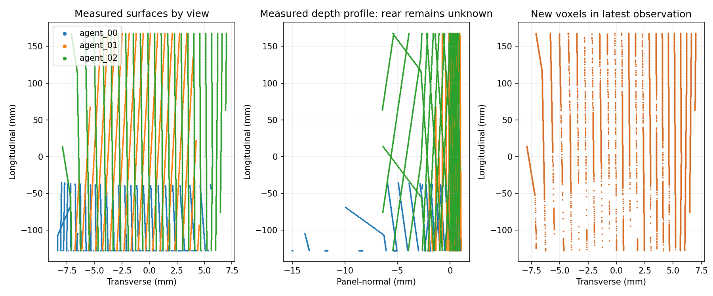
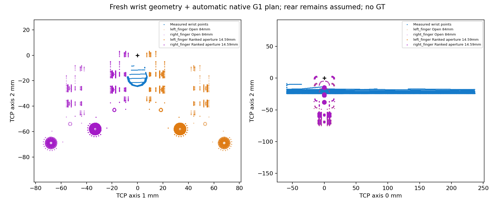
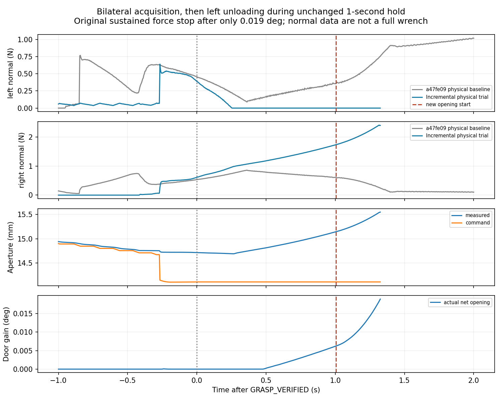

# 增量 Agent 腕部 Skill：45936 单次物理验证

**结果：未达到 ≥2° 短开门标准。** 本次完整接通了新鲜腕部观察 → 增量建图 → 自动选姿 → 物理交接，并真实建立双指抓取；原 1 秒保持期间左指卸载，右指载荷上升。开门探测开始后，原 temporal force policy 触发持续过载停止。净开门仅 **+0.018916°**。没有重试、改姿、加力、松开或再抓。

Reference `3da07ab`；冻结物理对照 `a47fe09`。标签：**CODEX_IN_LOOP / INCREMENTAL_WRIST_RGBD / KNOWN_HINGE_STATE_COLLISIONS / APPROXIMATE_ACTUATOR_SIMULATION**。这是一个开发案例的失败结果，不改变旧基准分数。

## 集成与来源核验

新增的[薄适配器](../../../scripts/native_g1_agent_incremental_physical.py)与[显式执行入口](../../../scripts/run_native_g1_incremental_physical.py)将 `native_g1_agent_incremental_activation` 的 observe/build/move 回调绑定到原 `native_g1_agent_execution.prepare`。返回路径、实测状态接近、腕部预抓取细化、JawCenteredClosure、native G1 位置执行器、1 秒保持、Pink 与所有保护均复用冻结实现。没有修改原控制器或旧基线。

启动前合成检查覆盖：原 motion globals（含 actuate）保留；语义增量模块 → contact-supported mesh → 原规划器；当前选姿传递到原物理交接；完整 Agent validate/execute 接口及生成入口编译。测试中的物理/碰撞依赖为桩，不冒充物理验证。一个测试 fixture 缺少 ROOT 的问题在启动前修正；没有无效 Isaac 初始化或额外物理尝试。

实际 actor 加载的 **34 项源码/配置快照全部匹配预先冻结哈希**，生成入口 SHA256 为 `a53d94c2193808a454dedef2d070f759ac7227c872ff433c0fd72bae86876dd6`。执行前后计划文件及 11 项几何输入哈希不变，赋给控制器的 T/whole.T 与本次实际选姿一致；不是旧首帧融合或保存的成功抓姿。见 [接口预检](INTERFACE_PREFLIGHT.json)、[加载核验](LOADED_SOURCE_VERIFICATION.json)、[冻结清单](FROZEN.json)、[来源证明](PROVENANCE.json)。

## 实际 Agent 观察与几何

Codex 检查了每帧实际 RGB、SAM3、metric depth、局部点云、增量新增表面和语义分区图，再决定动作。11 张被检查的图像哈希均与 actor 输出匹配，详见 [决策/动作轨迹](COMPACT_AGENT_TRACE.json)。两次请求均由原 IK/碰撞检查验证、通过实际 xArm7 执行器运动到达；没有复放旧视角或独立移动相机。

| 观测 | 看到的信息与决定 | SAM3 score | 该帧保留点 | 累计长度 mm | 新增/累计体素 |
|---|---|---:|---:|---:|---:|
| 00 | 掩码未触边但上段被夹爪遮挡；请求横向对齐并抬高 | 0.594 | 3,783 | 92.748 | 3,783 / 3,783 |
| 01 | 上段露出并进入累计点云；请求相反侧斜视补侧面 | 0.867 | 7,029 | 295.778 | 5,691 / 9,474 |
| 02 | 新侧面和安装端保留；停止观察，自动规划 | 0.875 | 10,618 | 295.935 | 6,914 / 16,388 |

使用 2/4 次调整预算。体素边长 0.5 mm，点数/体素不是实测压力面积。各帧来源及三角面来源保留；本例原 trusted-body 内的表面支持成立，没有新增语义扩展歧义点。未观测背面仍以原三组假设单独保存，不能视为完整实测实体。注册站位和已知场景碰撞检查保持原样。

自动选姿为 `section=-0.3, insertion=0, roll=0, pitch=0`；规划覆盖 30°，路径最低规划余量 0.4180 rad。**30° 是离线计划，不是物理结果。** 原返回检查 141 个样本、原接近检查 89 个样本通过；返回后实测接近与命令衔接检查再次通过。原腕部 refinement 使用 3,971 个 common-visible 点，修正 0.676 mm / 0.097°，无 GT 姿态修正。

## 物理结果与第一分歧

| 阶段 | 实际结果 |
|---|---|
| 感知 / 增量几何 / 自动计划 | 完成，保留后来新露出的全长表面 |
| 返回 / 实测接近 / 腕部细化 | 完成，实际执行器运动，无状态重置 |
| 左指第一次正法向接触 | t=272.6625 s，孔径 15.505 mm，0.00212 N；并非抓取确认 |
| 右指第一次正法向接触 | t=278.6250 s，孔径 14.756 mm，CENTER 中 0.0145 N |
| 双指 GRASP_VERIFIED | t=279.0375 s；L/R=0.446/0.566 N，门角约 0° |
| 原 1 秒保持 | 流程实际经过 1.0042 s；**接触保持退化，不能称为稳定双指保持** |
| 最先可见的物理分歧 | 左指在 t=279.2667 s 低于原报告阈值；t=279.2917 s 起无正法向报告，发生于保持阶段 |
| 开门开始 | t=280.0417 s；L/R=0/1.684 N，门角 0.00618° |
| 原 SOFT warning | t=280.1958 s；raw peak 2.005 N，window mean 1.959 N，未立即停止 |
| 原 HARD sustained stop | t=280.3625 s；window mean **2.361 N**，连续 **3** 个过载窗口 |
| 最终角度 / 抓取后净增量 | 0.018916° / **+0.018916°**；开门开始后仅 +0.012731° |
| ≥2° 结果 | **FAIL** |

从正接触确认到开门开始，左指无正法向报告约 0.750 s；全程抓取后无报告区间共 1.075 s，右指持续有报告。单指卸载没有成为新增 veto；原流程继续到开门，随后由原持续过载保护停止。正常退出后保存失败，没有改阈值或补做一次尝试。

原 report 的 `first_divergence` 字段为空，文件原样保留；上述第一分歧由独立离线遥测分析定位，见 [FIRST_DIVERGENCE.json](FIRST_DIVERGENCE.json)。力策略状态存于原 observation.force_event，而非仅 events.json；公开摘要显式保留了 soft/hard 两种状态，未漏报。

保持期间指令孔径固定 **14.106 mm**，实测孔径由约 **14.688 增至 15.141 mm**；停止前增至 15.551 mm。闭合指令重开次数为 0，故不能归因为指令反复重开。可观察到的是抓取后有限位置保持下的接触/载荷分配退化；尚不能仅凭这一轮确定是具体 pad 支撑、耦合机构受载、接触模型还是细小姿态变化主导。未增加执行器权威或实施推测性修复。

## 接触预测与实测对照

在线离散扫掠对两指均预测约 13.995 mm，排序名义孔径为 14.595 mm。以下细化是在 actor 退出后、相同的 wrist-refined 目标姿态计算；GT 只进入这个独立评价器，没有用于执行纠偏。

| 首次接触孔径 mm | 左 | 右 |
|---|---:|---:|
| 实测表面 + 原名义背面假设，离线细化 | 14.252 | 14.807 |
| GT native cooked，独立评价 | 15.274 | 14.244 |
| 实际首次正法向接触 | 15.505 | 14.756 |

左指实际比视觉/假设几何预测提前约 1.25 mm 接触。右指接触发生在原 CENTER 已改变 TCP 之后，因此不能把整张表当成固定姿态下的纯传感误差。正法向点接触不是压力面积，normal-only 数据不是完整接触 wrench，缺少 friction-anchor forces。原始点、法线、impulse、collider IDs 和反馈均私有保留。见 [接触对照](REFINED_CONTACT_COMPARISON.json)。

## 冻结物理基线对照与剩余瓶颈

| 指标 | a47fe09 / 45936 成功例 | 本次增量例 |
|---|---:|---:|
| 腕部观测 / Agent 调整 | 3 / 2 | 3 / 2 |
| 保留长度 | 约 105 mm，已知截断 | **295.94 mm** |
| 双指抓取 | 是 | 是 |
| 原保持时长 | 1.0042 s，保持内无零法向报告区间 | 1.0042 s，左指零报告约 0.750 s |
| 抓取后实际开门增量 | **+2.9985°** | **+0.0189°** |
| raw L/R 峰值 N | 1.067 / 1.163 | **0.640 / 2.416** |
| 抓取后最大相对平移 / 旋转 | 0.793 mm / 0.314° | 0.356 mm / 0.109° |
| loaded TCP 最大速度 | 1.754 mm/s | 2.024 mm/s |
| 最小关节余量 | 约 0.403 rad | 0.4187 rad |
| 终止 | 短目标达到 | 原持续过载 stop |

本次选姿与成功基线差 6.623 mm / 0.072°，refinement 后平移差 6.824 mm；与 `3da07ab` 未物理执行的增量选姿仅差 0.044 mm / 0.042°。说明新选姿确实被执行，但**几何覆盖提升和小相对位移并不等于稳定传力**。完整因果尚未隔离，不能单独归咎于增量融合，也不能据此改夹紧力。下一步应先离线对齐两抓姿实际 pad 接触迁移、闭合/耦合关节与受载位置保持，再决定最小修复；本轮没有实施或启动下一轮。

## 遥测、时间、来源与清理

- 全程最大 TCP 28.582 mm/s（包括 unloaded 观察/返回）；正法向接触时最大 2.024 mm/s，抓取后最大 1.391 mm/s。未放宽原 loaded 5 mm/s 保护。
- 最大 joint-command error 0.00378 rad，最大 planned-TCP error 0.281 mm。抓取后 L/R 平均法向载荷约 0.040/1.394 N，最大差 2.416 N；仅作诊断，无新增对称性条件。
- **仿真 280.367 s，actor 墙钟 2260.395 s（37分40秒）**；采集/SAM3 111.684 s，最终几何 3.316 s，自动规划 226.975 s，返回/实测交接 387.044 s，Agent 等待含传输/检查 264.960 s。分项不全互斥。
- Physics 与 observation 各 **67,288 条 / 66 个无损分块**；closure **17,972 条 / 18 块**，原生 240 Hz 时间连续。raw contacts、raw/filtered pad、velocity/effort/reaction/native-gripper 字段在全部 67,288 条 observation 中存在；存在不代表标定正确。
- 连续视频 1280×960、30fps、8,411 帧、280.367 s，全片解码通过；Agent 暂停墙钟不算进仿真视频时长。
- **唯一 actor PID 4167960 已正常导出退出，returncode=0；没有留下该 actor，没有物理重试。** 没有终止他人进程或要求 GPU 独占。
- 原始 RGB-D、视频、完整 240 Hz、source snapshots 和失败证据私有保存，见 [私有证据索引](EVIDENCE_INDEX.json) 和 [完整性核对](EVIDENCE_INTEGRITY.json)。私有归档约 142.44 MB，SHA256 `d7a9143c374423c00683af5d2e329b7c9e76837f817771654cc87f1ea9113c54`；本地备份逐项校验 464 个文件通过。公开仅源码、精简数值、图像哈希及派生图。

已知 hinge/dynamic state、注册站位、原场景碰撞/接触身份、仿真 wrist 安装/标定、近似有限执行器仍是依赖。没有 GT 把手生成/评分/修正，没有硬件部署或完全 GT-free 操作声明。本轮按单次实验预算停止。
