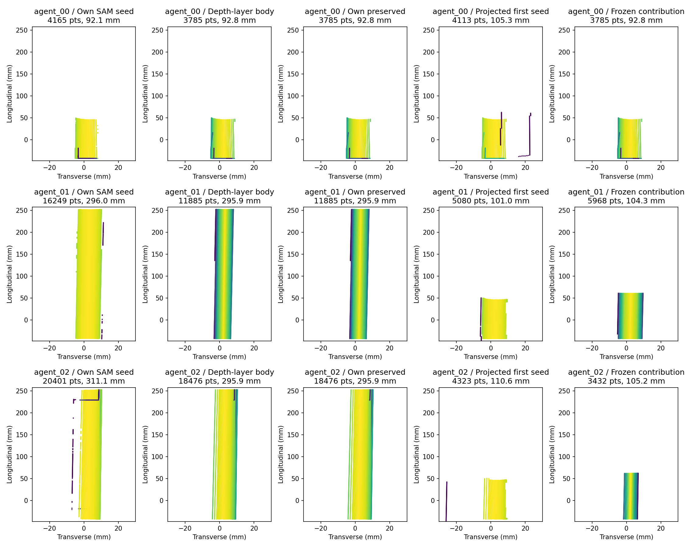
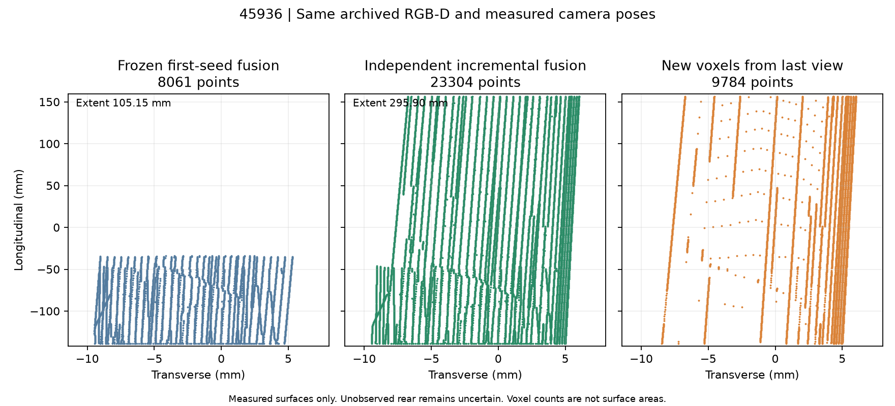
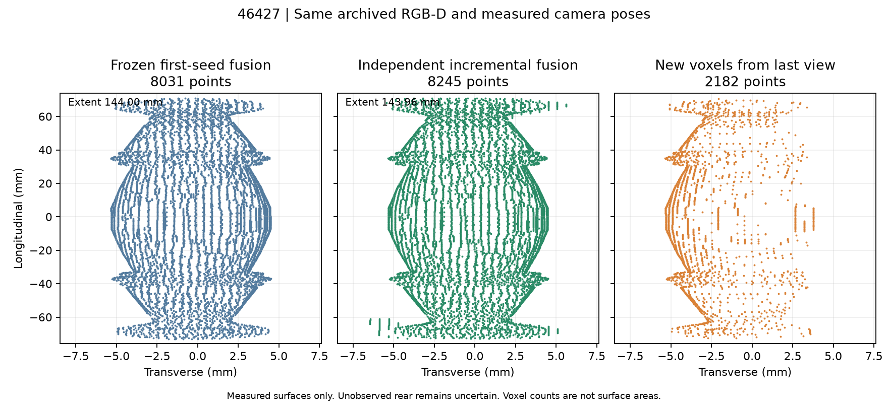
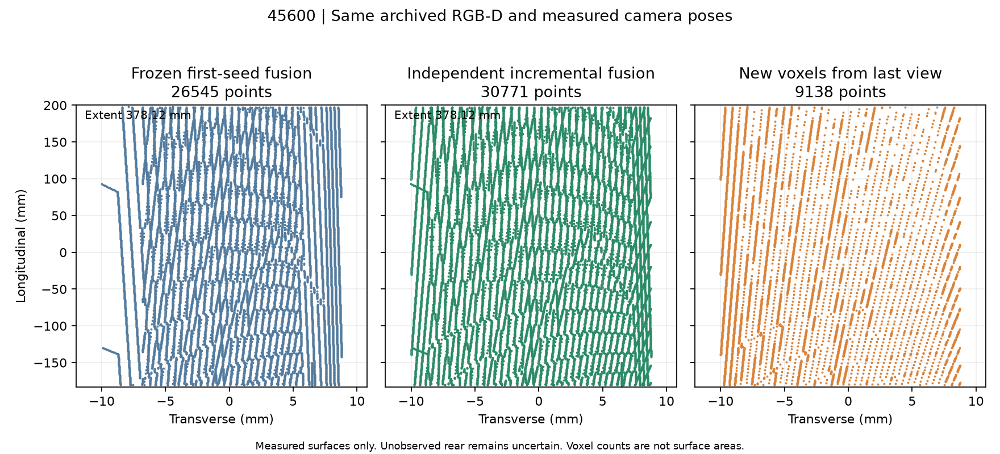

# 腕部 RGB-D 增量几何：离线配对结果（2026-10-16）

参考：`a47fe09`。**45936 的首帧范围锁定问题已在离线修复：105.15 → 295.90 mm；但 46427 新增少量门框点，因此按本轮明确的离线停止条件，不启动 Isaac。** 新观察 episode、抓取、开门均为 0。此版本是开发分支，未替换成功基线。

## 信息在哪里丢失

完全复用归档 RGB-D、SAM3 输出、相机位姿和自遮挡掩码，没有重跑 SAM3。冻结 A 的融合点云在三例都与归档逐点复现（最近邻最大差 0）。代表性 RGB/掩码/深度/点云检查板已实际查看；公开图只包含派生点云。

45936 的首帧仅保留 92.75 mm；后两帧各自的 SAM3 与深度处理已保留约 295.91 mm。`native_g1_multiview_input.build_geometry()` 却对每个后来视图调用 `projected_seed(folder, first["points"])`，再用该种子重新构建局部区域。新视图独立的 SAM3 掩码没有进入这条融合路径，长把手被重新截回约 104–105 mm。体素平均并非此次长度丢失的原因。

| 45936 视图 | 独立 SAM 深度点 | 独立保留点/长度 | 冻结融合贡献点/长度 |
|---|---:|---:|---:|
| agent_00 | 4165 | 3785 / 92.75 mm | 3785 / 92.75 mm |
| agent_01 | 16249 | 11885 / 295.91 mm | 5968 / 104.33 mm |
| agent_02 | 20401 | 18476 / 295.89 mm | 3432 / 105.17 mm |

另有独立问题：46427 的全局深度层分割先将约 145 mm 的装饰把手缩到约 117–119 mm，现有 `preserve()` 的局部端部扩展已恢复到约 143–144 mm。其 trusted-body 合并还会绕过完整的度量连通性过滤；独立掩码中少量与把手相接的门框像素可被保留下来。不能把这两类问题都归因于体素融合。

## 本轮共享改动

新增 `native_g1_incremental_geometry.py`，保留所有冻结文件。每个视图独立运行现有 `preserve()`，使用自己的 SAM3、光学 Z 深度、相机位姿、面板估计和自遮挡排除。累计已测几何的投影仅提供关联锚点；整块通过现有深度邻接条件的表面可以延伸到首帧范围以外。沿用原有 5 mm 深度一致性、3 mm + 像素采样分辨率的邻接语义，没有新增资产阈值。

逐视图三角形保持开放，不在视图之间连面，不补造背面。无法关联的独立观测不合并，并保留原因。累计关联支持后续视图与此前任一已保留表面关联，不要求每个新点或新表面都覆盖第一帧。

输出包含体素—视图稀疏来源、三角形—视图来源、每帧新增体素、纵向区间的观测来源、开放表面法向摘要和未知背面说明。体素数不是表面积，多视角数量也不代表背面已观测。

新增独立 Agent 适配器复用原 `observe/evaluate_view/move_and_observe/build_geometry/finish`：观察后给出累计与新增几何图；已有候选时，可在同一候选上被动重算接触预测；尚无候选时明确报告未计算。候选排名仍调用原函数。可达替代视图仍由 Codex 提议、原 IK/碰撞检查器评估，没有覆盖率停止规则。**该接口仅实现与语法检查，本轮未做实时 Agent/Isaac 验证。**

## 同图同位姿的离线结果

下表的 GT 只在重建保存后，由独立 evaluator 读取；候选规划独立运行，不接收 GT 评估结果或修正。覆盖率是已可见注册把手表面上 30,000 个确定性面积采样点中，距离观测 ≤2 mm 的比例；属于诊断，不是执行门槛。完整组件误差包括明确列出的把手支座/端帽，避免将遮挡背面或合法支座误判为传感器误差。

| 对象 | 长度 A→B (mm) | 点数 A→B | 可见注册表面覆盖 A→B | 完整把手组件 P95 A→B (mm) | 距组件 >3 mm 点数 A→B |
|---|---:|---:|---:|---:|---:|
| 45936 | 105.15 → 295.90 | 8061 → 23304 | 34.49% → 95.20% | 0.294 → 0.238 | 0 → 0 |
| 46427 | 144.00 → 143.96 | 8031 → 8245 | 100.00% → 100.00% | 0.323 → 0.333 | 0 → 8 |
| 45600 | 378.12 → 378.12 | 26545 → 30771 | 90.61% → 99.91% | 0.249 → 0.262 | 0 → 0 |

45936 的注册杆平均误差为 0.147 → 0.142 mm。45600 长度不变，但侧面表面覆盖有所增加。46427 的 152 个 B 点最近邻属于门框零件 `original-26/27`；多数接近支座边界，不能全部等同于严重背景污染。不过其中 8 点距完整把手组件超过 3 mm，最远 4.116 mm，A 没有这一尾部。它们与保留表面相接，新增的共享连通关联没有消除此残留。未使用 GT 删除或修正这些点。

## 每帧增量贡献

| 对象 | 视图 | 新增 0.5 mm 体素 | 累计体素 | 累计原始观测长度 (mm) |
|---|---|---:|---:|---:|
| 45936 | agent_00 | 3785 | 3785 | 92.75 |
| 45936 | agent_01 | 9735 | 13520 | 295.91 |
| 45936 | agent_02 | 9784 | 23304 | 295.92 |
| 46427 | agent_00 | 3746 | 3746 | 142.99 |
| 46427 | agent_01 | 2317 | 6063 | 143.96 |
| 46427 | agent_02 | 2182 | 8245 | 143.96 |
| 45600 | agent_01 | 21633 | 21633 | 378.07 |
| 45600 | agent_02 | 9138 | 30771 | 378.12 |

这里的长度来自逐帧原始观测并集；最终体素平均会带来约百分之一毫米的端点差别。逐帧三角形面积与阶段统计见 [CSV](PER_VIEW_CONTRIBUTIONS.csv)。新体素可表示新暴露表面，也可能只是同一表面的采样密度变化，不能单独视为信息增益。

## 同一冻结 TCP 下的接触预测

采用各例归档 pregrasp 视觉修正后的同一 TCP，保持原 native G1 运动学与手指实体；41 档离线扫描加 8 次局部二分。物理列是之前 episode 的首次正法向接触，不是本轮新试验。闭合时的真实 TCP 跟踪、CENTER 与接触动力学仍可能改变首次接触，静态结果不构成物理成功证明。

| 对象/逻辑指 | A 开放实测面预测 (mm) | B 开放实测面预测 (mm) | GT 原生碰撞预测 (mm) | 归档实际首次接触 (mm) |
|---|---:|---:|---:|---:|
| 45936/1 | 14.317 | 13.826 | 14.904 | 15.139 |
| 45936/2 | 14.582 | 14.863 | 14.646 | 14.757 |
| 46427/1 | 9.764 | 9.764 | 9.153 | 9.675 |
| 46427/2 | 9.813 | 9.813 | 10.199 | 11.289 |
| 45600/1 | 16.971 | 19.713 | 20.461 | 20.714 |
| 45600/2 | 17.228 | 17.574 | 17.067 | 18.852 |

三种显式未知背面假设的预测全部保留在 [RESULTS.json](RESULTS.json)。没有挑选最有利背面，也没有把假设表面计入实测覆盖。接触预测变化并非各处都变好，几何范围恢复不等于力传递或抓取稳定性提升。

## 自动排名与计算成本

复用原 candidate family、评分权重、扰动配置、注册站位及各例原始规划预算，没有 GT 接触评分或手工 pose。A 为归档已选候选，B 重新自动规划。

| 对象 | section A→B | TCP 位移 (mm) | acquisition A→B | retention A→B | task A→B | combined A→B | B 规划墙时 (s) |
|---|---:|---:|---:|---:|---:|---:|
| 45936 | 0.0 → -0.3 | 6.607 | 1.000 → 1.000 | 0.772 → 0.771 | 0.539 → 0.513 | 0.07657 → 0.06820 | 207.6 |
| 46427 | 0.0 → 0.0 | 0.133 | 1.000 → 1.000 | 0.734 → 0.734 | 0.148 → 0.147 | 0.00822 → 0.00819 | 97.4 |
| 45600 | 0.0 → -0.3 | 113.441 | 1.000 → 1.000 | 0.758 → 0.756 | 0.440 → 0.439 | 0.06156 → 0.06858 | 117.5 |

45936 的 section 从 0 转为 −0.3，原因是全把手长度、中心与横截面输入改变了候选分布；世界坐标 TCP 仅上移约 6.60 mm，仍在第一帧可见区域，不能称为选中了新恢复区域。45600 的另一个纵向候选被选中，TCP 相差约 113.44 mm；46427 候选基本不变。新旧分数来自不同可见表面集合，不是校准成功概率，也不能直接当作性能增益。摩擦模型假设 μ=0.5 沿用原 scorer，不是测得摩擦。

三个 B 候选均得到原共享规划器的 30° 离线路径，这不是开门试验，也没有将全路径可行作为新执行门槛。45936/46427 的已完成 B 排名通过五个输入几何文件逐字节一致证明复用；曾启动的旧 45600 离线规划被停止，随后在最终几何上完成，保留中间日志。没有物理重试。

| 对象 | A 融合与导出 (s) | B 融合与反馈导出 (s) |
|---|---:|---:|
| 45936 | 1.61 | 2.81 |
| 46427 | 1.77 | 2.72 |
| 45600 | 1.21 | 2.32 |

B 增加了来源数组、增量统计与绘图，以上不是隔离的核心融合性能测试。完整人工分析墙时未单独计时，不能用这些局部耗时声称端到端加速。没有新增感知运动或物理仿真时间。

## 停止原因、完整性与下一步

按用户条件“如果离线融合……引入污染，报告失败并在启动 Isaac 前停止”，本轮在离线结束。没有新 actor、手臂动作、相机重定位、抓取或开门；未消耗允许的观察 episode，也不声称新一轮 Agent 闭环成功。未新增运行时 quality/safety gate。

逐层图、实际归档图像检查和独立 GT 对比共同支持：首帧投影作为后续重建种子是 45936 的主要信息瓶颈；修复后仍需解决一般性的面板/支座边界关联。下一步最小工作应离线定位这些已连接到门框的像素如何进入 trusted body，而不是继续改抓取、控制、SAM 阈值或物理参数。本轮未继续迭代。

16 个在线/分析相关源码核对全部匹配，其中 11 个冻结参考文件字节不变；原 RGB-D 输入哈希未变，三例体素和三角形来源数量匹配，增量体素之和等于最终体素数。离线 Python 3.12.14 / NumPy 2.3.1 / SciPy 1.17.0 / trimesh 4.11.1。新增接口仅语法验证，未宣称实际 Isaac 加载验证。

来源：[源码与冻结哈希](SOURCE_PROVENANCE.json)、[配置哈希及相同的 1200 s 规划预算](CONFIGURATION_PROVENANCE.json)、[完整性结果](OFFLINE_INTEGRITY.json)、[紧凑结果](RESULTS.json)、[私有证据索引](EVIDENCE_INDEX.json)、[进程清理](OWNED_PROCESS_CLEANUP.json)。原 RGB-D、原视频、240 Hz 数据和新派生几何均保持私有。SSH 连接曾在握手前重置，使用本地原始归档继续诊断后恢复；没有新的 Isaac 初始化故障。所有本轮离线进程已结束，没有本轮 Isaac actor 留存。
