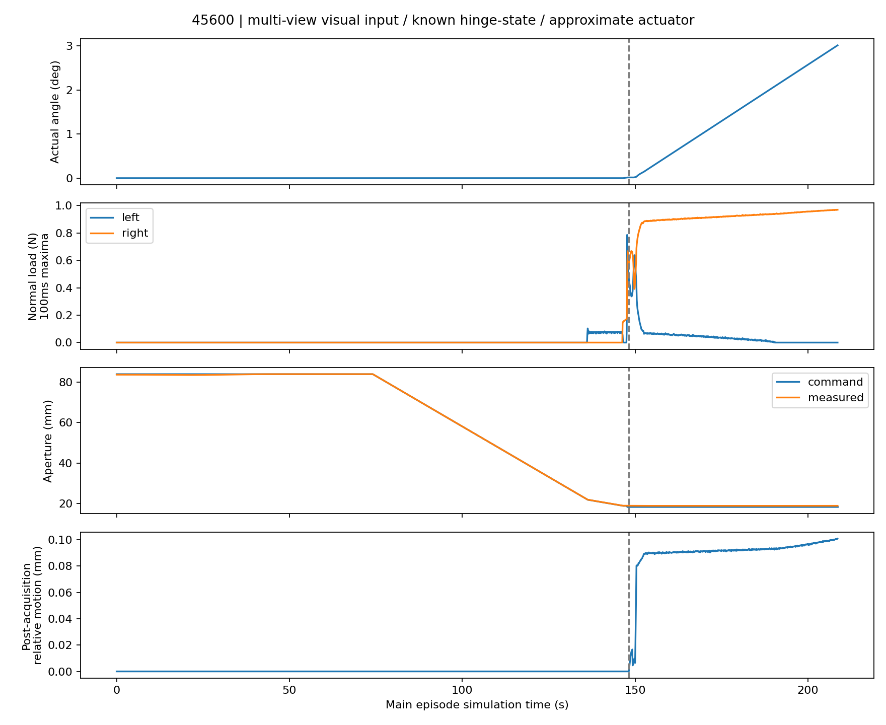
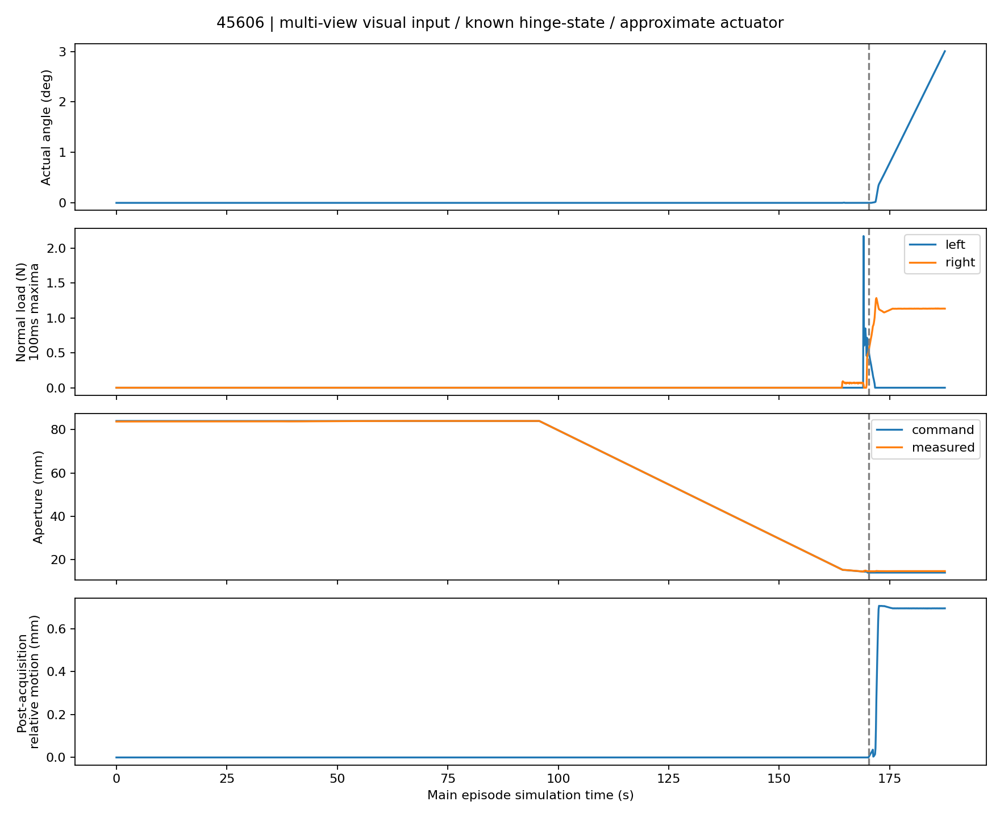

# Multi-view RGB-D → native G1 physical short opening

**Both registered development cases passed.** Fresh multi-view RGB-D/SAM3 grasps on 45600 and 45606 established native contact, retained the original one-second hold and physically opened approximately 3° with the frozen xArm7/G1 execution skill. Exactly one closed-start episode per case; no retries, manual continuation, release or regrasp. Both actors exited with code 0.

Reference: `3103651`. Manipulation input implementation frozen at **`5ae1b50`**, before physical outcomes. Scope: **MULTIVIEW_RGBD_SAM3 / KNOWN_HINGE_STATE_COLLISION / APPROXIMATE_ACTUATOR_SIMULATION**. These are paired development tests, not a held-out success-rate estimate, a 30° result, hardware validation or fully GT-free execution. The original ten-door 4/10 benchmark and all frozen baselines remain unchanged.

## Actual physical results

| Case | Archived visual result | New physical grasp | Gain after acquisition | Maximum actual angle | ≥2° transmission | Stop |
|---|---|---|---:|---:|---|---|
| 45600 | No bilateral acquisition | Yes | **2.999298°** | **3.016256°** | PASS | Original short target reached |
| 45606 | Grasp and +3.005721° opening | Yes | **3.007881°** | **3.008039°** | PASS | Original short target reached |

Gain subtracts the acquisition-event angle from the maximum actual post-grasp observation; closure-induced motion before a valid grasp is excluded. The opening controller targets +3° from its measured opening-start state. Native pre-integration contact geometry and post-integration observations differ by one physics step; both are preserved, not stitched.

| Evidence | 45600 | 45606 |
|---|---:|---:|
| First positive normal contact L / R aperture | 21.872 / 18.894 mm | 14.565 / 15.397 mm |
| Grasp acquired at simulation time | 148.233 s | 170.229 s |
| Acquisition filtered loads L / R | 0.475 / 0.540 N | 0.525 / 0.482 N |
| Post-acquisition hold before opening | 1.004167 s | 1.004167 s |
| Peak raw allowed-finger normal load | **0.970243 N** | **2.172888 N** |
| Maximum post-acquisition TCP speed | **1.206 mm/s** | **1.294 mm/s** |
| Maximum all-phase TCP speed, including unloaded motion | 23.476 mm/s | 30.524 mm/s |
| Maximum post-acquisition relative translation / rotation | 0.101 mm / 0.128° | 0.710 mm / 0.489° |
| Maximum joint command tracking error | 0.00450 rad | 0.00479 rad |
| Maximum planned-TCP tracking residual | 1.171 mm | 0.318 mm |
| Minimum measured joint margin | 1.19198 rad | 1.19198 rad |
| Main simulation duration | 208.675 s | 187.521 s |
| Actor wall time, including startup/export/shutdown | 1572.049 s | 1456.177 s |
| Scene-local automatic planning wall time | 226.118 s | 326.677 s |
| Opening local corrections / releases / regrasps / base moves | 0 / 0 / 0 / 0 | 0 / 0 / 0 / 0 |

45606's 30.524 mm/s all-phase maximum occurred at **11.946 s in unloaded PREGRASP**, with no allowed-target contacts. It is reported rather than hidden; it is distinct from the unchanged loaded 5 mm/s protection and the 1.294 mm/s post-acquisition maximum.

The right finger retained positive normal contact throughout both post-acquisition intervals. Left positive-normal reports were absent for a longest interval of **18.217 / 15.829 s**. These are report-absence intervals, not automatic proof of grasp loss: actual joint progress continued, with the relative-motion values above. No continuous-bilateral veto was added.

45606's first left contact during **CENTER at 169.120833 s** produced the **2.173 N** peak. The original policy recorded exactly **one SOFT_FORCE_WARNING**, window mean **0.575806 N**, and **zero consecutive overload windows**. It subsequently acquired bilateral hold. No hard-force stop, collision stop, speed stop or joint-limit stop occurred. This simulation-only normal-load quantity is not a complete wrench or certified hardware force limit.

## Shared integration and source boundary

[The thin adapter](../../../scripts/native_g1_multiview_input.py) reuses the observation preservation/fusion from `3103651`, original native-G1 candidate families and frozen robust scoring weights. [The runner](../../../scripts/run_native_g1_multiview_short.py) changes the perception import around the existing short-opening executable. It does not duplicate or redesign closure/Pink controllers.

Measured per-view neighboring depth triangles remain **open measured patches**. Hypothetical rear/lateral faces are stored separately at 0.75/1/1.25 times observed local width. Front-facing envelope caps are omitted so they cannot replace measured front patches. Unknown space is not certified empty or solid; hypotheses contribute soft mean/lower-quartile ranking, never an all-samples-pass requirement or best-imagined-backside selection.

Acquisition intersections use measured patches. Retention/task support uses measured surfaces plus separately labeled hypotheses. Native-G1 nonlinear finger kinematics, common aperture, root clearance, original perturbations and opening-direction features remain. An exact cached R-tree ray query replaces brute-force ray enumeration without mesh simplification. The saved 24-ray comparison matched hit masks/normals; maximum distance difference was 1.25e−16 m. This is a numerical implementation check, not physical certification.

**No GT handle mesh, saved grasp transform, GT instance mask/crop or GT pose correction enters grasp generation/contact scoring.** Registered stations, known hinge/dynamic state, robot/camera calibration, frozen native scene collision checks and contact-label identities remain. Legacy score fields named `native` refer to the observation/prior input in this mode, not hidden GT handle scoring. GT/cooked handle comparison occurs in separate evaluator processes and is never read by the actor.

Frozen closure, finite-effort position actuation, preload, Pink policy, hold duration, object physics/colliders and existing force/contact/joint/loaded-5-mm/s protections are unchanged. All **22 pre-frozen source/configuration hashes** and all compared shared job fields matched after the batch. No between-case tuning occurred. [Provenance](PROVENANCE.json), [frozen hashes](FROZEN_IMPLEMENTATION.json), [protocol](PROTOCOL.md).

## Offline candidate comparison

Preserved single-view versus multi-view below uses the **same new adapter**, fixed scoring configuration, registered station and 1200 s planning budget on saved observations. These single-view candidates were not new physical trials. The archived physical comparison above used the earlier visual loft; it is not a physical ablation of only the number of views.

| Case / input | Chosen section / insertion / roll | Observed first-contact L / R | Nominal rear-hypothesis L / R | Acquisition feature | Robust combined feature |
|---|---|---:|---:|---:|---:|
| 45600 single | +0.3 / 0 / 0° | 13.014 / 16.665 mm | 16.376 / 16.665 mm | 0.598 | 0.02137 |
| 45600 multi | 0 / −9.375 mm / 0° | 17.863 / 17.872 mm | 17.936 / 17.936 mm | 1.000 | 0.02792 |
| 45606 single | +0.3 / −9.375 mm / 180° | 10.939 / 10.979 mm | 10.939 / 10.979 mm | 1.000 | 0.04491 |
| 45606 multi | −0.3 / 0 / 180° | 14.502 / 14.510 mm | 14.510 / 14.542 mm | 1.000 | 0.08265 |

All four found existing collision/IK/approach paths to 30° offline; only the declared short task was executed physically. Insertion values derive from the unchanged native pad-depth candidate family, not asset-specific offsets. Scores are approximate ranking features, not success probabilities. Separate acquisition/retention/task values are in [OFFLINE_COMPARISON.json](OFFLINE_COMPARISON.json).

The first 45600 multi-view offline pass has a private pre-final source snapshot. Prelaunch finalization only invalidated rebuilt-geometry caches and corrected provenance labels; geometry and scoring equations did not change. Both physical episodes used the same frozen `5ae1b50` implementation.

| Saved-observation coverage diagnostic | 45600 single → multi | 45606 single → multi |
|---|---:|---:|
| Accepted views | 1 → 4 | 1 → 4 |
| Metric points | 2794 → 39245 | 2606 → 32918 |
| Full GT surface samples within 2 mm | 44.73% → 55.94% | 47.99% → 82.26% |
| Original-visible samples covered | 99.32% → 99.72% | 99.47% → 99.96% |
| Observed-point P95 GT-surface distance | 0.765 → 0.601 mm | 0.932 → 0.515 mm |

Coverage/error values reuse the separate `3103651` evaluator on the same saved measured fusion, not fresh-run accuracy. Fully unseen surfaces are not sensor-error samples. At the selected poses, first-intersection aperture spread across the three rear hypotheses was **0 mm at the reported refinement resolution**. This does **not** imply zero unknown-geometry uncertainty: the family only varies a limited rear prior. Robust pose/aperture perturbations and weights remain the original uncalibrated stress configuration.

The separate numerical evaluator brackets contact with the inherited 41-aperture sweep plus eight local bisections (~0.008 mm brackets). This refines a geometric crossing, not physical accuracy or the closing controller.

## Fresh input and remaining prediction error

Both actual episodes captured **four fresh initial RGB-D views plus one pregrasp observation**, preserving RGB, optical-Z depth, K, extrinsics and robot state. Fresh fusion contained **38,774 / 33,244 points**. 45600 used one existing observation-derived crop recovery (two handle inferences); 45606 needed one inference. Neither needed an alternate initial camera recovery or GT fallback.

Fresh 45600 chose the same candidate family as its shadow comparison. Fresh 45606 automatically chose **+0.3**, rather than the archived shadow's −0.3 section, with 0 insertion/180° roll. This was a new observation-driven selection, not a reused pose or between-case adjustment. Pregrasp correction used the frozen common-visible RGB-D/self-exclusion path; its near-identity correction in this ideal calibrated scene must not be presented as real-camera robustness.

At the fresh corrected 45600 pose, measured patches predict L/R **17.847/17.863 mm**, versus offline GT visual/native **21.000/16.544 mm**. Actual first left contact was **21.872 mm**. The visual model therefore retains a material left first-contact error; the narrow rear family does not explain all missing geometry. The original CENTER moved the TCP by at most **1.545 mm** during closure and acquired both contacts without changed limits. Actual right acquisition happened after that correction, so its aperture cannot be treated as a fixed-pose prediction error.

For fresh 45606, measured patches predict **14.477/14.510 mm**, versus offline GT **14.373/14.976 mm**. Actual first right contact was **15.397 mm**; left contact followed the original CENTER correction (maximum closure relative motion **0.724 mm**). Finite contact offsets, tracking and changing TCP pose remain distinct from observed-surface error. GT comparisons were diagnostics, not pose corrections or admission thresholds. [Fresh 45600](45600_FRESH_PREDICTIONS.json), [fresh 45606](45606_FRESH_PREDICTIONS.json).

Thus the shared input integration recovers a previously failed case while preserving this visual control's short opening. It does not establish universally accurate contact prediction, sustained bilateral pressure, held-out robustness, full-range capability or deployable active sensing.

## Sensing limitation, 45671 and evidence

Extra views use **simulation-only scene-camera repositioning**, −55/0/+55° around the observed panel normal, 0.7 m standoff and +0.1 m height. Physics time stayed unchanged during capture; original camera pose/clipping was restored before motion. These are not reachable wrist-camera trajectories or robot active-sensing results.

45671 received **zero new physical episodes**. Its independent native convex fill-in cannot be repaired by distorting observed RGB-D; see [offline review and separately versioned physics-fidelity recommendation](45671_OFFLINE_REVIEW.md). No collider comparison was executed here. No VGGT, new hinge estimator, full-30° batch, additional cases or timing optimization was run.

Both raw streams have uniform native 240 Hz timestamps: **50,082 / 45,005** physics and observation records, plus **17,788 / 17,886** closure-command records. Raw contacts, pad-load quantities, joint velocity/effort/reaction and native gripper feedback fields were retained in every observation, with sensor conversion/frame metadata. Optional empty-contact records are valid free-space measurements. Raw normal impulses are not complete frictional wrenches or pressure areas.

Both private videos decode fully: **6260 / 5625 frames**, 1280×960 at 30 fps, **208.667 / 187.500 s**. Public force curves use 100 ms maxima to retain peaks; statistics use all 240 Hz records. The dashed line marks acquisition; pre-acquisition zero in the post-grasp relative-motion channel is undefined, not a measured no-slip claim.

[Compact results](COMPACT_RESULTS.json), [private evidence paths/hashes](PRIVATE_EVIDENCE_INDEX.json), [private archive integrity/backup](PRIVATE_ARCHIVE_INDEX.json), [owned-process cleanup](OWNED_PROCESS_CLEANUP.json). The 275,718,554-byte archive is backed up privately on the server and locally, with matching SHA-256 `6de1681b7588e5920555a4c004ae934b129242fbc62fb31f0ff9cd2c246034ba`. Raw videos, RGB-D, point geometry and lossless telemetry remain private; no public Release/raw upload was made. The second actor started 0.104 s after the first exited; neither owned actor remains alive. The bounded batch is complete and stopped.
