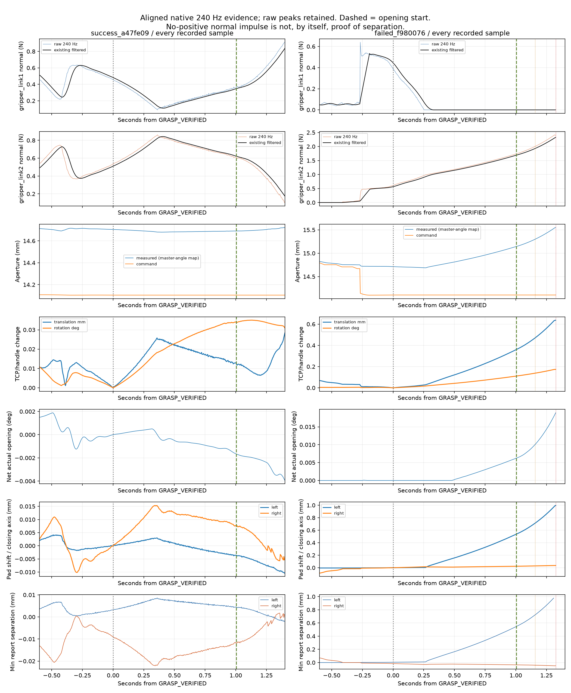
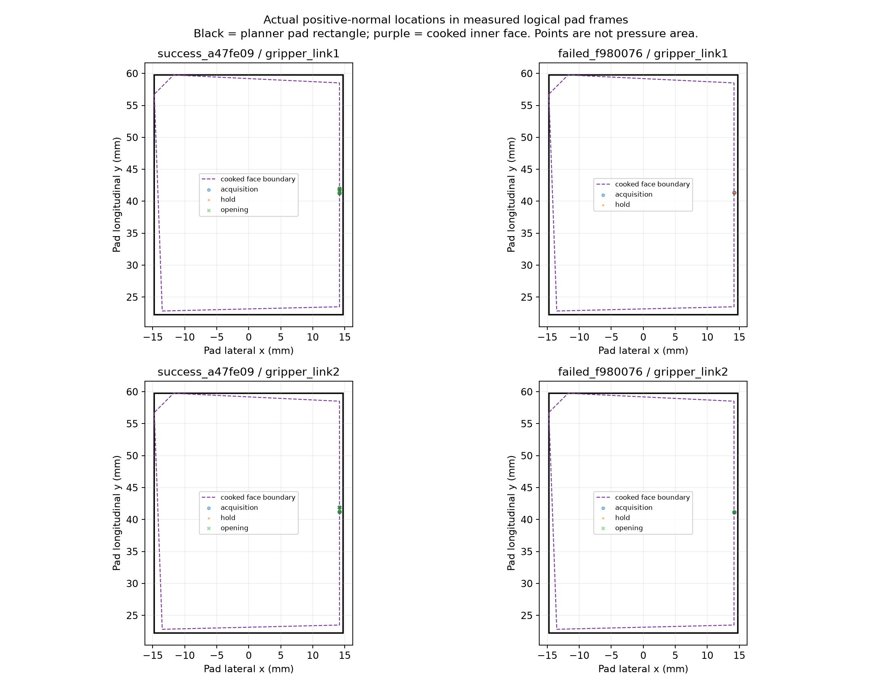
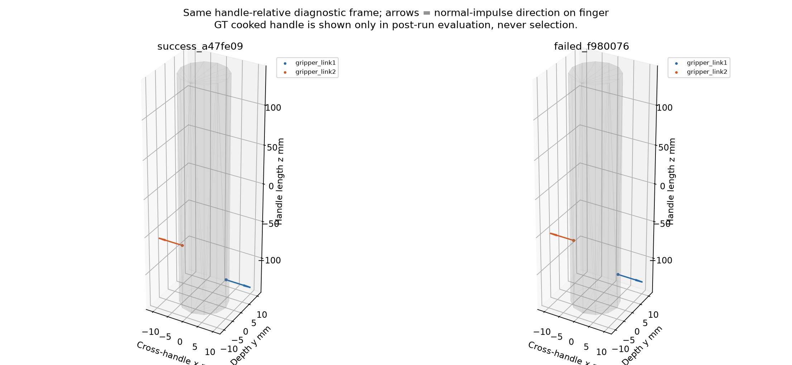
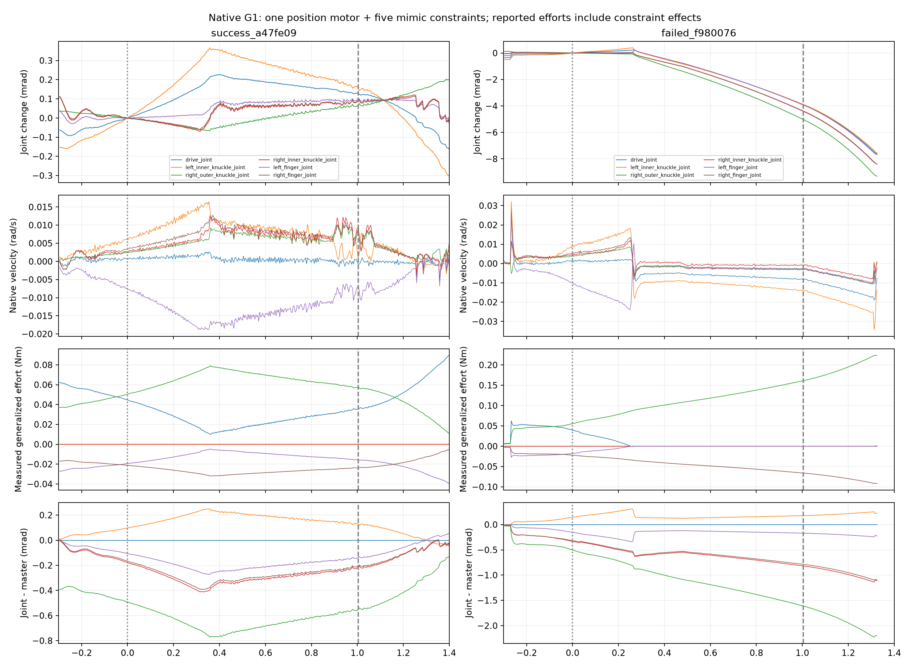
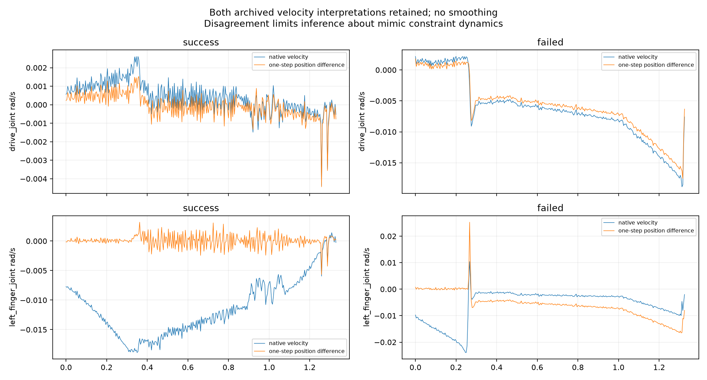
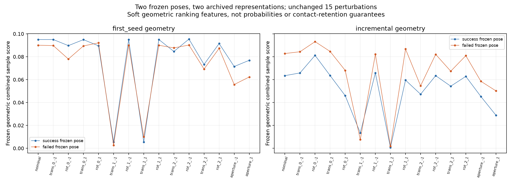

# 45936：Native G1 抓取保持与传力失败的离线机制诊断

范围：**ORACLE/GT 仅用于独立离线几何评估；实际实验为 Agent wrist RGB-D / KNOWN_HINGE_STATE / APPROXIMATE_ACTUATOR_SIMULATION**。

只分析 `a47fe09` 成功档案和 `f980076` 失败档案，参考增量几何版本 `3da07ab`。本轮 **0 次 Isaac 启动、0 次物理实验、0 项控制器/评分/物理参数修改**。两段物理记录没有被重写；原始 RGB-D、240 Hz 数据、完整视频及本轮私有视频切片均不公开。

## 结论先行

最符合记录的是 **D：接触载荷重新分配、小姿态变化和耦合夹爪张开共同发展的失稳过程**。已确定先后关系，但尚未确定唯一的初始物理原因：

1. 左侧首先在保持阶段卸载；这时夹爪仍在略微闭合，**不是先明显张开再失去左载荷**。
2. 左侧正法向报告消失后，实测主驱动角对应口径和重建的两 pad 间距开始持续增大，TCP 也在恒定 arm 指令下相对把手漂移；右侧载荷继续升高。
3. 开门时已是这种单侧承载状态，最终触发原有连续三个过载窗口保护。过载停止是后果，不是最早分歧。
4. 两次实际法向接触都落在 cooked pad 内侧面的横向边界，成功基线也如此。**“接触在边缘”是共同脆弱性，不能独立解释一成一败**。
5. 同几何交叉评分确实偏好失败抓姿，但评分无法预测上述保持动力学。不能据此把“新增点云有问题”或“6.6 mm 位移是唯一原因”当成已证明结论。

建议下一步只做一次独立的 **执行器/耦合约束/接触保持诊断**，先补齐实际 implicit-drive 力和目标读回，详见末节。现在没有依据增加夹紧力、调整 CENTER 或放宽保护。

## 1. 对齐方法与可复查证据

每个 episode 以其 `GRASP_VERIFIED` 为零点：成功 282.929167 s，失败 279.037500 s。绘制完整的原生 240 Hz 样本，未另加平均、裁峰或降采样。黑线是当时已有的 19 样本滤波输出，彩色线是原始 pad 法向量测；这两者没有混用。

`observations` 保留完成步的状态/接触，`physics_steps` 保留积分前几何采样；两种记录存在一个物理步的边界语义和约 15 μs 时钟累计差。排序结论不依赖亚步精度。正常力是 native impulse/dt 的既有映射，不是完整交互力。

橙色/红色竖线分别为失败例的原有软警告与持续过载停止；绿色虚线为开门开始。完整 acquisition-to-end 图见 [ENTIRE_POST_GRASP.png](figures/ENTIRE_POST_GRASP.png)，状态/速度图见 [CONTACT_STATUS_AND_TRACKING.png](figures/CONTACT_STATUS_AND_TRACKING.png)。

| 对齐后的事件/指标 | 成功 a47fe09 | 失败 f980076 |
|---|---:|---:|
| 首个左侧正法向报告，验证前 | −6.962486 s / 15.139 mm | −6.374986 s / 15.505 mm |
| 首个右侧正法向报告，验证前 | −2.545819 s / 14.757 mm | −0.412485 s / 14.756 mm |
| GRASP_VERIFIED 的原有滤波 L/R | 0.483 / 0.510 N | 0.446 / 0.566 N |
| 左侧原始量跌破已有 0.05 N | 未发生 | +0.229167 s |
| 首个左侧无正法向冲量样本 | 未发生 | +0.254181 s |
| 保持期最小主驱动口径 | 14.679 mm，+0.404167 s | 14.688 mm，+0.262500 s |
| 原有开门开始 | +1.004167 s | +1.004167 s |
| 开门入口 L/R（原有滤波） | 约 0.35 / 0.62 N | 0 / 1.684 N |
| SOFT_FORCE_WARNING | 无 | +1.158333 s |
| HARD_FORCE_STOP_SUSTAINED | 无 | +1.325000 s |
| 停止时窗口均值/连续窗口 | — | 2.361 N / 3 |
| 实际验证后净开门增量 | **+2.998523°** | **+0.018916°** |

右侧首次接触发生在原有 CENTER 移动之后，不能拿其口径差直接当固定 TCP 下的视觉误差。原有窗口式 `GRASP_VERIFIED` 证明获取过双侧接触，不等价于已经达到静态载荷平衡；这里没有新增保持门槛。

完整 native 记录中允许目标的最大原始法向载荷分别为 **1.162807 N / 2.415656 N**，没有用滤波峰值替代原峰值。原始 79,059 / 67,288 条 physics 记录及相同数量 observations 均已逐 chunk 读取校验，完整文件继续私有保留。

## 2. 实际接触在哪里

使用档案 native contact point/normal/collider 顺序，将点变换到记录的每指 pad 坐标和同一把手参考系。**`finger_world_poses` 是测得关节位置经冻结 URDF/FK 重建的逻辑 pad 帧；TCP/活动体则来自场景状态。它不是额外的独立指体位姿传感器。** 因此下列 cooked 距离也是记录状态的离线几何重建，不能替代 PhysX 的接触/rest offset、摩擦锚点或压力分布。

两次 left/right finger 及 original-39 把手的 cooked convex payload SHA-256 分别完全相同，排除了“本次发生了不同 cooking/碰撞几何替换”。

黑框为评分器现有矩形 pad 范围，紫线为实际 cooked 内侧面边界。正法向点在两次实验都接近该面 `x=+14.177 mm` 的边缘，而非评分网格所示的宽面支撑。小于约 1 μm 的正负边距视为数值边界，不解释成可靠穿出。

| 获取附近正法向接触 | 成功 L / R | 失败 L / R |
|---|---:|---:|
| planner 矩形横向边距 | 0.573 / 0.573 mm | 0.573 / 0.573 mm |
| **cooked 面横向边距** | **约 0 / 0 mm** | **约 0 / 0 mm** |
| cooked 面纵向边距 | 17.237 / 17.268 mm | 17.140 / 17.330 mm |
| 到把手纵向端部的投影距离 | 39.14 / 67.53 mm | 45.95 / 74.34 mm |

没有纵向 pad 末端滑出的证据。失败例在左侧仍有正法向冲量的早期保持段，接触点在把手系只移动约 0.007 mm；右侧约 0.013 mm。两次 pad 局部法向均近似沿内表面法向；没有“突然转到 finger root”的证据。左右有载点在把手长度方向相隔约 28.4 mm，因此它们不是同一截面上的压力面积测量。

失败例左侧正报告消失后，仍存在零冲量的 native 接触候选记录，不能将“0 N”直接等同于即时完全分离。但后续几何证据支持间隙确实扩大：

| 失败例保持时间 | native 最小 separation | 独立 cooked-FCL 最小间隙 |
|---|---:|---:|
| 验证时 | 0.0049 mm | 0.0054 mm |
| +0.254 s | 0.0099 mm | 0.0106 mm |
| +0.500 s | 0.1644 mm | 0.1650 mm |
| +1.000 s | 约 0.54 mm | 0.5436 mm |

早期 10 μm 量级受 contact/rest offset 和几何重建精度影响，不能作真实分离的强证据；晚保持期约 0.54 mm 的重建间隙更有说服力。右侧则保持小量几何压入/正法向载荷，停止附近 cooked 压入约 0.049 mm。该数值不是材料形变测量。

保持阶段两指到其他 cooked 柜体/面板几何最近距离约：成功 14.1–14.5 mm，失败约 15.2 mm；验证后前 1.4 s 未见允许目标之外的正法向接触。没有证据支持把手端部、支架或面板碰撞是首因。完整距离及 context 运动近似说明见 [COOKED_CLEARANCE.json](COOKED_CLEARANCE.json)。

已从两段私有视频截取验证前 0.2 s 至验证后 1.5 s 的短片，并检查同步放大帧及 +0.150 至 +0.383 s 的连续 30 fps 帧。指面被腕部/夹爪部分遮挡，没有可见大幅撞击；视频无法分辨上述微小间隙，**不据此宣称看见了脱离**。切片和帧的索引保存在私有目录。

## 3. 口径与耦合关节：漂移是后续放大过程

失败例从验证至 +0.254 s，主驱动口径反而从 14.713 降至约 14.689 mm，左侧载荷却降至零；随后于 +0.2625 s 达到 14.688 mm 的最低值，再增至保持末 15.141 mm。指令始终约 14.106 mm，**没有重开命令**。

| 原有一秒保持 | 成功 | 失败 |
|---|---:|---:|
| 主驱动角映射口径，首→末 | 14.704→14.690 mm | 14.713→15.141 mm |
| 全部测得手指关节 FK 的 pad 中心间距，首→末 | 14.740→14.729 mm | 14.742→15.252 mm |
| L/R pad 沿闭合轴相对把手移动 | −0.0036 / +0.0076 mm | +0.5331 / +0.0235 mm |
| 最大 mimic–master 角误差 | 0.772 mrad | 1.607 mrad |
| TCP/把手平移变化，验证锚定最大值 | 0.0258 mm | 0.3580 mm |
| TCP/把手转角变化，验证锚定最大值 | 0.0341° | 0.1101° |
| arm 指令变化 | 0 rad | 0 rad |

这里的“measured aperture”是原实现根据 **master 角**、理想耦合关系计算的量，并非两个真实 pad 的直接距离。使用全部六个关节重建时，失败例间距增量约 0.510 mm，比 master 映射增量约 0.427 mm 更大。不能只看一个口径字段就忽略 mimic 误差与腕部运动。

失败时有力的一侧是右侧，右外 knuckle 的 generalized reaction 增大；左侧报告消失后 master/左 finger 的 projected reaction 接近零。原生 `get_applied_joint_efforts` 为零仅代表没有额外显式 torque 命令，**不代表 implicit drive 没有施力**。`get_measured_joint_efforts` 是沿 DOF 投影的 solver joint reaction，不是隔离后的电机 torque。

保持期重建的 master cap 约 3.299 Nm；记录的 master projected effort 最大约 0.039 Nm（成功约 0.045 Nm），看不到达到 cap 的证据，**但也不能据这两个不同语义的量宣称已经证明电机不饱和/控制正确**。实际 drive force、drive target 读回和 mimic constraint impulses 未单独归档。

两次 mimic 关节的原生瞬时速度与一步位置差分明显不同。例如成功例 left_finger：保持平均原生 −0.0133 rad/s，位置差分约 +0.000095 rad/s；失败例对应 −0.00574 / −0.00392 rad/s。这限制了对耦合运动的动力学解释，不能把原生速度直接积分当作真实长期开合。原始速度保留不变，差分未加滤波。约束投影/采样阶段的具体贡献尚未隔离。

本轮平移曲线统一锚定 `GRASP_VERIFIED`；因此不能与旧报告使用当时 controller reference 的 `relative_slip` 最大值直接混用。停止时按本轮验证锚定约 0.64 mm；旧字段在停止时为 0.280 mm，其整个验证后区间最大值约 0.356 mm。原实现进入 opening 时已重新设置 reference；二者锚点语义不同，不是删掉或覆盖了原指标。TCP/把手相对位姿变化也不是已测得的材料滑移。

## 4. 同几何、两个固定抓姿：评分的交叉对照

没有搜索新抓姿。将两次记录的 **selected TCP pose 固定**，分别放到失败例新鲜 incremental 几何与成功例 first-seed 几何上，调用原 closing-quality、native-G1 common-aperture 和 robust/hypothesis scorer。refined pose 另做固定姿态 first-contact 评估。

保持全部原权重、15 个扰动（±1 mm、±0.5°、±0.6 mm aperture）、5 个 aperture 评分采样、9×7 pad 网格、0.7 mean + 0.3 Q25，以及 0.75/1/1.25 rear hypotheses。假设 μ=0.5 只是既有方向模型，**没有测到摩擦系数，也没有以 normal moment 符号否决抓姿**。

| 相同几何 | 固定抓姿 | Acquisition | Retention | Task | Robust mean / Q25 | 最终评分 |
|---|---|---:|---:|---:|---:|---:|
| 旧 first-seed | 成功姿态 | 1.000 | .7721 | .5385 | .07721 / .07508 | **.07657** |
| 旧 first-seed | 失败姿态 | 1.000 | .7717 | .5379 | .07230 / .06577 | .07034 |
| **同一新 incremental** | 成功姿态 | .7731 | .7694 | .4750 | .05074 / .04560 | .03804 |
| **同一新 incremental** | 失败姿态 | 1.000 | .7645 | .5152 | .06566 / .05654 | **.06293** |

排名随几何表示翻转，而 retention 特征几乎不变；新几何下 acquisition、支持量和 task 特征让失败姿态胜出。名义 ray 支撑加权横向边距约 6.50–6.56 mm，实际 cooked 正法向点的边距却约零。**静态 ray 支撑不是求解器的动态接触面积或保持成功概率。**

对失败姿态在新几何、所选共同口径 14.595 mm 上，rear scale 0.75/1/1.25 的名义 combined 分数约 .0481/.1044/.1044；支撑评分对未知背面有约二倍敏感性。与此同时 refined pose 的 first-contact aperture 随这些假设只小幅变化，说明“首碰预测稳定”不能证明“后续双侧保持预测可靠”。

下表对两个 **refined 固定姿态** 都用同一份新 incremental 几何；GT/native cooked 只在独立 evaluator 中使用，并且使用实际 cooked fingers。数值为 mm，约 0.008 mm 的细分括区只是数值精度。

| 固定姿态 | 新几何 observed-only L/R | 新几何 + nominal rear L/R | 独立全 cooked L/R | 归档首个正法向 L/R |
|---|---:|---:|---:|---:|
| 成功姿态 | 13.826 / 15.177 | 14.107 / 15.217 | 14.904 / 14.638 | 15.139 / 14.757 |
| 失败姿态 | 14.228 / 14.735 | 14.252 / 14.807 | 15.274 / 14.236 | 15.505 / 14.756 |

新几何甚至预测右侧先碰，而 native/物理首先是左侧。失败例左侧首碰预测误差约 −1.25 mm；右侧实际发生在 TCP centering 后，不能按该固定姿态表计算纯感知误差。成功姿态在其原几何上的预测是 14.445/14.743 mm；表中“成功姿态 + 新几何”不是当时在线使用的输入，不能混淆。

姿态差也并非只有 selected 的 6.623 mm：

| 阶段 | 两姿态平移差 | 转角差 |
|---|---:|---:|
| selected | 6.623 mm | 0.0722° |
| wrist refined target | 6.824 mm | 0.0449° |
| 实际获取时，世界系 | 6.818 mm | 0.2359° |
| 实际获取时，把手/活动体系 | 6.810 mm | 0.2670° |

selected 差异主要沿把手长度方向；实际获取状态还包含原有 CENTER、载荷下跟踪与物体微动的影响。两段物理实验同时改变了观测、表示、姿态及 approach/closure 历史，**不是只改变 6.6 mm 位移的因果实验**。2×2 离线交叉评分隔离了评分层的 pose/representation 影响，不能隔离物理保持的全部原因。

完整派生数字：[ALIGNED_SUMMARY](ALIGNED_SUMMARY.json)、[POSE_AND_TIMING](POSE_AND_TIMING.json)、[FIXED_POSE_COMPARISON](FIXED_POSE_COMPARISON.json)、[全 cooked 首碰评估](COOKED_FINGER_FIRST_CONTACT.json)、[速度一致性](VELOCITY_CONSISTENCY.json)。

## 5. 因果假设排序与尚不能回答的部分

| 假设 | 证据与反证 | 判断 |
|---|---|---|
| **D：接触/姿态/耦合运动共同发展** | 左侧先卸载，随后 master 与 mimic 共同张开、TCP 在恒定指令下偏移、右侧载荷上升 | **最强的过程解释**；不是已经证明的唯一初始原因 |
| **B：load-dependent aperture / coupling 漂移** | q、pad 间距和右侧反作用均支持，主指令不重开 | **强证据表明是放大机制**；明显张开晚于卸载，故不能解释为“先张开” |
| **C：小位姿差造成接触迁移/载荷差** | 获取时角差 .267°，失败保持期约 .11°；首个报告消失前仅约 27 μm TCP 平移 | **可信贡献因素**；缺少固定其他条件的配对实验，不能定量分配因果 |
| **A：接触放置/retention 不足** | cooked 横向边缘支撑、评分高估面支撑；新表示改变排名 | **共同弱点**；成功例也是相同边缘，未见纵向越界，不能作为单独首因 |
| **E：证据不足** | 缺独立 drive force、mimic impulses、摩擦锚点和独立 finger body pose | **精确初始机制仍未分离**，不等于什么都没查明 |

不支持的解释：closure 指令重新张开、首碰变成柜体/面板、先发生显著夹爪张开、先触发速度/IK 限制、单采样 2 N 误杀。没有推断未测摩擦力、压力分布或完整 contact wrench。

## 6. 一个建议的下一实验（本轮不执行）

**优先单独调查 native G1 的执行器/耦合约束/接触保持保真度，而不是立即重新调 grasp ranking。** 这是优先补齐未隔离环节，不是宣称模拟器已被证明是唯一原因。

建议一个短的、正常闭门初始化的 **原失败固定姿态 grasp-and-one-second-hold 诊断**，不加入开门，不寻找新姿态：保留全部几何、增益、力限、CENTER 和保护，仅被动记录实际 PhysX drive target/velocity target、stiffness/damping/maxForce 读回、独立 drive force（若接口支持）、mimic constraint impulses 和独立指体位姿；同时保留现在的 q/native dq/位置差分及完整接触记录。

目的：核对“口径指令还在”是否对应连续有效的有限 position drive，并区分 projected joint reaction、约束投影和接触 manifold 的贡献。若驱动/约束映射有问题，应隔离修复该接口；若其工作符合预期，再依据实际 cooked 接触支撑改进通用 retention ranking。**这不是提高夹紧力、增加等待/对称门槛或新增开门拒绝条件的理由。**

## 7. 复现、私有证据与结束状态

本轮新增的仅是离线脚本：

- [analyze_archives.py](analyze_archives.py)：按验证事件对齐原生流、重建接触坐标/边距、保留完整原生 NPZ 和私有 contact 产品。
- [compare_fixed_geometry.py](compare_fixed_geometry.py)：两个固定 pose × 两种记录几何，调用原评分，不进行 pose search。
- [evaluate_archived_clearance.py](evaluate_archived_clearance.py)、[evaluate_cooked_first_contacts.py](evaluate_cooked_first_contacts.py)：独立 cooked 几何 evaluator。
- [summarize_diagnosis.py](summarize_diagnosis.py)：生成精简数字、图和证据索引。

原始档案索引、视频/source/hash 和完整率见 [EVIDENCE_INDEX.json](EVIDENCE_INDEX.json)、[PROVENANCE.json](PROVENANCE.json)。旧的全部控制、评分与执行文件保持原字节；34 个 frozen source/config 校验保留。源文件、派生图和精简报告允许公开；原始图像、视频、深度、网格、完整 telemetry 和 private chunks 不进入 Git。

本轮没有创建 Isaac actor，不需要新场景清理，也没有管理其他用户的进程。完成上述离线诊断后停止。
