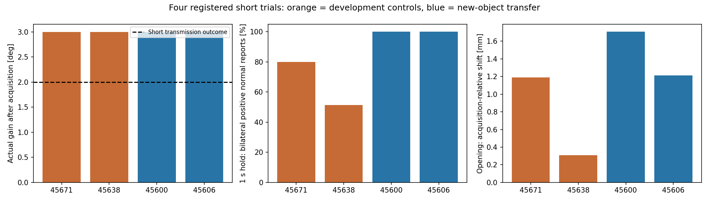

# Shared native G1 ranking: four registered short physical trials

**Scope:** ORACLE_HANDLE / KNOWN_MODEL / APPROXIMATE_ACTUATOR_SIMULATION. Reference `5ffe388`; initial-contact feature from `4890542`. Shared implementation, four-case registration and uncertainty settings were committed/pushed as **`ba33e41` before the physical outcomes**.

**Result:** all four normally initialized, independent episodes acquired a physical grasp, retained the declared one-second hold, and completed approximately +3° actual opening with a fixed base and zero intentional releases/regrasps. The two new-object transfer cases passed, alongside the two development controls. **This establishes short motion transmission, not robust bilateral retention or 30° generalization.** Curved-handle controls still unload one finger. The original ten-door **4/10** score and all frozen versions remain unchanged.

## Physical results

Angles below are maximum actual joint angle **minus the angle at GRASP_VERIFIED**. Incidental closure motion is excluded. The original short outcome is ≥2°, not a new 30° task result. Each case had exactly one valid episode; there was no between-case tuning, candidate retry or manual continuation.

| Asset / handle | Role | Plan range | Initial grasp | Gain after acquisition | ≥2° | Sim / wall time, s | Stop |
|---|---|---:|---|---:|---|---:|---|
| 45671 / original-35 | development control | 21° | yes | **3.000121°** | yes | 204.94 / 1185.24 | declared short target reached |
| 45638 / original-48 | development control | 30° | yes | **2.999581°** | yes | 180.38 / 1028.87 | declared short target reached |
| 45600 / original-25 | new-object transfer | 30° | yes | **3.000205°** | yes | 162.55 / 933.63 | declared short target reached |
| 45606 / original-24 | new-object transfer | 30° | yes | **3.001787°** | yes | 152.69 / 842.70 | declared short target reached |

**Outcomes:** controls 2/2; new-object transfer 2/2; registered short outcomes 4/4. Four cases are not a reliable success-rate estimate. The authored objects allow larger ranges; the trials intentionally stopped at the short target. No physical 21°/30° claim follows from the offline plans.

## Contact retention, loads and protection evidence

“Bilateral positive reports” means both fingers had positive native normal-impulse records in the same physics sample. It is neither a measured pressure area nor a force-closure certificate. All observed holds lasted **1.00417 s** (241 physics samples); no hold was shortened.

| Asset | Acquisition filtered L/R, N | End-hold raw L/R, N | Bilateral positive reports: hold / opening | Max opening-relative shift / rotation | Max post-grasp TCP speed | Min joint margin | Peak raw load, N |
|---|---:|---:|---:|---:|---:|---:|---:|
| 45671 | 0.485 / 0.545 | 0.000 / 0.996 | 80.08% / 76.33% | 1.192 mm / 0.507° | 2.881 mm/s | 0.838 rad | 1.253 |
| 45638 | 0.532 / 0.470 | 0.000 / 1.352 | 51.45% / 0.00% | 0.308 mm / 0.290° | 1.317 mm/s | 1.192 rad | 1.502 |
| 45600 | 0.458 / 0.577 | 0.617 / 0.447 | 100.00% / 99.67% | 1.707 mm / 0.099° | 1.972 mm/s | 1.192 rad | 1.066 |
| 45606 | 0.504 / 0.478 | 0.347 / 0.640 | 100.00% / 100.00% | 1.213 mm / 0.600° | 0.953 mm/s | 1.084 rad | 7.379 |

No collision, hard force, loaded-TCP speed or joint-margin stop occurred. All positive contacts were on the registered handle region; no positive non-handle reaction was recorded. No original local opening correction was needed. The 5 mm/s loaded-TCP guard, 0.05 rad margin, temporal force policy, native finite-position hand, gains/preload, physics and colliders were unchanged.

**Do not hide the 45606 spike:** a single SLOW_CLOSE sample at **137.679167 s** reached **7.378823 N**. The existing policy reported SOFT_FORCE_WARNING, window mean **0.712163 N**, consecutive overload windows **0**. It did not trigger sustained overload or the existing 10 N simulation-only emergency proxy. No threshold or actuator authority was changed. This is not hardware safety certification.

**Remaining retention divergence:** 45671 ends its hold with no left normal load and then changes to predominantly left loading during opening. Its terminal left zero-impulse hold interval is 0.1833 s; the old `5b10802` short trial had 0.3917 s. This is reduced absence, not elimination. New hold-relative movement is 0.0973 mm, versus 0.0562 mm previously. Despite unloading, the new grasp transmits **3.000121°**, versus the prior approximately **0.006067°**.

45638 loses left positive normal reporting late in the new one-second hold and opens with right-finger reporting only. The archived successful 30° configuration held for only 0.504 s and used a different automatically selected orientation. We cannot attribute the difference solely to ranking or claim that the old grasp would retain both loads for a one-second stationary hold. Short transmission is preserved; sustained bilateral retention is unproven.

Both new straight-bar cases retain bilateral positive reports throughout the one-second hold; 45600 has brief unloading during opening, while 45606 reports both throughout. Single-pad unloading was observed, not turned into a new veto. Normal impulses omit friction-anchor contributions; complete interaction forces were not reconstructed.

Case plots: [45671](plots/45671_short_result.png), [45638](plots/45638_short_result.png), [45600](plots/45600_short_result.png), [45606](plots/45606_short_result.png). These show filtered loads; the raw spike above is separately reported rather than inferred from the filtered curves.

## One coherent shared change

The update changes candidate utility and automatic plan selection only:

1. Retain cached native closing sweeps, first-contact pad/root labels, opposing-contact aperture accessibility and non-handle collision information. Keep the old initial-contact scalar for comparison. First-contact mismatch receives a soft penalty based on the existing 2 mm centering scale, not a new execution requirement.
2. Compute support on the unchanged native G1 inner surfaces and execution convex-hull input geometry. Longitudinal and lateral retention margins are separate continuous features (pad-depth/10 and pad-width/40 scales, combined with weights 2/3 and 1/3). There is no universal pad-centre exclusion. Geometric ray support is not measured pressure area.
3. Evaluate a fixed **15-sample** set: nominal, ±1 mm along each TCP-local translation axis, ±0.5° about each TCP-local rotation axis, and ±0.6 mm common aperture. Use five expected aperture samples. Aggregate **70% mean + 30% lower quartile**, not all-samples-pass. Select the best *aggregate* aperture rather than the best nominal aperture alone.
4. Include opening-direction compatibility with an explicitly assumed isotropic Coulomb direction cone **μ=0.5**; also retain μ=0 diagnostic capacities. This is a geometric direction model, not measured friction, force magnitude or a complete wrench. A negative summed normal moment is not an exclusion rule.
5. Reuse the existing approach, collision, camera, continuous Pink IK and station search; usable range can only increase contact utility by the existing bounded factor. One shared 18-candidate shortlist covers section/depth/roll/pitch diversity. No extra depth/orientation refinement was used.

The uncertainty file was frozen before new planning/outcomes. Across multiple archived cases, successful closure nominal residuals were roughly 0.64–0.86 mm, larger failed centred residuals 1.57–2.66 mm, orientations 0.14–0.30°, and loaded measured-minus-command widths commonly ~0.59–0.62 mm. The selected stresses are modest rounded tests, **not confidence bounds**, and do not replay the exact 45671 settling transform. Full rationale/measurements: [UNCERTAINTY_FROZEN.json](UNCERTAINTY_FROZEN.json).

Source: [ranking](../../../scripts/native_g1_robust_contact_ranking.py), [thin planner adapter](../../../scripts/plan_native_g1_robust_contact.py), [unchanged short runner](../../../scripts/run_native_g1_short_open.py). No asset-ID controller branch, hand-tuned pose, force increase or runtime quality gate was introduced.

## Archived ten-object ranking comparison

This is a cached geometry ranking comparison, **not ten new physical attempts or new station/IK plans**. Values below are dimensionless approximate features for the top robust geometry. No physical outcomes entered the score. Nominal-vs-perturbed choice compares candidates inside the same shortlist.

| Archived asset | Acquisition | Nominal retention | Nominal task | Aggregate score | Perturbations change pose choice? |
|---|---:|---:|---:|---:|---|
| 45526 | 1.000 | 0.787 | 0.729 | 0.06802 | no |
| 45638 | 1.000 | 0.772 | 0.495 | 0.05285 | no |
| 45667 | 1.000 | 0.787 | 0.663 | 0.05963 | yes |
| 45623 | 1.000 | 0.679 | 0.394 | 0.04054 | yes |
| 45717 | 0.773 | 0.636 | 0.187 | 0.00587 | no |
| 45850 | 1.000 | 0.716 | 0.476 | 0.02534 | no |
| 45671 | 1.000 | 0.629 | 0.329 | 0.03099 | yes |
| 45783 | 1.000 | 0.469 | 0.340 | 0.01590 | no |
| 45908 | 1.000 | 0.698 | 0.475 | 0.06503 | yes |
| 45916 | 0.773 | 0.611 | 0.238 | 0.00529 | no |

All ten retained; four choices changed under perturbations. The complete separate scores, nominal/robust pose-family choices and expected apertures are in [OFFLINE_TEN_RESULTS.json](OFFLINE_TEN_RESULTS.json). Total archived ranking cost: **32.44 s**. No Isaac launch per candidate. The four actual automatic planners used the same 450 s maximum budget; actual reported costs were 45671: 159.55 s, 45638: 230.88 s, 45600: 152.57 s, 45606: 188.74 s.

## Prediction limits and next bottleneck

Curved-handle retention remains overpredicted. The selected expected aperture is **13.395 mm** for 45671 and **15.454 mm** for 45638; measured hold apertures are **15.200–15.237 mm** and **17.076–17.319 mm** respectively. These mismatches exceed the declared ±0.6 mm aperture stress. The frozen closure reacts to real contact and does not enforce the score's preferred aperture. On 45671, actual hold contact points remain within ~0.012 mm of the pad end, despite a positive averaged retention feature. Prospective ray support does not prove that loaded contact will occupy that region.

The existing cached closing sweep has ~2.06 mm aperture spacing; its first-contact values are coarse brackets, not exact acquisition widths. Controller centering, finite-position compliance and pose error also contribute. These records do not isolate their causal shares. The next shared planning issue is to score **physically attainable closure intervals**, including bracket uncertainty and observed controller outcomes, rather than an optimistic common aperture. This is a recommendation only: no new correction, parameter change or trial was made after the registered batch.

Ranking used the existing unchanged execution convex-hull inputs. A **post-batch diagnostic**, using archived actual cooked native colliders at the same planned pose/aperture, reduced nominal combined scores by approximately 9.5% (45671) and 5.3% (45638); changes for the new straight bars were negligible. It was not used to retune plans retrospectively. This confirms additional representation approximation, but does not establish it as the sole unloading cause. [COOKED_INPUT_DIAGNOSTIC.json](COOKED_INPUT_DIAGNOSTIC.json).

## Initialization, integrity and stop

One 45671 initialization blocked in `omni.client.stat` while resolving the online Isaac assets root. The process had no inherited proxy and had not reached execution/recording readiness or physical manipulation. Its evidence was preserved; **only that owned initialization PID** was terminated. Sourcing the existing server-local `~/proxyon.sh` restored asset connectivity and the batch was restarted from normal closed setup. This is an environment repair, not a consumed manipulation attempt or unchanged-environment claim. [Initialization record](INITIALIZATION_REPAIR.json).

Actors ran sequentially on GPUs selected by actual available memory (4, 4, 0, 0); no GPU exclusivity or other-user termination. All four valid actors exited normally. Every observation, native physics and closure chunk was decoded and matched its index; all continuous videos decoded without errors. Actual runtime inputs, generated executable, closure/controller/config hashes and private evidence paths are in [SOURCE_PROVENANCE.json](SOURCE_PROVENANCE.json) and [EVIDENCE_INDEX.json](EVIDENCE_INDEX.json). Launch GPU/deadline metadata is hashed separately from preflight inputs.

The active closure remained `b522bcef78a1191a4a2a5c756c34d11d7df2e22ddaa5f782be61343947a1704c`; opening controller `284090eb4779b5d188f5c81a2432fbba590fbc05a1d5286d2a5cbc200a991681`; short runner `468013ac5beb6ffe97d71266d8d72a9bf44c15dec1cc779a73d1f87396fb9b7c`. No completed scene was left paused. [Cleanup](PROCESS_CLEANUP.json).

Raw 240 Hz streams, complete videos, source snapshots, all plans and failed-initialization logs remain private under `results/native_g1_robust_rank_20261013/` on the lab server. Remaining GT dependencies: handle region/geometry, authored hinge/collision model and dynamic object-state feedback. This is neither visual/unknown-model execution nor hardware validation.

**Stopped after four valid registered episodes. No extra retest, tuning round or benchmark launch.**
