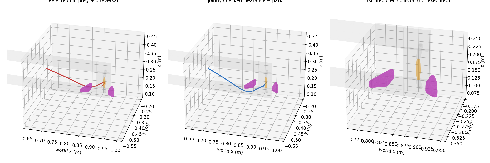

# Recovery V1.1：离线返回诊断

参考：`1730703`；物理实验前冻结代码：`545ea4f`。未启动任何离线诊断用 Isaac actor，也未恢复/拼接物体状态。

| 归档案例 | 原最终返回（实际门姿态） | 相同旧路径、闭门几何反事实 | 新联合退让/停车 | 选择 |
|---|---|---|---|---|
| 45936 | 拒绝：左指/`original39` | 通过 | 通过，124 个采样 | 40 mm tool-backoff + DIRECT native-rest |
| 46427 | 通过 | 通过 | 通过，98 个采样 | 同一共享方法 |

45936 原路线第 4 段（0-based segment 3），离开旧 pregrasp 后约 7.14% 的首个被拒样本，预测左指与 `original39` 相交约 **4.734 mm**。这不是实际执行碰撞：原检查在执行该返回之前拒绝。该路径在原闭门几何下通过，在最终约 3.033° 门姿态下失败。**开门后的场景变化使旧的闭门接近路径失效**；不能据此宣称不可达。

从完全相同的归档退让终点直接到 native-rest，原检查通过。因此局部退让终点本身不是不可避免的死路；关键缺陷是先选退让、之后只试一条旧返回。新方法在动作前联合检查退让及后续停车，不再依赖逆放 pregrasp。

## 边界与停车定义

全部查询使用归档实测七关节及六个 released G1 关节、当前实测活动件变换和原生 cooked 场景，不以理想对称开度替换手指状态。GT/碰撞模型仅用于允许的安全查询，不产生把手抓姿或 Agent 观察动作。

停车目标是机器人自身标准休息构型；备选为同一休息构型的 shoulder yaw ±20°，与物体 ID 无关。只有**完整规划路线实际执行、原 0.3 秒稳定保持、实测状态无碰撞且满足原 0.05 rad 余量/0.05 N 释放条件、进入所选休息构型关节 cell**后才记录 `SAFE_PARK_REACHED`。cell 半宽使用原路线采样步长 0.025 rad，是终点分类定义，不是新增抓取/开门门槛；不称为硬件标定精度。仅释放或局部退让不算停车。

候选：tool-backoff、观测面法向、法向+向上、tool-backoff+向上；40/80 mm；每个候选联合检查后续休息位。复用原 DIRECT/RRT（600 iterations、0.025 rad edge sampling、原 0.05 rad margin 和所有碰撞规则）；第一个足够可行的组合即可选用。运行时每段动作前后，以新的实测关节/手指/门姿态再次检查。若新状态使返回失效，仅允许原有有界路由重新连接；无路则 `SAFE_EXIT_UNAVAILABLE`。

离线回归还验证：已退让但不在停车区域不能被记作已停车；原 HARD 力异常在卸载第一步立即停止，不清空历史、不继续运动。详情见 [OFFLINE_REGRESSION.json](OFFLINE_REGRESSION.json) 和 [RUNTIME_PREFLIGHT.json](RUNTIME_PREFLIGHT.json)。原 V1 的 39 个输入逐字节不变，释放动作块、闭合、Pink、评分、驱动、物理参数和保护没有修改。

物理预算：只允许一个新 45936 正常闭门 episode，首次抓取 + 至多一次必要恢复；最多四次 Agent 观察调整。首次成功不额外重抓。原 RGB-D、视频、240 Hz 数据保持私有。完整结果另见最终 REPORT。
