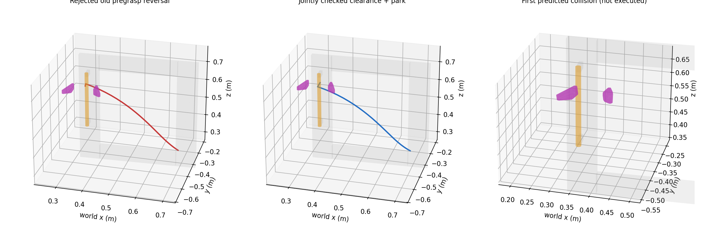

# Recovery V1.1：短交互与安全任务终止

**结论：唯一一次新的 45936 闭门 episode 完整 PASS。** 首次获取后保持退化、试拉失败；自动安全停车后，Codex 看真实反馈、重新观察，由原规划器选择另一候选。恢复后实际增加 **2.998738°**，随后完成真实释放、退让和实测安全停车。首次失败未被抹去，也没有追加第三次抓取。

范围：`AGENT_WRIST_RGBD / KNOWN_HINGE_STATE / APPROXIMATE_ACTUATOR_SIMULATION`。这是一个开发案例的完整生命周期验证，不是总体鲁棒成功率或真实硬件验证。

## 实际物理结果

角度增量均相对于各次 `GRASP_VERIFIED`，不是命令角，也不把释放后的自然运动计为试拉增量。

| 调用 | 双侧获取 L/R（滤波 N） | 原保持 | 实际试拉增量 | 操作结果 | 释放 / 退让 / 完整停车 |
|---|---:|---:|---:|---|---|
| 首次 | 0.3957 / 0.6141 | 1.0042 s；左正法向报告约 +0.158 s 后消失 | **+0.008696°** | 失败，原软力警告返回卸载 | **全部实测完成** |
| 唯一恢复 | 0.5157 / 0.5087 | 1.0042 s；保持内两侧均有正法向报告 | **+2.998738°** | **短程传力 PASS** | **全部实测完成** |

原控制器的 `termination_reason` 仍沿用旧字符串 `SHARED_DOOR_30_DEG_SUCCESS`；本次实际配置是约 +3°，实测增量如表，**不代表 30° 成功**。

恢复开门时右侧正法向报告随后消失，但门持续运动、原控制器允许继续；没有新增单侧卸载或载荷对称性否决条件。第二次获取实际门角为 **0.001490°**；第一次停车时为 0.024885°，其间的变化来自本场景中的重新接近/闭合接触，未设置物体状态。最终释放、停车后的实际门角为 **3.018578°**。

| 调用 | 原始 pad 峰值（N） | 固定获取参考的相对平移 / 转角 | 有正法向报告时最大 TCP（mm/s） | 调用内最小余量（rad） |
|---|---:|---:|---:|---:|
| 首次 | 2.00315 | 0.4714 mm / 0.1434° | 1.7435 | 0.41909 |
| 恢复 | 1.48258 | 0.9492 mm / 0.2722° | 2.0717 | 0.71955 |

相对运动是 TCP/活动件位姿变化代理，不是材料滑移实测；参考固定在首个完整获取样本，不随控制参考重置。调用内余量包含返回/接近，不能误当作仅带载开门余量。全场景最小余量 **0.418154 rad**。全阶段 TCP 最大 **28.9992 mm/s**，发生于原无载运动；原带载 5 mm/s 保护未改变，未触发速度停止。

只有一次原 `SOFT_FORCE_WARNING`：267.545833 s，raw peak 2.003146 N，window mean 1.987065 N，连续过载窗口数 0。它终止首次当前操作并触发受保护卸载，**不是 sustained HARD 力停**。无实际危险碰撞、关节或速度保护停止。完整峰值和窗口记录见 [RESULTS.json](RESULTS.json)，没有平均掉或删去原始峰值。

## 原返回失败的确切原因

以 `1730703` 两例归档的实测 arm/finger q、实际最终门姿态、原 native cooked 场景复现。

| 归档案例 | 旧路径、实际门姿态 | 相同旧路径、闭门反事实 | 新联合退让/停车 |
|---|---|---|---|
| 45936 | 左指 / `original39` 碰撞预测，拒绝 | 通过 | 通过，124 个路线采样 |
| 46427 | 通过 | 通过 | 通过，98 个路线采样 |

45936 的旧路线第 4 段（0-based 3），从旧 pregrasp 朝 home 旋转约 7.14% 的首个被拒样本，预测左指穿入 `original39` 约 **4.734 mm**。旧路线没有实际执行。**已打开的门使闭门 pregrasp→home 的扫掠路径失效**，并非不可避免的可达性限制。

从完全相同的归档退让终点直接到 robot-native rest，原检查通过，说明该局部终点并非死路。原实现的问题是“先执行第一个局部可行退让，再只检查旧返回”。详见 [离线诊断](OFFLINE_DIAGNOSIS.md)、[碰撞样本](FIRST_COLLISION_DETAIL.json)、[离线回归](OFFLINE_REGRESSION.json)。46427 本轮只做离线回归，没有新增物理 episode。

## 最小共享改动与停车定义

新增 [native_g1_safe_park.py](../../../scripts/native_g1_safe_park.py) 和 [native_g1_safe_termination.py](../../../scripts/native_g1_safe_termination.py)，通过一个显式依赖复用 V1 Agent/接触执行循环。释放动作块逐字节保留；新代码只替换卸载后的路线选择和终态验收。没有物体 ID 的退出分支、手写关节路径或历史成功路线回放。

从原条件确认卸载后：

1. 从实测 TCP、观测面法向生成有限 backoff / outward / upward 组合，40/80 mm。
2. **在执行退让前**，联合检查退让与后续停车。复用原 DIRECT/RRT、IK、0.025 rad 边采样、0.05 rad 余量和全部碰撞规则。
3. 所有查询使用当前实测门变换和六个真实 released G1 关节，不以理想对称开度代替实际手指。
4. 通过原执行器执行；每段前后按新实测 arm/finger/object 状态复查。若退让后原 onward 路线失效，允许原有界路由重新连接；无路则保存 `SAFE_EXIT_UNAVAILABLE`，不冒险运动。

物理批次前冻结的停车条件：完整路线执行至机器人自身休息构型区域；原 **0.3 s** 保持；当前实测状态无碰撞、满足原余量、原 ≤0.05 N 卸载和力历史自然 settled 条件。休息区域关节 cell 半宽使用既有路线采样尺度 **0.025 rad**，只定义终点分类，不是新增抓取/开门门槛，也不是硬件精度标定。备选是 robot-native rest 的 shoulder yaw ±20°，与物体 ID 无关。

| 结果 | 含义 |
|---|---|
| `RELEASED` | 原受保护 jaw-only 释放完成，力历史自然 settled；未带载清空 |
| `CLEARANCE_REACHED` | 已实际执行受检查退让；尚不等于停车 |
| `SAFE_PARK_REACHED` | 完整停车路线执行、原保持和实测终态检查完成 |
| `SAFE_EXIT_UNAVAILABLE` | 保留具体拒绝/保护原因，结束；禁止再操作物体 |

### 本次两条真实退出

| 退出 | 首个足够可行组合 | 规划 wall | 实际逐段复查 | 退出仿真时长 | 停车最大关节偏差 |
|---|---|---:|---:|---:|---:|
| 首次失败后 | 40 mm tool-backoff + DIRECT native-rest | 1.1447 s | 21 段 | 127.125 s | 0.0037232 rad |
| 恢复开门后 | 同一规则，按当前约 3° 门姿态重新生成 | 1.4266 s | 21 段 | 135.600 s | 0.0037248 rad |

两次均首个组合足够可行，未继续穷举，也未实际触发 RRT/备用停车区域；不能声称这些 fallback 已物理验证。旧碰撞路线在离线仍明确被拒绝，未放宽碰撞或穿透规则。原 HARD 力异常在卸载首步即停止、且不清历史的接口测试通过。

最终 arm q（rad）：`[0.0008333, -0.5007240, -0.0008404, 0.9988208, 0.0020024, 0.5020017, 0.0037248]`；最终余量 **1.190798 rad**；raw/filtered pad 均 **0/0 N**。原 0.3 s 最终保持中，arm 最大位置范围约 **9.71e-8 rad**，TCP 位置差分速度峰值 **0.009485 mm/s**。但原生 qdot 的 J7 最大绝对值约 **0.04933 rad/s**，明显不同于 q 位置差分约 **5.59e-7 rad/s**。两者原样保留，**没有用滤波掩盖、没有据此改驱动或追加试验，也不宣称原生速度接口/执行器已完成物理辨识**。见 [最终保持诊断](FINAL_HOLD_DIAGNOSTIC.json)。

## Agent 与 Skill 的边界

共 **1 个正常闭门场景、2 次物理抓取、1 次实际恢复、4 次新腕部观测、2 次 Agent 选视点调整、0 次场景重启/物体状态恢复**。固定注册站位，底盘未移动。

Codex 实际查看每代新腕部 RGB/SAM3/深度/点云：首次上段被自身遮挡，选择较高略侧视点，实测长度 92.750→295.849 mm。首次失效并安全停车后，查看真实载荷/开度/运动曲线和局部图，再补充更侧向的高视点，92.744→295.860 mm。原排名器自动从失败的 `[-0.3,0,0,0]` 换到 `[0,-0.009375,180,0]` 原候选族；未手写该姿态、复制旧成功姿态、改权重或提高夹紧力。此差异来自新观测和原有 episode 候选记忆，不能归因于退出规划改善了抓取评分。

低层负责安全检查和全部关节路径；Agent 只批准观察、另一自动候选和默认休息区域，不逐个指定关节 waypoint。两次都在完整卸载/停车后才暂停交回 Agent，未冻结带载 PhysX 来宣称保持成功。

[Agent 决策简表](AGENT_TRACE_SUMMARY.json) 保留实际结果。序号 0 的本地工具曾误附旧目录图片哈希，原记录未改写；序号 1 明确更正并附本次新图哈希。实际看图为本 episode 的新帧，后续命令均为当前证据；[更正说明](PROVENANCE_METADATA_CORRECTION.json) 与私有完整 trace 可核对。旧归档主证据不变。旧 `GRASP_VERIFIED.grasp_index` 在每次原初始化序列中为 0，离线按 `contact_recovery_attempt_index=0/1` 和 `attempts/00,01` 对齐，物理次数为 2。

## 基线对比、证据与清理

| 45936 | 首次增量 | 恢复增量 | 最终完整停车 | 完整 runner |
|---|---:|---:|---|---|
| 原 V1 `1730703` | +0.0096° | +2.9955° | 旧返回预测碰撞，未执行 | 失败，原记录保留 |
| 新 V1.1 | +0.0087° | **+2.9987°** | **实际执行并验收** | **PASS** |

这是 fresh visual episode，不是固定同一抓姿的配对抓取研究；不能从此表声称保持能力或总体成功率提高。`a47fe09`、`3da07ab`、`1730703` 及旧十门结果均未改。

物理结果前运行实现冻结于 **`545ea4f`**。44 个输入与冻结表一致，原 V1 39 个输入及原碰撞实现与 `1730703` 逐字节相同。实际 runner：`run_native_g1_safe_termination.py`，SHA256 `b3066e78…992ba8d5f`；生成执行器 `bb63b198…f01c2ad2`；实际 closure / trajectory / opening / initial-sequence 哈希均与 V1 相同。见 [冻结表](FROZEN.json)、[接线核验](RUNTIME_PREFLIGHT.json)、[实际源码](SOURCE_VERIFICATION.json)、[基线保持](BASELINE_PRESERVATION.json)、[配置/模型哈希](CONFIG_PROVENANCE.json)。

- 仿真 **820.7125 s**；episode wall **5823.811 s**（含感知/规划/Agent 等待）；监督进程总 wall **5844.409 s**，约 **97.41 min**。没有优化原动作时序。
- 240 Hz physics/observations 各 **196,971** 条；closure commands **35,385** 条。原始冲量、接触点/法线/collider IDs、耦合关节、载荷和元数据均留在私有 chunked gzip 流。
- 连续视频 **1280×960 / 30 fps，24,621 帧，820.700 s**；完整解码 return 0，无错误。是连续仿真记录，不代表 wall-clock 实时。
- 原始证据 **851 文件**本地私有备份逐 SHA256 核对无差异。公开仅代码、紧凑汇总、规划诊断图和哈希；没有上传 raw/video/Release。见 [证据索引](EVIDENCE_INDEX.json)、[备份核验](LOCAL_BACKUP_VERIFICATION.json)、[视频核验](VIDEO_DECODE_CHECK.json)。
- Actor **757200** 正常导出 return 0；监督进程和 encoder 也已退出，未触碰其他用户进程，见 [清理记录](PROCESS_CLEANUP.json)。未新增其他对象、试验或第三次抓取。

剩余限制：已知铰链/动态活动件状态、注册站位、原 native 碰撞模型仍参与执行/安全查询；GT 把手不参与在线观测和接触评分。腕部为仿真安装，原配置未验证相机外壳/线缆碰撞；驱动为近似有限执行器。原生法向报告不是完整 wrench，零正法向不能单独证明分离；独立电机输出和 mimic 求解冲量仍不可用。**停车结论限于原有建模场景与预先定义的终点区域，不是硬件安全认证。** 本轮已停止。
