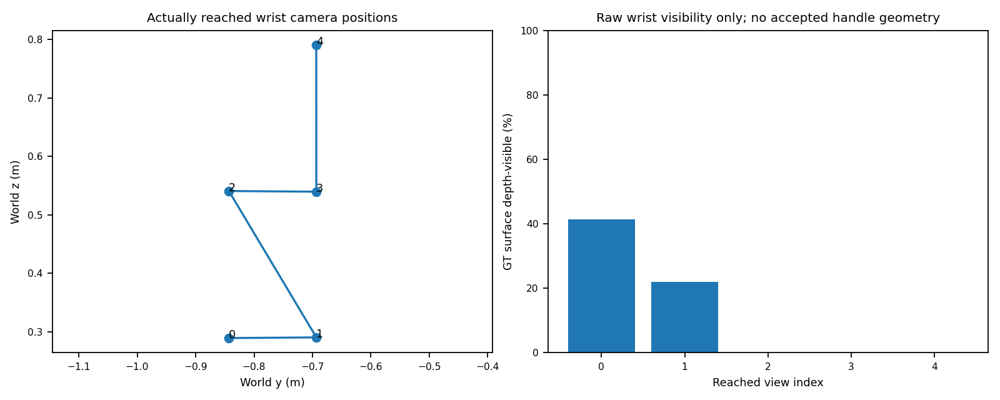

# xArm7 真实关节运动腕部 RGB-D：有限验证结果

参考基线：`dba947d`。范围：**RGBD_SAM3 / KNOWN_HINGE_STATE_COLLISION / APPROXIMATE_ACTUATOR_SIMULATION**。这不是硬件验证，也不是未知结构自主操作。

**实际机械臂带动刚性腕部相机完成了观测，但本轮没有打通视觉初始化。** 45600 的一个正常闭门观测场景执行了 5 段关节运动并保存 5 组 RGB-D；未得到有效 SAM3 把手 mask，因而未进入融合、抓取规划、闭合或开门。按协议停止，**抓取/开门物理尝试数为 0**，没有补跑、场景相机深度回退或修改检测阈值。

## 相机与执行来源

仓库原有 `WristRecorder` 为 PiPER 仿真假设外参，通过 `sync(E)` 设置相机世界位姿，初始化还使用外部相机；不是已验证的 xArm7 刚性挂载，未用于本轮观测输入。

新增独立传感器 `/World/Piper/.../link7/wrist_rgbd`，作为实际 link7 刚体的 USD 子节点。仅安装时设置一次**局部位姿**，运动/采集时不设置相机世界位姿。

| 项目 | 本轮配置 |
|---|---|
| TCP → optical camera | 平移 `[75, 0, -100]` mm；XYZ 欧拉角 `[0, -25, 0]`° |
| link7 → optical camera | 原生 G1 URDF 的 link7→TCP 固定变换再乘上述外参；平移 `[75, 0, 72]` mm |
| 图像/内参 | 1280×960，30 Hz；`fx=fy=920, cx=640, cy=480`，每帧另存实际 K |
| 深度 | `distance_to_image_plane`，米、optical-Z，裁剪范围 0.025–3 m |
| 校准性质 | 明确设计的仿真外参，非真实手眼标定、非已验证硬件支架 |
| 相机实体 | 光学传感器；未向冻结机器人增加质量/碰撞体。相机外壳、线缆、硬件安装间隙尚未验证 |

场景相机只用于诊断视频，**未向本轮输入提供图像、深度、把手点云或抓取几何**。初始巡看仍依赖注册站位与已知柜体粗包围范围；这也是已知模型依赖。预定的后续斜视由当前腕部把手点云/面板法向生成，但本轮未达到该阶段。

## 离线可达性与视野检查

使用相同 xArm7/G1、原有碰撞检查及 0.05 rad 关节余量。表中斜视目标是用**归档观测点云**做的条件可达性诊断；其关节路径/把手位置均不传给 live 输入，live 必须用新腕部观测重新生成。

| 对象 | 首个粗巡看位 | 归档点落入首帧 FOV | 条件斜视可达 | 路径采样最小余量 |
|---|---|---:|---|---:|
| 45600 | 柜体高度 25%，0.60 m standoff | 88.35% | −30°、+30° | 0.314 rad |
| 45606 | 柜体高度 25%，0.60 m standoff | 0% | −30°、+15°；+30°局部候选未获解后使用 +15° | 0.736 rad |

条件斜视中，归档观测点均落在 FOV 内，预测机器人遮挡为 0；这不是 live 可见性或物理成功。45606 只做离线检查，低位首帧不适合其高位把手，没有启动它的 Isaac 实验。原 ±55° 场景相机视角没有强加给机械臂。

## 一个观测场景的实际结果

6 个有限粗巡看候选中，5 个经正常执行器实际到达；高度 75%、standoff 0.60 m 的候选 `NO_IK`，跳过并继续下一个，没有结束场景。

| 视角 | 实测 optical camera 世界位置 m | 到达时间 s | SAM3 原图最高分 | 结果 |
|---|---|---:|---:|---|
| 0 | `[0.497767, -0.843297, 0.288981]` | 42.900 | 0.265625 | 高于 0.25；mask 接触画面右边界，被原有 `ROI_border` 过滤拒绝 |
| 1 | `[0.497566, -0.693376, 0.290146]` | 53.750 | 0.018433 | 无有效检测 |
| 2 | `[0.497920, -0.843121, 0.540673]` | 73.558 | 0.002594 | 目标把手已在视野外 |
| 3 | `[0.497806, -0.693483, 0.539493]` | 84.221 | 0.002823 | 目标把手已在视野外 |
| 5 | `[0.497444, -0.693566, 0.790570]` | 102.908 | 0.002289 | 目标把手已在视野外 |

视角 0 使用了一次冻结的、由图像/深度生成的裁剪恢复，最高分升至 **0.298828**，但仍因 `ROI_border` 拒绝。后续不重复该裁剪预算。共 6 次 handle inference（5 次原图、1 次裁剪），没有人工 prompt、点击或 GT crop。没有把“有置信分数但 mask 被拒绝”误记为模型完全没检测到。

5 次相机读取与实测关节 FK 的最大位置差 **0.001309 mm**、最大旋转差 **0.000172°**；相机与“实测 TCP × 固定外参”的最大位置差见 `COMPACT_RESULT.json`。这些是理想仿真读回的一致性，不是硬件标定精度。

实际取得的均是粗巡看平移/升高视角，**没有执行由把手点云生成的左右斜视**，不能声称已获得所需的有效多视角把手几何。

## 与冻结场景相机基线的比较

GT 只在场景结束后的独立 evaluator 使用，没有反馈至执行。

| 指标：45600 | `dba947d` 场景相机 | 本轮腕部相机 |
|---|---:|---:|
| 捕获视角 | 初始 + 3 个多视角 | 5 个实际到达的粗巡看位 |
| GT 表面在原始深度中可见的并集，2 mm 深度一致性 | 51.80% | 44.70% |
| 有效把手几何 | 38,774 个融合观测点 | 无有效 mask，未形成融合几何 |
| 融合点云对 GT 表面的 2 mm 邻域覆盖 | 55.79% | 不适用 |
| 已选姿态的 observed-only first-contact 预测，左/右 | 17.847 / 17.863 mm | 无腕部选择姿态，不伪造预测 |
| 实际短开门 | 抓取后 +2.9993° | 未尝试 |

“深度可见并集”和“点云邻域覆盖”定义不同，不能互换。腕部第一帧的 GT 深度可见比例为 41.39%，第二帧 22.04%，更高三帧均为 0%。目标把手投影落入机器人自遮挡轮廓的比例均为 0；全图自遮挡不为零，但不能据此归因于把手被遮挡。

冻结场景相机输入加入三个 rear 假设后的 first-contact 预测均为约 17.920/17.920 mm，原物理首接触为约 21.872/18.894 mm。右指接触发生在原 CENTER 调整后，不能将该差值直接解释为固定姿态几何误差。数值来自原归档，不用于本轮相机/抓取修正。

本轮不足以评价腕部融合的 first-contact 精度、未观测背面补全质量或物理力传递。没有把失败 mask 用 GT 修补后再称作视觉重建。

图中 0–4 是五次实际采集的顺序，对应 survey 00/01/02/03/05。连线仅连接到达位置，不表示连续笛卡尔轨迹；真实连续轨迹保存在 240 Hz 记录中。

## 时长、完整性与保护

| 指标 | 实测 |
|---|---:|
| 主观测场景仿真时间 | 102.9083 s |
| Actor 墙钟时间（进程开始至正常退出） | 751.7599 s |
| 5 段运动及原有 settle 的墙钟合计 | 519.7172 s |
| 主场景 240 Hz physics / observation 记录 | 24,698 / 24,698，时间间隔均匀 |
| 闭合控制调用 / 抓取事件 | 0 / 0 |
| 实际门角 / 把手接触峰值 | 0° / 0 N |
| 最小关节余量 | 0.77196 rad |
| 最大关节命令跟踪差 | 0.003781 rad |
| 最大实测世界 TCP 速度 | 29.117 mm/s，全部是**未加载巡看**；加载 5 mm/s 指标不适用 |
| 连续诊断视频 | 1280×960，30 fps，3,087 帧，102.900 s；完整解码无错误 |

raw contact、raw/filtered pad loads、关节速度/effort/reaction、native gripper feedback 在全部 24,698 条 observation 中均存在；本轮无接触，空 contact 列表表示没有接触，不是缺失数据。原生力信息仅为仿真诊断，非完整测得 wrench 或硬件安全证据。

冻结的闭合模块、precontact 轨迹、Pink 开门函数、初始抓取序列的 hash 与参考一致；22 个冻结源码/配置 hash 全部一致。没有改变 actuator、力、摩擦、碰撞模型、物体动力学或保护。此轮没有控制器失败，也没有证明腕部相机不可能找到好视角。

## 首个问题与建议

**首个实际分歧是初始巡看构图，不是 IK、不稳定夹持或相机/FK 不一致。** 粗柜体中心的固定高度/距离扫描未保证完整把手入画；第一帧已有检测线索，却只触发了旧裁剪恢复，后续竖直扫描没有利用该线索重新取景。

建议下一轮只改一个输入环节：将现有超过置信阈值但触边的 mask/深度 proposal 用作**机械臂重新构图的线索**，而不是直接用于不完整抓取几何；通过实际腕部移动补足画面边缘。保留 SAM3 阈值、mask 规则、G1/Pink 及全部物理保护。这里仅提出建议，**未实现该补救、未启动额外观测或抓取重试**。

新腕部输入适配器中的融合、自动抓取和移动相机共同可见配准接线尚未在本轮触发，不能称为已验证的新抓取基线。`dba947d` 继续是冻结的成功基线。

## 证据和复现

- `PROTOCOL.md`：运行前登记的范围与顺序。
- `OFFLINE_REACHABILITY.json`：两个对象的条件 IK、碰撞路径、视野诊断。
- `ACTUAL_VIEW_TRAJECTORIES.json`：本轮关节命令路段、实测末端关节、时间和站位；完整实测轨迹在私有 240 Hz streams。
- `WRIST_CALIBRATION.json`、`PROVENANCE.json`：实际 parent 路径、固定变换、源码 hash、冻结源检查和实际加载的控制函数 hash。
- `COMPACT_RESULT.json`、`GEOMETRY_COMPARISON.json`：完整数值、检测过滤原因与只读 GT 评估。
- `PRIVATE_EVIDENCE_INDEX.json`、`PRIVATE_ARCHIVE_INDEX.json`：私有原始证据位置、大小与 SHA256，不公开原始视频/RGB-D/telemetry。
- `OWNED_PROCESS_CLEANUP.json`：actor PID 2213155 正常退出，return code 0，完整导出后关闭；没有遗留 actor，也未触碰其他用户进程。

运行入口：`scripts/run_native_g1_wrist_short.py --job <private job.json>`；有限启动器为 `scripts/launch_native_g1_wrist.py --mode observation|physical`，会保留已有 launch，禁止自动重跑。本轮只执行了 `observation`。物理模式和预抓取修正的端到端行为仍未验证，不应直接当作已通过配置使用。
