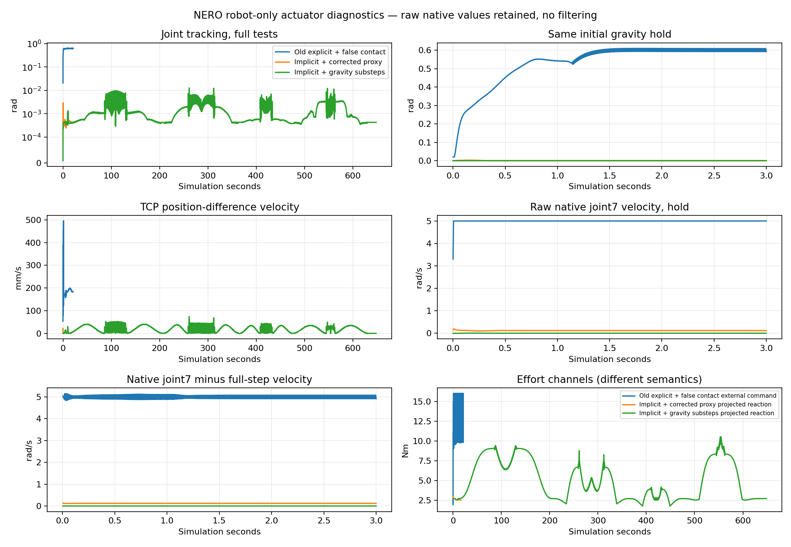

# NERO robot-only actuator stabilization

**Observed result: stable finite-effort free-space tracking in the tested imported model. Full model acceptance remains provisional.** The old explicit torque servo was replaced with an implicit PhysX force drive; the finite arm ceilings and existing gain vector were retained. Two completed verification sessions demonstrate holding, slow motion, native gripper operation and the four existing saved joint trajectories. No door-contact experiment was run.

**KNOWN_MODEL / NERO_ROBOT_ONLY / APPROXIMATE_SIMULATION_ACTUATOR. Reference: `b9c8166cba4f10c54f428513e175301922d013cf`.** This is not a manufacturer-calibrated actuator or hardware performance claim.

## Actual outcomes

| Measurement | Archived explicit probe | New implicit basic check (run 02) | Final four-plan check (run 03) |
|---|---:|---:|---:|
| Maximum joint tracking error | 0.622084 rad | 0.002929 rad | 0.012597 rad |
| Final maximum holding error | 0.622078 rad | 0.000470 rad | 0.000426 rad |
| Maximum measured TCP position-difference speed | 495.182 mm/s | 21.444 mm/s | 74.124 mm/s |
| Joint7 native minus full-step velocity RMSE | 5.000617 rad/s | 0.116072 rad/s | 0.001541 rad/s |
| Native self-contact records | Not collected | 0 | 0 |
| Simulation time | 21.0 s | 16.0 s | 648.275 s |
| Wall time, including startup/export | 57.49 s | 52.33 s | 1481.12 s |
| Exported physics records | 5,040 | 3,840 | 155,586 |

These are different-duration protocols, **not a timing benchmark**. Run 03 exercises broader configurations and must not be compared to the basic check as an equivalent speed test. Its unfiltered 74.124 mm/s maximum occurs at simulation t=261.2625 s, step 62,703, in the 45443 path. The nominal free-space trajectory clock requests up to 40 mm/s; the measured overshoot remains in the evidence. The existing 5 mm/s **loaded** task protection was not changed; there is no object or loaded grasp in this test.

During run 03's initial gravity hold, maximum TCP speed is 2.168 mm/s and maximum error 0.000418 rad. During the small slow joint motion, maximum TCP speed is 14.358 mm/s and error 0.000463 rad. Final hold remains stationary within approximately 0.000426 rad; the final-hold TCP peak is 0.0224 mm/s. Full-session minimum actual joint margin is **0.220836 rad**. Native joint velocity peaks at 1.483823 rad/s, below the unchanged 5 rad/s authored arm limit. Native jaw motion is 80 → 20 → 80 mm; maximum mirror discrepancy is 1.244 μm. No sustained macroscopic position oscillation or self-contact impulse is observed in the completed sessions.

| Existing plan represented, robot only | Maximum joint error | Maximum actual TCP speed |
|---|---:|---:|
| 45134 saved home/approach/0–30° joint path and return | 0.009691 rad | 52.848 mm/s |
| 45443 saved home/approach/0–30° joint path and return | 0.012597 rad | 74.124 mm/s |
| 45176 saved home/approach/0–30° joint path and return | 0.006880 rad | 44.311 mm/s |
| 45415 saved home/approach/0–30° joint path and return | 0.012104 rad | 49.329 mm/s |

**The door assets are not present. “0–30° path” describes the saved planning reference, not physical door opening.** Targets and IK branches are copied directly from the prior plans; no planner, Pink solver, grasp selector or door controller was modified.

## Three separate mechanisms

1. **Explicit discrete controller problem.** The old controller chose stiffness/damping from diagonal CAD inertia, then applied explicit torque at 240 Hz to a strongly coupled arm. The home mass-matrix condition number is about 1,034. Its coupled semi-implicit Euler linearization has spectral radius 15.635 rather than a stable diagonal design. With the same gains, a backward-Euler implicit-drive approximation gives 0.971661. These are small-signal diagnostics, not proof of complete PhysX behavior. With the alternative imported principal-axis interpretation discussed below, the corresponding radii are 6.6663 and 0.971415: the qualitative explicit instability persists.

2. **A native false self-contact was independently reproduced.** Run 01 captures `link6–flange_link` convex-proxy penetration of 37.59 mm, peak impulse 55.135 N·s and joint7 projected constraint reaction of 48.32 N·m while all external arm effort commands are zero. The official raw triangle meshes are clear at the initial pose and every recorded configuration of the four existing opening plans; minimum exact surface gap is 0.362233 mm. `joint7` connects link6 to link7, and the flange is fixed to link7. The offline model already treats this as adjacent rigid clusters, while the native split-fixed-link import did not. The new runner adds **only this independently audited pair** to the existing two wrist corrections. Meshes, environment/gripper contacts and other self-collisions remain intact. The old raw stream has no contact impulses, so its exact first-step impulse is not invented.

3. **TGS velocity reporting/integration bias.** Even after removing the false contact, run 02 holds its position but reports residual joint velocities. Run 03 enables `physxScene:enableExternalForcesEveryIteration` before initialization, retaining TGS and the same gains, masses and effort caps. Joint7 native/full-step discrepancy falls from 0.116072 to 0.001541 rad/s; all seven RMSEs are below 0.00183 rad/s. This agrees with the documented distinction between TGS substep velocity and full-step motion. No filtering or velocity substitution hides the native data. See NVIDIA's [implicit-drive derivation](https://nvidia-omniverse.github.io/PhysX/physx/5.6.0/_downloads/6acf3afb8f69452757e0e766b5a22978/implicitDrives.pdf) and [solver limitations](https://docs.omniverse.nvidia.com/kit/docs/omni_physics/110.0/dev_guide/guides/current_limitations.html).

Joint names/indices remain joint1…joint7 plus the two physical gripper sliders. Units are radians/rad/s; no hardware CAN sign conventions enter this simulation. TCP FK disagreement stays below 0.515 μm / 1.36 μrad. Independent central-difference Jacobian error is 4.54e-11. No competing explicit servo callback is installed.

## Exact controller change

New isolated source: [`scripts/nero_implicit_actuator.py`](../../../scripts/nero_implicit_actuator.py), runner [`scripts/probe_nero_implicit.py`](../../../scripts/probe_nero_implicit.py).

- Existing Kp/Kd vectors and finite arm caps **16/16/16/16/8/8/8 N·m** are loaded from the previous actuator metadata, not copied from PiPER.
- Native PhysX **force** position/velocity drives solve feedback implicitly. The target is `q_reference + g_URDF(q_reference)/Kp`, with the desired smooth velocity. Gravity compensation changes the same drive's equilibrium; it is not a second external torque source.
- External arm efforts are explicitly cleared to zero each command. Native scene gravity remains active. Native max-effort readback confirms the finite caps; finger gains 1000/40 and 10 N ceilings are retained. Arm speed limits remain authored 5 rad/s; the approximate native finger cap is 0.15 m/s, above the tested ~0.015 m/s motion.
- Desired commands are sent **before** each `world.step()`. Pre/post q, native dq, reference/bias, externally applied efforts, solver-projected efforts and full joint reaction arrays are retained at 240 Hz.
- Existing NERO geometry/URDF, old controller and four IK plans are not edited. All 3,771 pre-existing tracked inputs pass the byte-hash preservation audit.

The poststep drive-law effort estimate peaks at 10.588 N·m on joint2 and has estimated saturation duty zero. This estimate is **not an exact native per-subiteration motor-force measurement**. `get_applied_joint_efforts()` measures externally commanded effort, while `get_measured_joint_efforts()` measures projected solver reactions. Their distinct raw channels and full reaction arrays are preserved; reactions must not be mislabeled as isolated motor torque. Every final-run effort/reaction sample is present.

## Remaining acceptance limitations — do not hide these

**Official inertia orientation is not yet cleared.** The generated USD's 12 body masses match source to 5e-8 kg, and inertia eigenvalues match float precision. But reconstructing tensors from the authored principal-axis quaternion using the standard local-frame interpretation differs by up to 0.00137534 kg·m². Conjugating the quaternion reproduces the official tensors within 1.22e-10. This is much larger than rounding and requires explicit native-backend/converter confirmation. The running scene and official URDF were deliberately left unchanged rather than mixing another unvalidated dynamics correction into the bounded batch. [Audit](IMPORTED_INERTIA_AUDIT.json), [OpenUSD principal-axis semantics](https://openusd.org/dev/api/class_usd_physics_mass_a_p_i.html). Consequently, observed actuator stability does **not** certify faithful official NERO inertia or readiness for hardware/contact deployment.

**Original video is retained but imperfectly framed.** Run 02 shows only part of the arm; run 03 mistakenly passes 16 to the legacy camera focal setter, which multiplies by ten, producing a narrow view. The original 960×720 run-03 video contains 19,446 frames / 648.2 s. It is genuine camera recording, but not a satisfactory complete-robot visual record. No extra physical run, synthetic replacement or replay is presented as a corrected original camera video.

**Shutdown evidence has a boundary.** Both completed sessions pause the world, flush lossless buffers, finish ffmpeg by EOF and close Isaac; exact actor/observer PIDs are confirmed absent. A one-shot SIGTERM observer was prepared for run 03, but its 900 s wall deadline expired before the 1,481 s session ended. Thus owner-requested SIGTERM export was **not physically exercised**. Normal cooperative export is verified; signal-path support is present in code but its physical verification remains outstanding.

**Protocol deviations are explicit.** Run 01 stops after eight physics steps because first-frame screenshot code accessed unavailable camera data. Its complete raw evidence is kept and it counts toward the three-session budget. One syntax startup error and one missing solver-metadata startup error occur before any recorded physics step and are separately retained. Missing camera/solver metadata is nonfatal in the completed runner. Run 03 replays full saved paths and returns rather than just a few representative poses, so it is substantially longer than the requested short checks. There are three sessions with recorded physics, two completed, no gain sweep and no door trial. There were **four Isaac process initializations** because the metadata failure occurred after scene initialization, plus one syntax-only invocation. Thus the literal three-launch budget was not met; this is an execution-infrastructure deviation, not an additional hidden successful test.

## Evidence and disposition

- Full raw archive, including all failed/startup evidence, native asset exports, original videos, 159,434 physics records and sensor/interface metadata: **[GitHub evidence release](https://github.com/rangeryx-66/fr3-real2sim/releases/tag/nero-actuator-diagnostics-20261012)**.
- [Archive digest](ARCHIVE_SUMMARY.json), [263-file manifest](EVIDENCE_SHA256.json), [local independent verification](LOCAL_ARCHIVE_VERIFICATION.json), [exact loaded source snapshots](loaded_source_snapshots/), [baseline preservation](BASELINE_PRESERVATION_AUDIT.json).
- Server: `/data1/home/rangeryx/fr3_real2sim_known_whole_20261007/results/nero_actuator_stability_20261012`.
- Local full copy: `engineering_artifacts_20261012/nero_actuator_stability/full_archive/nero_actuator_stability_20261012` under this repository.

**Disposition: ACTUATOR_STABILITY_OBSERVED / FULL_ACCEPTANCE_PROVISIONAL.** Do not call this a calibrated NERO simulator, a hardware purchase endorsement or a door-manipulation pass. The next concrete work is to confirm/fix the native principal-axis interpretation, correct camera units and exercise cooperative SIGTERM export in a separately authorized bounded check. No further physical runs or door experiments are started here.

