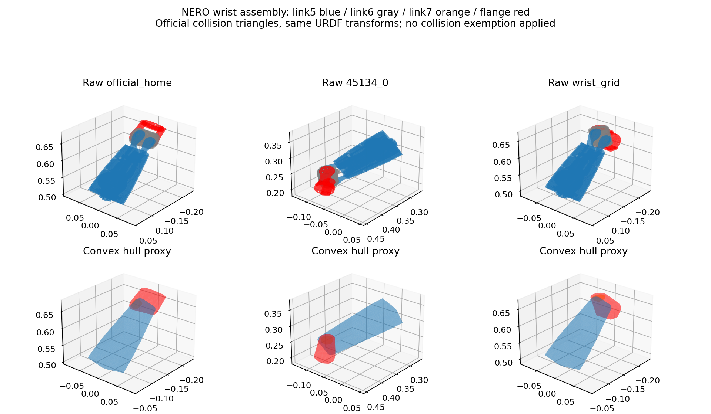
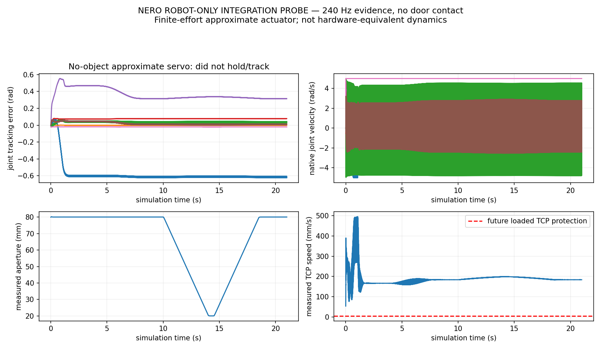

# NERO purchase feasibility — geometry promising, physics integration unresolved

**Recommendation: INCONCLUSIVE.** NERO should remain a candidate, but this round does not provide a successful contact demonstration or grounds for a hardware purchase endorsement.

**ORACLE_HANDLE / KNOWN_MODEL / NERO_FEASIBILITY / APPROXIMATE_ACTUATOR. Reference: `4b73580`.**

The previous wrist blockers were traced to convex hulls filling the official wrist cavity. After two verified corrections and a globally aligned native-gripper tool frame, automatic NERO-specific station/IK planning finds complete home → approach → grasp → 30° paths for all four objects. Joint-4/joint-6 limits do not block these selected 30° solutions.

The finite-effort approximate servo fails the no-object gravity-hold/tracking test: maximum joint error 0.622 rad, peak measured TCP speed 495.18 mm/s, and high-frequency velocity oscillation. **No 45134 door-contact episode was launched.** The explicit task condition to stop when integration is not ready applies. This is a limitation of our current actuator/simulator integration, not evidence that real NERO hardware is incapable of opening these doors.

## Exact collision corrections

| Pair | Original raw triangle intersections | Minimum exact surface gap | Minimum sampled signed gap | Correction and evidence |
|---|---:|---:|---:|---|
| link5–link7 | 0 across 22 configurations | 10.484 mm | 10.902 mm | link5-link7 Never in pinned SRDF |
| link5–flange_link | 0 across 22 configurations | 1.715 mm | 1.928 mm | flange is fixed child of link7; exact assembly geometry independently verified |

The actual collision STL and visual DAE agree to approximately 0.15 μm at their nearest vertices. Link5 convex hull volume is about 3.8× the raw signed mesh volume; the hull closes the wrist cavity and generates apparent intersections despite separated original surfaces. Link5 is not watertight: the signed sampled distances are qualified diagnostics, not a complete solid-volume certificate. Full raw-triangle intersection checks and exact surface distances are the primary geometric evidence. [Full geometry audit](WRIST_COLLISION_AUDIT.json) preserves q, transforms, nearest points and hull contacts.

The two proxy pairs are added explicitly to the NERO model and native PhysX filtered-pair relationships. The `NeroModel`/`RawCheckedScene` adapter retains actual raw-triangle checking for those pairs in shared scene checks. No other manufacturer `Never` pairs were adopted automatically; no mesh was removed, scaled or reshaped. Fixed-cluster/neighbor relationships are derived from **NERO’s own URDF topology**, not copied from a PiPER link list. The existing mechanically opposing finger-pair exclusion is retained and consistent with the manufacturer gripper semantics. Robot/environment, gripper/object, palm/root contact and all other unsafe self-collisions remain in the shared planner and native collision model.

No door runner was launched, so full runtime manipulation/contact guards were not physically validated on NERO. The robot-only probe applied these native filters, but did not instrument all self-contact impulses or run the complete task-scene contact guard. Remaining self-contact/projection contributions to the observed instability are therefore unresolved.

The audit label `official_home` denotes the official model at the selected reference simulation posture `[0,0,0,0.8,0,0,0]`; it is not a manufacturer-prescribed ready posture. [Home context](HOME_CONTEXT.json) and the hash-matched [audit input](WRIST_AUDIT_INPUT.urdf) preserve that distinction.

## Four-object offline reachability

| Asset / intended handle | Full 7DoF planned range | Base x/y/yaw | Min home/approach/opening margin | Closest joint/configuration | Physical result |
|---|---:|---|---:|---|---|
| 45134 / original-32 | 30.0° | 0.203, -0.525 m, 59.47° | 0.297 rad | joint6 at -0.433 rad | NOT RUN |
| 45443 / original-38 | 30.0° | 0.705, -0.718 m, 29.44° | 0.373 rad | joint4 at 1.767 rad | NOT RUN |
| 45176 / original-46 | 30.0° | 0.485, -0.615 m, 150.86° | 0.299 rad | joint7 at 1.272 rad | NOT RUN |
| 45415 / original-40 | 30.0° | 0.309, -0.728 m, 30.01° | 0.221 rad | joint7 at -1.350 rad | NOT RUN |

All use base height -0.1 m, unchanged object mounting/physics and fixed base after initialization. These stations are selected for NERO, not restricted to old PiPER locations. Inherited contact-aware patch/closing-sweep scores, camera/environment clearance, continuous Pink IK and home/pregrasp joint-path checks remain. Among complete 30° candidates, contact utility chooses the plan; partial candidates remain in the audit. This prioritizes the explicitly requested complete plan without adding a runtime certification gate. Search ceiling: 300 s per object, shared deterministic candidate rules, no per-object pose offsets or controller branches.

These are discretely sampled planning results, not globally optimal workspace or mechanical-limit claims. Source actual q paths, grasp transforms, approach routes and contact scores are in `offline/ID/candidate.json`; [four-object results](PURCHASE_FEASIBILITY_RESULTS.json) and CSV include timing/blockers. The selected paths have substantial reserve from the original 0.05 rad bound. No joint-limit increase was used.

## Full-seven versus joint-fixed approximation

| Asset | Full 7 | Joint3=-0.6 | Joint3=0 | Joint3=+0.6 | Joint3 fixed at full7 initial grasp |
|---|---:|---:|---:|---:|---:|
| 45134 | 30° | 4° | 29° | 30° | 30° |
| 45443 | 30° | 16° | no path | no path | 8° |
| 45176 | 30° | 12° | no path | 13° | 7° |
| 45415 | 30° | no path | no path | no path | 30° |

Each lock uses the same NERO geometry, native tool, selected station and nominal grasp. This is not a PiPER substitute. The locked tests evaluate the opening IK/collision sequence, not a separate physical grasp or complete locked-joint home route. On 45134 and 45415, the matched lock still covers 30°; on 45443/45176 it covers only 8°/7°. Extra joint-3 motion helps those particular selected continuous solutions, while other configurations can work with that joint fixed. Bounded solver failures do not prove global six-joint infeasibility. [Full ablation](FOUR_OBJECT_ABLATION.json) retains all variants and first blocked states.

## Native gripper and PiPER compatibility

- Primary model: the pinned official NERO arm, flange and AgileX gripper assembly. Arm/finger mesh geometry, masses and inertias remain official. Only the massless virtual width command is folded into two physical sliders with the native mechanical `q2=-q1` coupling for Isaac.
- Official native finger orientations differ from the legacy PiPER description. A single robot-level TCP convention—translation 0.138 m from gripper base, yaw π—aligns the frozen common pad frame. This is applied to all objects, not adjusted per asset.
- Gripper STL hashes are identical. At apertures 100/40/20 mm, symmetric nearest-vertex discrepancy is <4.3 nm for the fingers and 3 μm for the base, reflecting the official base mesh origin offset. NERO flange mount offset is 6 mm versus the legacy PiPER 4.5 mm. [Compatibility evidence](GRIPPER_COMPATIBILITY.json).
- Native runtime joint order and finger mapping are recorded. Max observed mirror error is 0.942 μm; the native jaw opens/closes from about 80 mm to 20 mm and back. Bilateral handle contact and force-hold are **not tested**.
- Actual bolt pattern, power/CAN interface, firmware SKU support, hardware force calibration and camera mounting still require manufacturer confirmation. Mesh identity is not an electrical/mechanical hardware interoperability certificate.

## Official versus approximate actuator assumptions

| Item | Official input or simulation assumption |
|---|---|
| Geometry / mass / link inertia / limits | Pinned AgileX `agx_arm_urdf` 983788b58d7eae76511177f768d85877534917fe; unchanged |
| Native arm drive | Zero implicit arm PD; explicit clipped torque callback at 240 Hz |
| Torque law | τ = clip(Kp(q_des−q)+Kd(dq_des−dq)+g_URDF(q)) |
| Gain design | Diagonal reference inertia × 20² for Kp; target damping ratio 1; Kp capped 500 and Kd capped 5 |
| Arm ceilings | 16/16/16/16/8/8/8 N·m, enforced by callback and native max-effort API |
| Ceiling interpretation | Conservative simulation design using documented firmware command ranges; not calibrated continuous hardware ratings |
| Gravity | Pinocchio gravity from the official native assembly, with measured joint positions |
| Fingers | Existing same-gripper position/effort logic: 1000/40 position gains, 10 N ceiling, native mirror coupling |
| Unmodelled | Rotor/gear inertia beyond CAD links, friction/backlash, electrical lag, internal gain scaling, thermal ratings |

No PiPER arm 10000/400 gains, unlimited effort, altered object resistance, attachment or external object force is used. The gain vector and exact formula are in [approximate actuator metadata](integration_probe/APPROXIMATE_ACTUATOR.json). The [manufacturer firmware reference](https://github.com/agilexrobotics/pyAgxArm/blob/master/docs/nero/firmware_reference.md) documents version-dependent torque encoding, which must not be conflated with a validated motor model.

## Actual robot-only Isaac result and first divergence

The valid probe executes **5040 native physics steps**, 21.0 s simulation / 57.49 s wall time. Its `completed=True` means the scripted sequence finished, **not** that integration passed. A previous API-name error occurred before any physics step and is separately preserved; its correction changed no gain, effort ceiling or physical parameter.

| Metric | Measured result |
|---|---:|
| Max TCP FK position discrepancy | 0.437 μm |
| Max TCP FK orientation discrepancy | 1.21e-06 rad |
| Max finger mirror discrepancy | 0.942 μm |
| Max joint tracking error | 0.622084 rad, joint1; joint5 reaches 0.552478 rad |
| Final max joint error | 0.622078 rad |
| Peak measured world TCP speed | 495.182 mm/s |
| Joint1 torque saturation duty | 48.016% at the finite 16 N·m cap |
| Door contact / actual opening / pad loads / slip | Not executed / unmeasured |

The first diagnostic discrepancy is already in the first completed physics step: joint7 is about -0.0208 rad from its zero target during nominal gravity hold. Large rapid velocities then appear while the target is stationary. Native q-velocity and pose-difference velocity disagree especially for joint7, consistent with solver/projection or feedback-timing issues; this alone does not establish a firmware sign bug. No hardware SDK was driving this simulation.

A linearized offline check at the same chosen home gives arm inertia condition number 1033.7, fastest coupled closed-loop mode about 196 rad/s despite the requested uncoupled 20 rad/s, and a semi-implicit discrete spectral radius **15.635 >1**. This identifies a serious flaw in the approximate diagonal-gain/discrete-control design and supports the observed oscillation. It is not a full PhysX causal proof: self-contact forces, mimic dynamics, actual torque application timing and solver projection were not isolated. See [saved tracking divergence](integration_probe/TRACKING_DIVERGENCE.json), [velocity diagnosis](integration_probe/VELOCITY_DIAGNOSTIC.json) and [linearized check](integration_probe/DISCRETE_SERVO_DIAGNOSTIC.json).

The task’s loaded 5 mm/s TCP protection was not activated in a no-object test; it remains unchanged in the frozen skill. These uncontrolled no-object motions are clearly incompatible with proceeding to loaded manipulation. This stop is not a new force-quality or convergence gate. No attempt was made to raise effort, remove more collisions, change mass/friction or repeatedly tune gains after the result.

## Video and telemetry limitations

Both 240 Hz observation and actuator buffers contain 5,040 records and are preserved losslessly in gzip/pickle chunks. They include measured q/dq, TCP/finger poses, targets and bounded torque commands. Actual motor torque/reaction and self-contact impulses were not collected; no missing measurements are invented. This limits causal attribution of the instability.

The original `integration_continuous.mp4` is preserved, but its camera was misframed and did not usefully show the robot. A **separately labelled recorded-q replay** uses saved measured q and simplified hull visuals; it is not original Isaac video, not a new physics run and not collision evidence. No camera-only physics rerun was performed. There is no successful door video or object-contact telemetry in this round.

## Purchase decision and next engineering action

**Overall: INCONCLUSIVE. Kinematic candidate status: PROMISING. Hardware-unsuitable status: NOT ESTABLISHED.**

NERO can remain on the shortlist because corrected official geometry and automatic stations cover the four 30° tasks with substantial joint reserve. It should not be purchased on the claim that this simulation has demonstrated stable grasp-and-open behavior; it has not.

The next concrete blocker is a stable, finite-effort actuator/physics interface: verify effective coupled inertia and delivered torque/velocity timing, use a stable discrete or implicit servo treatment, and capture all native self-contact impulses before any door test. The diagonal-inertia gain rule should not simply be made stronger. Once robot-only hold/track is actually usable, the originally allowed single 45134 contact episode is still unconsumed. Real purchase validation should also obtain vendor evidence for payload/continuous torque, rotor/gear dynamics, friction/backlash, firmware/calibration, actual jaw force/compliance and an instrumented fixed-base door demonstration.

## Preservation and reproducibility

Frozen PiPER and reference experiment sources/results are unchanged. [Final audit](FINAL_AUDIT.json) checks 11,262 frozen inputs plus both previous result archives. No owned Isaac or planning process remains. The API failure used zero physics steps; only one valid 21 s robot-only probe was run; **zero closed-start door-contact episodes** were used.

Full raw result root on server:

`/data1/home/rangeryx/fr3_real2sim_known_whole_20261007/results/nero_feasibility_20261012/`

Verified local archive:

`/Users/rangeryx/Documents/ChatGPT/robot in loop real2sim/github_release/fr3-real2sim-piper-mobile-door/engineering_artifacts_20261012/nero_feasibility/results/`

Source/configuration hashes, official-derived URDFs, signed/surface clearance data, four selected plans, ablations, probe buffers and videos are preserved. [Raw archive verification](LOCAL_ARCHIVE_VERIFICATION.json), [source/config hashes](SOURCE_CONFIG_HASHES.json) and [readiness decision](INTEGRATION_READINESS_DECISION.json) distinguish completed code/sequence execution from a passed physical skill.
