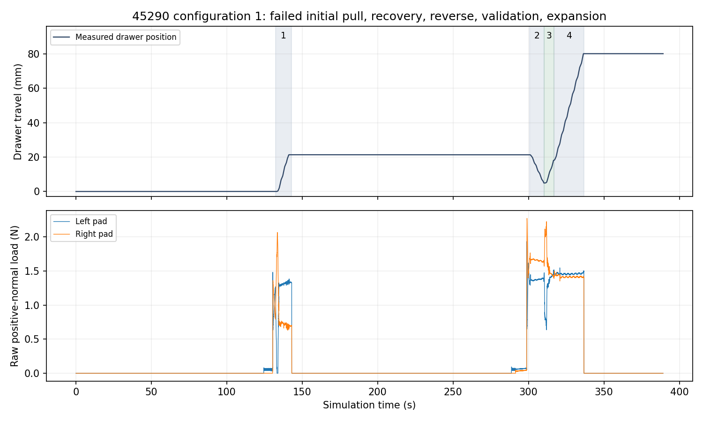
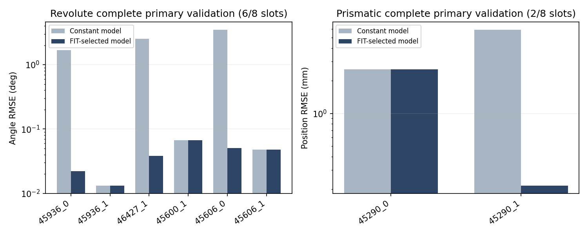

# V7.2: completed registered cross-object benchmark

**Assessment: the registered batch is complete, with failures. This is not an overall benchmark PASS.** The eight frozen revolute slots remain unchanged. The eight prismatic slots used the original registered configurations and order with explicitly authorized repaired lighting. No valid completed physical episode was retried.

## Stage results

| Stage | Revolute (8 slots) | Prismatic (8 slots) | Combined (16 slots) |
|---|---:|---:|---:|
| Initial verified grasp | 8/8 (100%) | 5/8 (62.5%) | 13/16 (81.25%) |
| Range target: >=20 deg / >=80 mm | 8/8 (100%) | 1/8 (12.5%) | 9/16 (56.25%) |
| Reverse travel >=2 deg / >=5 mm | 8/8 (100%) | 3/8 (37.5%) | 11/16 (68.75%) |
| Complete independent VALIDATION | 6/8 (75%) | 2/8 (25%) | 8/16 (50%) |
| Verified final unloaded parking | 7/8 (87.5%) | 5/8 (62.5%) | 12/16 (75%) |

The reverse-motion cutoffs are descriptive reporting thresholds, not new execution gates. Model availability is 8/8 revolute and 4/8 prismatic. Failures and missing estimates remain in the stage denominators; parameter-error summaries show their available-sample counts. Two dynamics configurations per object do not constitute two independent objects. Several assets were prior development objects.

## Every registered result

Revolute maxima below retain the previously frozen report values. The supplemental JSON separately records maxima over the full exported stream, including small unloaded settling differences. Reverse travel is cumulative across executed segments.

| Slot | Max motion | Reverse | Acquisitions | Complete VAL | Park | Wall min | Outcome |
|---|---:|---:|---:|:---:|:---:|---:|---|
| 45936_0 | 20.053 deg | 8.282 deg | 2 | yes | yes | 60.18 | 首次传力退化后恢复，完成验证；额外外推误差保留 |
| 45936_1 | 22.066 deg | 9.487 deg | 2 | yes | yes | 43.62 | 首次传力退化后恢复，完成验证 |
| 46427_0 | 20.031 deg | 13.470 deg | 1 | no | no | 20.05 | VALIDATION期间CONTACT_LOST硬停止 |
| 46427_1 | 20.031 deg | 17.079 deg | 2 | yes | yes | 64.52 | 更换抓取后完成验证 |
| 45600_0 | 20.037 deg | 12.058 deg | 1 | no | yes | 31.39 | Agent无载等待超时，未执行VALIDATION |
| 45600_1 | 20.025 deg | 16.084 deg | 1 | yes | yes | 30.33 | 完成验证 |
| 45606_0 | 20.109 deg | 17.446 deg | 1 | yes | yes | 26.66 | 完成验证 |
| 45606_1 | 20.095 deg | 17.410 deg | 1 | yes | yes | 26.84 | 完成验证 |
| 19179_0 | 47.398 mm | 0.000 mm | 2 | no | no | 33.18 | 恢复拉动后COMMAND_JOINT_MARGIN硬停止 |
| 19179_1 | 30.080 mm | 22.114 mm | 2 | no | no | 33.13 | 恢复后拉/推成功，再次拉动SUSTAINED_OVERLOAD硬停止 |
| 45290_0 | 54.834 mm | 29.698 mm | 3 | yes | yes | 80.59 | 两次传力停滞后恢复，完成验证，最大行程未达80mm |
| 45290_1 | 80.073 mm | 16.430 mm | 2 | yes | yes | 49.74 | 恢复后完成验证及80mm拉出，额外观测Agent超时 |
| 27044_0 | 56.920 mm | 0.000 mm | 1 | no | yes | 37.40 | 拉出后传力停滞，恢复计划未执行即Agent超时 |
| 27044_1 | 0.000 mm | 0.000 mm | 1 | no | no | 17.59 | 闭合CENTER中gripper_link2/original15碰撞停止，未建立双侧抓取 |
| 45746_0 | 0.000 mm | 0.000 mm | 0 | no | yes | 13.38 | 四次换视角后仍无有效SAM目标，零物理抓取 |
| 45746_1 | 0.000 mm | 0.000 mm | 0 | no | yes | 10.80 | 四次换视角后仍无有效SAM目标，零物理抓取 |

There were 22 total physical acquisitions: 11 revolute and 11 prismatic. Seven acquisitions were failed-action recoveries (2 revolute, 5 prismatic); the extra 46427_1 acquisition was a proactive planned change and is not called a failed-action recovery. Both 45746 slots used five fresh wrist checkpoints/four actual view adjustments but obtained no accepted SAM handle mask: zero physical acquisitions, **perception failures**, not failed grasps. 27044_1 reached unilateral closure contact (raw pad peaks 0.073/0 N) before gripper_link2/original15 commanded-collision protection; no bilateral verification, hold, pull or validation.

## Contact feedback and recovery

Every drawer began with the shared 1.0 N requested preload. At verified unloaded boundaries the Agent could select the previously tested 0.5/0.75/1.0/1.5 N requests. Actual measured pad load differs from that request; native drive caps/gains were unchanged.

- **19179_0:** initial grasp/hold but only 0.286 mm first motion. Fresh observation, another candidate and 1.5 N request produced 47.398 mm, then the original commanded joint-margin stop. No reverse/VAL/final park.
- **19179_1:** initial pull stalled near 1.761 mm. Same-scene fresh recovery produced 28.501 mm opening and 22.114 mm reverse. Reopening triggered the original sustained-overload stop (0.15 s window mean 3.867 N). No VAL or final park.
- **45290_0:** initial 1 N pull stalled after 19.248 mm. A fresh alternative with 1.5 N added 35.559 mm and stalled. A third, independently replanned central grasp reversed 29.699 mm and completed the predeclared 20.212 mm independent validation. Maximum 54.834 mm remains below the 80–150 mm target.
- **45290_1:** initial 1 N pull stalled at 21.349 mm. Fresh same-scene alternative/1.5 N reversed 16.430 mm, completed 13.166 mm independent validation, and only then extended to 80.073 mm. Later extra observation timed out; no extra grasp occurred. Final parking certificate is valid.
- **27044_0:** first 1 N grasp pulled 56.920 mm before persistent stall. Measured TCP/handle drift rose to 1.819 mm while commanded-to-measured TCP error decreased; unilateral load redistribution and small lateral edge margins supported contact-transmission degradation rather than merely poor arm tracking. A new observed 180-degree-roll candidate was planned, but Agent publication missed the original no-load wait deadline. No second acquisition occurred. Final parking was verified.

These are observations, not proof of a unique friction/contact mechanism. Missing positive-normal reports alone do not prove physical separation. Point contacts are not pressure areas and normal impulses are not complete interaction wrenches. Wrist F/T, with the existing compensation/projection, remains the primary identification measurement.

## Frozen online dynamics and independent prediction

Truth was accessed only after all 16 actors/online workers and Agent decisions had ended. Before/after hashes of every available online model, episode result, numeric index and source provenance match. There was no post-truth refit or model switch. SG121 common filtering, single downstream-tool inertia compensation, segment-local processing and FIT-only model selection are unchanged.

Authored randomized rigid-body mass/inertia is a reference, **not independently verified effective PhysX dynamics**. Conditional standard deviations exclude model selection, contact/compensation systematics. All unavailable values remain N/A.

| Slot | I (kg m²) / m (kg), estimate ± conditional SD | Authored | b estimate ± SD | Authored b | I/m error % | b error % | C(q)/F_c(x) support RMSE |
|---|---:|---:|---:|---:|---:|---:|---:|
| 45936_0 | 0.129161 ± 0.000434 | 0.129321 | 0.231438 ± 0.001125 | 0.223561 | -0.12 | 3.52 | 0.000072 N m |
| 45936_1 | 0.115149 ± 0.000338 | 0.115398 | 0.131586 ± 0.000935 | 0.123077 | -0.22 | 6.91 | 0.000092 N m |
| 46427_0 | 0.382195 ± 0.000711 | 0.382368 | 0.282909 ± 0.002287 | 0.259325 | -0.05 | 9.09 | 0.000152 N m |
| 46427_1 | 0.477668 ± 0.000774 | 0.478010 | 0.181398 ± 0.002472 | 0.154411 | -0.07 | 17.48 | 0.000192 N m |
| 45600_0 | 0.809515 ± 0.011589 | 0.814516 | 0.200813 ± 0.036026 | 0.184007 | -0.61 | 9.13 | 0.001255 N m |
| 45600_1 | 0.713700 ± 0.000723 | 0.715182 | 0.284666 ± 0.002258 | 0.253112 | -0.21 | 12.47 | 0.000214 N m |
| 45606_0 | 0.039286 ± 0.002096 | 0.037106 | 0.117251 ± 0.003481 | 0.112575 | 5.88 | 4.15 | 0.000241 N m |
| 45606_1 | 0.034976 ± 0.000301 | 0.034909 | 0.292051 ± 0.000237 | 0.288577 | 0.19 | 1.20 | 0.000059 N m |
| 19179_0 | N/A | 1.517906 | N/A | 5.472253 | N/A | N/A | N/A N |
| 19179_1 | 1.626595 ± 0.028340 | 1.598919 | 1.549620 ± 0.064977 | 1.458644 | 1.73 | 6.24 | 0.000196 N |
| 45290_0 | 4.639282 ± 0.451149 | 2.357452 | 5.792662 ± 1.665268 | 4.126269 | 96.79 | 40.38 | 0.009357 N |
| 45290_1 | 1.954261 ± 0.041534 | 1.928131 | 3.545328 ± 0.128270 | 3.392322 | 1.36 | 4.51 | 0.001370 N |
| 27044_0 | 1.841747 ± 0.127338 | 2.009302 | 6.673677 ± 0.662484 | 5.852077 | -8.34 | 14.04 | 0.002514 N |
| 27044_1 | N/A | 1.594109 | N/A | 3.574814 | N/A | N/A | N/A N |
| 45746_0 | N/A | N/A | N/A | N/A | N/A | N/A | N/A N |
| 45746_1 | N/A | N/A | N/A | N/A | N/A | N/A | N/A N |

All authored laws, online nonnegative resistance controls, conditional support flags, excitation, scaled condition numbers, support intervals, errors and both constant/extended comparisons are in [FINAL_RESULTS.json](FINAL_RESULTS.json). Resistance error is evaluated only on observed FIT support, not on unobserved travel.

| Complete primary validation | Torque/force RMSE | Free q RMSE | Free velocity RMSE | Retained prediction horizon |
|---|---:|---:|---:|---:|
| 45936_0 | 0.0000297 N m | 0.02235 deg | 0.01707 deg/s | 5.171 s |
| 45936_1 | 0.0000418 N m | 0.01317 deg | 0.01893 deg/s | 4.454 s |
| 46427_0 | N/A N m | N/A deg | N/A deg/s | N/A s |
| 46427_1 | 0.0000565 N m | 0.03810 deg | 0.02562 deg/s | 10.921 s |
| 45600_0 | N/A N m | N/A deg | N/A deg/s | N/A s |
| 45600_1 | 0.0000879 N m | 0.06701 deg | 0.01914 deg/s | 8.229 s |
| 45606_0 | 0.0001239 N m | 0.05091 deg | 0.07876 deg/s | 2.742 s |
| 45606_1 | 0.0000403 N m | 0.04773 deg | 0.05882 deg/s | 2.800 s |
| 19179_0 | N/A N | N/A mm | N/A mm/s | N/A s |
| 19179_1 | N/A N | N/A mm | N/A mm/s | N/A s |
| 45290_0 | 0.0056270 N | 2.55809 mm | 0.80857 mm/s | 7.083 s |
| 45290_1 | 0.0008693 N | 0.21543 mm | 0.21986 mm/s | 4.392 s |
| 27044_0 | N/A N | N/A mm | N/A mm/s | N/A s |
| 27044_1 | N/A N | N/A mm | N/A mm/s | N/A s |
| 45746_0 | N/A N | N/A mm | N/A mm/s | N/A s |
| 45746_1 | N/A N | N/A mm | N/A mm/s | N/A s |

The primary trajectory is the first **complete, independently declared** validation, not the best held-out error selected afterward. Forward prediction uses one measured initial state and held-out wrist effort, without subsequent state corrections. Endpoint trimming is retained and its shorter evaluation horizon is shown above. Incomplete validation is never scored as complete.

Revolute absolute inertia-error median/mean/max are 0.199%/0.918%/5.876% (8 available models); damping 8.004%/7.996%/17.477%. Complete primary angle RMSE is 0.0132–0.0670 deg (6/8 slots). Prismatic mass-error median/mean/max are 5.035%/27.054%/96.792% (4/8 models); damping 10.138%/16.293%/40.385%. Complete primary position RMSE is 0.215–2.558 mm (2/8). Missing results are not zero and no mixed radian/metre RMSE is averaged.

**Important negative result:** 45290_0 selected mass is 4.639 ±0.451 kg versus authored 2.357 kg (+96.79%); b is +40.38% despite complete validation. Its frozen FIT-selected constant model stays selected. A low force/trajectory residual does not establish accurate physical parameters. 45290_1 mass error is +1.355%, b +4.510%, primary position RMSE 0.215 mm. These two cases do not establish cross-object drawer identification robustness.

Additional held-out extrapolation is preserved: 45936_0 optional beyond-FIT expansion has ~6.03 deg selected-model angle RMSE. It is not substituted for, or hidden by, the sealed supported-range primary validation. All held-out trajectories and constant-model alternatives remain in the JSON.

## Lighting, protocol and accounting

- [Lighting activation](RELIGHTING_ACTIVATION.json): repaired sensor illumination only (dome 1000, distant 1500, exposure 0). Scene physics/material/collider digests were identical and static optical-Z depth A/B was identical. Dark-pixel fractions fell from 65.89% to 5.36% on 19179 and 33.32% to 0.58% on 45290. This is explicitly a changed visual-input batch, not an entirely unchanged-input claim.
- Old dark 19179 records and the lighting-pause 45290 record remain private with illumination/orchestration labels. They are not silently deleted. Relit executions retain original configuration indices 8–15 and the original experiment IDs.
- 27044_1 had two preserved zero-acquisition orchestration interruptions before the valid physical attempt. The second captured two fresh views but timed out before planning/grasp. Their walls were 494.929 s and 799.605 s. Only the later valid physical closure attempt consumed its physical slot; it was not retried after collision.
- The original 360 s no-load Agent wait was not enlarged. 45290_1 extra command arrived ~491.7 s after feedback, after the completed interaction/VAL; 27044_0 recovery validation was published ~368.24 s after plan feedback, so no recovery acquisition was executed. Missing ACKs were not relabelled as IK/RRT failures.
- A private persistent stdio transport reduced repeated SSH overhead. Terminal canonical-line truncation and a readback-type bug were repaired outside frozen actor/controller code. Physical operations still required explicit readback and original atomic command publication. No physics/controller/watchdog/budget settings changed.
- Final parking is audited from the **terminal certificate**. The frozen generic evaluator inspected only the last command and missed EPISODE_RESULT.safe_exit for the two Agent-timeout cases. Its original output is preserved; the derived audit corrects those two false negatives using reached/unloaded/measured-collision certificates. Earlier intermediate parks are not used to certify later hard stops.

## Runtime, storage and provenance

All 16 main slot walls total 9.66 h; median 32.26 min, mean 36.21 min (range 10.80–80.59). Revolute median/mean 30.86/37.95 min; prismatic 33.15/34.47 min. These include failures and sensing/Agent overhead, not a matched before/after speed benchmark. The zero-acquisition interruptions and old dark records are additional overhead, separately preserved, not hidden in the main slot times.

Main episode storage totals 838.84 MB, 17.47–88.24 MB per slot; all under 100 MB. Category bytes and operation wall/wait times are in the JSON. The main-slot total includes source/metadata/geometry, essential 240 Hz interaction channels, sparse RGB-D and existing optional event clips. Unloaded recording is compact; no continuous high-resolution video/depth was added. Private orchestration/dark evidence is additional and is not included in that main-slot footprint. No redundant raw archives were created.

[FINAL_PROVENANCE.json](FINAL_PROVENANCE.json) records job/source/numeric-index/completion hashes. The 71 frozen revolute files, 22 external dependencies and five lighting files all match. All owned Isaac actors have exited; the temporary communication bridge has been closed. Models were immutable through truth reveal.

Server: **test-X640-G50**. Canonical private evidence view: `/data1/home/rangeryx/fr3_real2sim_known_whole_20261007/results/cross_object_v7_final_v72_20261021/`. This is a symlink view of original episodes, not a copied raw archive. Relit prismatic evidence lives under `results/cross_object_v7_v72_relight_20261020/episodes/`; 27044_1 valid evidence is `27044_1_orchestration_resume02`. Original interruption directories remain intact.

## Conclusion and next bottleneck

The frozen revolute Skill transfers across these four ordinary doors, with consistent 20-degree motion but incomplete validation/safe termination in two/one slots respectively. Prismatic preload improves traction enough for real recovery and bidirectional interaction on 45290, but does not solve cross-object contact retention, collision-feasible recovery or perception. The next shared investigation should isolate contact-transmission/compensation bias under matched traction before tuning any estimator or object pose. White-bar SAM misses and Agent no-load decision latency are separate bottlenecks.

This remains known-axis/state, registered-station, simulated wrist-camera, ideal-load-cell and approximate-actuator development evaluation. It is not a hardware safety/accuracy validation or a population-level robustness claim. No more objects, controller tuning or physical episodes were launched after this registered batch.
