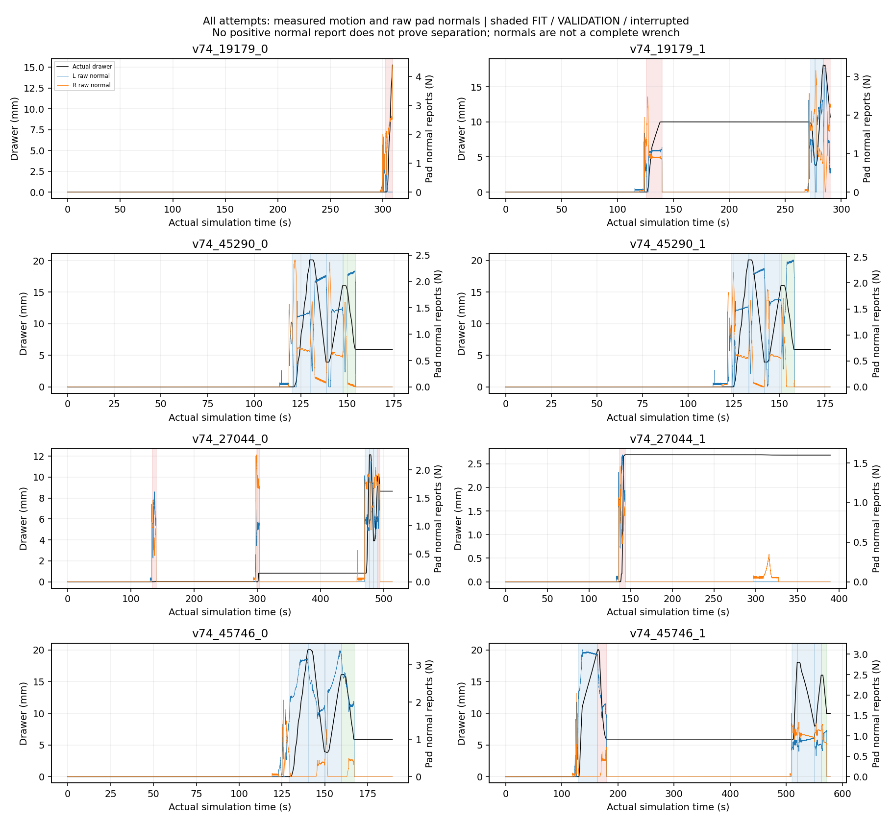
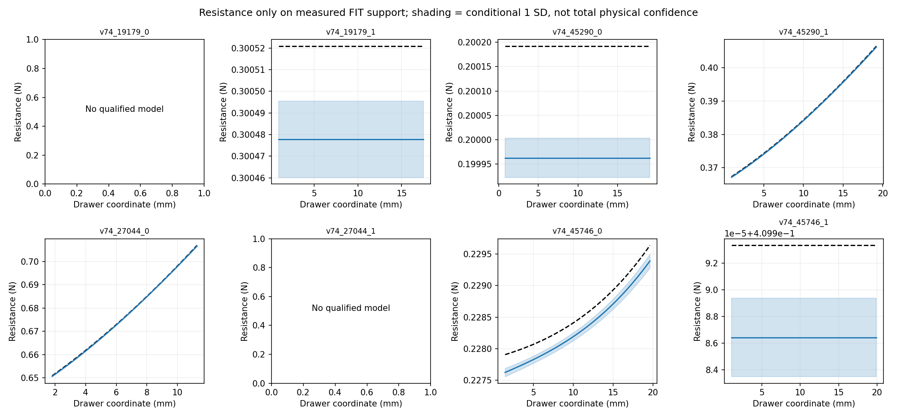
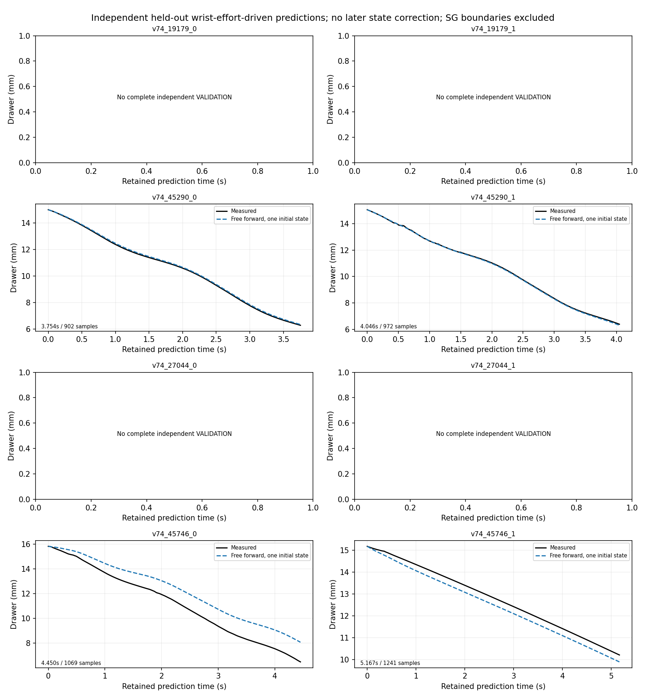
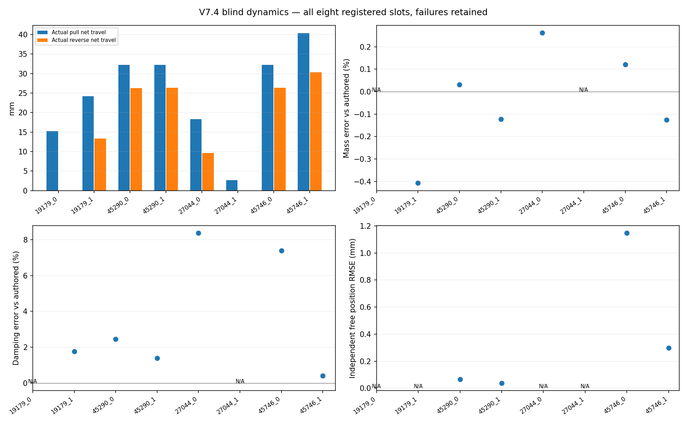

# V7.4 — preregistered blind prismatic benchmark

All **eight original slots were executed once, in registered order**. Complete physical independent VALIDATION: **4/8**; VALIDATION plus verified final parking: **3/8**. First physical acquisition succeeded in 8/8, but transmission, collision, budget and exit failures remain. This is a completed blind evaluation, **not a claim that the prismatic Skill is robust across all four drawers**.

These are four previously studied development objects with fresh blind dynamics, not an unseen-object benchmark. No failed slot was replaced or rerun. V7.2's 16 outcomes and the revolute 71+22 frozen dependencies remain unchanged. No new engineering tuning, controller change or physics change was made after outcomes.

## Activation, lighting and blinding

The separately authorized registered entry was frozen at `4c329f1` before physical outcomes. `RegisteredPrismaticRuntimeV74` inherits the V7.3 operations/controller/worker; its minimal constructor wiring passes AST parity. The original engineering-only launcher still rejects registered jobs. Before launch, 53 short offline regressions passed, including original order/commitment, malformed-command recovery and concurrent atomic command/ACK checks.

The original 87 registered source/config hashes and all 71+22 revolute hashes matched at launch and final audit. [ACTIVATION.json](ACTIVATION.json) records the registered-entry hashes. The original private registration hash is `1391c707aa44b965c321f2605d92d009c05a1bc8b20ec4190898ba610701d36b`; the public mirror is sanitized metadata, so it is not byte-identical. Episode identities, configuration indices, source hashes and the hidden commitment are unchanged.

Hidden configuration SHA256: `03fe71771eef18fcb8fb22ccbfb4e6cb1b1d261bc104c6fac30314d7c546bc29`. Every online output seal, actor exit and sealed-file hash was checked **before** the first parameter-value access at **2026-10-21 18:04:24.150836 UTC**. An actual pre-reveal test refused evaluation while the eighth episode was still running. Online estimates remain immutable; evaluation never refits them or chooses filters/models against truth. A post-seal reporting-path error (`jobs/<id>.json`, not episode-local `job.json`) was repaired; first truth-access time is retained, and executed-job SHA256 is now checked. This was a reporting repair, not a physical retry.

All scenes used the unchanged corrected lighting: dome intensity 1000, white key intensity 1500, exposure 0; configuration SHA256 `d0ebafb28b968e1bf823676be961b9f19618bbfc22d88731adfcf5e2545d70b4`. Codex actually inspected fresh wrist RGB, mask/depth/point-cloud boards and grasp plans. Images were usable; lighting and SAM threshold were not retuned between cases. Only wrist observations supplied online grasp geometry. Scene/native colliders remained safety checks; no GT grasp fallback or saved successful pose was used.

## Interaction and recovery — denominator eight throughout

| Stage | Slots |
|---|---:|
| First physical grasp and original one-second hold | 8/8 |
| Any detected sliding/pull beyond the startup monitor | 8/8 |
| At least one completed pull target | 6/8 |
| At least one completed reverse target | 6/8 |
| Complete independently declared physical VALIDATION | 4/8 |
| Verified final unloaded park | 5/8 |
| Complete VALIDATION **and** final park | 3/8 |

“Any pull” is not a meaningful-range or full-task PASS: 27044_1 moved only 2.69 mm. Total pull/reverse below sums **net displacement within each actual interaction segment**, including partial failed segments; it is not maximum opening or integrated travel through jitter. “FIT” counts completed targets; qualified prefixes are separately retained in the machine-readable record.

| Registered slot | Max coordinate / total pull / reverse (mm) | Closures / recoveries | Requested preload sequence (N) | FIT / complete VAL / final park | Wall min / MB | Outcome |
|---|---:|---:|---|---|---:|---|
| v74_19179_0 | 15.26 / 15.26 / 0.00 | 1 / 0 | 1 | 0 / no / no | 24.89 / 39.72 | Sustained wrist-torque hard stop; no reset/recovery permitted |
| v74_19179_1 | 18.11 / 24.18 / 13.31 | 2 / 1 | 1 → 1.5 | 2 / no / no | 45.46 / 57.11 | Initial transmission failure; regrasp moved both ways; reverse collision hard stop |
| v74_45290_0 | 20.12 / 32.24 / 26.29 | 1 / 0 | 1 | 3 / yes / yes | 16.79 / 37.07 | FIT + complete VALIDATION + park |
| v74_45290_1 | 20.11 / 32.24 / 26.30 | 1 / 0 | 1 | 3 / yes / yes | 17.68 / 37.78 | FIT + complete VALIDATION + park |
| v74_27044_0 | 12.13 / 18.31 / 9.63 | 3 / 2 | 1 → 1.5 → 1.5 | 3 / no / yes | 56.24 / 69.02 | Two failed pulls; third grasp completed FIT; VALIDATION interrupted for exit reserve |
| v74_27044_1 | 2.69 / 2.69 / 0.00 | 2 / 1 | 1 → 1.5 | 0 / no / yes | 52.22 / 60.17 | Initial stall; recovery hold not established; new plan not executed within remaining budget |
| v74_45746_0 | 20.06 / 32.20 / 26.30 | 1 / 0 | 1 | 3 / yes / yes | 18.78 / 40.59 | FIT + complete VALIDATION + park |
| v74_45746_1 | 20.06 / 40.32 / 30.36 | 2 / 1 | 1 → 1 | 4 / yes / no | 48.28 / 65.44 | Recovered FIT + complete VALIDATION; released, SAFE_EXIT_UNAVAILABLE |

Thirteen physical closure attempts included five same-scene recovery acquisitions in four episodes. Four recovery acquisitions established grasp, one did not. Three recovery episodes regained completed pull and reverse targets (19179_1, 27044_0 and 45746_1); two completed all three proposed FIT targets (27044_0 and 45746_1). Only 45746_1 recovered through complete VALIDATION, then failed final parking. Thus recovery-to-VALIDATION was 1/4 recovery episodes, and recovery-to-full-lifecycle was 0/4. Initial failures are never erased by later movement.

- **19179_0:** hard sustained overload at 15.26 mm. Replay of the final 36 native samples gives 0.15 s means: pad maximum 3.882 N, wrist force 3.913 N, wrist torque **0.60464 N·m**, exceeding the unchanged 0.6 N·m sustained torque limit. This was not a fatal 2 N warning. The hard latch remained authoritative; no regrasp or parking motion was forced.
- **19179_1:** after a 9.99 mm initial pull stalled, fresh wrist observation and a new automatic roll family were used. Actual normals/slip motivated a legal unloaded change from 1.0 to 1.5 N requested preload. Recovery completed reverse and opening FIT, then a native `gripper_link2 / original10` collision stopped the next reverse. No latch reset, VAL or final park.
- **27044_0:** Codex moved the wrist to recover an initially clipped handle. Initial slip and the first recovery stall were preserved. Increasing requested preload to 1.5 N alone did not solve traction. Another fresh oblique view and automatic −15° pitch candidate completed three FIT targets; global exit reserve interrupted VALIDATION, which remains incomplete/N/A. Safe parking succeeded. Pose and observed geometry changed together, so this does not isolate a causal benefit from pitch alone.
- **27044_1:** the initial pull stalled after 2.69 mm. Fresh RGB-D and the current candidate catalog supported a different +15° candidate with legal 1.5 N request; it did not establish the original bilateral hold. Actual left positive-normal reports were absent and right peak was 0.249 N; absence alone is not proof of geometric separation. A further fresh automatic plan was obtained but not executed: remaining action time was shorter than measured acquisition/probing costs. Final park succeeded. The standard feedback board still referenced the preceding segment after failed closure; the Agent used a separately plotted actual closure trace rather than treating that stale board as new measurements.
- **45290_0/1 and 45746_0:** first acquisition, three FIT, distinct-profile complete VAL and parking. Codex selected the intended lower handle on 45290 from actual imagery, rather than selecting the highest SAM score on the upper bar.
- **45746_1:** first pull reached 20.04 mm; reverse moved 14.22 mm before transmission failure. After safe parking, fresh RGB-D had no accepted SAM mask; Codex visually verified the existing independent metric-depth bar hypothesis. A different automatically generated section/roll/−15° pitch candidate was fully checked. Preload stayed **1.0 N**, because prior unilateral normal loading already reached about 3 N. Recovery completed FIT gains +12.23/−10.07/+8.05 mm and distinct VAL −6.07 mm. Released/unloaded afterward, but the bounded joint retreat/return planner exhausted its alternatives (`NO_ARM_PATH` and `right_outer_knuckle / original25` collision). It returned **SAFE_EXIT_UNAVAILABLE** and shut down. A rejected bounded search is not proof no exit exists; no unsafe retreat was executed. The recovery approach alone had 47,962 timed 240 Hz samples (~200 s simulated), and exit planning took ~198 s wall time: collision feasibility is not time efficiency.

Requested preload is not measured gripping force. For example, initial 1 N holds had median L/R normal reports 0.631/1.342 N (19179_0), 1.188/0.880 N (45290_0), 1.039/0.975 N (27044_1), and 1.294/0.757 N (45746_0). Every attempt's measured hold distribution and aperture are in [METRICS.json](METRICS.json). No drive authority, gains, friction, native collider or safety threshold was changed.

## Dynamics identification and uncertainty

The actual V7.3 prismatic worker uses the V3.1 common SG121 operator on generalized force and all regressors, one downstream-tool inertia compensation, native rail units and strict segment-local FIT qualification. Incomplete VALIDATION never enters fitting or independent prediction. The source worker hash is `b451426b212f791a8e20f1cadf636f17afff6a958effb487908a3759a9c5b2f0`. At least three distinct eligible FIT trajectories preceded any FIT-only selection of the position-dependent extension. No model was changed after the truth reveal.

References below are **authored moving-body mass combinations**, not independently verified PhysX effective masses. No extra unrandomized moving body was found by this evaluator. SD is conditional on this regression/data/model and is **not calibrated total physical uncertainty**. Two slots have no qualified model; they remain N/A rather than zero error.

| Slot | Authored mass / damping | Online mass ± conditional SD (kg) | Online damping ± conditional SD (N·s/m) | Signed mass / damping error (%) | C(x) support RMSE (mN) | Eligible FIT / model / scaled condition |
|---|---:|---:|---:|---:|---:|---|
| v74_19179_0 | 1.984827 / 4.498865 | N/A | N/A | N/A | N/A | No qualified model |
| v74_19179_1 | 1.525492 / 1.600311 | 1.519283 ± 0.004410 | 1.628639 ± 0.007431 | -0.407 / +1.770 | 0.0431 | 3 / constant / 89.5 |
| v74_45290_0 | 2.445742 / 4.054304 | 2.446516 ± 0.003476 | 4.153953 ± 0.015279 | +0.032 / +2.458 | 0.2292 | 3 / constant / 136.4 |
| v74_45290_1 | 1.664791 / 5.627070 | 1.662753 ± 0.003348 | 5.705404 ± 0.011860 | -0.122 / +1.392 | 0.1959 | 3 / position-dependent / 30978.9 |
| v74_27044_0 | 2.495334 / 1.042610 | 2.501866 ± 0.007993 | 1.129942 ± 0.031863 | +0.262 / +8.376 | 0.2206 | 3 / position-dependent / 35936.0 |
| v74_27044_1 | 2.190012 / 5.062373 | N/A | N/A | N/A | N/A | No qualified model |
| v74_45746_0 | 2.153581 / 1.484624 | 2.156180 ± 0.003312 | 1.594322 ± 0.016057 | +0.121 / +7.389 | 0.2331 | 3 / position-dependent / 277.7 |
| v74_45746_1 | 1.845534 / 3.599879 | 1.843228 ± 0.004405 | 3.614491 ± 0.005555 | -0.125 / +0.406 | 0.0069 | 4 / constant / 200.8 |

Among six available models (6/8 availability), absolute mass-error mean/median/population SD are **0.178% / 0.124% / 0.123%**; damping **3.632% / 2.114% / 3.079%**. Local resistance RMSE mean/median/SD are **0.1548 / 0.2082 / 0.0931 mN**. These available-case summaries include two episodes without independent validation, so they are not an eight-slot identification-success rate. Among the four complete-VAL slots, mean absolute mass/damping error is 0.100%/2.911%; the other four still lack independent behavioral evaluation.

| Slot | Qualified FIT velocity RMS range (mm/s) | Acceleration RMS range (mm/s²) | Between-FIT constant-model mass / damping range |
|---|---:|---:|---:|
| v74_19179_1 | 1.2642–2.8455 | 0.2715–4.0528 | 0.5024 kg / 1.7046 N·s/m |
| v74_45290_0 | 1.7680–2.8489 | 0.1463–4.4217 | 0.4029 kg / 1.9113 N·s/m |
| v74_45290_1 | 1.7863–2.9222 | 0.2593–4.5349 | 18.3311 kg / 77.6049 N·s/m |
| v74_27044_0 | 1.5657–2.8392 | 0.7130–4.8122 | 9.6897 kg / 29.5811 N·s/m |
| v74_45746_0 | 1.7185–2.4028 | 0.5250–3.0771 | 0.1369 kg / 1.8001 N·s/m |
| v74_45746_1 | 0.3793–2.0662 | 0.0490–2.6001 | 0.0561 kg / 0.1784 N·s/m |

Acceleration-rich FIT contains more actual excitation than the nearly constant-speed reverse segments. Scaled conditions reach ~3.1–3.6×10⁴ for narrow-support extensions. The cross-FIT diagnostic fits a constant model per trajectory; its large spreads can mix weak excitation, omitted position dependence and contact-state changes, and are not calibrated uncertainty of the selected joint model. For example, 45290_1's constant per-FIT mass range is 18.33 kg despite a well-fitting combined extension. Algebraic rank and small conditional SD therefore do not certify independent physical identifiability. Damping discrepancies are several conditional SD in multiple slots.

All localized authored resistance centers lie beyond the measured maximum coordinates (about 43–109 mm versus 12–20 mm for those cases). Only their local tails were observed. The accurate local C(x) curves below **do not validate peak location/amplitude or unobserved travel**. No extrapolated curve is presented as measured knowledge.

## Complete held-out physical prediction

The whole physical action must reach its target/stopped-state check. Forward prediction then uses one measured initial coordinate/velocity and the held-out compensated wrist-effort input, with no future-state correction. The production segment-local processing and derivative boundaries retain a shorter numerical horizon than the complete physical action. Both durations are reported explicitly; no incomplete VAL was promoted to complete.

| Slot | Physical VAL / processed piece / retained prediction (s) | Samples | Effort RMSE (mN) | Position / velocity RMSE (mm; mm/s) | Position / velocity normalized RMSE (%) | Constant → extended position RMSE (mm) |
|---|---:|---:|---:|---:|---:|---:|
| v74_19179_0 | N/A — no complete physical VALIDATION | N/A | N/A | N/A | N/A | N/A |
| v74_19179_1 | N/A — no complete physical VALIDATION | N/A | N/A | N/A | N/A | N/A |
| v74_45290_0 | 6.767 / 4.762 / 3.754 | 902 | 0.0284 | 0.0656 / 0.0633 | 0.75 / 2.64 | 0.0656 → 0.0673 |
| v74_45290_1 | 7.058 / 5.054 / 4.046 | 972 | 0.0755 | 0.0381 / 0.3961 | 0.44 / 17.71 | 1.1324 → 0.0381 |
| v74_27044_0 | N/A — no complete physical VALIDATION | N/A | N/A | N/A | N/A | N/A |
| v74_27044_1 | N/A — no complete physical VALIDATION | N/A | N/A | N/A | N/A | N/A |
| v74_45746_0 | 7.463 / 5.458 / 4.450 | 1069 | 3.7938 | 1.1481 / 0.4884 | 12.31 / 22.67 | 0.9069 → 1.1481 |
| v74_45746_1 | 9.679 / 6.175 / 5.167 | 1241 | 0.0843 | 0.2977 / 0.1433 | 5.99 / 14.78 | 0.2977 → 0.2920 |

The extended model on 45290_1 improved independent position RMSE from 1.1324 to 0.0381 mm; it had already been selected by FIT-only CV. Conversely, the FIT-selected extension on 45746_0 **worsened** held-out position RMSE from 0.9069 to 1.1481 mm, and it was retained unchanged. Its selected normalized position/velocity errors are 12.31%/22.67%. 45290_1 has small position error but 17.71% normalized velocity error. Low conditional force residual or small position RMSE alone is not proof that all dynamics are correct. No new post-hoc accuracy PASS threshold was invented.

## Efficiency, evidence and cleanup

Summed actor/launcher wall time including initialization and cleanup: **16,820.685 s (4.672 h)**; per-slot mean/median **35.04/35.17 min**, range 16.79–56.24 min. This excludes final offline report generation and gaps between sequential launches. There were **22 Agent wrist observations**, **8 Agent-selected viewpoint motions**, and **13 distinct pregrasp checkpoints** (35 RGB-D checkpoints total). Long recovery route/planning costs remain visible; no extra physics rehearsal or full revolute episode was launched.

Canonical private episode files total **406,889,855 bytes (406.89 MB decimal)**, maximum **69.02 MB**, all eight below 100 MB. Category totals:

| Category | MB decimal |
|---|---:|
| Essential motion/F/T | 81.68 |
| Native contact evidence | 25.69 |
| Sparse wrist RGB-D checkpoints | 121.21 |
| Geometry/plans | 24.19 |
| Protocol | 6.26 |
| Models | 0.72 |
| Source/config snapshots, metadata, logs and other | 147.13 |

The metadata/source snapshot category remains substantial; it was preserved rather than deleting sealed evidence. No continuous full-resolution video/depth stream or duplicate raw archive was exported. [EVIDENCE_INTEGRITY.json](EVIDENCE_INTEGRITY.json) verifies all eight seals, 40 compressed numeric chunks, checkpoint RGB/depth/calibration hashes, immutable online model hashes and process exits. All owned actors exited; hard-stopped episodes and the final unavailable park are not labelled parked. One read-only SSH status review timed out and an old multiplex connection stalled; direct SSH restored status access without restarting an actor. These operational issues remain distinct from manipulation outcomes.

The publication contains only derived figures/metrics, source and the [compact Agent decision/action trace](AGENT_TRACE.json); original RGB-D, F/T, telemetry, native contacts and private decision images stay private. No hidden seeds or infrastructure paths are published. [CLEANUP_AUDIT.json](CLEANUP_AUDIT.json) records final hash checks, no remaining owned batch process, and last seal/exit at 18:03:30.563 UTC before the 18:04:24.151 UTC reveal. The frozen [V7.2 report](../prismatic_benchmark_v72_20261020/REPORT.md) remains separate: its configurations, implementation and achieved ranges differ, so 2/8 versus 4/8 VAL is an unpaired descriptive comparison, not an isolated treatment effect.

Limits remain: known rail kinematics/state, registered station, simulated wrist mount, ideal virtual wrist load cell, approximate actuators and convex native contact proxies. Normal reports are not pressure distributions or complete wrenches. Most completed targets were 8–20 mm, not 80–150 mm robustness. This run supports credible **short-support** identification where informative interaction completed, but transmission/recovery scheduling and safe exit still limit end-to-end reliability. No follow-on tuning, new object or benchmark retry was launched.
