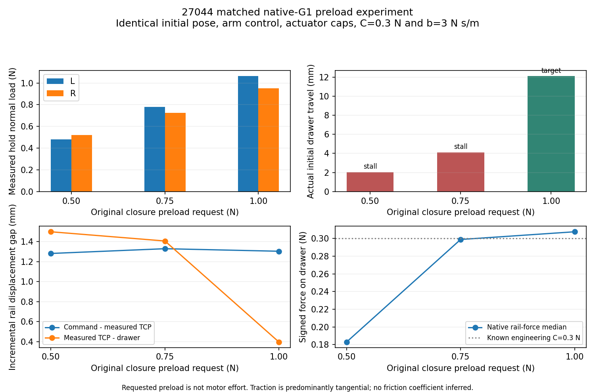

# V7.1 — Native-G1 preload and prismatic traction

Status: representative pulling/reversal and complete physical VALIDATION actions
verified on both drawers; eligible to freeze the prismatic version and resume the
original blind registration. This is not a benchmark or general robustness PASS.
Reference: `780b1ab` (previous repair NOT PASS). All earlier results remain intact.

## Controlled result

On27044, changing only the original closure's normal-load request from0.5 to1N
enabled sustained native-contact pulling and reversal. The three measured
pregrasp TCP matrices were identical, including orientation. Same station,
contact geometry/materials, arm reference backend, C=0.3N, b=3N s/m and original
guards. The engineering fixture used a previously failed observation-derived
pose, never GT or a saved successful grasp. This fixture is not a fresh visual
or Agent generalization result.

|Requested preload N|Measured hold L/R N|Actual initial pull mm|Reverse mm|Independent physical VALIDATION|Safe park|Wall s|
|---|---|---|---|---|---|---|
|0.50|0.480 /0.521|2.048|Not executed|Not executed|Yes|311.9|
|0.75|0.780 /0.725|4.124|Not executed|Not executed|Yes|313.7|
|1.00|1.064 /0.950|12.098|−8.133|Complete, −4.121mm|Yes|402.4|

The first two actions remain `TRANSMISSION_FAILURE / PERSISTENT_SLIDING_STALL`.
The1N condition additionally completed a +6.096mm variable-speed FIT segment.

Signed native rail-force medians were0.183/0.299/0.308N. Normal-force projections
were small; useful rail force was mainly native tangential contact traction.
These medians do not measure maximum friction capacity or identify a friction
coefficient. At1N the same-interior compensated wrist/native medians agreed at
0.3067/0.3080N. The primary identification measurement remains the wrist load
cell; native impulses are a transmission diagnostic.

Incremental command-to-measured TCP deficits were1.282/1.329/1.304mm, while
measured-TCP-to-drawer relative travel fell from1.499/1.407 to0.397mm. Thus the
preload contrast did not fix arm tracking. It demonstrated useful transmission
without requiring perfect100µm tracking. The conditional alternative arm-backend
comparison was not triggered. Integral and transverse-retention prototypes
remain OFF; no grasp-score change was needed for this contrast.

## Fresh Agent tests

27044: Codex inspected new wrist RGB/SAM3/depth/cloud and incremental surfaces,
requested two complementary reachable views through actual arm actuation, then
inspected the new automatically selected plan. Family `[-.3,+.009375,0,0]` was
generated from those observations; no fixture or archived pose was supplied.
One acquisition and original one-second hold, all four actions `TARGET_REACHED`:
**+16.110 /−11.168 /+9.115 /−6.154mm**, followed by verified unloaded parking.
Recovery was unnecessary, not artificially triggered. Wall1418.3s;41.91MB.

45290 at1N: bilateral acquisition and one-second hold succeeded, but initial
pull stalled at **1.795mm**. Actual TCP moved3.431mm versus a4.066mm command;
command-to-measured deficit0.635mm and TCP-to-drawer relative motion1.636mm are
distinct. Same-interior wrist/native rail-force medians were0.296/0.299N.
Normal load redistributed, with raw peaks1.586/2.214N; no hard protection fired.
The historical2N warning remained informational. All subsequent motion/VALIDATION
remained unexecuted. Safe release and parking succeeded.

The Agent inspected actual contact plots, reobserved in the same scene, saw a
fresh SAM miss, and selected another view that recovered200.75mm of complete
handle extent. The finite resource envelope did not leave enough time for
another acquisition. `BOUNDED_AGENT_STOP` is preserved, including a late finish
command that was not consumed. Final parking was verified by the actor's own
guarded exit. This is not physical regrasp recovery success and not evidence
that no alternative grasp exists. Wall1671.7s;43.05MB.

The explicitly registered1.5N follow-up used fresh wrist geometry from an
Agent-selected upper-left view, unchanged automatic ranking and the same four
profiles. Measured hold normals were **1.573/1.524N**. One acquisition, one-second
hold and all four actions completed: **+16.130 /−11.181 /+9.137 /−6.161mm**.
Safe release and parking succeeded; finish sequence6 was consumed and the actor
exited. Wall1022.7s;41.04MB. Initial pull rail-force median0.3113N; command-to-measured
TCP deficit0.679mm and TCP-to-drawer relative travel0.363mm. Raw normal peaks
**3.015/2.731N** are retained; no hard protection fired. No actuator authority,
controller, ranking or physics changed.

This fresh-geometry follow-up is not an exactly matched45290 preload ablation.
The improved preload and changed visual/refined pose are not causally isolated
on that object. Both successful fresh scenes completed at their first acquisition;
no physical recovery was artificially triggered. The earlier45290 failed scene
does not disappear: fresh visual recovery worked, but physical regrasp with the
new preload strategy remains unverified in that scene. The shared interface
preserves safe same-scene reobserve/alternative-candidate/regrasp opportunities.

## Dynamics and limits

The unchanged SI/V3.1 worker uses segment-local common SG121 filtering and one
tool-inertia compensation, FIT-only selection and complete held-out physical
actions. No benchmark hidden parameters were read.

|Run|m kg ±conditional std|b N s/m ±std|C N ±std|Held-out effort RMSE N|Forward position RMSE mm|Retained prediction horizon s|
|---|---|---|---|---|---|---|
|Matched27044,1N|1.543 ±0.383|4.564 ±1.161|0.29644 ±0.00264|0.000299|0.0321|1.167|
|Fresh27044,1N|1.487 ±0.311|3.423 ±0.313|0.29869 ±0.00095|0.000267|0.0401|1.433|
|Fresh45290,1N|Insufficient FIT|N/A|N/A|N/A|N/A|No VALIDATION|
|Fresh45290,1.5N|2.00071 ±0.00488|3.00477 ±0.00646|0.299996 ±0.000023|0.0000857|0.0722|1.471|

The complete physical VALIDATION actions are distinct from the shorter retained
interiors used for forward prediction after derivative boundary exclusion.
No full-duration forward accuracy is claimed. Conditional uncertainties exclude
contact/compensation/model-selection systematic errors; these are engineering
identification checks, not blind parameter accuracy or population robustness.

## Implementation and provenance

`PrismaticPreloadRuntime` changes only the original closure `preload_n` request
in a separate prismatic entry. Its original finite master-position mapping,
coupled joints, gains10/0.1 and aperture-Jacobian drive authority remain installed.
Master caps were approximately3.29N m, dependent on the measured aperture Jacobian;
they are configured caps, **not measured motor effort**. Independent motor output
is unavailable; explicit effort=0 and projected joint reactions are not presented
as motor torque. No robot friction, drawer resistance or safety limit changed.

`PreloadOperations` permits selection before a new acquisition only at a verified
unloaded boundary, without clearing force history or a hard latch. Existing
current-state IK, timed approach/native-collision fallback, original closure,
one-second hold, startup/breakaway/sliding monitoring and safe termination remain
authoritative. The matched fixture is a separate engineering-only branch.

Frozen revolute tag: `codex/v7-revolute-freeze-20261020` at`94dab46f`.
All71 source/configuration and22 external hashes remain unchanged. Actual matched
entry: `25a4e5c`; fresh Agent source: `619e6f8`; follow-up protocol: `4da30ae`.
49 server regressions passed before the fresh runs; versioned benchmark-admission
and initial-image tests bring the offline suite to54 passing checks before
activation. Exact per-file loaded hashes take
precedence over a checkout label. No source is
deployed while an owned actor is alive. Only our own actors are serialized;
shared GPU use is allowed. Raw numeric/contact data and wrist observations stay
private; only derived statistics, this plot and code are published.

Private evidence lives on`labserver_inschool` (`test-X640-G50`) under
`/data1/home/rangeryx/fr3_real2sim_piper_mobile/results/prismatic_preload_v71_20261020/`.
Per-run `SOURCE_PROVENANCE.json`, `PRELOAD_CONFIGURATION.json`,240Hz compact arrays,
contact evidence, decision/image hashes and process-completion records are retained.

## Interpretation

Preload was a causally demonstrated bottleneck on27044, not a universal explanation
for every drawer. The old PiPER45746 success used different finger geometry,
effort control, collision proxies and base setup; its SI breakaway resistance was
not established. Current independent native drawer tests measured breakaway in
(0.300,0.325]N. An immovable rail is not supported by that evidence. Static bilateral
holding alone remains insufficient proof of useful pulling.

This is KNOWN_KINEMATICS / SIMULATED_WRIST_RGBD / IDEAL_WRIST_FT /
APPROXIMATE_ACTUATOR_SIMULATION. Native pad force feedback is simulation-only.
The original blind16-episode registration, hidden configurations, completed
revolute outcomes and every negative engineering result remain unchanged.

## Registered-batch activation

Use a separate versioned activation manifest; do not overwrite the original
registration or completed outcomes. All eight deferred prismatic slots retain
their object/configuration indices and hidden-file commitment. The shared initial
preload is1N; the Agent may select a tested0.5/0.75/1/1.5N request at a verified
unloaded boundary based on actual contact/motion evidence, without asset-ID rules.
Any further physical failure remains in its original registered denominator.

The recorded45606 pre-physics failure was the first fixed survey proposal having
no collision-feasible arm path, not a physical grasp result. A separate initial
image wrapper retains the original route when feasible; otherwise it captures
fresh wrist RGB-D at the measured verified-unloaded state. Codex inspects that
image and selects subsequent views through unchanged operations. No archived
view, joint teleportation, new framing rule or frozen-controller modification is
introduced. The failed initialization is retained; this is not an unchanged-input
batch. Hard latches/loaded conditions cannot use the fallback.

### Continuation at interruption

Both original45606 configurations completed fresh first-acquisition bilateral
grasp, the original one-second hold, approximately20deg opening, reverse FIT and
complete independent VALIDATION, followed by verified parking and process exit.
Together with the preserved six earlier results, all eight revolute physical
slots are closed: six complete VALIDATION and seven verified final parks. The
earlier46427_0 and45600_0 failures remain unchanged.

The first registered drawer19179_0 captured an initial wrist observation but
received **zero Agent commands and made zero physical grasp attempts** before
the conversation was intentionally interrupted. The original bounded Agent
wait expired; guarded parking succeeded and the actor exited. This is an
orchestration interruption, not a measured drawer-traction or segmentation
failure. No automatic retry or next actor was launched. All eight registered
drawer physical manipulation outcomes remain untested; hidden truth stays
withheld. See[blind progress snapshot](BLIND_BENCHMARK_PROGRESS.json). The full
16-episode benchmark is **not complete**.
