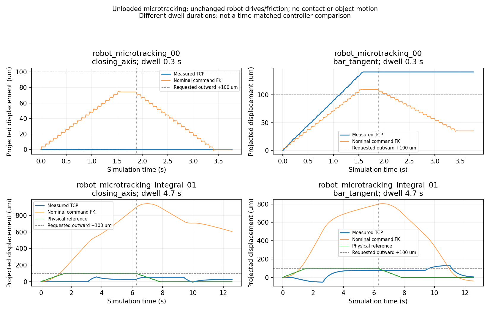

# V7 prismatic transmission repair — NOT PASS

The revolute baseline is frozen and unchanged. The drawer repair is **not ready
for the registered benchmark**. Native contact tests and same-scene Agent
recoveries remain negative; no complete drawer reversal/independent dynamics
VALIDATION was obtained. No blind benchmark episode was launched in this round,
and its hidden configurations remain unread.

## Freeze and scope

Immutable tag: `codex/v7-revolute-freeze-20261020`, commit
`94dab46f4e1b6ee8b1cbbea1d02ad7c4a0706089` (runtime `2a91dbf`).
[REVOLUTE_FREEZE.json](REVOLUTE_FREEZE.json) records 71 exact source/config hashes;
[REVOLUTE_EXTERNAL_FREEZE.json](REVOLUTE_EXTERNAL_FREEZE.json) records 22 external
robot, camera, closure and geometry files. Final server verification found **zero
mismatches**. Six previous V7 revolute episodes, including their failures, and
V6 results remain intact. No new full revolute episode was needed.

New code is isolated in `PrismaticFeedbackRuntime` and an engineering-only
launcher; it rejects revolute/registered benchmark jobs. New ranking is scoped
to the prismatic planning call. Native G1 closure, Pink solver source, robot/G1
gains, joint friction, clamp authority, object C/b/m, colliders and safety policy
were not changed. Known rail/state/station, simulated wrist mount and approximate
actuators remain dependencies. GT surfaces did not generate executable grasps.

## Physical engineering outcomes

All contact plans used fresh inspected wrist RGB/SAM/depth/cloud, automatic
candidates, actuator motion and native contact. These are engineering fixtures,
not hidden randomized benchmark configurations.

| Case/run | Acquisitions | Actual pull per attempt | Reverse / complete VAL | Final state | Wall s |
|---|---:|---|---|---|---:|
| 45746, frozen V7/G1 | 1 | No pull: bilateral hold not established | Not executed | Earlier failed-grasp exit parked; final reobservation exit hit phase-speed stop, park not verified | 2104.51 |
| 27044, measured-state prototype | 2 | 2.2181 / 0.01748 mm | Not executed | Both exits and final park verified | 3143.04 |
| 45290, bidirectional ranking + measured-state prototype | 2 | 0.02202 / 0.42190 mm | Not executed | Both attempt exits and terminal park verified | 3201.04 |

A pre-physics 27044 input-marker failure was retained and corrected, without
consuming a grasp attempt. A malformed recovery profile was rejected with no
motion and corrected before execution. They are not physical failures/retries.

Archived 27044 engineering had previously achieved 7.3046 mm pull, including a
6.238 mm sustained-transmission interval, then failed and reversed only 0.7056 mm.
Its approximate prefix identification has no independent validation and is not
a blind ID PASS. The fresh grasps above differ from archived grasps; changes in
outcome do not isolate controller causality.

## What caused the failure?

1. **Not an immovable/high-resistance rail alone.** Separate native known-force
   fixtures resolved breakaway on both drawers in `(0.300,0.325] N` and produced
   17.5724 mm opening / 11.6862 mm closing. Authored C=0.3 N and b=3 N s/m were
   kept. This is an engineering force test, not robot-side identification.
2. **Bilateral normal contact is not axial traction.** In archived 45290 at
   2–5 s, native friction forces on the object were approximately
   `[+.1951,-.0892,-.0004]` and `[-.0001,-.0806,0] N`; rail is world `-Y`.
   Considerable traction acts along the bar. Sustained rail effort is often below
   breakaway. Fully compensated wrist effort and native rail traction agreed to
   about 0.0164 N RMS in that first archived pull. Normal impulses alone were
   not substituted for a complete contact wrench.
3. **Arm tracking and contact-relative motion are separate.** New 27044 first
   pull: command TCP 4.9990 mm, measured TCP 3.6825 mm, drawer 2.2181 mm.
   Incremental servo deficit is 1.3164 mm; actual TCP/drawer rail motion is
   1.4645 mm. Neither quantity can replace the other.
4. **Load migration matters, but a unique cause is not established.** 27044
   recovery held an unchanged aperture command while L/R loads moved from
   0.475/0.512 to 0.126/0.813 N during the one-second hold, before pulling.
   TCP Z moved only 0.0351 mm. Missing positive normals do not prove separation.
5. **A pad representation discrepancy is real.** Native inner-pad polygon area
   is 1017.49 mm² versus scoring rectangle 1106.25 mm². Reported contact points
   lie on the cooked lateral boundary, rather than 0.573 mm inside that rectangle.
   Manifold points are not pressure areas; this does not prove the discrepancy
   accounts for the whole transmission failure. No collider was changed.

See [traction comparison](BASELINE_TRACTION.png),
[native pad geometry](NATIVE_PAD_GEOMETRY.png) and [detailed diagnosis](DIAGNOSIS.md).

## PiPER is not a controlled same-physics baseline

`run_45746_regrasp_clean.py` used measured-progress +2 mm steps, measured-joint IK
and retained loaded bias. The current runtime already retains loaded bias, ruling
out a missing-bias explanation. PiPER used independent effort-controlled fingers;
G1 has finite position-controlled master/mimic articulation. No PiPER gains or
finger effort law were copied.

Historical PiPER used a bar-box/support proxy, a different station and unloaded
base repositioning. Its selected drawer joint did not author the current SI
Coulomb/viscous law; effective historical breakaway is unknown. Its 48.0248 mm
success is preserved, but cannot prove equal contact/resistance conditions. The
fresh 45746 G1 comparison failed closure before pulling, so it cannot establish
axial-transmission equivalence.

## Shared repairs attempted and their limits

- Retained finite CONTACT_PRELOAD/BREAKAWAY/SLIDING state separation and separate
  servo-deficit/contact-relative evidence, instead of merely extending timeout.
- Added isolated measured-state IK feedback and bidirectional two-pad rail
  ranking. Actual drawer tests above show these alone **did not repair** traction.
- Preserved fresh catalog alternatives and complete current-state approach/
  native collision fallback. 45290's requested pitch-15 candidate was infeasible;
  fallback continued past a low-margin candidate to a different feasible section.
- Fixed unloaded exit phase handover: decelerate under its actual travel phase
  before entering the lower-speed RELEASE phase. The subsequent 45290 terminal
  exit executed this path and reached verified native-rest parking.
- Implemented an optional bounded transverse contact-retention feature, reusing
  the existing 5 um / 19-sample cadence and total 2 mm centering budget. It remains
  **off and not tested in physical contact**, because its small-motion delivery
  prerequisite has not passed.
- Implemented an isolated measured-state integral IK prototype, retaining native
  gains/authority, original motion/collision guards and finite anti-windup. It is
  **not production-ready** and is not used by the frozen benchmark.

### Native robot-only delivery checks

No grasp/object actuation occurred; both used the same archived observed,
unexecuted **unloaded pregrasp fixture**, with freshly checked native routes.

| Prototype | Closing-axis +100 / return um, actual | Bar-axis +100 / return um, actual | Dwell | Wall s |
|---|---|---|---:|---:|
| Measured seed, fixed bias | -0.12 / -0.12 | +140.96 / 0 | 0.3 s | 108.45 |
| Bounded integral | +30.33 / -4.98 | +79.16 / -73.21 | 4.7 s | 145.15 |

Interval endpoints exclude the following reference-handover sample; this explains
minor differences from the raw fixture's endpoint summary. The dwell differs,
so this is not a time-matched causal A/B. No load/contact/door motion occurred;
both parked and exited. No recorded safety or anti-windup-limited sample occurred.

Native TCP agrees with measured-joint FK within 1.14 um, ruling out a millimetre
FK offset here. Installed friction-properties API confirms 1 N m static/dynamic
arm friction per joint (unchanged). Observed offsets are consistent with static
friction deadband, but motor drive output is unavailable and this is not a unique
causal proof. The deprecated friction-coefficient getter returning zeros does
not mean those newer effort properties are absent.

The remaining closing-axis error/reversal failure is consequential. Per the
predeclared [engineering protocol](PLAN.md), another long contact episode using
an inadequately delivered micro-correction was not launched. No gain/force/
friction sweep was used to force a passing result.

## Agent recovery and an orchestration failure

Both drawers received a genuine same-scene recovery: inspect physical feedback,
guarded release/park, fresh wrist RGB-D, automatic alternative generation,
complete native execution checks, a different acquisition, one-second hold and
pull. Neither recovery restored reliable traction. No reset or GT fallback occurred.

45290 also produced a third valid fresh roll-180 plan, but the Agent spent too
long on separate offline analysis and exceeded its 360 s unloaded wait. The actor
returned **BOUNDED_AGENT_STOP** and parked. A subsequently published finish command
was **unconsumed**. This is explicitly an Agent/orchestration failure, not proof
of exhausted feasible grasps. Original decision records remain unchanged; the
corrected interpretation is here. No third acquisition occurred.

## Regression, evidence and disposition

45 deterministic V7 tests pass on installed server Python. Unchanged fast-runtime
fault injections still stop collision, joint-margin/velocity, actuator-effort,
emergency pad/wrist force, sustained overload and phase-speed faults. Adaptive
regression retains meaningful progress beyond 45 s, stops a blocked interaction
at 3 s, permits only qualified conditional continuation, and excludes incomplete
VALIDATION. These are offline tests, not native safety certification.

[Final audit](FINAL_REGRESSION_AUDIT.json) verifies all 71+22 frozen hashes,
all six owned actor PIDs absent and the owned-actor lock available. Private raw
240 Hz telemetry, RGB-D and decision traces remain on `labserver_inschool`
(`test-X640-G50`) under
`/data1/home/rangeryx/fr3_real2sim_piper_mobile/results/prismatic_transmission_v7_20261020/engineering/`.
[Private evidence index](PRIVATE_EVIDENCE_INDEX.json) publishes only paths,
checksums and sizes, not observations or raw numeric streams. No raw release,
duplicate archive or continuous high-resolution video was published. The six run
directories total 166,633,628 bytes at final indexing (including one invalid
initialization and both robot-only tests); the largest is 59.30 MB. Optional
48-byte clip output on 45290 is not a valid video and is not counted as video
evidence; essential numeric/RGB-D records and their hashes are retained.

Frozen source commits: `bf5378e` (isolation/ranking/retention), `75b31b2`
(first robot-only fixture), `ae866e3` (integral prototype/second robot-only fixture).
Actual contact runtime hash `34c6eab93d94dc597886ed6e34f22d9b2b6392eb1d96b6dfa11e1f4918e2ff9e`
and ranking hash `4a2d5a515f55a454c6ce9d5fcd018c7bf707742176c90ae4e57617e8c674a600`
are retained in per-run source provenance. Final documentation changes do not
retroactively change an executed snapshot.

**Remaining blocker:** reliable delivered transverse correction and sustained
rail traction under unchanged native authority. A matched robot-only delivery
verification must precede a new contact-retention claim. Both representative
drawers still lack meaningful reverse motion and independent physical ID
validation. I/m, damping, friction errors and held-out prediction remain **N/A**
for these new trials. The requested repair is incomplete; no benchmark promotion
or new research outcome is claimed.
