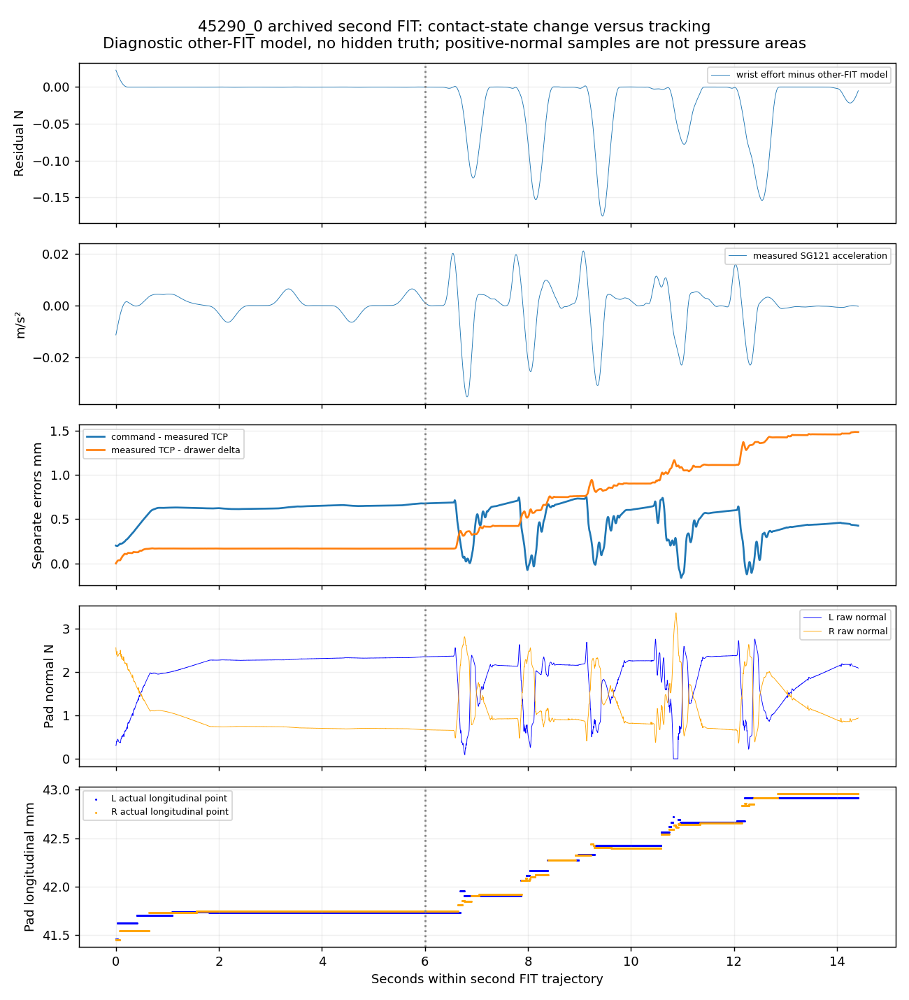

# V7.3 — isolated prismatic engineering

Status: NOT READY; engineering in progress, no new blind benchmark launched.
V7.2 remains unchanged. Three cross-object physical regressions remain outstanding.

## Scope and baseline

New development is in `prismatic_v73.py`, `prismatic_planning_v73.py` and small
observed-input/inspection/quality helpers. The frozen revolute71 source/config
and22 external dependency hashes matched before every launch. Original closure,
actuator authority, safety policies, friction/materials and V3.1 SG121 mathematics
are inherited. Engineering uses known C=0.3N, b=3N s/m and unchanged positive
uniform density, separately from the registered hidden benchmark configurations.
Requested preload starts at1.0N and is not measured normal force.

## Diagnosed failure mechanisms and changes

**45746 discovery.** The archived RGB visibly contains the white horizontal bar;
the primary `cabinet door handle` query scored0.1514, below the unchanged0.25
threshold. On identical pixels the generic prismatic query `drawer handle`
scored0.3242. Fresh observations scored approximately0.332. Shared bounded
semantic alternatives and robot-excluded metric foreground proposals now expose
observation-based alternatives; depth-only hypotheses require explicit visual
Agent approval. Border-clipped masks remain cues, not complete grasp inputs.
No GT crop, threshold reduction, weights change or asset-ID branch is used.

One complementary fresh view contained two separate drawer handles; its highest
semantic score selected the other bar. Existing cross-view association rejected
that unmatched surface rather than mixing two drawers. The interface also exposes
all current mask hypotheses so the Agent can explicitly choose the associated
observed region. Unknown backside remains separate from measured support.

**27044 closing collision.** Replaying the original cooked collision geometry
found that nominal closure passed, but the original CENTER allowance of−2mm
at12.315mm aperture reproduced `gripper_link2/original15`. Candidate execution
checks now include the native closure envelope at0/±the existing2mm bound and
41 existing-authority aperture samples. The unchanged ranking tries subsequent
eligible candidates when a proposal fails. The same envelope is rechecked after
measured-state pregrasp refinement. Authorized pad/handle contact remains legal;
real prohibited collisions and hard latches remain authoritative.

**19179 reachability.** Current-state rail IK/collision checks now include both
kinematic and retained command-bias configurations and stopping distance. From
the archived recovery state, the original80mm request has only a40.220mm safe
prefix before the original commanded joint margin. FIT may explicitly authorize
such a prefix as SAFE_PARTIAL_PROGRESS; an incomplete VALIDATION never becomes
complete. Agent decisions may instead choose a shorter range or unloaded regrasp.

**Execution precision, discovered in engineering.** The first fresh45746 run
passed perception/planning but stopped before acquisition. Its IK endpoint had
margin0.05000000049rad; assignment to native float32 rounded it outside the
strict0.05rad guard. The isolated prismatic IK now uses representable bounds
strictly inside the original margin. This changes numerical boundary convention,
not actuator gains, authority or physical safety distance. The failed run remains
recorded with zero physical acquisitions and no hard-stop reset.

**Agent latency.** Each unloaded boundary publishes concise measured-contact,
current candidate/hash, geometry/image, remaining-resource and model references.
Automatic plan/contact boards avoid repeated external analysis. The original
finite360s unloaded deadline and exit reserves remain. Orchestration timeout is
labelled separately from physical contact failure. The controller never waits
for slow Agent reasoning under unstable load.

## 45290_0 parameter bias

Read-only replay exactly reproduces the original constant model:
mass4.639282kg, damping5.792662N s/m, Coulomb0.259811N. The authored mass reference
was2.357452kg; it is not an independently measured effective PhysX mass.

| Eligible FIT trajectory | Own diagnostic mass kg | Damping N s/m | Acceleration RMS m/s² |
|---|---:|---:|---:|
| First opening | 2.34418 | 4.20161 | 0.002366 |
| Second opening | 4.99379 | 8.74422 | 0.008091 |
| Reverse | 2.36352 | 4.19070 | 0.001810 |

The second trajectory's first6s gives local mass2.3566–2.3755kg. After roughly
6.6s, measured TCP/drawer drift begins staircase growth, native pad contact points
migrate longitudinally and normal loads repeatedly redistribute. The acceleration
pulses then dominate the pooled inertial coefficient. Excluding each FIT trajectory
in turn localizes the issue: leaving out the second produces2.35559kg/4.18094N s/m;
leaving out the others still gives4.73–4.85kg. This is a diagnostic exclusion, NOT
a replacement production result or a truth-selected sample correction.

Compensated wrist effort versus signed native normal-plus-friction rail traction
differs by0.026–0.279mN RMS across the four eligible trajectories. This independent
contact cross-check contradicts a large global F/T sign/scale error. Gravity
projection is zero for the horizontal rail. Single tool-inertia compensation
contributes−0.793kg to the pooled unconstrained coefficient; it is neither removed
nor tuned. Native velocity versus finite differences and±four-frame F/T shifts
do not explain the factor-of-two local mass change. Velocity/sign correlation
is0.909, so damping and Coulomb separation is additionally weak.

Best supported: a contact/constraint-state-dependent transient contaminates the
later interrupted FIT prefix, beyond the simple constant single-DOF model. The
archives lack full moving-link pose and non-pad guide/frame reaction history;
contact compliance, off-axis constraint loading and solver effects cannot be
uniquely separated. Missing positive-normal reports are not proof of separation.
A further controlled diagnosis identified that the original eligibility test
checks filtered velocity, allowing the SG kernel to span native sticking/reversal
while its center remains classified as sliding. The isolated prismatic worker
now requires the FULL existing support (radius62samples) to have one resolved
native velocity direction above the EXISTING1e−4m/s threshold. Torque, acceleration,
velocity and sign filtering, regularization and single tool compensation remain
unchanged. This is a FIT data-quality rule, not an execution gate. VALIDATION
masks remain byte-identical and failed actions keep their original status.

On45290_0 this removes1181/3190 previously eligible samples from the bad FIT
trajectory and changes the diagnostic pooled mass to2.32342kg (−1.44% versus
post-hoc authored reference), damping4.15588N s/m and Coulomb0.269089N. The
correction was specified from the sliding-model assumption and existing kernel
support/velocity resolution, not from minimizing error against hidden truth.
The45290_1 selected extended-model mass remains1.95379kg, consistent with the
original1.95426kg; fresh45746 replay changes mass/damping/C to1.99807/3.02460/0.299965.
On identical complete validation samples,45290_0 effort/position RMSE changes
from0.005627N/2.558mm to0.0000755N/0.00951mm.45290_1 stays0.000869N/0.215mm;
fresh45746 stays approximately0.1538mm position RMSE (slightly worse than the
original0.1515mm), despite the better mass estimate. Validation was not used to
choose the rule. These are separate labelled replays, not replacements of previous
online results.
The new worker is activated only in subsequent versioned engineering scenes.

The new passive recorder retains measured moving-link pose without extra scene
queries. A separate FIT-only consistency packet exposes per-trajectory/local fits,
leave-one-FIT-out spread and excitation beside the unchanged production model.
It never fits on VALIDATION, changes coefficients or silently deletes samples.

Complete VALIDATION alone did not certify parameters: the original45290_0 forward
position RMSE was2.558mm despite+96.79% authored-mass error. The selected extended
45290_1 result differs from its diagnostic constant replay; those are labelled
separately rather than conflated. See the compact derived bias plot and metrics.

## Engineering evidence

All attempts, including precontact failures, will be tabulated here. No selected
engineering success rate is presented as a population benchmark. Each fresh scene
uses wrist RGB-D, automatic observed-geometry grasping and actual native contacts.
Finite action sequences predeclare FIT and independent VALIDATION before motion.

| Engineering attempt | Actual acquisitions | Pull / reverse / independent VAL travel | Termination |
|---|---:|---|---|
|45746_fresh_00|0|N/A|Precontact strict joint-margin stop caused by command precision; preserved, no reset|
|45746_fresh_01|1|20.018 /16.063 /12.124mm; all TARGET_REACHED|Guarded release/parking verified; later unloaded SSH timeout; actor exit confirmed|
|27044,19179,45290 fresh tests|not launched|N/A|Pending server access; no replacement or invented outcomes|

45746_fresh_01 used fresh full-bar wrist geometry, common1.0N requested preload,
an automatically selected central grasp and original one-second hold. Measured
native normal peaks during the final contact inspection were3.440/1.298N, not
the requested preload. Final validation included absent right-pad positive-normal
reports while actual progress continued; no new unilateral-contact veto was added.
The selected production constant estimate was mass1.86710±0.21404kg,
damping3.44665±0.29636N s/m and Coulomb0.298953±0.000667N (conditional standard
errors, not a complete uncertainty budget). The two individual FIT masses were
1.86929 and1.85131kg; damping3.38030 and3.04611N s/m. FIT conditioning remained
170–301, so velocity/damping separation remains a limitation.

The complete independent VALIDATION action took7.729s simulation and moved
12.124mm. Its eligible segment-local derivative-supported prediction interval
was4.713s/1132samples, with effort RMSE0.002678N, free position RMSE0.15145mm,
velocity RMSE0.41558mm/s and final position error−0.56577mm. The action was fully
executed; derivative boundaries/startup exclusions are not relabelled FIT.
Post-episode authored moving-body masses sum to2.0kg; the original online mass
estimate differs by−6.65%. Agreement between two FIT estimates alone was not used
to infer the true mass. Authored mass remains distinct from independently verified
effective PhysX dynamics. Engineering C/b references were
0.3N/3N s/m, giving−0.35%/+14.89% respective estimate differences.

After this test's safe park, the attempted finish command and existing SSH multiplex
channel stopped responding. Independent fresh SSH connections to the configured
entry also timed out during banner exchange. No next actor is launched without
confirming owned-process cleanup. This is an infrastructure blocker, not a
27044/19179/45290 physical failure or a completed cross-object validation.
The hung local publisher/SCP clients were identified and stopped so stale commands
cannot be silently delivered later. The original finite unloaded-decision deadline
and launcher watchdog remain the server-side termination fallback; their execution
was subsequently verified: actor exited normally after1369.29s wall. Its runner status is ORCHESTRATION_TIMEOUT, separate from the completed physical targets. Access recovered after closing the stale local multiplex session; the remaining tests continued sequentially.

39 original/new deterministic prismatic regressions passed before the first contact
validation; six additional FIT-qualification regressions subsequently passed, including exact reproduction of
the float32 boundary crossing, preserved native collision rejection, CENTER bound
and command-bias reachability. The actual native45746 test subsequently passed
the previously failing precontact transition. No full revolute episode was run;
preservation is audited through71+22 original hashes and isolated activation.

## Readiness and limitations

NOT READY until cross-object physical tests, independent validation, parameter
consistency and safe parking are demonstrated. The next benchmark protocol is
prepared separately and is not automatically executed. Remaining assumptions:
known rail/state, registered station, simulated wrist mount, ideal wrist load cell,
approximate actuators and native collision representation. Raw RGB-D/contact/F/T
and telemetry remain private; only derived figures/metrics are published.
