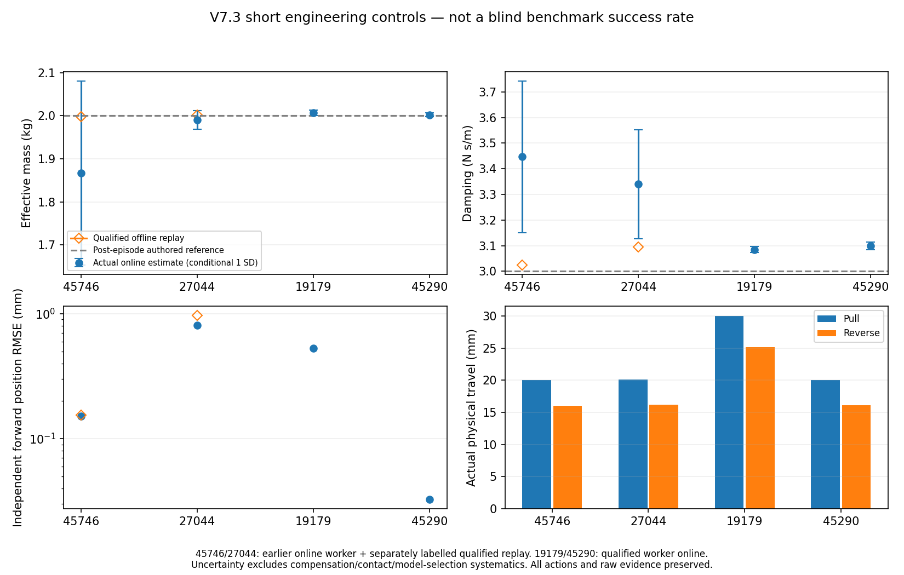

# V7.3 — isolated prismatic engineering

Status: SHORT-RANGE ENGINEERING READINESS DEMONSTRATED; new blind benchmark NOT launched.
All four drawers completed fresh physical acquisition, bidirectional FIT, a complete
independent VALIDATION action and verified unloaded parking. This is development
evidence, not a replacement benchmark success rate. Physical regrasp recovery was
not triggered in the successful engineering runs.

## Scope and baseline

New development is in `prismatic_v73.py`, `prismatic_planning_v73.py` and small
observed-input/inspection/quality helpers. The frozen revolute71 source/config
and22 external dependency hashes matched before every launch. Original closure,
actuator authority, safety policies, friction/materials and V3.1 SG121 mathematics
are inherited. Engineering uses known C=0.3N, b=3N s/m and unchanged positive
uniform density, separately from the registered hidden benchmark configurations.
Requested preload starts at1.0N and is not measured normal force.

## Diagnosed failure mechanisms and changes

**45746 discovery.** The archived RGB visibly contains the white horizontal bar;
the primary `cabinet door handle` query scored0.1514, below the unchanged0.25
threshold. On identical pixels the generic prismatic query `drawer handle`
scored0.3242. Fresh observations scored approximately0.332. Shared bounded
semantic alternatives and robot-excluded metric foreground proposals now expose
observation-based alternatives; depth-only hypotheses require explicit visual
Agent approval. Border-clipped masks remain cues, not complete grasp inputs.
No GT crop, threshold reduction, weights change or asset-ID branch is used.

One complementary fresh view contained two separate drawer handles; its highest
semantic score selected the other bar. Existing cross-view association rejected
that unmatched surface rather than mixing two drawers. The interface also exposes
all current mask hypotheses so the Agent can explicitly choose the associated
observed region. Unknown backside remains separate from measured support.

**27044 closing collision.** Replaying the original cooked collision geometry
found that nominal closure passed, but the original CENTER allowance of−2mm
at12.315mm aperture reproduced `gripper_link2/original15`. Candidate execution
checks now include the native closure envelope at0/±the existing2mm bound and
41 existing-authority aperture samples. The unchanged ranking tries subsequent
eligible candidates when a proposal fails. The same envelope is rechecked after
measured-state pregrasp refinement. Authorized pad/handle contact remains legal;
real prohibited collisions and hard latches remain authoritative.

**19179 reachability.** Current-state rail IK/collision checks now include both
kinematic and retained command-bias configurations and stopping distance. From
the archived recovery state, the original80mm request has only a40.220mm safe
prefix before the original commanded joint margin. FIT may explicitly authorize
such a prefix as SAFE_PARTIAL_PROGRESS; an incomplete VALIDATION never becomes
complete. Agent decisions may instead choose a shorter range or unloaded regrasp.

**Execution precision, discovered in engineering.** The first fresh45746 run
passed perception/planning but stopped before acquisition. Its IK endpoint had
margin0.05000000049rad; assignment to native float32 rounded it outside the
strict0.05rad guard. The isolated prismatic IK now uses representable bounds
strictly inside the original margin. This changes numerical boundary convention,
not actuator gains, authority or physical safety distance. The failed run remains
recorded with zero physical acquisitions and no hard-stop reset.

**Agent latency.** Each unloaded boundary publishes concise measured-contact,
current candidate/hash, geometry/image, remaining-resource and model references.
Automatic plan/contact boards avoid repeated external analysis. The original
finite360s unloaded deadline and exit reserves remain. Orchestration timeout is
labelled separately from physical contact failure. The controller never waits
for slow Agent reasoning under unstable load.

## 45290_0 parameter bias

Read-only replay exactly reproduces the original constant model:
mass4.639282kg, damping5.792662N s/m, Coulomb0.259811N. The authored mass reference
was2.357452kg; it is not an independently measured effective PhysX mass.

| Eligible FIT trajectory | Own diagnostic mass kg | Damping N s/m | Acceleration RMS m/s² |
|---|---:|---:|---:|
| First opening | 2.34418 | 4.20161 | 0.002366 |
| Second opening | 4.99379 | 8.74422 | 0.008091 |
| Reverse | 2.36352 | 4.19070 | 0.001810 |

The second trajectory's first6s gives local mass2.3566–2.3755kg. After roughly
6.6s, measured TCP/drawer drift begins staircase growth, native pad contact points
migrate longitudinally and normal loads repeatedly redistribute. The acceleration
pulses then dominate the pooled inertial coefficient. Excluding each FIT trajectory
in turn localizes the issue: leaving out the second produces2.35559kg/4.18094N s/m;
leaving out the others still gives4.73–4.85kg. This is a diagnostic exclusion, NOT
a replacement production result or a truth-selected sample correction.

Compensated wrist effort versus signed native normal-plus-friction rail traction
differs by0.026–0.279mN RMS across the four eligible trajectories. This independent
contact cross-check contradicts a large global F/T sign/scale error. Gravity
projection is zero for the horizontal rail. Single tool-inertia compensation
contributes−0.793kg to the pooled unconstrained coefficient; it is neither removed
nor tuned. Native velocity versus finite differences and±four-frame F/T shifts
do not explain the factor-of-two local mass change. Velocity/sign correlation
is0.909, so damping and Coulomb separation is additionally weak.

Best supported: a contact/constraint-state-dependent transient contaminates the
later interrupted FIT prefix, beyond the simple constant single-DOF model. The
archives lack full moving-link pose and non-pad guide/frame reaction history;
contact compliance, off-axis constraint loading and solver effects cannot be
uniquely separated. Missing positive-normal reports are not proof of separation.
A further controlled diagnosis identified that the original eligibility test
checks filtered velocity, allowing the SG kernel to span native sticking/reversal
while its center remains classified as sliding. The isolated prismatic worker
now requires the FULL existing support (radius62samples) to have one resolved
native velocity direction above the EXISTING1e−4m/s threshold. Torque, acceleration,
velocity and sign filtering, regularization and single tool compensation remain
unchanged. This is a FIT data-quality rule, not an execution gate. VALIDATION
masks remain byte-identical and failed actions keep their original status.

On45290_0 this removes1181/3190 previously eligible samples from the bad FIT
trajectory and changes the diagnostic pooled mass to2.32342kg (−1.44% versus
post-hoc authored reference), damping4.15588N s/m and Coulomb0.269089N. The
correction was specified from the sliding-model assumption and existing kernel
support/velocity resolution, not from minimizing error against hidden truth.
The45290_1 selected extended-model mass remains1.95379kg, consistent with the
original1.95426kg; fresh45746 replay changes mass/damping/C to1.99807/3.02460/0.299965.
On identical complete validation samples,45290_0 effort/position RMSE changes
from0.005627N/2.558mm to0.0000755N/0.00951mm.45290_1 stays0.000869N/0.215mm;
fresh45746 stays approximately0.1538mm position RMSE (slightly worse than the
original0.1515mm), despite the better mass estimate. Validation was not used to
choose the rule. These are separate labelled replays, not replacements of previous
online results.
The new worker is activated only in subsequent versioned engineering scenes.

The new passive recorder retains measured moving-link pose without extra scene
queries. A separate FIT-only consistency packet exposes per-trajectory/local fits,
leave-one-FIT-out spread and excitation beside the unchanged production model.
It never fits on VALIDATION, changes coefficients or silently deletes samples.

Complete VALIDATION alone did not certify parameters: the original45290_0 forward
position RMSE was2.558mm despite+96.79% authored-mass error. The selected extended
45290_1 result differs from its diagnostic constant replay; those are labelled
separately rather than conflated. See the compact derived bias plot and metrics.

## Fresh native-contact engineering results

Each successful scene used fresh wrist RGB-D, observed geometry, automatic native-G1
ranking, original one-second hold, and real actuator/contact motion. All started
at1.0N requested preload; none increased drive authority or needed another preload.
Targets/profiles/FIT windows and a distinct-profile VALIDATION were published before
execution. The fixed engineering plant was C=0.3N, b=3N s/m, mass scale1 with positive
uniform density. Post-episode readback lists two1kg moving bodies per drawer:2kg
authored mass, distinct from independently verified effective PhysX dynamics.

| Attempt | Acquisitions | Pull / reverse / VALIDATION travel mm | Release + park | Runner outcome | Wall min / storage MiB |
|---|---:|---|---|---|---:|
|45746_fresh_00 (R1)|0|N/A|No acquisition|Precontact strict joint-margin stop; numerical conversion repaired separately, no latch reset|22.12 /26.59|
|45746_fresh_01 (R2)|1|20.018 /16.063 /12.124|Verified|Physical chain complete; later unloaded SSH orchestration timeout|22.82 /37.69|
|27044_fresh_00 (R3)|1|20.104 /16.197 /12.171|Verified|SESSION_COMPLETE|23.51 /36.00|
|19179_fresh_00 (R4)|1|30.051 /25.134 /10.105|Verified|SESSION_COMPLETE|24.86 /43.44|
|45290_fresh_00 (R4)|1|20.055 /16.133 /11.205|Verified|SESSION_COMPLETE|25.49 /39.73|

Every listed physical segment returned TARGET_REACHED with measured stopped-state
checks. This is20–30mm short-range engineering, not evidence of reliable80–150mm
operation or a new4/4 blind benchmark. All four final parked pad loads were0/0N,
with native measured-state collision validation; actors exited normally (rc0).
No full revolute trial or additional blind physical episode was run.

Simulation totals (including observation/motion/release) were186.23s for45746 R2,
178.05s for27044,169.65s for19179 and173.91s for45290. The physical FIT/FIT/VALIDATION
segments took34.90/27.04/32.84/23.09s respectively. Wall totals include initialization,
SAM3/planning, Agent inspection, exit and cleanup; the45746 total also includes the
unloaded network timeout. No continuous full-resolution video or duplicate raw
archive was generated. Essential interaction evidence remains240Hz; RGB-D is sparse.

### Actual Agent decisions and recovery boundaries

* **45746:** Agent inspected the fresh RGB/mask/depth and full long-bar geometry.
  The common semantic alternative recovered discovery without lowering0.25.
  R2 used one fresh view and an automatically generated central/180°-roll grasp.
  R1's float32 margin failure remains a separate zero-acquisition record.
* **27044:** Initial RGB showed shelves with the relevant handle outside the useful
  framing. Agent requested one complementary physically reachable wrist view from
  its actual image/depth. The first ranked off-center candidate failed the native
  closure envelope (`gripper_link2/original17`); automatic fallback selected a
  feasible central candidate before physical contact. No collision was suppressed.
* **19179:** Agent inspected two fresh views. The second view's highest score was
  another drawer; Agent explicitly selected the associated lower observed SAM3
  hypothesis. Current-state preflight checked the measured robot, retained command
  bias and actual drawer state. Agent chose30mm pull and25mm reverse, rather than
  driving the loaded grasp into the archived80mm joint-limit problem.
* **45290:** The first automatic semantic seed was the upper drawer despite the
  lower handle being fully framed. Agent inspected a new oblique wrist view, then
  requested SAME-SCENE unloaded `reobserve_and_replan`, preserving the old generation.
  It selected the fresh lower SAM3 mask before fusion and approved the automatic
  15°-pitch candidate. Three actual observations, one view adjustment, one acquisition;
  no door reset, archived view/grasp, manual pose or GT geometry correction.

Each viewpoint passed existing IK/native collision checking and used actual arm
actuators. Private `CODEX_DECISIONS.jsonl` records inspected-image provenance,
missing information and chosen actions; `AGENT_ACTION_TRACE.json` records actual
acknowledged operations. Concise decision packets expose model/contact/candidate
summaries directly. The unchanged360s unloaded wait remains finite. After45746 had
already parked, a stale local SSH multiplex channel prevented the finish command;
the runner correctly retained ORCHESTRATION_TIMEOUT, then exited. Only identified
owned clients/master were closed; later runs used a fresh channel. This is not
reported as a physical transmission failure or a completely successful runner.

**Physical regrasp recovery was not triggered in these four successful runs.**
Same-scene perception recovery and collision-invalid planning fallback were actually
exercised. The inherited measured-state release/reobserve/regrasp path remains wired,
with multiple acquisitions available, but its post-failed-pull branch was not newly
physically exercised in V7.3. No unsafe failure was manufactured to fill this gap.
A genuine hard stop remains terminal; there is no latch-reset path.

### Identification: immutable online results versus separate qualified replays

R2/R3 used the earlier production FIT eligibility. R4 (19179,45290) actually loaded
`scripts/update_prismatic_v73_model.py` with SHA256
`b451426b212f791a8e20f1cadf636f17afff6a958effb487908a3759a9c5b2f0`.
The asynchronous workers published ready/rc0 packets in4.51–5.23s. R2/R3 outputs
are preserved; the common new qualification was replayed offline on exactly those
recordings into separate directories. No second physical run was performed to
replace them, and no VALIDATION sample entered fitting or model selection.

| Object / estimator result | Mass kg ± conditional SD | Damping N s/m ± conditional SD | Coulomb N | Mass / damping error vs authored | Held-out effort RMSE N | Free position / velocity RMSE mm, mm/s |
|---|---:|---:|---:|---|---:|---|
|45746 actual R2 online|1.86710 ±0.21404|3.44665 ±0.29636|0.298953|−6.65% /+14.89%|0.002678|0.1515 /0.4156|
|45746 qualified offline replay|1.99807 ±0.00658|3.02460 ±0.01318|0.299965|−0.10% /+0.82%|0.002823|0.1538 /0.4410|
|27044 actual R3 online|1.99065 ±0.02148|3.33970 ±0.21236|0.299046|−0.47% /+11.32%|0.004152|0.8131 /0.4654|
|27044 qualified offline replay|2.00161 ±0.00361|3.09419 ±0.01343|0.299765|+0.08% /+3.14%|0.004236|0.9737 /0.4854|
|19179 actual R4 online|2.00680 ±0.00596|3.08519 ±0.01249|0.299771|+0.34% /+2.84%|0.003358|0.5283 /0.3353|
|45290 actual R4 online|2.00226 ±0.00435|3.09917 ±0.01531|0.299753|+0.11% /+3.31%|0.0000777|0.0326 /0.1175|

Lower authored parameter error did NOT improve every held-out trajectory:45746 and
27044 qualified replays have slightly higher forward position errors. No selection
was made on VALIDATION to hide that result. All selected models here are constant;
these short two-FIT blocks do not establish a wide-range position-dependent law.
Conditional errors exclude sensor/compensation/contact/constraint/model-selection
systematics; they are not calibrated total physical confidence intervals. Source
and immutable model hashes, full held-out metrics and FIT-only consistency spread
are in [DERIVED_RESULTS.json](DERIVED_RESULTS.json).

The original frozen V7 predictor ALREADY integrates the whole contiguous local
filter-supported interval, including stationary/reversal samples, from one measured
initial q/qd under held-out measured wrist effort, without subsequent correction.
The new read-only evaluator explicitly verifies invariance to the sliding-validity
mask; it is NOT a new forward-prediction fix. Complete physical VALIDATION actions
and shorter numerical derivative-supported intervals are reported separately:

| Object | Complete VALIDATION action s | Predicted contiguous support s / samples |
|---|---:|---:|
|45746|7.7292|4.7125 /1132|
|27044|8.1458|5.1292 /1232|
|19179|9.7125|7.1958 /1728|
|45290|5.7000|3.1833 /765|

### Tracking, transmission and contact evidence

These are two separate measurements, not one generic “slip” number. Across opening
FIT, incremental command-to-measured TCP rail RMS was0.177/0.581/0.608/0.271mm for
45746/27044/19179/45290; measured-TCP-to-drawer rail RMS was
0.588/0.401/0.826/0.755mm respectively. The second quantity includes compliant
contact migration and geometric/constraint effects, not necessarily free sliding.
Signed native normal-plus-tangential rail traction cross-checks the wrist measurement;
RMS discrepancies on qualified motion were about0.008–0.106mN. Native contact
traction is diagnostic only, never the estimator's primary input.

Measured normal-force peaks during VALIDATION were L/R3.440/1.298N (45746),
1.736/1.360N (27044),1.118/2.850N (19179). They differ from requested1N preload.
Intermittent missing positive-normal reports occurred while useful motion continued;
none became a new unilateral-contact veto.19179 retained a narrow approximately
1.24mm longitudinal pad margin and reached about2.00mm relative-translation drift;
this is a limitation for longer travel, not proof of universally stable contact.
Raw point contacts are not pressure areas, and normal forces alone are not full
wrenches. Where available, native tangential records were used only as a cross-check.

## Integrity, readiness and next benchmark

Final audit: original71 source/configuration hashes and22 external dependencies
match exactly; all16 V7.2 episodes retain their64 original provenance hashes and
all13 existing online-model hashes. Three original episodes had no model and were
not invented. The original V7.2 prismatic2/8 independent-VALIDATION outcome remains
unchanged. No revolute source/control/estimator file changed.

48 deterministic prismatic/data-registration regressions passed (including six
FIT-support and three non-launching/private/non-overwriting registration tests). They cover strict float32 boundaries, true native-collision
rejection, original CENTER bounds, retained command-bias reachability, synthetic
known-parameter recovery through static transients, VALIDATION isolation and
prismatic-only worker activation. Short physical evidence above then exercises
fresh discovery, native collision fallback, real pull/reversal and guarded parking.
No new force, grip, gain, friction or collision waiver was introduced.

**Readiness assessment:** sufficient for a separately registered short-range
independent dynamics test on these four development objects; NOT evidence of
population robustness, reliable80–150mm travel, or a newly validated physical
post-failure regrasp branch. The new protocol preserves those limitations and all
failures. Fresh seeds/configuration commitments are prepared in a separate versioned
registration; no new benchmark is automatically launched. The engineering runner
explicitly rejects original registered slots and remains engineering-only; activation
of a registered launcher is a separately reviewed step before any new outcome.

Known rail/state, registered station, simulated wrist mount, ideal wrist load cell,
approximate actuators and native collision representation remain explicit dependencies.
Depth-only hypotheses were implemented but not physically selected; all executed
grasps used Agent-inspected SAM3 observations. The current semantic-selection API
acts on the latest view; changing a mistaken first target currently requires the
existing safe same-scene observation-generation reset, as honestly demonstrated
on45290. The door and robot scene are never reset.

Raw RGB-D/contact/F/T and telemetry remain in the private experiment store.
Machine identity and absolute private storage paths are omitted from this public report.
The private hash index references compact numeric chunks and source provenance;
no duplicate full raw archive was copied. Final compaction retains selected masks,
RGB/depth/calibration and essential native records, but deletes reconstructible
unselected SAM mask arrays; candidate metadata/decision image provenance is retained.
All five owned actors (including the zero-acquisition failure) exited; no finalized
scene remains waiting. Public delivery contains source, derived plots/metrics,
[physical R4 hashes](PHYSICAL_R4_FREEZE.json) and the
[next protocol](NEXT_BENCHMARK_PROTOCOL.md), not raw camera/F/T/video evidence.

Final source/configuration inventory: [SOURCE_FREEZE.json](SOURCE_FREEZE.json).
Retained private evidence:1084 files,192,373,134bytes across all five engineering
records, including the precontact failure; private index SHA256
`46f0399499688ef4fd205693889a5d87ecf038165d81507bac447fb19f6ace6a`.
See [integrity/cleanup summary](EVIDENCE_INTEGRITY_SUMMARY.json).
