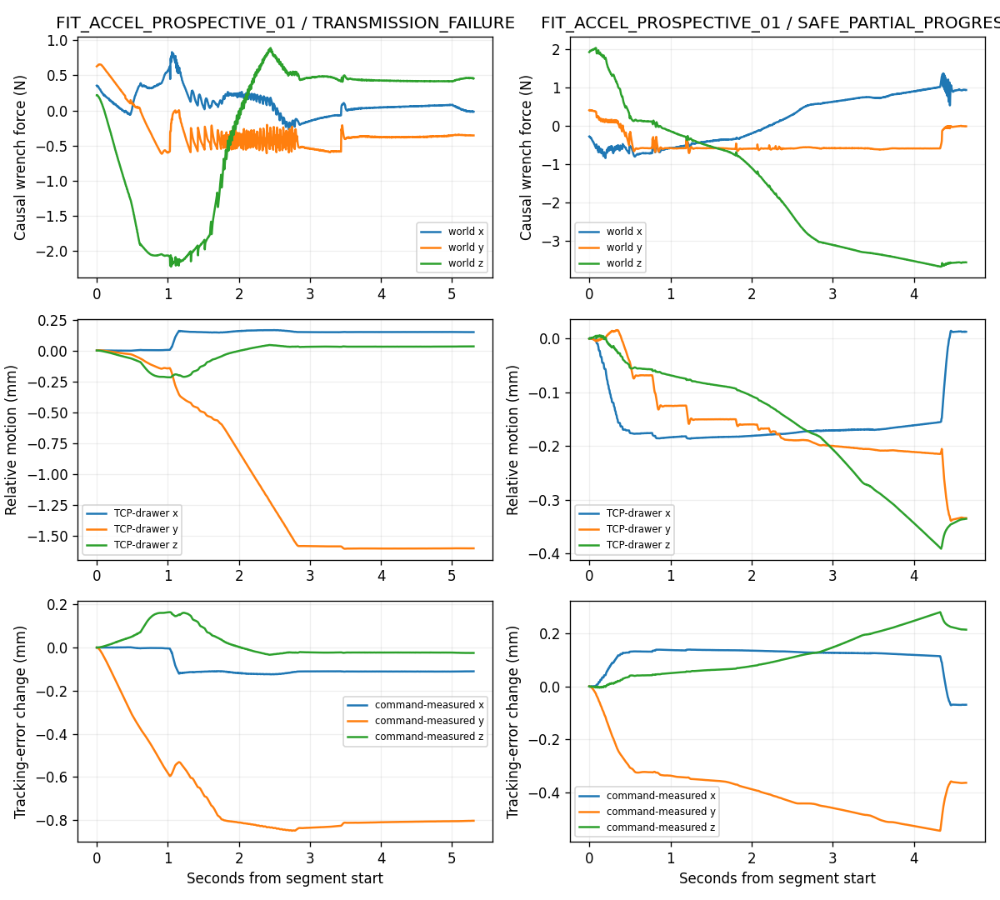
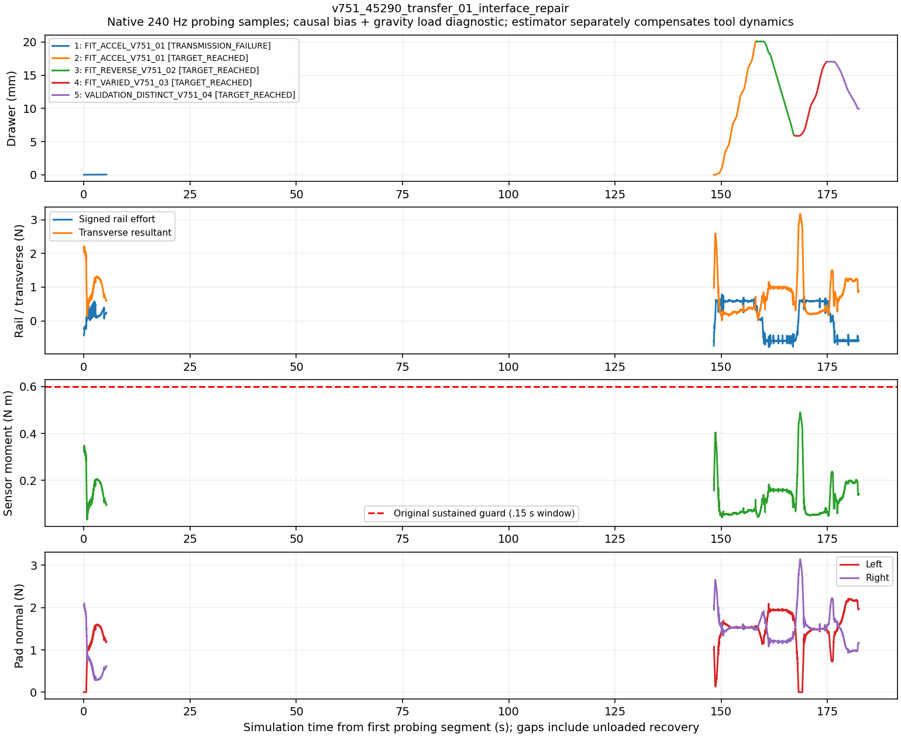
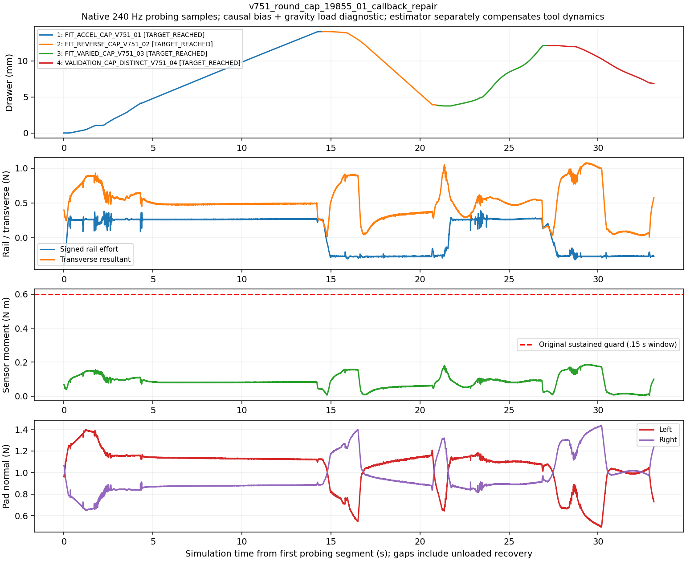
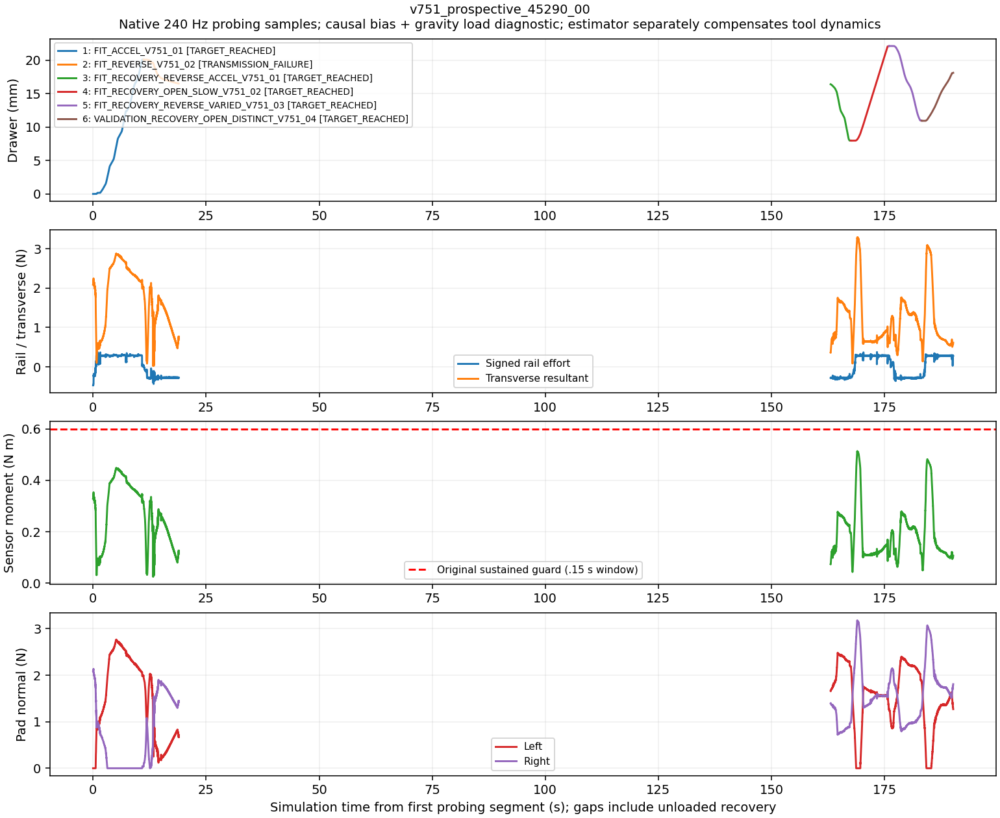

# V7.5.1 — Prismatic dynamics transfer, exit and compact-cap engineering

References: `9349083` (V7.5), frozen revolute 71+22 dependencies. This is bounded engineering development and a separately committed prospective check, **not** a replacement benchmark. Historical results remain unchanged. Raw RGB-D, 240 Hz wrist/contact/motion streams and inspected-image boards remain private.

## Outcome at the bounded stop

| Milestone | Physical result | Independent validation | Final park |
|---|---|---|---|
| A: revealed 45290 new dynamics | First pull failed; one same-scene recovery reached 20.090 mm, reversed 14.204 mm | Complete | Verified |
| B: difficult unloaded observation state | Original Cartesian exit rejected; joint-space alternative actually executed | Not a manipulation test | Verified |
| C: observed round cap, 19855 | First acquisition reached 14.062 mm, reversed 10.215 mm | Complete | Verified |
| D: newly hidden 45290 dynamics | First reverse failed; one same-scene recovery reached 22.102 mm, reversed 11.138 mm | Complete | Verified |

The requested engineering lifecycle milestones passed within short measured ranges. First-attempt reliability is still imperfect. These cases do not establish a population success rate or full-stroke identification, and no new benchmark batch was launched.

## Evidence-supported mechanism

The revealed R2/R3 45290 plant has authored Coulomb resistance 0.58305 N, compared with 0.3 N in the earlier local control. This change alone does not establish a friction failure: useful axial loading and non-task loads must be separated.

In the last complete causal 150 ms window before R3's predictive unload, robot-side wrist force was `[0.985127,-0.592824,-3.642437] N`; independently signed native reaction was `[0.985172,-0.592850,-3.642388] N`. Useful rail traction was 0.592824 N versus 3.773318 N transverse resultant. Thus a sensor-only compensation artifact is not supported. Sensor-origin moment was 0.583459 N m, but TCP-origin moment was 0.081790 N m: the lever arm matters. The original sensor-origin protection remains active; changing origins is diagnostic, not a reason to omit torque protection.

Over that pull, measured TCP-to-drawer displacement changed by `[0.012881,-0.334012,-0.335365] mm`. Command-to-measured tracking error changed by `[-0.069324,-0.363593,+0.213974] mm`. Nominal transverse Z command itself changed by -0.121391 mm; servo/tracking contributed approximately another -0.214 mm. Aperture increased 0.468701 mm and the tail pad-normal reports were approximately `[3.644,0] N`. This supports combined command/servo deflection and contact-load redistribution. It does not prove physical separation from a zero normal report. Native contact-manifold corners are not measured pressure areas and do not prove exclusive pad-edge contact.

The old 1 N attempt also had a rail tracking deficit (~0.803 mm) and larger measured TCP/drawer relative motion (~1.603 mm), while the drawer moved only 0.084 mm. Insufficient arm tracking and ineffective contact transmission coexist; bilateral acquisition alone is insufficient evidence of traction. Grasp geometry, arm branch, coupled-G1 compliance and native contact fidelity remain partially confounded.

## Isolated changes and controls

The V7.5.1 extension is prismatic-only. It preserves implicit native G1 targets, gains, effort authority, actuator mapping, colliders, plant resistance, estimator mathematics and safety limits. No integral-IK or transverse-retention prototype is enabled.

At an explicitly Agent-approved unloaded boundary, a new acquisition can enable bounded transverse unloading. It uses causal robot-side wrist load, the measured jaw-centre axis projected perpendicular to the known rail, the original closure centering slope, at most the original 5 micrometre step per 19 native frames, original Cartesian rate limiting and original 2 mm combined centering/correction ball. There is no rail-axis correction or jaw-force command adjustment. Existing current-state IK, collision checking and load forecast retain authority. A reference epoch prevents accumulating the same offset twice at segment transitions.

The original pad sustained/emergency bands are 4/10 N, wrist 8/10 N and sensor-origin torque 0.6/1 N m; informational warnings are not blanket fatal thresholds. No band is raised. No independent implicit-drive motor force is available; explicit effort commands and projected reactions are not labelled motor output.

The legal requested preload menu remains 0.5/0.75/1/1.5 N. Requests are not measured finger forces. Numeric JSON `1` and `1.0` are canonicalized before the recovery-condition fingerprint, avoiding a protocol-only false changed-condition rejection.

Compact-cap planning is an explicit Agent-selected family: observed cap centre, existing insertion-depth family, eight in-plane jaw directions, same 18-candidate diverse shortlist, existing scores and uncertainty surfaces. It has no privileged bar longitudinal axis or bar-end sections. A current-generation nonce verifies that the actual selected plan came from this generator. The radial hook is installed after the inherited scorer is selected; generator failure cannot silently execute a bar fallback.

## A — Revealed new-dynamics 45290 engineering scene

Fresh wrist observations initially detected the wrong upper handle. Codex inspected RGB, masks, metric depth and local cloud, rejected a non-reachable extra view, executed a validated alternative view, then began a new observation generation and explicitly associated the lower moving-part handle. A pitched candidate was rejected by bounded approach/IK search; automatic feasible-candidate fallback remained active. The preserved record does not identify a specific collider for that rejection.

First acquisition: automatic roll-180 candidate, requested 1 N, unloading disabled. Bilateral acquisition and original one-second hold succeeded; the pull stopped with `TRANSMISSION_FAILURE / PRISMATIC_STARTUP_KINEMATIC_TANGENTIAL_SLIP_EVIDENCE` after only 0.0236 mm. Full safe release and parking succeeded. This failure remains part of the scene result and contributes no qualified FIT.

At the verified unloaded boundary Codex inspected actual contact/motion boards, obtained fresh wrist observations, selected another automatic roll-0/arm-branch candidate, legal 1.5 N request and the preregistered bounded unloading extension. This changes several factors and is **not** an isolated preload/unloading A/B. The second complete approach had minimum joint margin 0.682 rad. Bilateral acquisition, original hold and all four predeclared physical segments succeeded:

| Segment | Actual travel | End position | Physical duration | Status |
|---|---:|---:|---:|---|
| Acceleration/plateau opening FIT | +20.087 mm | 20.087 mm | 10.092 s | TARGET_REACHED |
| Different-speed reverse FIT | -14.204 mm | 5.883 mm | 9.021 s | TARGET_REACHED |
| Varied-speed opening FIT | +11.152 mm | 17.035 mm | 7.675 s | TARGET_REACHED |
| Independent distinct-profile VALIDATION | -7.083 mm | 9.952 mm | 7.338 s | TARGET_REACHED |

Maximum actual position was 20.090 mm. Full guarded release and measured parking succeeded; no HARD protection stop. Correction maximum was 0.359 mm, with numerical rail component below 4.6e-22 m. Moving transverse means were 0.374/0.912/0.626/1.003 N, with sensor-origin moment maxima 0.404/0.184/0.490/0.237 N m. These are different phases from the R3 terminal window, not matched-load effect sizes. A brief single-pad zero-normal report did not introduce a new veto.

The immutable online constant model estimated mass 1.551461 kg, damping 2.961096 N s/m and Coulomb force 0.582866 N. Conditional standard deviations were 0.002640 kg, 0.010855 N s/m and 0.0000258 N, with scaled condition 141.87. FIT support is only 0.514–19.021 mm. Three FIT trajectories qualified; state dependence is not claimed.

Complete physical validation lasted **7.338 s**. Strict derivative-supported independent prediction retained **4.321 s**, initialized once and driven by held-out measured effort, with force RMSE 0.0000912 N, position RMSE 0.03894 mm and velocity RMSE 0.10828 mm/s. Unfiltered-input force RMSE was 0.01771 N; the much smaller common-filtered residual is not a hardware precision claim. Conditional uncertainty excludes contact, compensation and model-selection systematic error.

After actor, Agent and online model were sealed, authored references were evaluated: 1.552124 kg, 2.878360 N s/m and 0.583051 N. Relative errors were -0.04275%, +2.87443% and -0.03160%. Authored references are not independently measured effective PhysX parameters. Damping error exceeds its conditional standard deviation; the latter is not calibrated total physical uncertainty. Wall time was 2398.10 s; compact private footprint 58.21 MB.

## B — Difficult unloaded observation-state exit

A separate native-actuator fixture moved from normal rest to the archived difficult observation region by a freshly validated collision-free route. This fixture uses an archived joint state as an explicit diagnostic destination, never as an online grasp or observation correction. No robot or object state was teleported; no grasp was attempted.

From the actual reached state the original Cartesian exit still returned `SAFE_EXIT_UNAVAILABLE`. The legal joint-space alternative then physically executed `ALREADY_UNLOADED_FREE_JOINT_RETURN:DIRECT` to `shoulder_rest_+20/winding[0,0,0,0,0,0,0]`, with original collision predicates, actual released fingers and final measured parking verification. Final pad loads were 0/0 N, object remained closed; actor exited normally. Wall time 101.615 s. This is a physical exit result, not merely offline IK feasibility.

## C — Compact round-cap result

Fresh initial wrist images showed lower table structure and no handle. Codex rejected those cues and requested a higher/farther view derived from the current metric depth boundary and measured camera pose. The actual actuator-executed view revealed a small front cap. Codex inspected RGB, SAM3, colorized depth, local cloud and the depth-proposal overlay; selected the compact front-cap hypothesis, excluding table edge/legs and keeping a shallower rear/stem/panel cue uncertain.

The active radial generator produced 48 candidates and scored the same diverse shortlist of 18. Complete native approach fallback selected the centre-only +18.75 mm insertion / 225-degree in-plane family; the current nonce matched. The measured-state return had 134 checked samples; approach 91 samples, minimum margin 1.192 rad; actual timed path 2636 samples validated. Predicted first contact was approximately 18.11 mm for both sides; actual first positive normal reports occurred at 22.732/21.752 mm, and the original 50 mN contact criterion at 22.717/21.747 mm. Thus the contact predictor still underestimates onset by roughly 4.62/3.64 mm; successful manipulation does not establish exact cap reconstruction. No GT correction was applied. The finite original closure physically acquired bilateral contact and held for one second. Requested preload stayed **1.0 N** and transverse unloading stayed **disabled**.

All predeclared segments reached their measured targets: +14.060 mm, -10.215 mm, +8.275 mm and independent validation -5.277 mm. Maximum actual displacement was 14.062 mm; final coordinate 6.842 mm. Original guarded release, clearance and full measured parking succeeded, no HARD stop, actor exited normally. One acquisition, one intentional fresh view adjustment, 1354.62 s wall time, 35.25 MB private footprint. Native per-contact point reconstruction was unavailable in this scene; per-pad normals and independent native friction-anchor reaction were recorded, so no point-centroid or pressure-area claim is made.

The online model selected a low-dimensional resistance extension from three FIT trajectories only. Mass was 1.545910 kg, damping 4.340269 N s/m, scaled condition 1134.78; observed support was 1.412–3.759 and 4.471–13.777 mm. Post-seal authored mass/damping were 1.540885 kg and 4.324542 N s/m (approximately +0.326%/+0.364% errors). On frozen observed FIT support, post-hoc resistance RMSE was 0.0000171 N. The authored resistance includes a localized region near 80.7 mm, far beyond observed travel: that peak is **not identified**. Complete physical validation lasted 5.975 s; retained free prediction 3.958 s, effort RMSE 0.01142 N, position RMSE 0.45584 mm, velocity RMSE 0.20342 mm/s. The unfiltered-input sensitivity gave 0.01852 N and 0.07576 mm. This filtering sensitivity, high conditioning and systematic-error exclusions limit parameter-confidence claims even though the contact lifecycle passed.

## D — Prospective unseen-dynamics result

One independent 45290 constant-resistance configuration was generated once from the established physically consistent family after A/B readiness. Private configuration commitment: `24be80a6afa509669defaa97da17b1d0640fe3a15e732546998f449605fe6e43`. Registration D freezes source/job/configuration before launch. Hidden values and seed remain unavailable to Agent/controller/estimator until all operations and online fitting end. No author-truth selection of filters, candidates or coefficients is permitted.

The actual source/job/private commitment checks passed before launch (641 source entries, no mismatch). The first fresh wrist image contained upper and lower handles. Codex inspected actual RGB/depth/cloud and the lower candidate overlay, selected the lower drawer bar, and enabled the frozen transverse unloading extension with the shared initial 1 N request. No archived view or grasp was replayed.

The first roll-180 acquisition and one-second hold succeeded; opening reached 20.060 mm. Reverse motion stopped after -3.572 mm with `TRANSMISSION_FAILURE / SUSTAINED_LOW_TRANSMISSION` (last progress ratio 0.0865), not budget exhaustion or a hard force stop. Rail command-to-measured TCP change was -0.694 mm; measured TCP-to-drawer relative change was -1.438 mm. Both pad normals were reported near the reverse failure. Thus absent contact reports or tracking alone do not explain the result. Safe release and full measured park succeeded.

Codex inspected this attempt's actual contact/motion and native-location boards, then obtained new wrist RGB-D at the **actual 16.488 mm state**. It selected the lower front-strip hypothesis and legal 1.5 N request for a new acquisition. Native search rejected multiple closing-envelope collisions and low-margin branches, selected a new automatic roll-0/arm branch, and validated all 1728 complete-chain native configurations including reversal, centering envelope and exit. Current return/approach checks passed, minimum approach margin 0.703 rad. This is changed observation/contact/arm-branch/preload recovery, not an unchanged retry or isolated preload A/B.

The Agent declared reverse-first acceleration FIT to test the failed direction over observed overlap, then another-speed opening FIT, varied reverse FIT and immediate distinct-profile opening VALIDATION. Second acquisition and the original one-second hold succeeded:

| Recovery segment | Actual travel | End position | Physical duration | Status |
|---|---:|---:|---:|---|
| Acceleration-rich reverse FIT | -8.417 mm | 7.968 mm | 4.467 s | TARGET_REACHED |
| Slower opening FIT | +14.119 mm | 22.087 mm | 8.429 s | TARGET_REACHED |
| Varied reverse FIT | -11.138 mm | 10.949 mm | 7.221 s | TARGET_REACHED |
| Independent distinct opening VALIDATION | +7.150 mm | 18.099 mm | 6.996 s | TARGET_REACHED |

Maximum position was 22.102 mm. Complete guarded release and measured safe parking passed; actor exited normally. Exactly two acquisitions, one recovery; the failed first reverse remains in the record and is excluded from qualified FIT. The complete first opening FIT is retained. No door reset, hidden-pose correction, force increase or source change occurred between attempts. Transverse correction maximum was 0.645 mm (zero rail component to numerical precision); maximum probing sensor-origin moment remained below 0.514 N m. Single-pad zero-normal transients did not create a new fatal gate.

Before truth reveal, the immutable online constant model used 212 FIT bins from four complete eligible FIT trajectories and 46 independent VALIDATION bins. Estimated mass/damping/friction were **1.577839 kg / 5.659749 N s/m / 0.273420 N**, conditional standard deviations **0.002802 kg / 0.009176 N s/m / 0.0000218 N**, scaled condition **142.12**, FIT support **1.161–21.401 mm**. No state-dependent extension was selected. FIT-only leave-trajectory-out effort errors were 0.000101/0.000107/0.0000478/0.0000637 N across the four FIT trajectories.

Complete physical validation lasted **6.996 s**; derivative-supported free prediction retained **4.479 s**, initialized once with no subsequent measured-state corrections. Common-filtered effort RMSE was **0.0000818 N**, position RMSE **0.10150 mm**, velocity RMSE **0.06534 mm/s**; final position error +0.18111 mm. Unfiltered-input sensitivity yielded **0.01720 N**, **0.09711 mm**, **0.03206 mm/s**. The input is held-out measured robot effort, not an independently predicted future contact force.

Only after actor, Agent and worker ended and model/index/trace were sealed, authored references were revealed: **1.575195 kg / 5.581651 N s/m / 0.273583 N**. Relative errors were **+0.16780% / +1.39919% / -0.05970%**. No refit or model selection followed the reveal. Authored mass is not an independent measurement of effective PhysX mass. Damping/friction errors exceed their narrow conditional standard deviations, so those are explicitly not calibrated total physical confidence intervals.

Total wall time **1792.10 s (29.87 min)**, native simulation **333.38 s**, private footprint **52.47 MB**. No optional third acquisition or additional research episode was run.

## Actual excitation and applicability

The motion below is measured and qualified under complete-window V7.3 sliding rules, not inferred from requested profiles. Values are RMS velocity / common-filtered acceleration in mm/s and mm/s².

| Dataset | Acceleration FIT | Other-speed FIT | Varied/reverse FIT | Validation |
|---|---:|---:|---:|---:|
| A recovery | 2.627 / 3.622 | 2.207 / 0.585 | 2.249 / 1.566 | 1.394 / 0.587 |
| C cap | 1.087 / 0.304 | 2.106 / 0.427 | 2.145 / 1.566 | 1.193 / 0.808 |
| D recovery block | 2.698 / 3.604 | 2.171 / 0.521 | 2.240 / 1.565 | 1.345 / 0.460 |

D also retains its complete first opening FIT (2.501 / 3.401). Qualification, per-block retained samples and support are in the compact `*_EXCITATION.json` files. VALIDATION remains a separate complete physical trajectory; the retained prediction horizon is shorter. The model remains conditional on known rail/state and valid contact transmission, and cannot identify unobserved resistance peaks or full-stroke dynamics. Native contact data are independent diagnostics only; all formal fitting uses compensated wrist F/T with exactly one downstream-tool inertia compensation.

## Infrastructure failures, provenance and limits

Before any A0 acquisition, an incorrect client publisher invocation created a directory where the receiver expected a JSON file; the scene exported and closed. Correct atomic publisher round-trip checks passed before A1. C0 also had zero acquisitions: the inherited scorer-selection wrapper overwrote an outer radial-generator hook. This was detected before physical approval; safe park completed, source and failure were preserved. The repaired actual callback seam passed selector-order and no-bar-fallback tests before C1. Neither invalid setup is counted as a failed physical grasp or erased.

The final freeze audit retains 71+22 hashes without mismatch, and 42 isolated runtime/recovery/radial-interface regressions passed. Per-scene complete private file manifests, online seals and process cleanup are indexed in `EVIDENCE_INDEX.json`; source checks are in `FREEZE_AUDIT.json`. Raw evidence remains private, with sealed model/index/Agent-trace hashes and per-scene source snapshots. Same-account procedural blinding is not a security boundary. Known rail/state supervision, registered station, simulated wrist mount, ideal virtual F/T load cell and approximate actuators remain explicit limitations. No real-hardware safety or population success rate is claimed. No new full benchmark is authorized automatically.

## Readiness and remaining uncertainty

The best-supported failure mechanism is combined contact-load redistribution and constrained command/servo motion, amplified by grasp/arm-branch sensitivity. The archive contradicts a sensor-only explanation and does not support simply lowering friction or raising the moment limit. The successful recoveries change more than one factor, so they do not identify a unique causal coefficient for preload, orientation or unloading. A future isolated engineering A/B could separate them; it was not appended automatically.

A/B/C/D demonstrate the requested ordinary-handle new-dynamics interaction, physical difficult-state exit, compact-cap contact family and one prospective hidden-dynamics recovery-to-validation lifecycle. Full safe parking is physically verified, not inferred from IK alone. The original first failures and both zero-acquisition infrastructure errors are preserved.

This supports a **new, separately preregistered short-stroke independent evaluation** of the frozen branch. It does not establish long-stroke reliability, calibrated physical uncertainty, arbitrary knob reconstruction, or readiness to claim all drawers robust. Round-cap first-contact onset error and non-task loading remain measurable limitations. No additional benchmark, asset, controller tuning or physical trial is started after this report.
