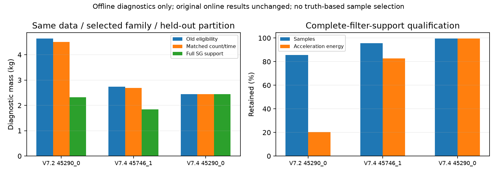
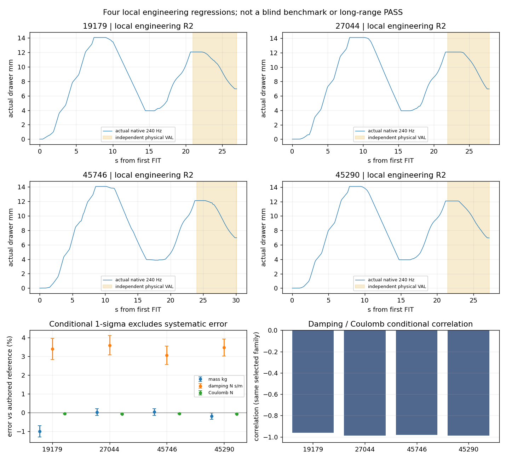
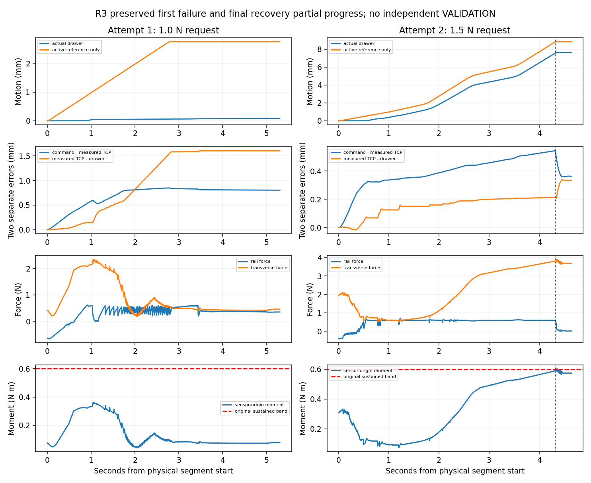

# V7.5 — prismatic lifecycle, loads and model applicability

**Final assessment: NOT READY for a new formal benchmark.** This is not a new
benchmark and does not replace any V7.2–V7.4 outcome. Fresh native-contact results
are reported individually, including unsuccessful acquisitions and recovery.

Four local R2 drawers completed short pull/reverse/independent VALIDATION/park.
Both subsequent prospective checks failed to complete VALIDATION. The one
registered R3 development recovery improved pulling to **7.640 mm**, but increasing
non-task load caused guarded early unloading before reversal/VALIDATION. These
results cannot be combined into an unbiased benchmark success rate.

## What the archived failures actually show

| Failure | Measured evidence | Interpretation / unresolved issue |
|---|---|---|
| 19179_0 sustained overload | Last 150 ms: pad maximum mean 3.882 N; wrist force norm mean 3.913 N; sensor-origin moment norm mean **0.604644 N m**. Useful rail force 0.194 N versus transverse force 3.899 N. | The original moment channel, not a generic 2 N stop, terminated execution. Predominantly non-task loading; high drawer resistance is not established. Contact geometry, constrained motion and actual finger settling remain possible contributors. |
| 19179_1 reverse collision | Native `gripper_link2 / original10` collision after recovery and useful bidirectional motion. Its recorded nominal grasp passes the new whole-chain offline check (540 configurations). | A nominal geometric preflight does **not** prove loaded reversal safety. Original online native collision protection remains necessary. |
| 27044 traction / recovery cost | Some pulls have both increased commanded-to-measured TCP error and increased measured-TCP-to-drawer relative motion; these are separate quantities. The last recovery completed three FIT actions but had insufficient resources for full VALIDATION. | Neither arm tracking nor bilateral closure alone establishes useful traction. Admission must include complete validation and exit before another acquisition. |
| 45746_1 safe exit | Actual released terminal state had first arm joint near 4.818 rad. The old rest representations required a long sweep. With the observed retreat normal, old planning rejected after 112.38 s; legal equivalent joint winding found an original-predicate-valid full route in 1.496 s. | One rejected return was not an unavoidable reachability limit. This is an offline route result until actuator execution verifies the terminal state. |
| Failed closure feedback | The old feedback path could display the preceding successful identification segment. | Attempt/generation/step provenance, bounded writer barrier and current-attempt-only numeric/contact selection replace that fallback. Missing current data is explicitly unavailable. |

Native contact manifolds are not pressure distributions. Missing positive normal
reports are not proof of physical separation. Native impulse/anchor forces are
diagnostic cross-checks only; identification still uses robot-side six-axis F/T.
PiPER and G1 results are not matched physical controls. Revolute torque and
prismatic force are not compared numerically without task geometry/virtual work.

R1's fresh failure further identifies `original10` as part of the **moving
drawer panel**, not a stationary frame. At its last accepted reverse command,
native clearance was 7.31 micrometres; the next command was rejected. Reverse
command/actual TCP/drawer travel were 3.208/2.149/1.859 mm respectively. Useful
opposite-direction traction existed before the geometric command stop.

## Load-channel audit and calibration

The active original policy uses per-pad maximum positive normal load, the norm of
the world-oriented wrist force, and the norm of moment at the **instantaneous
sensor origin**. Raw sensor bias is subtracted and downstream-tool gravity is
compensated. Downstream inertia remains in this conservative causal protection
channel. The estimator separately compensates tool inertia exactly once and
applies common SG121 filtering after a segment is complete. Centered estimation
operators never feed protection.

On the same earlier reliable native window of archived 19179_0, full tool
inertia compensation changes moment mean norm from 0.396969 to 0.397077 N m:
0.000108 N m cannot explain the subsequent overload. Full centered compensation
at the final stop boundary is unavailable, not extrapolated. The final guard
window's exact wrench-origin transform gives 0.604644 N m at the sensor versus
0.092339 N m at TCP, with a 172 mm lever and 0.670642 N m lever-force moment.
Vector norms do not add linearly. TCP moment is not a measured contact couple;
none of these transformations removes a component from online protection.

| Channel | Informational warning | Trailing 150 ms sustained stop | Immediate emergency |
|---|---:|---:|---:|
| Maximum reported pad normal | 2 N | 4 N | 10 N |
| Wrist resultant force | 4 N | 8 N | 10 N |
| Sensor-origin resultant moment | 0.3 N m | 0.6 N m | 1 N m |

`force.window_s=0.05` is an inactive configuration field; `sustained_s=0.15`
is the actual guard interval. Histories are retained across mode changes and
reversal. Native collision, joint margin, speed/acceleration and actuator guards
remain authoritative. **No load band or native drive authority was increased.**

The official [xArm specification](https://docs.xarm.ufactory.cc/8.technical_specifications.html)
does not permit converting payload into a safe handle pull or clamp limit. The
installed model is the pinned official
[G1 URDF](https://raw.githubusercontent.com/xArm-Developer/xarm_ros/aad7e1611c9c46eb719045414394bfdd42dcb0f8/xarm_description/urdf/gripper/xarm_gripper.urdf.xacro),
with legacy position/speed actuation, not a G2 force-command interface. Requested
preload is converted through the unchanged native mapping; measured pad load is
reported separately. Independent motor drive force is unavailable. Explicit zero
effort and projected joint reactions are not reported as motor output.

The reference [AI1500 specifications](https://docs.accessories.ufactory.cc/6_Axis_Force_Torque_Sensor/5.Technical_Specifications.html)
state 400 N /20 N m range, 0.4 N /0.01 N m resolution and 200 Hz sampling.
Resolution is not a Gaussian standard deviation; capacity is not a task safety
rating. The implemented sensor remains an ideal 240 Hz virtual interface, with
no physical AI1500 mass/adapter or calibrated hardware-accuracy claim. Raw versus
compensated meanings follow the [UFACTORY SDK convention](https://docs.api.ufactory.cc/xarm_python_sdk_docs/7.-Force-Torque-Sensor.html).

Short native sensor fixtures, all preserved:

- First fixture was infrastructure-invalid before any valid applied-load samples
  (missing recorder coordinate unit; cleanup masked the original exception).
  The exact wiring issue was repaired; it is not a physical failure.
- Normal fixture: 11.733 simulation seconds /39.65 wall seconds; unloaded static
  orientations, unloaded actuator motion, independent 1 N XYZ and 0.05 N m XYZ
  tool loads. Sensor reaction had the expected opposite sign. Object motion and
  pad contact were zero. This is not an exact matched loaded-grasp calibration.
- Abrupt 9 N tool-load contrast triggered the original 0.03 m/s phase velocity
  guard first, at 0.03100085 m/s. This is **not** a sustained-force-stop result.
- A separately predeclared 1 N/s tool-load ramp triggered original sustained
  overload at 8.055 N over the 150 ms window; speed was 0.000371 m/s. No hard
  latch was reset. These tool fixtures are not drawer-jam or manipulation PASS.

The isolated prismatic extension forecasts the **same** trailing sustained window
at the bounded stopping horizon using past loads and a declared linear trend.
It requests ordinary deceleration/unloading before predicted margin exhaustion;
it cannot clear, override or guarantee avoidance of a hard stop. Archive replay
and fresh contact outcomes must be reported separately.

## Shared prismatic changes

All additions are versioned V7.5 modules; the 71 source/configuration and 22
external revolute hashes, call paths and historical results remain frozen.
The initial requested preload stays 1.0 N; only the previously tested
0.5/0.75/1.0/1.5 N menu is available at a verified unloaded boundary.

1. Candidate feasibility now includes the Agent-declared pull/reverse/validation
   chain, unchanged CENTER envelope/preload mapping, command bias, stopping
   distance, release and full exit. Scores and observed contact surfaces are
   unchanged. Current-state native checks continue during actual execution.
2. Parking enumerates only legal 2*pi representations of original rest regions
   for explicit revolute/continuous robot joints, within original margins.
   Complete paths and measured endpoints use the original predicates/executor.
3. Acquisition admission counts actual waypoint execution, measured observation
   cost, original closure/hold bound, all FIT actions, **complete independent
   VALIDATION**, worker closure and safe exit. Forecast uncertainty is explicit;
   an unknown cost is not treated as zero. Original deadlines/reserves remain.
4. Contact evidence carries episode, physical/logical attempt, observation
   generation, half-open native step interval, simulation times and source
   hashes. Current failed closure cannot borrow an older successful segment.
5. Explicit operations/session wiring preserves the V7.3 protocol/safety control
   flow (AST parity check with only the operations factory changed). Commands
   retain atomic publication, sequence numbers and ACKs. Decisions occur only
   at verified unloaded boundaries; orchestration timeout is separate from
   physical failure.

## Estimator applicability, not truth-matching

Read-only comparison covers all eight V7.2 prismatic recordings, eight V7.4
recordings and five V7.3 engineering recordings. Original selected model family,
compensation, regularization and held-out segments are fixed for each comparison.
Hidden truth was not used to choose filters, samples or coefficients.

| Recording | Old eligibility mass (kg) | Complete SG-support mass | Equal-count/time control | Independent sliding momentum mass |
|---|---:|---:|---:|---:|
| V7.2 45290_0 | 4.63928 | 2.32342 | 4.50649 | 2.34624 |
| V7.4 45746_1 | 2.74288 | 1.84323 | 2.69356 | 1.81904 |
| V7.4 45290_0 | 2.44684 | 2.44652 | 2.44686 | 2.44027 |

The first two changes are not explained by sample count alone. V7.4 45746_1
retains 16,063/16,796 samples; V7.2 45290_0 retains 7,027/8,212. The momentum
diagnostic integrates unfiltered, fully compensated effort over complete sliding
windows with endpoint velocity/displacement and the same friction basis. It is
an independent diagnostic, not a hidden replacement for the production result.
Here `original` in diagnostic JSON means the old **eligibility ablation**, not
the original V7.4 online estimate (which already uses V7.3 qualification).

For V7.2 45290_0 the rule retains 85.57% of samples but only 20.40% of the old
apparent acceleration energy; much of the removed excitation lay in invalid
static/reversal filter support. V7.4 45290_0 retains 99.57% of samples and 99.53%
of acceleration energy. The qualification is therefore not a free improvement
in information: insufficient retained excitation must remain unknown.

Same-family leave-one-FIT-out and 1-second contiguous-block bootstrap supplement
conditional covariance. Raw-input scenarios cover bias, quantization, independent
noise, 1/2-sample delay, tool mass/COM errors and noisy/quantized joint position
with derived velocity. FIT/VALIDATION noise streams are independent. Empirical
structured-residual warnings are **uncalibrated diagnostics**, not new gates or
proof that every statistically detectable micro-newton residual invalidates mass.

Analytical raw-wrench fixtures are explicitly **not native physics**. With the
production ridge 0.001, the ideal constant plant [2 kg,3 N s/m,0.3 N] gives
[1.999916,2.999872,0.3000003] using the installed [5,10,1] parameter scales.
The earlier separate diagnostic using [3,5,0.5] scales remains preserved.
An asymmetric opening/closing resistance plant
does not have one true Coulomb coefficient: the constant fit absorbs mismatch
into mass (1.622 kg) while the integral formulation disagrees. That model is
flagged, not presented as successful recovery of a nonexistent parameter set.
AI1500-resolution quantization destroys the small excitation's mass information;
10 micrometre position-noise scenarios can leave insufficient qualified data.
Ideal native-velocity accuracy therefore does not establish hardware generality.

An additional audit catches a limitation of the initial residual warning itself:
ridge bias can create statistically repeatable tiny grouped residuals even for
an exact same-law plant. `prismatic_applicability_v75.py` separately reports
production residual and same-**global**-family lack of fit after isolating the
known penalty/constraint effect. It never replaces production coefficients,
uses no VALIDATION or truth and does not fit independent direction masses.
Exact-law tests no longer spuriously blame physics for ridge bias; asymmetric
resistance remains flagged, and rank-deficient data remains unknown. This is a
diagnostic, not a calibrated confidence bound or a new execution gate.

Physical VALIDATION duration, retained derivative-supported prediction horizon,
support interval and parameter availability are separate fields. A small free
trajectory RMSE does not validate every parameter or unobserved friction peaks.

## Fresh engineering validation — all bounded scenes ended

R1 source freeze: `23a30b2`, with `SOURCE_FREEZE_R1.json`. In its continuous 19179
scene, first automatic grasp and original 1-second hold succeeded;
pull stopped at 1.373 mm under original persistent sliding-stall logic, then
guarded release and verified parking succeeded. Commanded TCP moved 3.510 mm,
measured TCP 3.185 mm, drawer 1.373 mm: added tracking error was 0.325 mm versus
1.813 mm measured-TCP/drawer relative motion. This supports transmission/compliance
degradation rather than an arm-tracking-only explanation. It does not uniquely
identify friction slip versus coupled-finger deformation.

The Agent inspected actual fresh RGB/mask/depth/local cloud, incremental surfaces,
current contact curves and native contact locations. In the same scene it chose
an opposite oblique view, a newly generated shallower/changed-section candidate,
and a tested 1.5 N requested preload at the unloaded boundary. This changes both
pose and preload and is **not** an isolated preload A/B experiment. Full recovery
chain and current-state transition passed preflight. Actual recovery reached
12.124 mm but reverse motion triggered original command collision after 1.859 mm;
VALIDATION and final parking were not completed. No hard stop was reset.

R2 `bc81d50` addresses the demonstrated missing robot/drawer relative-reference
envelope, as registered in `REVISION_R2.md`. It uses the existing two finite
startup allowances (total 3.7 mm), moving the robot relative to the object during
native safety checking instead of incorrectly translating both together. Actual
coupled fingers and command bias are rechecked at each segment boundary.

In fresh `v75_19179_fresh_01_R2`, the Agent inspected new RGB-D, chose a new
left-oblique view, and approved the automatic plan after five collision-invalid
candidates were skipped. Initial requested preload stayed **1.0 N**. Actual
completed travels were +14.072 / -10.139 / +8.135 mm FIT and -5.111 mm independent
VALIDATION; original one-second hold and verified unloaded native-rest parking
both completed. All four statuses are TARGET_REACHED. No recovery was needed in
this separate R2 scene; it does not erase R1 or form an unbiased success rate.

Frozen online model: mass 1.979746 kg, damping 3.101726 N s/m, resistance
0.299792 N; conditional standard deviations [0.006023 kg,0.016997 N s/m,
0.000038 N]. Scaled condition 136.1. Complete physical VALIDATION lasts 6.013 s;
retained independent prediction lasts 3.004 s, with effort RMSE 0.001945 N,
position RMSE 0.593 mm and velocity RMSE 0.478 mm/s. These conditional uncertainty
numbers exclude sensor/contact systematic error. Authored-reference evaluation
is separate from online action choices and final model fitting.

The same frozen R2 implementation then completed fresh 27044 and 45746 local
engineering lifecycles. These are deliberately short identification trajectories,
**not** completion of the old 80–150 mm task or a new blind success rate.

| R2 fresh object | First pull / reverse FIT (mm) | Third FIT / independent VAL travel (mm) | Complete physical VAL / retained prediction (s) | Held-out force RMSE (N) | Free position / velocity RMSE (mm; mm/s) | Final verified park |
|---|---:|---:|---:|---:|---:|---|
| 19179 | +14.072 / -10.139 | +8.135 / -5.111 | 6.013 / 3.004 | 0.001945 | 0.593 / 0.478 | yes |
| 27044 | +14.121 / -10.184 | +8.154 / -5.119 | 5.888 / 2.379 | 0.0000810 | 0.0193 / 0.0247 | yes |
| 45746 | +14.054 / -10.108 | +8.156 / -5.135 | 6.108 / 3.100 | 0.001094 | 0.412 / 0.295 | yes |
| 45290 | +14.099 / -10.166 | +8.153 / -5.127 | 5.733 / 2.717 | 0.0001210 | 0.0304 / 0.311 | yes |

All sixteen R2 physical segments reached their declared targets. Each scene used one
acquisition, the original one-second hold and initial **1.0 N requested** preload;
that request is not measured clamp force. Native pad-load asymmetry and missing
positive reports did not create a new veto. No load limit was raised.

27044's first actual image lacked the handle; an observation-driven upward view
recovered it, then an opposite oblique added measured geometry. Closing-envelope
candidate fallback rejected unsafe alternatives before the successful acquisition.
On 45746 the first bar was detected, but the second view lacked accepted SAM
output. The Agent inspected actual RGB/depth proposals and selected the complete
lower bar from measured depth, rejecting another drawer and mounting fragments.
No GT mask, cached grasp or threshold reduction supplied either plan.

The 45746 fresh route reached the ordinary winding-zero rest region. It **did not
physically exercise** the alternative joint-winding route needed by the older
difficult terminal state; that branch's evidence remains offline only. Likewise,
the load-forecast early-unload branch was not triggered by these complete R2
trajectories. R1's same-scene recovery remains useful-pull evidence followed by
collision stop, not recovery-to-validation success.

Frozen online [mass kg, damping N s/m, Coulomb N] and conditional standard deviations:

| Object | Online parameters | Conditional standard deviations | Scaled condition |
|---|---|---|---:|
| 19179 | [1.979746, 3.101726, 0.299792] | [0.006023, 0.016997, 0.0000380] | 136.1 |
| 27044 | [2.000407, 3.107848, 0.299766] | [0.003592, 0.015779, 0.0000379] | 141.4 |
| 45746 | [2.000581, 3.091850, 0.299815] | [0.003537, 0.014788, 0.0000320] | 163.2 |
| 45290 | [1.995978, 3.104080, 0.299771] | [0.003412, 0.013552, 0.0000323] | 142.3 |

The FIT-only applicability diagnostic exactly reproduces these production
coefficients. 19179 has a repeatable closing residual mean of about 12 micro-N;
its physical materiality is unknown without an independent error model. It is
not proof of a wrong mass. The other three have no detected same-family grouped
lack of fit, which also does not calibrate total physical accuracy.

Launcher wall time was 949 /1426 /1559 /1940 s. Essential data plus checkpoint images,
source and metadata for the first three occupy approximately 45.8 /43.7 /47.1 MB; no continuous video
or duplicate raw archive was added. All failure and calibration records are
additional and are included separately in final accounting.

45290's initial no-command unloaded orchestration timeout and separately
registered same-configuration continuation are documented in
[ORCHESTRATION_CONTINUATION.md](ORCHESTRATION_CONTINUATION.md). They must not be
silently dropped from cost/latency reporting.

The continuation initially associated an adjacent drawer's bar. Both automatically
generated plans were rejected at zero progress by native collisions with the
nonselected `l_3` surfaces (`original53/54`), **not by drawer resistance**. The
generic top-level error said approach IK exhausted, but its detailed native arc
audit showed the actual blocker. The Agent inspected fresh masks/depth and
requested complementary/lower views, then isolated a new observation generation
for the correct lower handle. A fresh complete-mask selection produced a feasible
automatic grasp and all four physical segments plus park. This is real same-scene
perception/planning recovery to VALIDATION, with zero failed physical acquisitions
and no physical regrasp. Earlier rejected plans and observation history remain.

The additional predeclared matched-unloaded fixture completed 55.508 simulation
seconds /138.42 launcher wall seconds, with zero object motion and pad force,
and verified final parking. Two measured references were translated 40 mm away
using the **observed** normal, with identical requested timing/orientation. Actual
free-space TCP tracking RMS was 1.138 /0.747 mm; it is not an exact replay of loaded
tool dynamics. Reliable full-inertia-compensated rail residual RMS was
7.137 /7.000 mN before common filtering, 0.362 /0.363 mN for 100 ms means, and
0.0769 /0.0414 mN under the production common SG121 operator. All six components,
raw/gravity/full compensation and source hashes remain in the compact diagnostic.
No parameter, bias or filter was tuned against these values. This ideal virtual
measurement check cannot calibrate hardware accuracy or explain all loaded bias.

Post-episode engineering references are authored/readback moving mass **2 kg**,
damping **3 N s/m**, constant resistance **0.3 N**, for all four local scenes.
Mass errors range -1.013% to +0.029%; damping remains +3.06% to +3.59%, and Coulomb
error -0.078% to -0.062%. This common small damping discrepancy is outside some
conditional intervals; those intervals omit sensor/contact/solver systematic
error. A nominal coefficient readback is not independently verified effective
PhysX dynamics, and small held-out position error does not settle the distinction.

Only two small prospective checks are now preregistered in
[PROSPECTIVE_PROTOCOL.md](PROSPECTIVE_PROTOCOL.md) and
[PROSPECTIVE_REGISTRATION.json](PROSPECTIVE_REGISTRATION.json): known geometry
with fresh blind dynamics, then an untuned ordinary round-knob drawer as an
explicit geometry-domain boundary. Both R2 prospective scenes have now ended;
neither completed physical VALIDATION. Their unchanged R2 outcomes remain below.
The unchanged R2 runtime is frozen before those results; no new eight-slot or
formal benchmark is authorized or launched.

The figure shows actual 240 Hz motion, complete physical VALIDATION intervals,
and conditional parameter errors for the four local engineering scenes. It is
not a blind success-rate plot. Strong damping/friction anticorrelation remains
(approximately -0.961 to -0.988). Complete physical VALIDATION lasts longer than
the retained derivative-supported forward-prediction horizon reported above.

## Preserved R2 prospective failures and bounded R3 repair

45290 with new blind dynamics acquired bilateral contact but moved only
**0.03895 mm**. Its original startup monitor reported tangential-slip evidence;
command-to-measured tracking deficit and measured-TCP/drawer relative motion were
both present. Guarded release and full parking succeeded. The Agent inspected
current force/motion/RGB-D, chose a legal different 1.5 N request, reobserved and
requested another complementary wrist view. Native CENTER/mount, joint and free
route failures rejected the other families. A generic **family-only failure
memory** also incorrectly excluded the previously feasible family despite the
changed request. No second acquisition or VALIDATION occurred. Wall: 2104.71 s.

Untuned round-knob 19855 required three actual Agent wrist adjustments before
an existing pitched automatic family passed the full native chain. Original
closure did **not** establish bilateral holding (right normal peak 1.04468 N;
left positive-normal peak zero, not proof of separation). No useful pull/FIT or
VALIDATION occurred. Post-failure release and parking succeeded. The Agent then
inspected its current contact board and fresh wrist depth; a fourth actual view
still showed a compact cap and uncertain stem, and a higher proposed view was
rejected by original IK. Remaining active wall budget 586.95 s was below recent
planning 365.16 s plus original closure/hold cost alone (101 sim s ×2.755 wall/sim),
before complete FIT/VAL/exit. No budget-infeasible second acquisition was started.

Its **final** observation-to-park attempt returned SAFE_EXIT_UNAVAILABLE: all
eight required Cartesian backoffs had no IK. This final parking failure is not
erased by the earlier successful post-grasp park or the process's clean exit.
Wall: 2796.51 s. Offline at the exact recorded native terminal state, an unchanged
predicate joint-space return reaches an original shoulder-rest cell in 0.586 s;
the deliberately blocked route is rejected. This new exit branch is offline
evidence only at this terminal pose, not a physically completed exit.

R3 is a **post-failure development repair**, not a replacement blind result.
All 620 registered source hashes, 20 R2 hashes and 71+22 revolute hashes matched
after both R2 actors exited. New isolated modules condition candidate memory on
verified prior unloaded parking, recoverable acquired-contact transmission
failure and a different provenanced legal preload request. Same failed request,
unknown conditions and hard stops remain excluded; no old pose or failure flag
is changed. Native closing/CENTER/relative-lead/IK/whole-chain/cost checks remain.
Explicit Agent catalogue selections use the same condition identity and reject
stale catalogues. R3 also permits original bounded joint routing to the same rest
cells when already unloaded/free and the old Cartesian exit search fails;
complete no-waiver collision checks and original measured parking verification
remain mandatory. No load band, actuator, estimator or physics change.

Thirty R2/R3 software checks passed, including hard-latch preservation, blocked
route rejection, unchanged safety/protocol control-flow AST and exception-scope
restoration. [R3 registration](R3_REGISTRATION.json) permits **one** fresh 45290
engineering scene on the same still-unrevealed committed dynamics, initial 1 N,
at most two acquisitions and minimum three FIT plus complete VAL/park. It cannot
establish independent generalization or erase either R2 prospective failure.

## R3 actual recovery: better traction, incomplete identification

Frozen physical revision: **a75f15a**; post-result analysis does not change any
of its 628 registered files. One continuous fresh scene, two acquisitions, two
Agent observation checkpoints, no additional Agent-selected wrist adjustments.
The Agent inspected each actual RGB/depth/cloud/mask, current native-contact
plots and measured/uncertain surfaces. It selected the lower handle rather than
the higher-scoring neighbouring drawer. Initial requested preload was 1.0 N.

| R3 stage | Actual result | Termination / next step |
|---|---|---|
| First acquisition and original 1 s hold | bilateral verified; +0.08445 mm pull | original startup transmission failure; guarded release and full park succeeded |
| Agent recovery | fresh same-scene observation, automatic existing roll-180 family, tested 1.5 N request | complete native current-state route/closing/lead/chain checks passed; second acquisition approved |
| Recovery acquisition and original 1 s hold | bilateral verified; **+7.64020 mm** actual pull | SAFE_PARTIAL_PROGRESS; causal load-margin forecast requested unload |
| Reverse / three eligible FIT / complete VAL | **not executed/completed** | no retrospective FIT qualification; zero training/validation bins |
| Final release and park | verified native rest; pad reports [0,0] N | original joint-cell error 0.003718 rad; actor exited |
| Final Agent protocol | unloaded decision window expired following session interruption | separate ORCHESTRATION_TIMEOUT, after physical stop and successful park |

The recovery's planning pose changes **0.091 mm /179.997 degrees** and requested
preload changes from 1.0 to 1.5 N. This is **not an isolated preload A/B**. The
reconsidered old family was available under R3, but the final automatic choice
was the other roll family; this episode does not uniquely attribute improvement
to the failure-memory correction. That correction's direct evidence remains
condition tests and the archived native-feasibility counterfactual. No old grasp
transform was supplied to execution. Slight drawer motion during reacquisition
is part of the same physical scene; no joint reset or direct object actuation.

Measured peak reported pad normals were [1.474,2.244] N first and [3.695,3.033] N
on recovery. Requests are not measured clamp forces or motor output. First pull:
command/measured TCP/drawer motion 2.490/1.687/0.084 mm, separating 0.802 mm tracking
deficit from 1.603 mm TCP/drawer relative motion. Recovery end-of-segment changes
were 0.364 mm tracking deficit and 0.334 mm relative motion. These are separate
signals, not proof of one unique friction/compliance mechanism.

At the recovery forecast, the actual causal 150 ms mean sensor-origin moment
was **0.583459 N m**, current moment 0.590032 N m, projected mean 0.600105 N m at
a 0.19357 s stopping horizon. Original sustained band remains 0.6 N m. The
corresponding window had **0.592824 N rail force versus 3.773318 N transverse
force**. Exact wrench-origin transformation gives 0.081790 N m at TCP; this
does not remove a channel from protection or measure a contact pressure couple.
The controller stopped, released and parked without a hard overload latch.
**This is a forecast-triggered conservative interruption, not proof that a real
jam or hard overload would have occurred had motion continued.** Useful traction
improved; task-irrelevant loading and the applicability of the historical
engineering moment band remain unresolved. Raising the band from this peak is
not justified by the calibration fixtures.

The derived plot preserves all native samples in the physical segments. It masks
inactive references: the legacy clock field can retain its previous value during
closure, which is not an active motion command. Original private boards/records
remain unchanged; all plotted measurements belong to the indicated attempt.
Native point plots show contact near lateral pad edges with substantial separate
longitudinal margin; neither edge proximity nor missing positive reports alone
establishes slip or separation. Predicted first apertures versus first strictly
positive aggregate reports are in [the diagnostic](R3_OUTCOME_DIAGNOSTIC.json);
the latter is an observability convention, not a calibrated geometric threshold.

Online model remained **insufficient informative FIT**, with zero eligible FIT
and VALIDATION bins. Mass/damping/resistance estimates, parameter errors and
held-out predictions are **N/A**, not zero error. Both original interrupted
segments and all 240 Hz data are retained; neither is silently promoted into
training or independent validation. No post-hoc model was fitted.

Only after all three actors, decisions and workers ended were online models,
trace and telemetry-index hashes sealed and authored parameters revealed.
45290's unchanged configuration is **1.552124 kg authored moving mass,
2.878360 N s/m damping, 0.583051 N constant passive resistance**. These are authored
references/readbacks, not independently measured effective PhysX coefficients.
19855 has a localized passive-resistance law but no useful interaction data;
its unvisited resistance profile was not identified. No filter, model or action
was changed after reveal.

R3 launcher wall time: **2152.56 s**, including the final finite unloaded timeout.
Storage: **47.040 MB** (source/metadata 19.617, essential numeric 11.008, geometry
2.480, RGB-D 13.935 MB). Both R2 prospective scenes occupy 40.236 /45.935 MB.
All nine engineering/orchestration scene folders are individually <100 MB;
the entire private V7.5 study, including calibration and derived diagnostics,
occupies approximately **461.7 MB**. No continuous video or duplicate raw archive
was generated. Observation totals are counted across generations in the final
integrity summary, not only from the last generation's observation list.

## Answers and readiness boundary

1. **Contact/planning:** native closing/CENTER and relative-reference geometry,
   target association, coupled contact/load migration and return representation
   explain distinct failures. Drawer resistance alone is not the common cause.
   Load forecasts and original task-level moment bands also limit otherwise
   transmitting motion; their hardware applicability is uncalibrated.
2. **Load policy:** no band or actuator authority was increased. Known six-axis
   loads, unloaded motion, original overload response, native collision failures
   and the real R3 forecast/unload branch provide evidence. They do not certify
   every jam, every wrist posture or a higher hardware-safe task band.
3. **Recovery:** R2 demonstrated perception/planning recovery through VAL; R3
   demonstrated fresh feedback-guided physical regrasp and useful pulling plus
   safe exit, **but not physical recovery through independent VAL**. R1 and all
   prospective failures and orchestration costs remain in the record.
4. **Identification:** full SG-support qualification, same-sample controls,
   integral cross-checks and same-family stability diagnostics improve supported
   sliding-data interpretation. Tiny excitation, assumed sensor/state errors,
   strongly correlated damping/friction and nonmatching resistance laws can
   invalidate parameters even with small position RMSE. Unknown stays unknown;
   short local support does not identify unobserved travel or resistance peaks.
5. **Preservation / next benchmark:** all 71+22 revolute hashes and call paths,
   R2's 20 files, prospective 620 files and R3's 628 files match. Recorded raw
   chunk hashes pass, and sealed models remain unchanged after reveal. All owned
   actors exited and the owned lock is free. Historical missing models for the
   original V7.2 27044_1/45746_0/45746_1 are expected pre-identification N/A, not
   deleted recordings. **No new formal benchmark is launched or declared ready.**

The next prerequisite is a general contact/load-distribution investigation with
posture-matched normal versus constrained loading, and a physically verified
complete exit from difficult unloaded observation poses. The recorded 19855
joint-return solution remains offline only. Preserve the existing benchmark
denominators and predeclare geometry scope, new dynamics, interaction/VAL/exit
and parameter-support metrics before any future blind evaluation. Do not use
the present failures to choose easier configurations or claim population rates.

Known joint/state, registered station, original native safety collision model,
simulated wrist mounting, ideal F/T and approximate actuators remain explicit
dependencies. Raw RGB-D, contact/F/T and telemetry are private on labserver_inschool.
See [final integrity/storage](FINAL_INTEGRITY_AND_STORAGE.json),
[R2 prospective outcomes](PROSPECTIVE_METRICS_R2.json) and
[R3 metrics](R3_METRICS.json). Stop after this bounded study.
