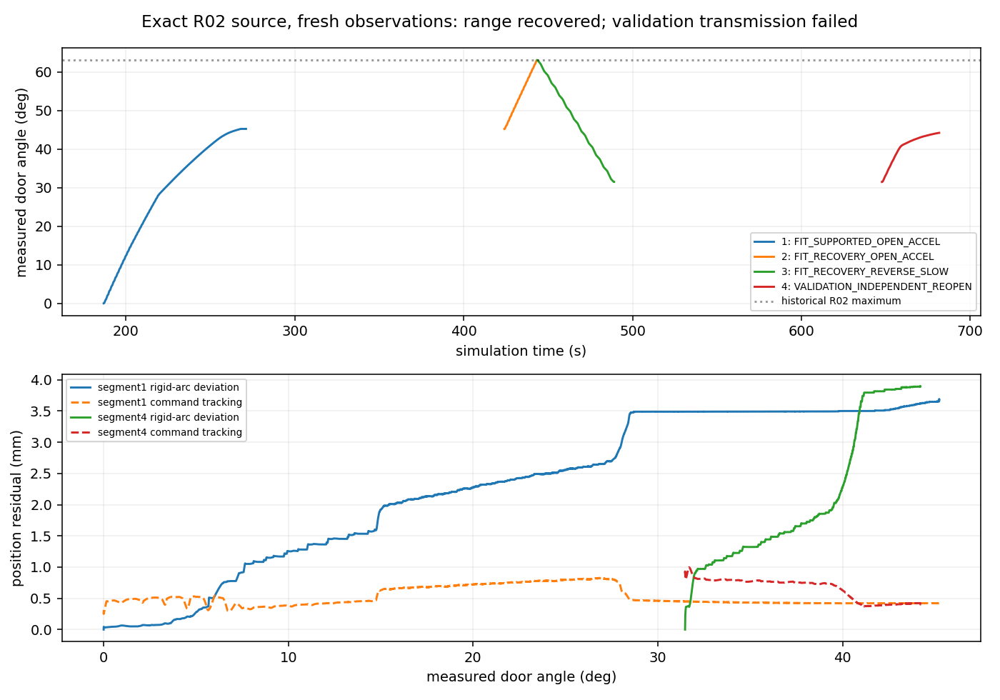

# R02 revolute recovery — exact source restored; complete regression NOT PASS

**Stopped after one R02 reproduction. No correctness port, 90° episode, drawer test or further physical retry was performed.**

Recovery branch: `codex/r02-revolute-recovery`, based directly on actual execution commit `dd83cb5a21da60490fbd44df3161d9cb05e93093`. The current V8.1 branch/head `81580cf0e39f762d2ad457612ae5677dcf27f458`, V8.0 and all previous reports remain intact.

## Result

| Check | Historical R02 | Fresh exact-source reproduction |
|---|---:|---:|
| Maximum actual opening | 63.086° | **63.053°** |
| Largest completed reverse FIT | 31.580° | **31.540°** |
| Acquisitions / verified 1 s holds | 3 / 3 | **3 / 3** |
| Qualified bidirectional FIT | Yes | **Yes**, 985 positive / 446 negative bins |
| Complete independent VALIDATION | Yes | **No** |
| Validation result | Reached approximately 57.3° | **31.476° → 44.215°**, `SUSTAINED_LOW_TRANSMISSION` |
| Guarded release and final parking | Verified | **Verified**, all three attempts and explicit final `finish` |
| Hard-stop records | 0 | **0** |
| Wall / simulation time | 4978.3 / 662.25 s | **4768.65 / 707.92 s** |

The original opening/closing targets were physically reproduced, but the full lifecycle regression failed its independent-validation requirement. Held-out torque and forward-motion success metrics are **N/A**: the partial validation is not relabelled as complete. The user's stop condition therefore blocks the optional fix port and separate 90° test.

## Exact restoration and dependency audit

The historical startup ledger (20 files), loaded-module ledger (133), provenance ledger (87), and 87 archived execution source copies all match `dd83cb5` byte for byte. The fresh actor also loaded **133 source files with zero mismatches**. Nothing was guessed or substituted. The isolated local/server worktrees retained the original runtime throughout execution.

V8.0 verification passed for **606 physical source files, 71 frozen revolute files, 956 release files and 22 external dependencies**. The bundle commitment is `70127bd0e2f5868aa72ad8aa16e81d95ed46f5b621741f43a3f28b18496ae042`. Installed numerical/IK package versions match the recorded environment lock. Offline original tests passed before launch: local V8.1 **42/42**, server V8.1 **42/42**, V8.0 **7/7**.

The original physics-file commitment matched. Native mass/inertia/COM readbacks, actuator metadata and native stage audit are exactly equal to archived R02. The effective policy SHA remains `9ef5bd91047d46b56d3ba61b5bb704272bbd302eccbd14fdb3673e05183a8ee9`. This does not independently measure effective PhysX object inertia or establish hardware fidelity.

Only read-only audit/summary tools and this report were added. Controller, gains, preload mapping, collision geometry, physical parameters, estimator and hard protections were not modified.

## Same-scene physical trace

One fresh closed-state scene used the original registered initial station, assembly, physics, finite budgets and recorded R02 motion profiles. Its recorded relocated station was an explicitly matched engineering condition, **not an independently rediscovered station**. Camera targets and grasp transforms were not replayed: Codex inspected fresh wrist RGB/SAM/depth/cloud boards and used automatic current-state candidates.

1. Fresh higher/oblique observation recovered the approximately 296 mm bar. The initial plan returned `plan=true` but stopped at 0.89375 rad, short of the declared 1.1 rad. Contact was not approved on that partial plan.
2. Original guarded parking and actual XY-carriage motion reached the matched R02 station; the door stayed closed. A coarse self-collision refusal and one unsuccessful SAM view were preserved. A complementary wrist view recovered accepted geometry.
3. A fresh lower-bar candidate acquired bilateral contact and held 1 s, then opened **45.233°** before `CONTACT_TRANSMISSION_STALL`. It released and parked.
4. After fresh observation at the actual opened state, a different automatic upper-bar candidate completed opening to 1.1 rad and closing to 0.55 rad. Validation was correctly deferred while the latest reverse FIT worker output was pending. It released and parked.
5. Qualified FIT was published. A fresh current-state validation-only plan was inspected and approved, and the FIT-only model sealed before execution. The third acquisition held 1 s, but validation stalled at **44.215°**, below its 1.0 rad target. Original guarded exit and explicit `finish` verified parking at **44.217°**, with **0 / 0 N** final pad loads.

Nine Agent wrist checkpoints and three unique pregrasp checkpoints were retained. All object motion was contact-driven; there was no object reset, joint teleportation, hidden grasp input or force increase.

## What actually regressed, and what remains unresolved

**Confirmed original ambiguity:** `plan=true` can describe a partial nominal arc. This was reproduced without executing the uncovered target. Planned reach is not physical progress.

**Confirmed newer over-rejection:** `81580cf`/`c1c1d22` checks every action endpoint against the *first opening arc* before invoking its native whole-chain checker. The fresh recovery candidate's nominal interval was `[0.789470, 1.1]` rad. That gate rejects reverse target `0.55`, although the exact-source actor subsequently passed its original live native checks and physically completed both opening and reverse. The error is using an initial-arc interval as a whole-chain certificate, not a demonstrated collision. See [counterexample](COVERAGE_COUNTEREXAMPLE.json). A future minimal port must retain collision authority and the original measured-state successor checks; it must not blindly transplant this over-rejection.

**Retention failure also exists in the original source.** Historical R02 required recovery after its first 22.50° transmission failure. Restoring that source did not eliminate fresh-grasp transmission degradation:

| Failed motion | Max commanded–measured TCP error | Max measured TCP deviation from rigid hinge arc |
|---|---:|---:|
| First opening | 0.826 mm | **3.692 mm** |
| Independent validation | 0.997 mm | **3.894 mm** |

The deviation grows with load migration while aperture remains within approximately 14.6–15.0 mm. This supports contact retention/constraint migration as a contributor, rather than command tracking alone. Missing positive normal reports do not prove separation. Exact pad pressure, full contact wrench and a unique friction/compliance mechanism are not established.

The legacy feedback plot's drawer-axis displacement panel is invalid for a revolute joint. The numbers above use the complete known rigid hinge transform; no online controller or estimator was replaced. Source, physics and readback equality rule out an undocumented parameter increase in this reproduction. Fresh views, selected grasp geometry and approach/refinement still differ from the historical successful episode; this single trial cannot isolate their individual causal effects.

Later V8.1 adds roughly 3200 lines across 40 extension files, including admission, recovery, diagnostics and exit wrappers. Frozen owner directories and core mobile collision/station/FK modules remain identical. Apart from the demonstrated admission counterexample, these additions are **not collectively proven physical regressions**. No broad reversion or speculative fix was attempted.

## Preservation and cleanup

The pre-existing `v81_integrated_revolute_02` was doing unloaded planning with zero acquisitions. Its documented `STOP_AND_EXPORT` marker also interrupted its final release routine with `OWNER_REQUESTED_EXPORT`; last loads were zero, but final parking was **not verified**. That separate failure and its outputs remain preserved. Process exit is not parking success.

The new R02 actor instead completed explicit `finish`, verified parking and exited. Both owned actor PIDs are absent; the owned-actor lock is available. Raw RGB-D, native 240 Hz F/T/contact/motion and event media remain private on `test-X640-G50`. Canonical episode storage is **123.24 MB**, plus **8.16 MB** of supplementary audit/inspection records; no complete raw archive was copied or published. All **11 numeric chunks** passed hash verification, and the read-only summary left the online model unchanged.

See [metrics](METRICS.json), [Agent decisions](AGENT_TRACE.json), [source restoration](RESTORATION.json), [final audit](FINAL_AUDIT.json) and [private evidence commitment](PRIVATE_EVIDENCE_RECEIPT.json). The full private index commits 585 files with SHA256 `533c67dc97b28792330e42856657d9b35e96e72393e8939b87c7d4b3ba43e70c`.

**Remaining blocker:** stable retention of the newly acquired validation grasp. The restored source is preserved as a reproducible reference, but complete historical R02 behavior has not been reproduced. Work stops here under the requested gate.
