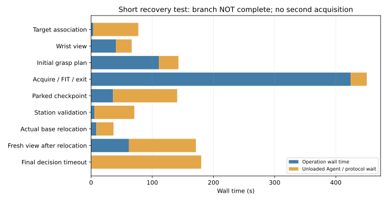

# Recovery-first V8.1 — NOT PASS

Full 90°/150-mm testing is stopped. All owned actors have exited through
verified unloaded parking. No new preload comparison or independent repetition
was launched. Physical recovery and repeated retention remain unverified.

## Why the relocated recovery search failed

P06's measured base/camera records agree; robot FK differs from saved measured
TCP by 0.313 µm. This rules against a gross base-origin error, not every possible
representation error. Its original initial cooked export was not retained, so
a byte-exact initial/current collider comparison is unavailable.

The observed generator produced 108 families, but the frozen preliminary
shortlist contained only 18. Native CENTER collisions at `original35/36` and
joint-margin failures in that shortlist were genuine. However, 19 omitted
families passed the archived static closure check, versus two included families.
A disjoint second batch produced six candidates passing the original complete
native execution/closing/action/exit planning checks. The selected central
neutral pose was regenerated from observations; no stored successful transform,
GT scoring surface or hidden dynamics was inserted. This was offline planning,
not physical recovery.

Production replay retained exactly the same pose while skipping native checks
whose exact fine-path utility could not replace an already validated winner:
234.62→141.68 s, 1.66× for this isolated search. This is not an end-to-end speedup.
The first replay's final identity export expected live `.npy` files, whereas
closed checkpoints were compressed. That diagnostic error is retained; live
identity validation now precedes expensive search.

Sources `6467c25`/`1a8a86d` add a bounded, explicit second batch, current
observation/mask/station/acquisition identities, and retirement of stale plans.
Source `0ab0088` additionally allows the Agent to decline a native-feasible but
mechanically poor current proposal after inspecting its exact plan image. No
new score threshold, gripper force, collision waiver or pose offset was added.

## Fresh tests, including the incomplete branch

Two scenes were launched, and both are preserved:

| Scene | Physical acquisitions | Actual result |
|---|---:|---|
| Short recovery 01, `1a8a86d` | 0 | Agent inspected and declined a shallow executable proposal: original retention score zero, pad contacts near longitudinal ends. The first second-batch interface could not accept this rejection. Guarded parking succeeded; rc=0; 579.47 s. This is an interface/selection result, not failed physical acquisition. |
| Short recovery 02, `0ab0088` | 1 | Fresh observed central −15° candidate acquired bilateral contact and original 1 s hold; pulled 20.097 mm, reversed 12.179 mm; released/parked. Native XY actuators then moved 21.508 mm; destination parking and fresh relocated wrist observation succeeded at actual drawer position 7.918 mm. **No second grasp was selected or physically acquired.** Final unloaded wait expired; guarded final parking succeeded; rc=0. |

In short recovery 02, maximum measured TCP/object translation drift was
0.553 mm during opening and 0.181 mm during reverse. Aperture changed
+0.056/−0.010 mm over those respective segments. End pad means were
1.064/1.076 N and 1.532/0.619 N; full-attempt raw peaks were
2.288/1.990 N. Normal asymmetry did not create a new fatal gate. These
diagnostics do not establish complete contact wrenches, motor output, pressure
distribution, measured friction coefficient or hardware safety.

The requested preload remained 1.0 N. The distinct validation action was
`VALIDATION_DEFERRED` because the latest qualified FIT publication was not ready;
it was not counted complete. No hidden physical truth was revealed or used.

## Orchestration and resources: still a real failure

Short recovery 02 consumed **1479.41 s wall** and **51.09 MB**. Completed
operation waits total **465.23 s**, plus the final 180-s unloaded timeout.
An earlier live commentary's approximate 565-s wait was incorrect; the trace
sum above is authoritative. The initial acquisition/probing/exit operation took
424.29 s and planning 110.94 s. There was insufficient remaining work time for
another credible observe/plan/acquisition chain with the exit reserve intact.

The Agent's intended finish command arrived after the window closed and was
rejected by the protocol. It was not ACKed or executed. Thus the recorded final
status remains **ORCHESTRATION_TIMEOUT**, not intentional task completion.
The robot nevertheless reached verified parking with zero final pad loads.
This failure must not be attributed to drawer friction or post-relocation
contact infeasibility: no such physical regrasp was attempted.

## Post-test software correction — not physically verified

An optional prismatic-only `relocate_observe_prepare` operation now combines
original station validation, native actuator relocation, fresh wrist sensing
and tentative candidate preparation. The Agent must first select the station
from fresh permitted evidence, then inspect the returned new RGB-D/geometry
and grasp before a **separate** contact approval. Incomplete new perception
returns to the Agent without automatic target selection. HARD exceptions
propagate; no contact is held during inference.

Decision packets expose same-episode measured maximum operation costs. A
recovery whose observed preparation/acquisition cost exceeds remaining work
is refused **before base motion**. Exit reserves remain excluded from work;
the estimate is not a confidence bound. These interfaces have software and
protocol tests only; they were not injected into the running actor or claimed
as a physically successful fix. **127 software regressions pass.**

## Integrity and next gate

The frozen audit verifies 606 physical-source files, 71 revolute files,
22 external dependencies and 956 release files with no mismatches. Frozen
controllers, physics, actuator authority, estimator and hard protections remain
unchanged. Raw 240-Hz F/T/contact/motion and sparse wrist RGB-D stay private.
Known rail/hinge state and registered station remain permitted priors; the wrist
mount, ideal virtual F/T and approximate actuators are simulation assumptions.
The base is a native-actuated simulated XY carriage, not verified mobile hardware.
Compact metrics preserve private evidence commitments:

- [P06 diagnosis](P06_RECOVERY_DIAGNOSIS_METRICS.json)
- [Offline production comparison](P06_OFFLINE_PRODUCTION_COMPARISON.json)
- [Zero-acquisition preview](SHORT_RECOVERY_01_ZERO_ACQUISITION.json)
- [Short physical test and storage categories](SHORT_RECOVERY_02_METRICS.json)

The next gate remains an actual same-scene relocation→new observation→new
automatic grasp→physical regrasp→pull/reverse→parking demonstration. Only after
that may the registered matched 1.0/1.5-N comparison run. Earlier matched tests
showed preload helped the first block but failed later; they do not justify
more gripping force or replace the missing recovery evidence. **No full-range
resumption is enabled.**
