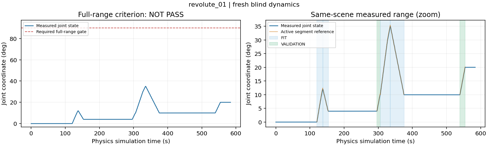
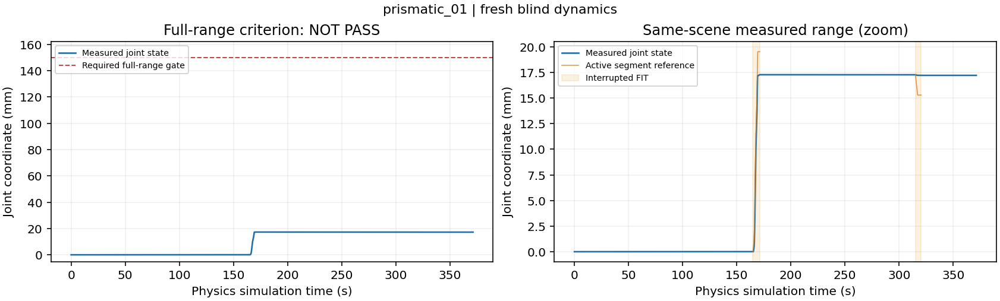

# V8.1 fresh blind full-range integration gate — NOT PASS

References: frozen `agentic-interaction-v8.0.0`, recovery/validation gate `0d5cfbb`.
Execution source: **`1acf52afab7a8b5dd449401f16b4769c2f1fa97b`** for both valid scenes.

Two fresh, sequential, continuous scenes were executed. Neither met the complete
full-range criterion. **No V8.1 release/readiness freeze, four independent
repetitions, or unknown-geometry benchmark was started.** Successful stages from
these scenes are not combined with earlier experiments.

| Required stage | Revolute 45936 | Prismatic 45290 |
|---|---:|---:|
| Maximum measured opening / travel | **35.019° / required 90°** | **17.279 mm / required 150 mm** |
| Largest driven reverse segment | **25.031°**; 33.061° total | **No meaningful reverse**; only 0.059 mm coordinate change |
| Physical acquisitions / original 1 s holds | 3 / 3 | 2 / 2 |
| Fresh physical reacquisitions | 2: validation / relocation | 1: recovery after failed pull |
| Actual base relocations | 1; 329.5 mm XY | 1; 194.8 mm XY |
| Qualified bidirectional FIT | Yes: 4 trajectories, 733 regression bins | No: 1 interrupted positive prefix, 26 bins; no eligible reverse |
| Complete independent VALIDATION | **2** | **0; prediction metrics N/A** |
| Guarded release and measured final parking | Yes | Yes |
| Hard safety-stop samples | 0 | 0 |
| Wall time / physics simulation time | 72.50 min / 584.125 s | 70.15 min / 371.467 s |
| Canonical private episode storage | 113.48 MB | 62.96 MB |
| Full-range result | **NOT PASS: continuation collision rejection** | **NOT PASS: traction/slip, incomplete identification** |

These are development integration outcomes, not a population success rate.
Prismatic micro-displacement during failed reverse startup is not counted as
successful reverse manipulation.

## Freeze, blinding and initialization

The new positive-density mass/inertia configurations and constant native passive
resistance were committed by opaque hash before execution. Commitments and the
experiment contract are in [the protocol](../FULL_RANGE_INTEGRATION_PROTOCOL.md)
and [blind commitments](../FULL_RANGE_BLIND_COMMITMENTS.json). Neither seed nor
realized dynamics entered Agent decisions or fitting. Both actors and Agents
closed and their online models/actions were hash-sealed **before either case's
truth was inspected**. Post-hoc comparisons did not alter the online estimates.

The first revolute launch failed before command 0 with a missing parent
`decision_packet` method: **zero commands, zero acquisitions**. Its record is
preserved in [the initialization repair record](../FULL_RANGE_INITIALIZATION_REPAIR.json).
A minimal read-only feedback adapter was repaired and 134 software tests passed
before the valid scene. The replacement used the **same committed physical
configuration**, with a separately recorded runtime-repair identifier. This was
an infrastructure restart, not a retry of a physical outcome.

Final audits verified **606 frozen physical source files, 71 revolute source
files, 22 external dependencies and 956 release files**, with no drift. No frozen
physics, actuator authority, grasp scores, control coefficients or protection
settings changed between outcomes. The only new execution changes in this round
were the separately versioned resource profile and initialization interface fix.

Both scenes used 5,400 s wall / 2,700 s simulation budgets, 600 s unloaded decision
windows, and a protected 600 s wall / 120 s simulation exit reserve. No slow Agent
reasoning occurred under unstable load. PhysX was paused only at unloaded decision
boundaries; this does not count as physical holding success.

## Actual Agent interaction and blockers

### Revolute

Fresh wrist RGB, SAM3 overlays, optical-Z depth and local clouds were inspected.
Agent-selected views recovered the initially self-occluded long bar; no historical
view or grasp transform was replayed.

1. Automatic grasp, bilateral acquisition and hold; actual **0→12.013→3.984°** FIT.
   The queued validation was explicitly **deferred**, not counted complete, while
   the asynchronous FIT publication was pending. The robot released and parked.
2. Fresh observation/new automatic grasp; original independently declared
   **3.996→10.023° VALIDATION**, then **10.023→35.019→9.987°** FIT. Release/park passed.
3. Agent inspected current contact/motion feedback and fresh wrist evidence,
   selected an outward/right station, and executed the fully checked XY move.
   Fresh observations and a new automatically selected grasp followed.
   **9.973→20.020° independent VALIDATION** completed.
4. The subsequent 90° request failed its live full-path check:
   `DANGEROUS_GEOMETRY_COLLISION:link3:.../l_2/...original31...`.
   **The colliding route was not executed.** Guarded release and parking passed;
   final door angle was **20.027°**.

The planning summary had reported a best endpoint of **81.1° for a 90° request**.
The Agent initially overstated this as full 90° feasibility; the archived
summary and this report correct that interpretation. **81.1° was never physically
achieved.** After the live collision rejection, roughly eight minutes of normal
work remained, below measured relocation/observation/planning/acquisition costs.
This establishes a blocked selected route and insufficient remaining recovery
resources, **not proof that every 90° route is impossible**. It is not a finger
transmission failure at 90°, because that motion never started.

### Prismatic

Initial SAM3 hypotheses alternated between neighboring drawer handles. The Agent
initially reinforced an incorrect association by treating the known joint anchor
height as evidence of handle identity; a joint anchor is not a handle center.
Two candidate batches failed before any acquisition. This was a real Agent
association/planning inefficiency, not a physical grasp failure. Their generic
search-exhausted message does not isolate IK from collision rejection in every
branch, and does not establish universal grasp infeasibility.

After checked unloaded parking and actual outward base relocation, fresh images
and alternative SAM masks were inspected. A new lower-bar hypothesis passed the
native execution checks. **Actual selected-joint travel subsequently confirmed
this association**, without GT handle coordinates.

- **Attempt 1:** requested preload **1.0 N**; bilateral acquisition and original
  hold passed. Actual pulling reached **17.279 mm**, then stopped with
  `PRISMATIC_PERSISTENT_SLIDING_STALL`. A useful predeclared FIT prefix was retained;
  the 60 mm target, reverse and validation were not completed.
- **Same-scene recovery:** fresh wrist RGB-D, pad-contact plots, wrist F/T and
  motion feedback were inspected. The Agent selected a new automatic candidate
  and the existing frozen `transverse_unloading:true` option, retaining **1.0 N**
  requested preload and legacy contact following. Actual family changed from
  `[0,0,180,0]` to `[0,0,0,0]`; an approval reason's mistaken `[0.3,…]` reference is
  corrected here without editing the original decision trace.
- **Attempt 2:** bilateral acquisition and hold passed, but reverse startup
  stopped with `PRISMATIC_STARTUP_KINEMATIC_TANGENTIAL_SLIP_EVIDENCE`. Coordinate
  change was only **−0.059 mm**, not useful closing. Its startup was not FIT data.
  Release and measured parking passed. Final drawer coordinate: **17.216 mm**.

| Current-attempt evidence | Initial pull | Recovery reverse |
|---|---:|---:|
| Rail command-to-measured TCP error | Approximately ≤0.6 mm | Approximately ≤0.08 mm |
| Measured TCP-to-drawer relative slip | Jump to approximately 2.6 mm | Approximately 1.7 mm |
| Useful rail-axis wrench/traction | Approximately +0.45 N at stall | Approximately −0.4 N, oscillatory |
| Bias/gravity-compensated transverse force | Approximately 2.2 N | Approximately 0.8 N |
| Compensated sensor-origin moment magnitude | Approximately 0.35 N·m | Approximately 0.15 N·m |
| Interpretation | Transmission degraded after real sliding | Improved load distribution still did not establish reverse traction |

Values above are compact readings of full-rate diagnostic plots, not pressure
measurements or inferred complete contact wrenches. Native traction was a
cross-check, **not the estimator's force input**. Missing positive normal reports
do not prove separation. In the recovery, both pads still reported positive
normal loads while measured TCP motion failed to move the drawer.

Post-reveal authored Coulomb resistance was **0.44928 N**, consistent with the
measured axial plateau. That explains why marginal useful traction could not
sustain sliding, without requiring an incorrectly large resistance or a timeout
explanation. Tracking error alone does not explain the measured relative slip.
The evidence does not uniquely separate pad placement, compliance and contact
model effects, nor prove that another legal preload/grasp could not work.

A final fresh wrist observation was inspected. Approximately 689 s normal work
remained; measured recovery preparation plus acquisition alone cost approximately
680 s, before the additional acquisition needed for independent validation.
The Agent stopped at verified unload/park rather than spend the exit reserve on
another incomplete chain. **This was a cost-feasibility termination, not a global
budget exhaustion, hard force stop, or claim of universal grasp infeasibility.**

## Identification: short support remains explicit

Frozen production processing retained common segment-local SG121 filtering of
wrench-derived effort and every regressor, one tool-inertia compensation, FIT-only
fitting/model selection and complete validation isolation. Truth was used only
for the following post-seal evaluation.

| Parameter | Final online value ± conditional 1σ | Authored reference | Relative error |
|---|---:|---:|---:|
| Revolute inertia, kg·m² | 0.104956 ± 0.000300 | 0.105176 | −0.209% |
| Revolute damping, N·m·s/rad | 0.114628 ± 0.000580 | 0.112863 | +1.563% |
| Revolute Coulomb, N·m | 0.0221654 ± 0.00000672 | 0.0221899 | −0.110% |
| Prismatic mass, kg **†** | 2.283948 ± 0.002001 | 2.284769 | −0.036% |
| Prismatic damping, N·s/m **†** | 4.224871 ± 0.006637 | 4.158550 | +1.595% |
| Prismatic Coulomb, N **†** | 0.448918 ± 0.00003746 | 0.449282 | −0.081% |

**† Provisional numerical fit only. Operational mass/damping/friction remain
unknown/unvalidated; accepted bidirectional identification is unavailable.**
It used one eligible prefix over approximately **1.89–15.50 mm**,
with 26 positive and zero negative bins. Small post-hoc coefficient errors do not
replace independent validation. Revolute FIT had 453 positive/280 negative bins,
condition number 41.13, acceleration RMS 0.00962 rad/s² and velocity RMS
0.01324 rad/s. Prismatic condition number was 71.17 with acceleration RMS
approximately 0.00481 m/s². Conditional uncertainties omit systematic
compensation/contact/model errors; damping errors exceed those narrow conditional
standard deviations.

Each primary held-out result uses **its own pre-execution model seal**, not a
future final-model replay. Forward prediction starts once from measured q/qd and
uses held-out wrist effort, with no later state correction.

| Independent trajectory | Full physical duration | Derivative-supported prediction | Torque RMSE | Angle RMSE | Velocity RMSE |
|---|---:|---:|---:|---:|---:|
| R initial forward | 9.9875 s | 8.975 s | 3.316×10⁻⁵ N·m | 0.0395° | 5.325×10⁻⁴ rad/s |
| R post-relocation forward | 15.5875 s | 14.575 s | 5.313×10⁻⁵ N·m | 0.2137° | 4.434×10⁻⁴ rad/s |
| P | **Not completed** | **N/A** | **N/A** | **N/A** | **N/A** |

These are short-stroke results, not 90° or full-drawer-travel validation. The
references combine authored rigid-body tensors/masses and native passive laws;
post-reset tensor readback is **not an independent measurement of effective
PhysX dynamics**. No physical-equivalence claim beyond that is made.

## Efficiency, evidence and readiness

| Mutually exclusive wall-time categories | Revolute | Prismatic |
|---|---:|---:|
| Acquire/probe/release/park operations | 22.33 min | 14.08 min |
| Other Agent operations: sensing, planning, station, finish | 16.88 min | 16.35 min |
| Unloaded decision/packet/command waiting | **31.58 min** | **37.93 min** |
| Outside session operations | 1.72 min | 1.79 min |

The waiting category includes feedback-packet work, communication and Agent
inspection/reasoning; it is not a measurement of model inference alone. Total
throughput including those costs was only 0.134 and 0.088 simulation s/wall s.
**Efficient full-range autonomous operation has not been demonstrated.** No
contact physics rate or sensing fidelity was reduced to improve these numbers.

Canonical valid-scene evidence totals **176.44 MB**; the preserved initialization
failure adds **3.62 MB** and registration/analysis/source-transfer metadata adds
approximately **0.83 MB**, for **180.89 MB** total canonical private study storage
(existing resource bundles/checkouts excluded). RGB-D is checkpoint-only: 8 Agent + 3 pregrasp captures
for R, 6 Agent + 2 pregrasp for P. Essential interaction numerics/native contact
records remain private at 240 Hz. No continuous high-resolution video, duplicated
raw telemetry archive or passive-camera input was introduced. Informational
warnings remained nonfatal (4,941 R / 1,410 P recorded samples); hard-stop samples
were zero. No force/joint/collision protection was relaxed.

All 9 R and 5 P numeric chunks passed hashes; both online seals still match;
owned actor PIDs 2114264 and 2129586 exited, and the actor lock was available.
The frozen R owner overwrites its root plan-image filename: the exact earlier
images actually inspected before approval were retained locally and archived
privately after shutdown, with matching approval hashes, rather than regenerated.
P already preserved plan history. This reporting/evidence work did not modify
online models or physical execution.

The explicit [readiness record](../ENGINEERING_READINESS.json) is false for both
joint types; the existing launcher therefore rejects independent repetitions.
Next engineering gates are specific: full-horizon/current-state station+grasp
feasibility before approving a range extension; stable observed moving-part
association across wrist views; and sustained task-direction traction/reversal
with native pad-contact geometry and measured slip. Repeating the same full run,
raising force or extending time alone is not justified. Legal stronger preload
was not tested in these scenes, so no claim about its sufficiency is made.

Known joint geometry/state, registered stations, a simulated wrist mount, an ideal
virtual wrist F/T load cell, a simulated XY base carriage and approximate robot
actuators remain limitations. No hardware safety or unknown-articulation result
is claimed.

### Reproduction and private locations

- [Metrics](METRICS.json), [Agent trace and corrections](AGENT_TRACE.json),
  [source/config hashes](EXECUTION_PROVENANCE.json),
  [private evidence index and cleanup](PRIVATE_EVIDENCE_INDEX.json).
- [Read-only post-seal summarizer/plotter](summarize_full_range.py). Run with
  `EPISODE --root CHECKOUT --output METRICS --figure FIGURE`; it rejects a running
  actor or changed sealed files and does not read hidden truth.
- Canonical data machine: **`test-X640-G50`**, SSH alias **`labserver_inschool`**.
  Private episodes are under `/data1/home/rangeryx/agentic_v81_private/episodes/`:
  `v81_full_range_blind_revolute_01_runtime_repair` and
  `v81_full_range_blind_prismatic_01`. Raw RGB-D: `rgbd/`; compressed numerics:
  `telemetry/`; native contact evidence: `contact_evidence/`. No raw data is
  published with this report.
