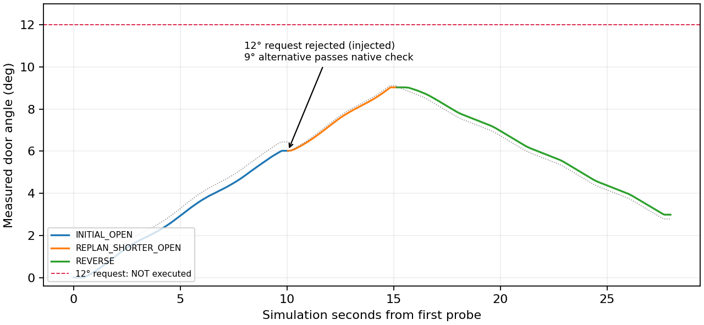

# V8.1 rejected-path replanning — short gate PASS

One fresh same-scene native-contact test demonstrated a rejected request followed
by a different checked action and continued manipulation. **This is not a 90°
feasibility, full-range lifecycle, or independent dynamics-validation PASS.**
No full-range benchmark or new independent repetition was launched.

## Root cause and repair

The archived `84be8e0` plan ended at **81.109620°**, despite a 90° request and
`plan=True`. Read-only replay of its unchanged path with the new contract gives
`full_requested_actions_feasible=false` and
`full_requested_horizon_feasible=false`. The later link3/original31 rejection
was a correct native safety decision, not an actual executed collision. The
old scene returned to an unloaded decision boundary; the Agent then chose
`finish` without trying cheaper same-station alternatives. It was not evidence
that every route or grasp was infeasible.

All changes are isolated in `agentic_interaction_v81`:

* Admit only complete checked action targets; report advisory-horizon coverage
  separately. Existing IK branches/ranked observed candidates fall through when
  incomplete or native-invalid. The actual approach/closing and live successor
  checks remain authoritative.
* Introduce explicit READY → REPLAN_REQUIRED → CHECKED_ALTERNATIVE_SELECTED /
  UNLOADED_REPLAN_REQUIRED states. Native rejection is preserved. A hard latch
  never enters recovery. Bounded FIT alternatives are declared beforehand and
  checked from the actual stopped state; there is no silent target truncation,
  validation substitution or Agent wait under unstable load.
* If no alternative passes, original guarded release/parking returns structured
  `PLANNING_REJECTED`, not automatic episode termination. Recovery packets expose
  current generations, resources, measured preparation costs and cheaper-first
  choices. Where costs/resources support it, post-contact wrist reobservation
  can be batched at the verified unloaded boundary. New grasp/station decisions
  still require Agent inspection of fresh evidence.
* Reserve a measured attempt plus a recovery opportunity before expensive
  replanning/acquisition; deterministic exit reserves remain separately intact.
  Initial unknown costs are labeled unknown. Multiple safe same-scene replans
  are permitted; new-scene outcome retries and safety resets are not.

## Actual physical test

Execution source: **`25d827392d9589ba9b53d05e6944ef1d2a23e69b`** (behavior
`97792cf`), precommitted [registration](REGISTRATION.json). Same previously
revealed development physics, explicitly **not a fresh blind evaluation**.
Fresh wrist RGB-D only: initial image was self-occluded/no accepted SAM mask;
Agent inspected RGB/depth/cloud, unprojected a visible handle pixel, requested
one raised/lateral reachable wrist view, then inspected the complete bar and
automatic native-finger plan. No archived viewpoint or grasp was supplied.
The new plan fully covered 0–15°, including every declared alternative.

| Stage | Actual result |
|---|---|
| Acquisition / original hold | One automatic native-G1 acquisition; bilateral verification; 1 s hold |
| Initial 6° FIT | TARGET_REACHED, **6.016449°** |
| 12° successor | One explicitly injected **planning rejection**; request not executed/completed |
| Different checked 9° FIT | Original native checker passes; TARGET_REACHED **9.027910°**, +3.011461° |
| Reverse 3° FIT | TARGET_REACHED **2.983623°**, reverse travel **6.044288°** |
| Independent VALIDATION | **Not executed / VALIDATION_DEFERRED**, async latest FIT not ready at admission; metrics N/A |
| Release and parking | RELEASED / CLEARANCE_REACHED / SAFE_PARK_REACHED; measured native collision check passes; pad loads **0/0 N** |
| Hard stops / informational warnings | **0 / 0** recorded samples |

The injected rejection was applied only after an otherwise native-valid
successor check. It is **not** a newly observed link3/original31 collision or
proof that 12° is physically impossible. The different 9° path passed the
unchanged native checker and was physically actuated. No rejected path was
waived. Same grasp and station were retained, with no redundant geometry search,
relocation or regrasp. Contact feedback and native contact-location images were
actually inspected before `finish`; sparse normal-report changes were not
interpreted as proven pad separation.

## Tests, provenance and limits

143 software tests passed locally and on the Isaac host before the physical
test. Final software audit has **147 passing tests**, including actual archived
endpoint replay, no call to the physical owner for an uncovered 90° target,
injected rejection → different checked target, all-alternatives-rejected session
continuation, hard-latch authority, unstable-contact rejection, immutable
VALIDATION and recovery-resource admission.

After shutdown, software compatibility audit additionally preserved the frozen
prismatic **whole-chain** certificate: a first nominal arc must not incorrectly
exclude already native-checked bidirectional targets across the acquisition
coordinate. That compatibility branch, explicit top-level all-rejected status,
and rejection-scope metadata were checked in software; **no extra prismatic
physical test was run**. The recorded revolute physical source above remains
immutable and distinct from the final reporting/compatibility revision. Neither
controller, score, physics nor estimator was tuned to this outcome.

Frozen V8.0 audit: **606 physical sources, 71 revolute sources, 22 external
dependencies and 956 release files**, zero drift. Actual loaded replanning SHA:
`5f253e27a59d32ebe21f5fea70519350fcc347f1627e5536daa1edb0844bdcfe`;
all loaded V8.1 source hashes match that episode's prelaunch ledger. All four
compressed numeric chunks verify against their original hashes.

Total **1002.091 s wall / 167.800 s simulation**. Full grasp search 169.057 s;
actuator acquisition/probing/release/parking block 444.544 s; selected additional
wrist view 41.833 s. Unloaded packet/Agent/communication windows total 258.985 s
(not pure model inference). Remaining initialization/export/cleanup accounts
for approximately 87.629 s. This is not an equivalent-scenario speedup benchmark.

Final private footprint: **39,840,101 bytes**: 6,098,239 numeric; 8,844,417
checkpoint RGB-D; 1,511,652 native contact evidence; 967,542 inspected diagnostic
boards; 22,418,251 source/geometry/derived metadata. No continuous full-resolution
video or duplicate raw archive. Actor PID **2219607 exited**, return code 0,
authoritative state CLOSED/unloaded, owned actor lock released.

Raw data stays private on **test-X640-G50 / labserver_inschool**, under
`/data1/home/rangeryx/agentic_v81_private/episodes/v81_replanning_gate_01`.
[Private evidence index](PRIVATE_EVIDENCE_INDEX.json), [derived metrics](METRICS.json),
[decision trace](AGENT_TRACE.json), [storage](STORAGE.json).

Known hinge/state, registered station, simulated wrist mount and ideal wrist
load cell remain explicit assumptions. This test demonstrates the cheap
same-station rejection/continuation branch; it does not demonstrate a new
post-rejection base relocation, guarantee a safe 90° route, or complete new
independent dynamics VALIDATION. The previous full-range failures and closed
full-range readiness gates are unchanged. Stop after this bounded gate.
