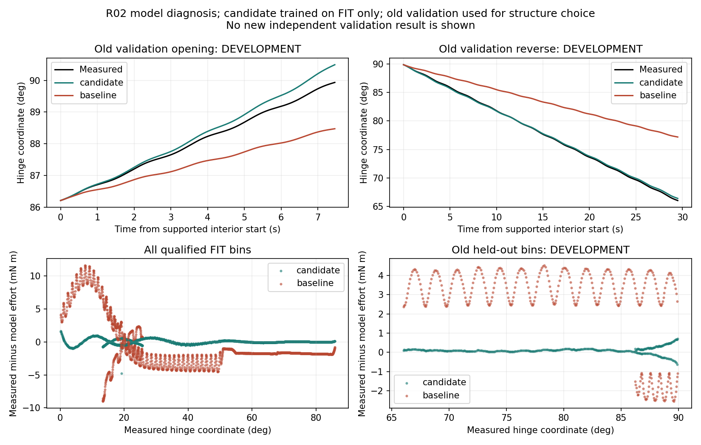

# Report B — V8.3 high-angle reverse Physics-ID

**Development diagnosis supports a coupled damping/position-resistance model
error. A fixed candidate is frozen for a new independent episode; independent
improvement is not yet established.** The protected R02 source/report baseline
remains `792fa3b`. No physical actor was started or controlled by this offline
work line. No hidden authored dynamics or passive-camera image was read.

## Data split and frozen models

Training uses only the four qualified FIT trajectories of
`v81_r02_active90_20261024_01`: 1621 positive and 233 negative regression bins.
The original quality rules, SG121 common processing, downstream tool inertia
compensation and qualified transmitting prefixes remain unchanged. Failed
motion remains failed even where an explicitly eligible prefix supports FIT.

Old segments 5 and 6, formerly independent VALIDATION, are now explicitly
**development diagnostics** because their errors informed structure choice.
They are not final independent proof in V8.3. No sample from those two segments
was used to fit coefficients. The new candidate is the existing V7 cubic
position-dependent resistance model with eight intervals and smoothness .001;
the physical controller and frozen production estimator were not edited.

| Frozen object | SHA256 |
|---|---|
| [CANDIDATE_FROZEN.json](CANDIDATE_FROZEN.json) | `80a8b03601f506eb6aeac0277ac8f49846a721b188e3eec419589d106dadf323` |
| [BASELINE_FROZEN.json](BASELINE_FROZEN.json) | `b6871727187dda6c55fff8311a529c5668a56a1b3b04275b5449847ccadb22f8` |

The baseline contains the exact selected model sealed before original
validation, whose original model hash is
`6d7c8b9af817dc3bae7faf62c884837dcdcb8a19a163533fd7e94fdf52834c65`.
Candidate and baseline files were created exclusively before any new R02
episode and cannot be overwritten through the interface. Both include FIT
lineage, quality provenance, freeze time and the predeclared evaluation
contract. No new-episode FIT or VALIDATION may update or select either model.

## Evidence and prioritized diagnosis

1. **Direction/angle coverage is incomplete.** Original negative-velocity FIT
   spans only about 13–26°. The 66–90° reverse trajectory was held out. High
   forward FIT extends to about 86° but, above 60°, its speed is nearly constant
   at 0.0084 rad/s and acceleration RMS is only 0.00031–0.00063 rad/s². Local
   inertia, damping and resistance are therefore weakly separated.
2. **The high-angle residual is systematic.** Original reverse compensated
   effort minus model effort averages +0.003408 N m, almost identical in the
   60–75° and 75–90° bands. High forward FIT residual averages approximately
   -0.00171 to -0.00177 N m. The mismatch persists across position rather than
   appearing only at reverse startup. Stiction/startup effects remain possible,
   but cannot explain the entire sustained residual by themselves.
3. **Large transmission loss is not supported as the main cause of this
   particular validation error.** Completed reverse maximum TCP servo error
   is 0.525 mm and rigid-hinge residual 0.729 mm; reported relative slip is
   stable around 1.02 mm, with no hard-stop samples. These measurements do not
   establish perfect contact or calibrated force accuracy. Missing one-pad
   positive normals are not treated as proven separation.
4. **The minimal structure correction changes damping as well as resistance.**
   Compared with the baseline, candidate inertia changes only from 0.130266 to
   0.130790 kg m², whereas damping changes from 0.513135 to 0.238081 N m s/rad.
   On the old high reverse, the mean predicted effort correction decomposes
   into +0.003886 N m from damping, -0.000526 N m from position resistance and
   approximately zero from inertia. This is a decomposition of two joint fits,
   not a causal identification of true damping or friction.

These findings prioritize damping/resistance coupling and missing directional
excitation. Unknown F/T systematic error, compensation error, contact effects
and an unobserved joint-coordinate offset are not separately identifiable from
these records. Friction is not asserted to be the sole cause.

[DIAGNOSIS.json](DIAGNOSIS.json) retains the per-position/direction residuals,
velocities, accelerations and measured contact summaries.
[DECOMPOSITION.json](DECOMPOSITION.json) retains the full correction accounting.

## Structure comparison on development data

The production FIT-only leave-complete-trajectory-out selector preferred the
constant model: its effort CV RMSE was 0.004874 N m versus 0.005544 N m for
the eight-interval candidate. **The candidate did not pass that original
selection rule.** Its V8.3 structure was chosen using old validation now
designated development data, because torque-only trajectory CV did not
anticipate the sustained high-angle reverse integration error. No claim is
made that this change improves the original CV score.

| Old development metric | Exact baseline | Frozen candidate |
|---|---:|---:|
| All old validation intervals, pooled RMSE | 5.7635° | 0.1955° |
| High-angle reverse RMSE | 6.4386° | 0.1819° |
| Reverse endpoint error | +11.1810° | +0.3734° |
| High-angle forward RMSE | 0.8193° | 0.2419° |
| Forward endpoint error | -1.4607° | +0.5584° |
| Measured-position band 60–75° RMSE | 9.1680° | 0.2553° |
| Measured-position band 75–100° RMSE | 3.3977° | 0.1635° |

The two- and four-interval alternatives reduced reverse error but worsened
high forward error. Their complete outcomes are preserved in
[DEVELOPMENT_STRUCTURE_COMPARISON.json](DEVELOPMENT_STRUCTURE_COMPARISON.json).
No repeated tuning of a new independent validation set has occurred.

Each prediction starts from one measured initial coordinate and velocity,
then integrates measured compensated effort without later state correction.
The supported interior excludes the unchanged filter boundary. Full physical
durations are 8.475/30.508 s and prediction horizons are 7.463/29.496 s.
The candidate still extrapolates outside observed FIT support near 90°.

All position, speed, acceleration and quality strata, including empty strata,
are present in [DEVELOPMENT_COMPARISON.json](DEVELOPMENT_COMPARISON.json).
For example, old speed strata below/above .01 rad/s improve from
0.8691°/6.1805° to 0.2416°/0.1875°. No data support speeds above .02 rad/s or
acceleration magnitudes above .02 rad/s² in these old held-out intervals.

## Low-angle checks and limitations

These are **training diagnostics**, not independent validation:

| Original qualified FIT trajectory | Baseline coordinate RMSE | Candidate RMSE |
|---|---:|---:|
| Initial low-angle pull prefix | 13.1469° | 1.0507° |
| Short forward 19–26° | 0.3698° | 0.6055° |
| Low-angle reverse | 1.4825° | 0.2589° |
| Long forward prefix | 13.9247° | 0.7188° |

The short forward case worsens even on training data. This is preserved in
[FIT_DIAGNOSTIC_COMPARISON.json](FIT_DIAGNOSTIC_COMPARISON.json), and prevents
claiming uniform improvement. A new low-angle forward validation is requested
alongside the high-angle reverse and forward validation. Parameter accuracy
remains unknown without a separately authorized post-hoc reference comparison;
conditional parameter standard deviations do not include model-selection,
contact or systematic measurement uncertainty.

## New independent validation protocol and current status

**Pending a new physical episode scheduled by the root Agent after the
prismatic actor is closed.** Models remain fixed. Register all three future
roles at an unloaded WAITING boundary before the first new validation starts:

- `VALIDATION_V83_LOW_FORWARD`: a reachable low-angle short forward stroke,
  such as current .23 to .45 rad; choose motion conditions from current state.
- `VALIDATION_V83_HIGH_REVERSE`: about 90° to 1.10 rad, nominal TCP speed
  .0065 m/s, acceleration .018 m/s², sine low fraction .45, period 1.9 s.
- `VALIDATION_V83_HIGH_FORWARD`: about 1.10 to 1.48 rad, nominal speed .008
  m/s, acceleration .022 m/s², sine low fraction .6, period 2.2 s.

Targets remain subject to original native whole-chain feasibility and live
physical guards. Failed or partial validation remains incomplete, is retained
and requires current-state recovery. The fixed models do not affect safety
or control authority. The original online numerical worker may run normally;
its later coefficients are not used in the external model comparison.

The CLI is `python -m agentic_interaction_v83.physics_id` with subcommands:
`freeze` (FIT only; exclusive files), `register` (fresh episode, future roles,
verified unloaded boundary), and `evaluate` (closed episode; fixed registered
hashes; no fitting/selection). Evaluation reports pooled/all/high-angle/reverse
RMSE, every endpoint, position/velocity/acceleration strata and contact/quality
association. It rejects a reused training/development episode as independent
validation and cannot count an incomplete requested role as complete.

Six focused tests pass, including exact equivalence with the frozen production
predictor, no validation fitting, immutable snapshots, safe preregistration,
freshness and the real evaluation path's refusal to refit or hide a failed
role. Three original V7 estimator regressions also pass. The baseline, raw
telemetry and original reports remain preserved. All raw/processed sample
caches stay private; this directory contains derived summaries and plots only.
