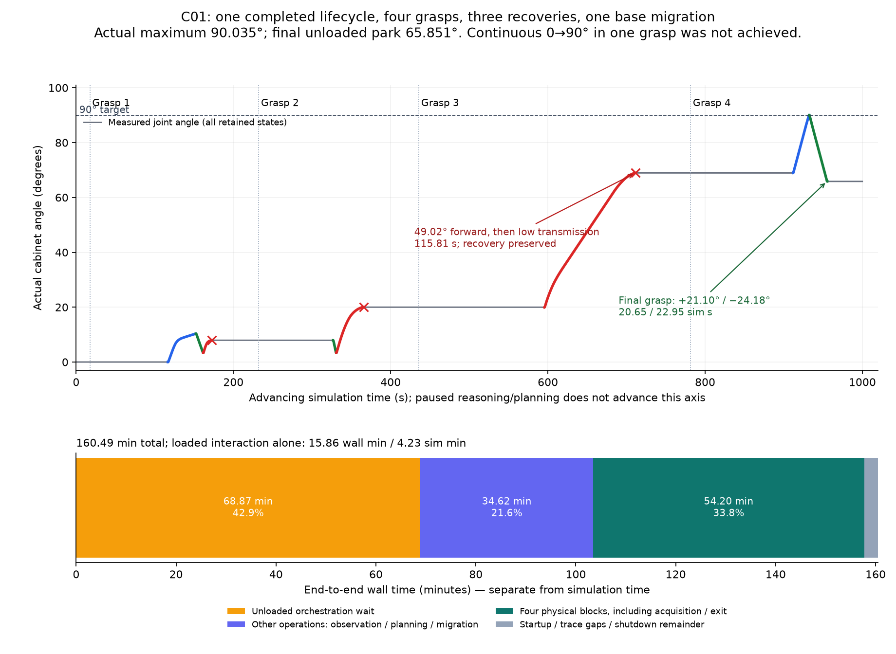
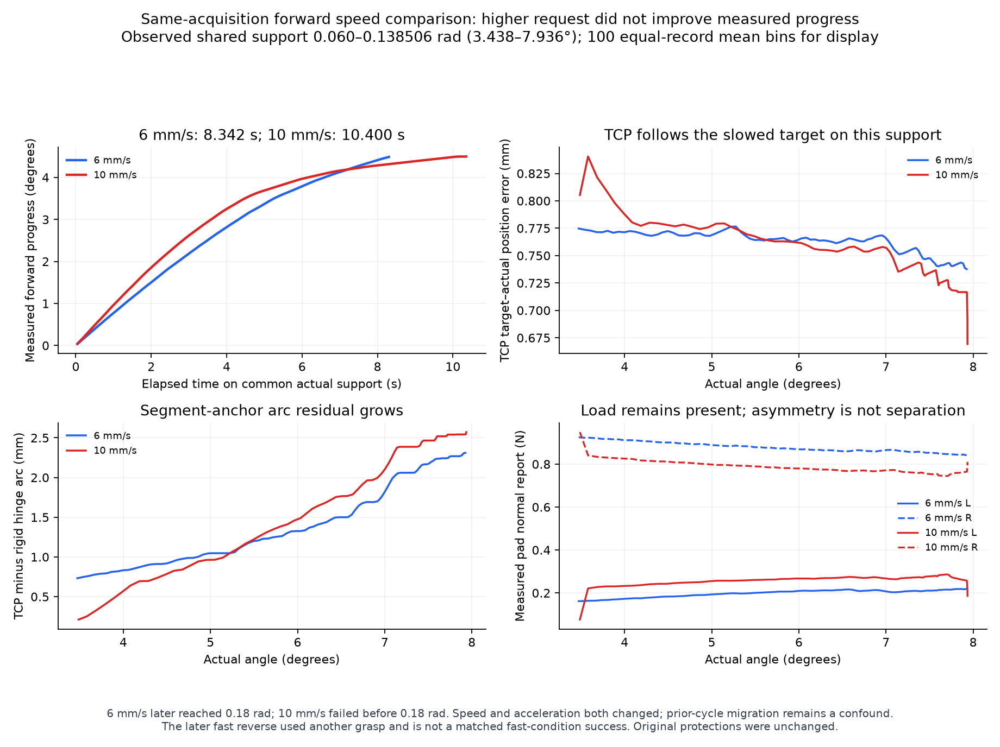

# R02 速度对照、持续传力退化与恢复（C01）

## 结论与边界

本 episode 的操作生命周期 **PASS**：真实门角最大 **90.035076°**，随后完成 **24.184136°** 反向运动，最终门角 **65.851083°**；独立验证段、原生释放与安全停车均完成，双指载荷 **0/0 N**，actor 与 launcher 已退出。

**持续传力退化尚未解决；提高速度没有证明能改善正向实际进展。** 同次抓取的共同实际角度区间内，6 mm/s 用时 **8.342 s**，10 mm/s 用时 **10.400 s**，后者未达到完整目标就触发低传力。最终成功经过四次抓取、三次接触恢复、一次底座迁移，不能写成一次抓取连续从 0° 打开至 90°，也不能由这一个 episode 推导总体鲁棒成功率。

全过程 **9629.566 s = 160.493 min 墙钟时间**，推进仿真 **999.979 s**。最后一次抓取的正向 **20.646 s** 只覆盖约 69°→90°，不能当作完整开门耗时。历史成功基线墙钟约 3900.415 s；源码、轨迹、试验任务和记录配置不同，本轮没有证明端到端效率提升。

- Episode：`v83_r02_speed_comparison_20261025_01`。
- 实际运行源码：`1782baf392402db1d547732c8709a6ac15369c6c`。
- 受保护成功基线：`codex/r02-active-recovery` / `792fa3b55160c8e83d50ec70f82803af8de14e9b`，未覆盖。
- 采用新鲜腕部 RGB-D/实际规划图、已知铰链与实际状态；没有复用历史抓取变换、重置物体状态、读取隐藏物理系数或放宽原保护。基线、原始冻结 Physics-ID 模型和旧证据均保留。
- 本次新增的是显式授权时间扩展与同步只读负载记录；没有修复或重写运动、夹持、碰撞、安全监控或估计器数学。

配置与承诺见 [CONFIG.json](CONFIG.json)，逐段、窗口与时间明细见 [METRICS.json](METRICS.json)，来源、数值、视频与清理核查见 [FINAL_AUDIT.json](FINAL_AUDIT.json)。

## 1. 当前慢，主要是控制策略还是物理交互？

端到端耗时主要受编排与恢复开销影响，同时带载运动本身确实会变慢。两者必须分开。

下表是由实际 command trace 得到的互斥墙钟分解：

| 类别 | 秒 | 分钟 | 占全过程 |
|---|---:|---:|---:|
| 卸载边界等待下一条命令 | 4132.183 | 68.870 | 42.91% |
| 其他操作：观察、规划、检查、迁移等 | 2077.392 | 34.623 | 21.57% |
| 四次完整物理块，包含获取接触与退出 | 3252.213 | 54.204 | 33.77% |
| 启动、trace 外间隔、关闭等余量 | 167.779 | 2.796 | 1.74% |
| 合计 | **9629.566** | **160.493** | **100%** |

“卸载等待”不能全部归为 LLM 推理：它包含看图、命令准备、传输、协调等，现有日志不能进一步可靠拆开纯推理时间。剩余 167.779 s 也不强行归因。

原生 profiler 提供另一套**与上表重叠、不可相加**的视角：抓取排序/IK 1425.878 s，PREGRASP 阶段 2338.981 s，慢闭合 871.360 s，实际 OPEN_CONTINUE 阶段 951.634 s，释放/清退/停车合计 722.543 s。全部八个物体交互段合计只有 **254.038 仿真秒**，而所有推进仿真共 999.979 s。仿真计算开销也不等于真实硬件运动时间。

没有证据说明“多等模型”是本轮慢的主要来源。模型工作器异步运行；本报告不把等待、规划拒绝、真实低进展和接触相对运动统称为抓取失败。

## 2. 退化前，圆弧误差、夹持载荷与物体进展如何变化？

同步记录覆盖实际关节角/角速度、TCP 目标与实际位置、刚体铰链圆弧残差、夹爪开度、双指载荷、接触，以及请求速度、加速度与原始触发原因。新增六个负载通道在全部保留样本中均有效，未改变采样与控制。

以下窗口使用同一段的起点作为圆弧锚点。早期为开始后 1–4 s；“疑似至停止”从原监控器 first_suspect 到该段最后样本，包含约 0.3 s 原保护减速/保持。它不是重新定义传力判据。

| 段/窗口 | 实际门进展 °/s | 实际/目标 TCP mm/s | servo P95 mm | 圆弧残差 P95 mm | 双指平均法向 N | 平均开度 mm |
|---|---:|---:|---:|---:|---:|---:|
| 同抓取 10 mm/s 正向，早期 | 0.810 | 6.407 / 6.400 | 0.781 | 1.699 | 0.257 / 0.794 | 14.701 |
| 同段，疑似至停止 | 0.098 | 0.752 / 0.726 | 0.727 | 2.570 | 0.265 / 0.760 | 14.686 |
| 迁移后 8 mm/s 长正向，早期 | 0.899 | 6.995 / 7.057 | 0.788 | 1.680 | 0.768 / 0.467 | 14.577 |
| 同段，疑似至停止 | 0.082 | 0.624 / 0.611 | 1.091 | 3.520 | 0.355 / 0.589 | 14.398 |

10 mm/s 段全抓取相对滑移 P95 从早期约 3.950 mm 增至疑似阶段 4.820 mm；这与“以当前段起点为锚”的圆弧残差使用不同参考，不能混为一个数。长正向段相对滑移 P95 约从 1.687 增至 3.528 mm。

证据支持：相对位置/接触分布逐渐迁移，随后目标 TCP、实际 TCP 与门的进展一同下降，参考领先接近原 **0.5°** 上限。10 mm/s 失败末次监控比值为 0.0738，第三次长正向末次比值为 0.0746。**servo 没有同步出现大幅失控误差；测得载荷也没有整体消失。** 这不足以把原因唯一归为 IK 跟踪错误、夹持力不足、某一摩擦系数或机械臂输出饱和。

最终成功反向的早期窗口左指法向为 0、右指约 1.230 N，仍有约 1.123°/s 实际进展；末尾约 0/1.410 N，servo P95 0.719 mm、圆弧残差 P95 2.006 mm。因此单侧正法向缺失和不对称本身不能判为分离，也没有添加这种新门控。

夹持链仍为原生有限隐式位置驱动：逻辑 preload 请求经原开度 Jacobian 与刚度映射为位置偏置，不能将请求 N 当作实测双指力；驱动上限仍按测得主关节角的 Jacobian 更新。本次保存了 projected reactions、incoming reactions、explicit applied effort、驱动位置/重力补偿指令与 G1 上限。**它们都不是独立测得的隐式电机输出**；显式外加力矩为零不表示电机不出力，native reaction 也不能直接证明饱和。原生力/碰撞/关节/执行器保护始终有效。

## 3. 6→10 mm/s 是否改善了真实进展？

第一抓预声明 constant 6 mm/s、20 mm/s²，再为 10 mm/s、30 mm/s²，均低于原带载上限 12 mm/s、40 mm/s²。原稳定完成条件控制后继动作，未强制越过退化继续。

原声明共同范围为 0.06–0.18 rad；快正向只到 0.138505563 rad，故公平的已观察共同支撑仅为 **0.06–0.138505563 rad**。

| 共同实际角度支撑指标 | 6 mm/s 正向 | 10 mm/s 正向 |
|---|---:|---:|
| 仿真耗时 s | 8.342 | 10.400 |
| 实际关节进展 rad/s | 0.009406 | 0.007546 |
| 实际/目标 TCP 平均 mm/s | 4.200 / 4.196 | 3.443 / 3.434 |
| servo P95 mm | 0.773 | 0.793 |
| 圆弧残差 P95 mm | 2.269 | 2.542 |
| 平均双指载荷 N | 0.201 / 0.873 | 0.262 / 0.776 |

较快请求的实际正向进展约慢 **20%**，且动作失败。速度与加速度同时变化，快段又处在前一次正反向周期之后，累积迁移仍是混淆因素；不能据此声称严格单变量速度因果关系。

原同抓取快反向未执行。它在第二抓换姿后完成了 4.531° / 4.025 s 的反向运动，这说明该新条件可以完成这次短反向，却不能补成第一抓完整速度对照成功。

## 4. 如果无法稳定提速，具体瓶颈是什么？

当前最直接的证据链是：**累积相对运动/接触迁移 → 参考领先接近限值 → 实现的参考/TCP/门进展共同变慢 → 原 nominal-demand 比值监控报告低传力**。它包含真实接触相对运动，也包含参考生成与监控定义的耦合；不是“TCP 已按 10 mm/s 正常走、门完全不动”的单一情形。

更换抓取与站位后，原 8 mm/s、25 mm/s² 常速条件能显著扩大连续区间并最终达标，说明任务可恢复；没有证明任何抓姿、任意方向或全区间都能稳定提速。约 69° 不是已确认物理限位，因为同 episode 换抓姿后实际继续超过 90°。拒绝某一退出路径也不等于门的物理限位。

全过程保留如下完整轨迹：

| 抓取/command | 动作结果 | 该块交互仿真时间 | 完整物理块墙钟 | 块末停车角 |
|---|---|---:|---:|---:|
| 1 / seq4，上段 roll0 | 0→10.318°；反向 6.907°；快正向至 7.936° 失败 | 55.796 s | 759.363 s | 7.936910° |
| 2 / seq13，换下段 roll0 | 完成待办快反向至 3.382°；8 mm/s 正向至 19.998° 失败 | 38.833 s | 703.652 s | 19.997824° |
| 3 / seq25，迁移后下段 roll180/pitch15 | 约 20→68.949°，连续增加 49.017°，随后低传力 | 115.808 s | 1074.958 s | 68.949325° |
| 4 / seq34，换上段 roll180 | 约 69→90.035°；反向 24.184°；验证与退出完成 | 43.600 s | 714.240 s | 65.851083° |

每次失败均安全卸载、fresh observe、改变可行候选，原目标与物体当前状态保留。第二次恢复包含底座从原站迁移至约 (1.08, −0.60) m，迁移后重新观察与规划，未沿用旧抓取变换。

上一物理块结束到下一块开始的恢复开销依次为 **1490.116 / 2328.864 / 1452.327 s**；其中对应卸载编排等待为 **933.543 / 1752.480 / 1004.095 s**，实际观察/规划等操作为 **556.573 / 576.384 / 448.232 s**。这些成本不再包含下一物理块，以免重复相加。

四块“接触获取及回到执行起点”仿真时间分别约 99.192 / 94.667 / 159.742 / 130.254 s；退出约 49.950 / 21.158 / 48.458 / 44.629 s。日志没有可靠的逐抓墙钟获取/退出完整拆分，不能用最后一次缓存估价回填历史。

seq10 首次规划拒绝与 seq20/29 视角拒绝都保留，之后改候选/视角继续。seq10 的原 mutable 细分审计后来被覆盖；command/response 仍在，报告不伪造其完整原始审计或哈希。seq23 与 seq32 完整 native 90°/反向/退出规划快照已另行私有保存。

## 5. 下一步应改哪个共享机制？

优先处理两个共享瓶颈，仍需后续明确实验验证，本轮没有继续修改：

1. **进度参考与反馈诊断接口。** 同时显式呈现 nominal 请求、实现的 reference/TCP 运动与实际物体进展，区分参考本身受限、跟踪误差与接触相对运动。对原 progress clock / Cartesian reference 的耦合和位姿跟随做有假设的对照。保留原 0.5° 领先与所有硬保护；不通过取消低传力监控掩盖问题，也不增加“某角度换某抓姿”的规则。
2. **卸载边界编排与复规划调度。** 减少重复等待与重复候选检查，将当前已证可行链、待办验证和安全出口证据清晰交给下一次决策。授权时间扩展解决了提前被编排期限截断的问题，但本轮数据不支持它降低总体耗时。

这比继续无限降速、增加无区分 probing 或叠加摩擦模型补丁更符合本次证据。没有独立电机输出及受控接触条件对照，暂不能唯一判定物理阻力或实际驱动能力的贡献。

## 独立验证、冻结模型与安全审计

最终第 7、8 段分别完整执行剩余高角正向与高角反向，均未进入 FIT；两段使用同一辅助冻结模型 SHA `19aff222957ad5a856d35090803b0bd9a1cae6cc1f6ff4f8bdb964d8b6959174`，冻结凭证记录 latest FIT 5、qualified bidirectional、validation_used=false。

第 6 段同名高角正向失败，整体排除独立验证，不能拼接第 7 段补成一个从 20° 开始的完整预测。原待办 `VALIDATION_SPEED_RECOVERED_REVERSE` 的 0.35 rad 目标未执行，最终仍为 READY_FOR_CURRENT_STATE_REPLAN；不能补记成功。第 3、5 段失败 FIT 仅原预声明且合格的传力前缀可用于辅助拟合，失败末端不能直接纳入合格数据。

本报告没有重拟合或选择新的动力学模型。操作生命周期 PASS 不等于 Physics-ID 参数准确或模型整体改善；原冻结外部模型的独立预测对照另见 [Physics-ID 报告](</Users/rangeryx/Documents/ChatGPT/robot in loop real2sim/github_release/fr3-real2sim-v83-physics-id/docs/experiments/v83_physics_id_20261024/REPORT.md>)，其低角退化与总体指标必须一并报告。

- 按用户授权，在原生 verified parked/unloaded 边界接受 seq6/15/27 各 1800 s，共 **5400 s** 墙钟信用；有效任务期限 12600 s，原时钟不重置。仿真上限 3600 s、获取次数 6、退出储备 300 wall /120 sim s、全部物理上限不变。
- 本地/服务器 205 项回归由 root 实跑，本地 1 skip、服务器无 skip。仅保留会话实际工具输出，没有另存 stdout 承诺，不补造。606/71/956 冻结源审计通过。
- Loaded 159、SOURCE_PROVENANCE 122、prelaunch 56 个文件承诺均逐字节匹配 `1782baf`。tracked 运行源无改动；存在一个原运行生成的 asset-path receipt，保留未删除。
- 16 个 NPZ chunk、81843 条保留记录、239995 个推进物理步，哈希、列长度、时间/step 对齐均通过；接触/交互保留 240 Hz，普通卸载状态按原策略保留 10 Hz。保留记录中 hard-stop=0、invalid F/T=0，numeric recorder issues 为空。
- 私有视频 4954 帧、640×480、目标 5 Hz；时间戳覆盖 0.204167–999.854167 仿真秒，最大间隔 0.204167 s，末尾 0.125 s，编码时长 990.8 s。编码时长不能替代实际仿真时间戳。日志中的一次 record_frame IndexError 原样保留；没有据此删除失败记录或伪称日志无异常。
- seq36 正常 finish，SESSION_COMPLETE；原生碰撞核查有效、停车到位、双指 0 N；process rc0 且 actor_exited=true，拥有 actor PID1360117 与 launcher PID1341499 的 /proc 均不存在。
- 原始 240 Hz 数组、腕部图片/视频、contact records、命令/响应与冻结文件保持私有。这里仅交付派生指标和两张曲线图；派生审计与原始文件哈希见 FINAL_AUDIT。审计未查看被动相机像素，也没有再启动物理动作。

本结果证明的是该模拟条件下一个可追溯、经过恢复的完整操作生命周期，以及一次负向的正向提速对照。持续传力退化、端到端效率和广泛鲁棒性仍未解决。
