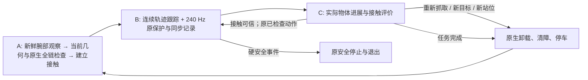

# V8.4 共享 ABC 机制与证据边界

运行源码冻结为 `78b83523143c84b6a7f90856c1e38c7716b220f3`。它是 opt-in 的工程集成；`792fa3b`、V8.0/V8.1 Skill、冻结物理控制器以及 V83 原始模型和所有历史实验保留。新 Actor 通过 `v84_abc_continuous_v1` 选择本机制，回退时选择原 profile/source；不热修改正在运行的 Actor。

## 状态流与长程接口

`prepare_grasp` 预声明完整有限动作链；`acquire_execute` 以当前真实状态、当前计划图 SHA、合法预载和有限段开始 A→B。可执行已检查链的一个子集，并通过 `retain_contact:true` 返回 C。`continue_motion` 必须提供实时 `contact_generation`，动作的目标、速度、加速度、角色与数据划分必须精确匹配原声明，并再次检查当前测量后继路线。新抓姿、新目标或预载调整仍回到卸载后的 A。

B 沿用已有连续执行器，不能把原系统说成每个物理周期都由 Agent 决策。本次实际减少的是不必要的释放/重新抓取、重复原生候选认证、只读反馈和数值工作器在安全边界的阻塞。接触记录含真实关节状态、TCP 参考与实测、速度、请求/测量夹爪状态、载荷和原始保护反馈；可用原生关节反力与 explicit effort 不被宣称为隐式电机的独立测量输出。

C 中物理和原监督继续运行，最长 20 s 墙钟或 5 s 仿真；接触不可信或超时均通过原释放/清障/停车返回 A，同一 episode 和原目标继续保留。C 不是安全停车。短程对照已实际执行一次 `continue_motion`，原抓取连续复用；不是仅有接口测试。

## 0.5° 参考领先与传力反馈

原 ProgressClock 的 0.5° 是物体相对参考的跟踪领先约束，并非单一接触载荷阈值；原硬力、碰撞、速度、关节和失联保护另行运行。C01 的失败前回放显示，领先逼近 0.5° 时，实测 TCP 相对门的接触相位迁移约消耗 0.34–0.45°，命令 TCP 相对实测 TCP 约消耗 0.02–0.10°。这不支持直接增大上限。原进度时钟、笛卡尔参考及其阈值均未改动。

原 nominal-demand 传力比将标称请求速度作为分母；时钟限制后，目标 TCP、实测 TCP 与门可能一起变慢。C01 第 3/5/6 段末窗存在可分辨的 TCP/物体共同运动，却触发 nominal 低比值。新软监控保留原影子诊断，再依据实际 TCP 进展区分：真实运动可分辨且实际传递比例足够时仅记 advisory；真实停滞或实际传递比例差仍在原窗口长度内触发恢复。原 increasing-slip、启动判据与硬保护保持。

离线重放仅证明该判定区别，不是后续物理成功。有限受控滑移、单指正法向缺失不单独变成新的动作许可门控。跨越 nominal 告警的 FIT 整段被保守排除；这不阻塞物体操作，也不把被排除数据重新加入合格拟合。

## 等待与规划调度

`ABC_WAITS.json` 明确记录起止墙钟/仿真时间、原因、依赖对象。卸载后的数值边界改为非阻塞检查，已完成快照不重复提交；独立验证仍必须有冻结模型与密封数据，不跳过原有限、真实物理监督的交接。接触图只读缓存且不在载荷保持期间渲染。

自动候选只有在已有候选通过**完整原生全链认证**后，才跳过按原严格 utility 规则绝不可能胜出的候选。几何评分及赢家原生检查不变；被裁剪者不是碰撞失败，也不声称已通过检查。它们保留为后续当前状态重新规划的候选。全链未通过的高分候选不能成为裁剪依据。

V83 C01 的 68.87 min 卸载 Agent 等待是整个编排延迟，不能全部归因于工作器或模型推理。新旧报告分别保留调用耗时与原生 phase/cost 两种相互重叠的分解，不混加仿真时间和墙钟时间。

## 必须保留的失败

short01 在已完成两段 legacy 运动后，C 包中的 NumPy 布尔值无法 JSON 序列化，Actor 退出前未验证原生卸载停车。该轮 **NOT PASS**，不能因 returncode=0 改称安全结束。原始视频、源版本、末端非零载荷和失败证据完整保留于私有目录，公开派生摘要见 `SHORT01_FAILURE.json`。

随后修复实际包序列化，并仅对只读元数据发布错误增加原保护下的卸载恢复；不吞掉执行/控制器/硬安全异常。short02 用冻结新源码完成四段、受监督 C 续动、独立验证、原生停车及进程退出。两轮抓姿来自各自新鲜图，不能当作相同抓姿的严格时间因果对照。

## 已完成回归

本地回归通过（1 项环境依赖跳过）；服务器日志确认 `Ran 223 tests`、`OK`，223 项全部通过。冻结源审计 606 个物理文件、71 个 revolute 文件、956 个 release 文件及 22 个历史外部依赖通过。新增回归覆盖实际 NumPy 布尔包、元数据错误原生退出、真实停滞与共同慢运动、有限 C 超时、全链 utility 裁剪和 FIT/VALIDATION 隔离。

完整任务及平移迁移结果另见最终 REPORT 与各轮派生审计；本文件不把短程通过当作完整任务或成功率提升。
