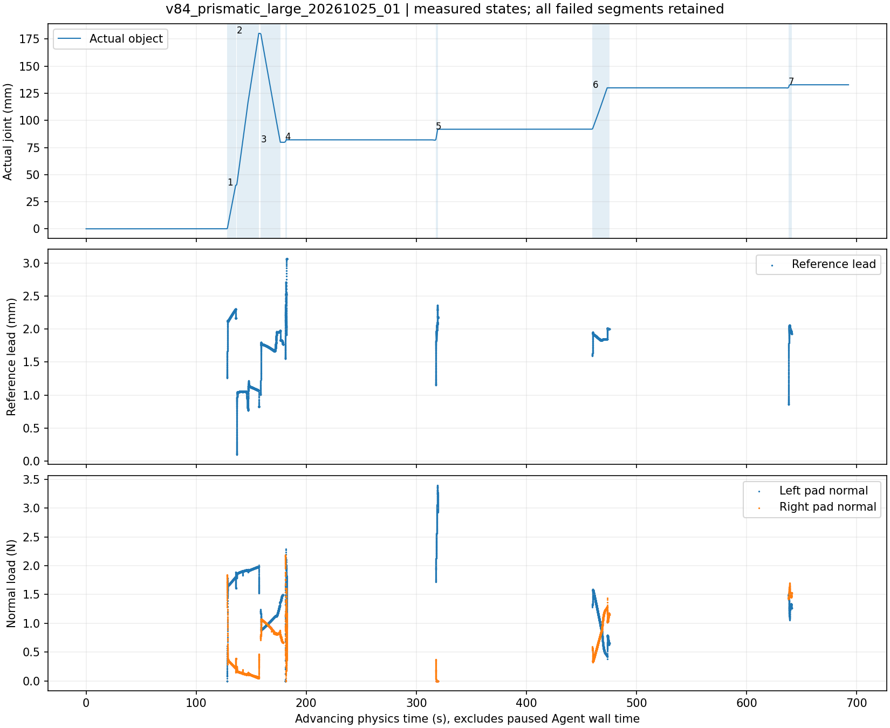
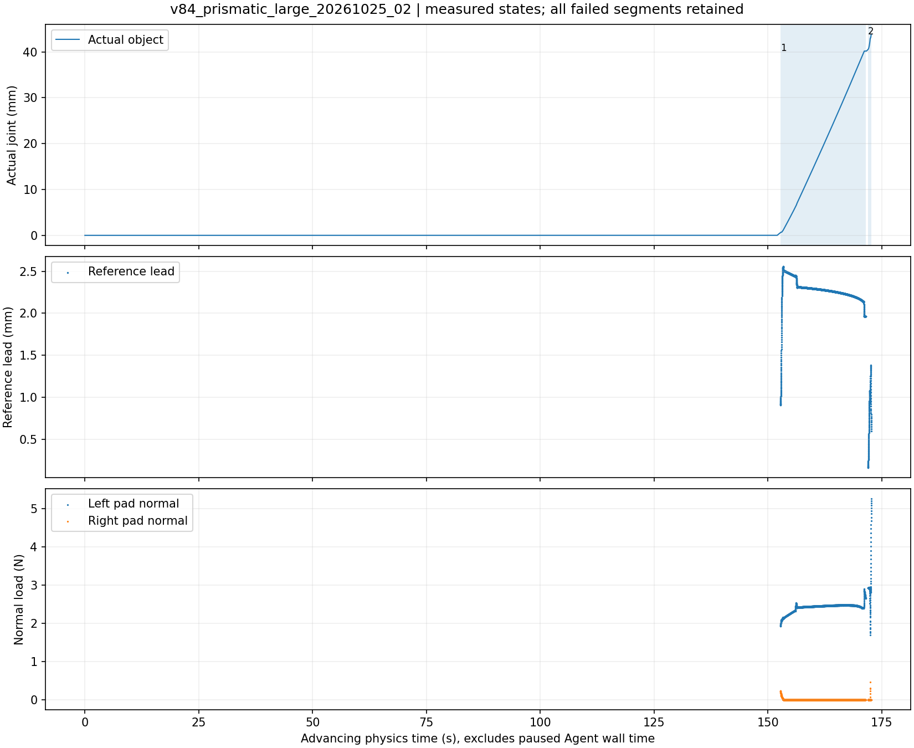

# V8.4 平移关节迁移

第一轮实际完成大尺度拉出与反向，但独立再开 **NOT PASS**。共享 ABC 接口已用于水平移动关节，运行源码 `78b83523143c84b6a7f90856c1e38c7716b220f3`，不混用旋转模型或参数。全部原始腕部图、240 Hz 轨迹、接触反馈与视频私有，失败段保留。

## 第一轮：完整拉出/推回与四次再开尝试

同一 episode `v84_prismatic_large_20261025_01`，第一抓一次下发4段：FIT 拉出40 mm、FIT继续180 mm、FIT推回80 mm、独立VALIDATION再开160 mm。前三段均真实达到：40.137645、180.250555、79.845361 mm，实际反向 **100.405194 mm**。全程最大实测180.250883 mm；不能用TCP位移替代这些物体行程。

| 独立再开尝试 | 配置/策略升级 | 实际停止位置 mm | 结果 |
|---|---|---:|---|
|1|初始1 N请求，先完成拉出/推回，独立sine速度再开|82.064845|原载荷趋势保护要求卸载|
|2|新鲜观察、换抓姿，恒速10 mm/s|91.841727|原载荷趋势保护要求卸载|
|3|安全底座迁移、重新观察与抓取，原有有界横向卸载分支，1 N|130.021155|持续停滞保护|
|4|新鲜观察、不同抓姿、合法1.5 N请求|132.841691|持续停滞保护；增加预载未改善|

1/2 的 `PREDICTED_LOAD_MARGIN_REQUIRES_UNLOAD` 是原保护器根据当下测量载荷及趋势、停止时域作出的保守预测，**不是 Physics-ID 模型预测**。第二次原保护输入力矩约0.583 N·m，预测0.601 N·m，对应原持续上限0.6 N·m；不能因控制效率目标取消它。该通道是偏置/重力补偿的保护输入，保留动态工具载荷，不能与未补偿原始F/T模长混为一谈。

第三次迁移后推进38.196 mm，未再次触发上述载荷边界；后来最后三个0.5 s窗口物体仅各进1.788 µm，TCP也几乎停下，参考领先约2 mm。此前存在相对位移增长，但末窗不是TCP持续空跑的充分证据。原因仍可能涉及接触相位与进度限制耦合，不能确定为完全脱抓或真实机械限位。第四次增加预载仅推进2.976 mm即重现停滞，不继续加力或叠加阈值补丁。

每次均通过原生释放、清障和停车返回卸载边界；同一场景保持真实物体状态，没有重置。原菜单、力、碰撞、关节和参考保护不变。该轮4个实际VALIDATION均未完成，另外预声明的反向/完整再开因前序停止而未执行，不能拼接为完整独立验证。

第一轮总墙钟6766.281 s（112.771 min），卸载Agent等待3540.032 s（59.001 min），交互段物理推进71.700 s，22条Agent命令、5次prepare调用（含一次5段超协议预声明的拒绝）、4次接触块、1次底座迁移。大量卸载等待包含Agent在边界做报告/审计的编排延误，应计入真实成本，不能都推给控制器。由于该轮没有完成独立再开，**不能称整体效率达标**。

最终真实位置132.841721 mm、双指0 N，原生native_rest停车确认，硬停止记录0、无效F/T记录0，所有遥测chunk哈希及源码ledger核对。Actor260753、launcher240283均已退出。关闭原因是当前原生安全资源边界下，剩余时间短于实测接触建立与安全退出成本；不是证明所有安全策略穷尽，也不是用户要求结束整个开发。未热改计时器、没有伪造扩展授权。结果见[第一轮审计](prismatic_01/FINAL_AUDIT.json)。

图使用推进中的仿真时间，排除暂停的Agent墙钟；载荷只绘制动作记录，卸载间隙留空。已实际查看。

## 与历史结果比较

V83平移结果：拉出180.115446 mm、反向100.240 mm，独立再开在85.4958 mm失败，墙钟109.535 min、4抓、1迁移，安全停车。V84第一轮保持大尺度能力，并从当前状态有界升级恢复至132.842 mm，但没有补齐独立再开，墙钟也未改善。不能把这个局部进展包装成完整任务通过或成功率提高。

## 第二轮独立对照

第一轮关闭且拥有进程释放后，注册 `v84_prismatic_large_20261025_02`。假设：从开始即采用更伸展且原生认证的底座站位、恒速动作、无额外横向补偿，能避免首次推回后的载荷约束。初始请求预载仍1 N，目标40→180→80→160 mm，前三段FIT、第四段独立VALIDATION；10 mm/s配置与原安全边界保持。该轮使用各自新鲜观察、重新自动规划、独立模型/结果目录，不与第一轮拼接。

第二轮 **NOT PASS / HARD_STOP**，未修改物理参数或依靠新Physics-ID拟合许可操作。迁移前先因初始观察姿态不在native park cell被拒绝；Agent走原生停车，再重新评估、迁移并获取新鲜腕部观察。该普通规划拒绝没有终止episode。当前SAM细杆与阴影分开选择，自动center0抓姿、整条40/180/80/160 mm链及退出均原生认证，实际查看计划图后批准。

首段达到40.179715 mm，用20.229167仿真秒。实测速度均值约2.117 mm/s，TCP servo P95 0.691 mm，参考领先P95 2.489 mm，tracking_limited_fraction=0.9124；后续窗口实际TCP/物体传递比接近1，二者共同慢动。这是进度/接触相位受限的证据，不是TCP持续空跑。左pad均值2.413 N、右侧大部分0 N并未单独触发执行门控。

开始第二段180 mm后，在约0.721秒记录窗内实际位置升至 **43.844294 mm**，TCP跟踪P95升至1.285 mm、相对迁移最大2.392 mm、左pad最终5.263 N；原监督在t=172.7125 s触发 `SUSTAINED_OVERLOAD`，当时wrist force约5.254 N、torque约0.840 N·m。这里是硬安全事件，不属于应继续重试的软接触告警。没有清锁存、降保护、进一步移动或另起物理重试。

该结果不支持“更伸展底座+恒速+无横向补偿即可解决问题”的假设，该配置不被采用为高效安全配置。段间目标/参考与速度状态衔接、接触相位迁移可能相关，但当前证据不能唯一确定原因，更不能从失败命名推断是抽屉机械限位或需要更大夹力。下一步应先离线检查共享段间参考连续性与原载荷预测/硬保护时序，形成可证伪假设；不再增加特定行程/抓姿规则。

第二轮总墙钟1230.525743 s（20.509 min），8条Agent命令、1次prepare、1次acquire、1次迁移；卸载Agent等待308.467 s，接触块439.382 s。原生phase计时中SLOW_CLOSE167.560 s、OPEN_CONTINUE56.085 s，两者是相互独立的阶段墙钟；它们与接触块/Agent等待的trace分解不可重复相加。首段报告时长20.229 s包含其接触预载，记录的OPEN_CONTINUE两段共19.450 s不包含预载，两种口径分别保留。

最终原生停车**未完成**、末条pad为5.263/0 N；`safe_exit=false`、`HARD_STOP_NO_AUTOMATIC_CONTINUATION`。原保护停止后Actor2449838、launcher2430811正常退出，资源已释放；进程returncode=0不代表成功。FIT第二段受硬停止排除，推回与独立再开尚未执行，不能宣称已完成独立验证。原始数据/视频和全部失败保留，见[第二轮审计](prismatic_02/FINAL_AUDIT.json)。

## 两轮交付边界与后续

| 指标 | 历史V83 | V84第一轮 | V84第二轮独立对照 |
|---|---:|---:|---:|
|完整拉出终点 mm|180.115|180.251|首段40.180；硬停最终43.844|
|完整反向行程 mm|100.240|100.405|未执行|
|完整独立再开|未通过|未通过，恢复推进至132.842|未执行|
|完整墙钟 min|109.535|112.771|20.509，硬停失败|
|卸载Agent等待 min|未在本表重新推算|59.001|5.141|
|Agent命令 / prepare / 接触块|按历史原报告|22 / 5 / 4|8 / 1 / 1|
|实际抓取 / 底座迁移|4 / 1|4 / 1|1 / 1|
|硬停止记录|0|0|1|
|最终原生停车|完成|完成|**未完成**|

第一轮相较历史没有实现完整任务效率改善，第二轮因硬停更不能以较短耗时宣称更快。本轮证明同一ABC接口能用于移动关节、执行大尺度双向运动和有界恢复；未证明完整独立再开、鲁棒成功率提升或所有配置均安全可行。第二轮的约束明确阻止继续扩大物理实验，保持成功R02与历史基线，暂不把V84 profile设为全局默认。

两轮遥测chunk和实际加载源码ledger全部匹配；连续视频分别3441和855帧，解码计数与时间戳一致，推进间隔最大0.204167 s，原始视频私有且不用于在线决策，见各VIDEO_AUDIT。没有将两轮最佳前缀拼成一次成功，也没有将未知参数准确性包装为Physics-ID通过。
