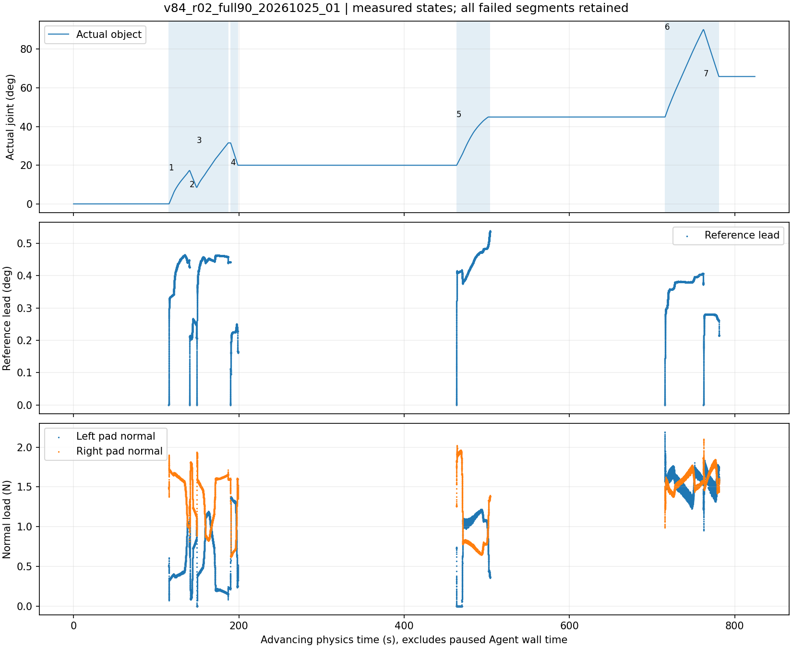

# V8.4 R02：ABC 连续操作与完整任务

**完整物体操作生命周期通过；冻结模型高角预测未通过。效率明显改善，仍未达到快速、稳定操作的最终目标。** 同一 episode 最大实际门角 **90.035144°**，完整反向 **24.196710°**，独立正向/高角反向轨迹及冻结验证流程完成（预测精度不通过，见下文），原生停车与拥有进程退出均确认。全过程 **5114.077291 s / 85.235 min**，3 次抓取、1 次底座迁移、1 次接触恢复；没有重置物体或放宽原保护。

运行源码为 `78b83523143c84b6a7f90856c1e38c7716b220f3`，分支 `codex/v84-abc-continuous`，episode `v84_r02_full90_20261025_01`。受保护成功基线 `792fa3b55160c8e83d50ec70f82803af8de14e9b` 与三条 V83 分支均未改动。完整配置见 [SPEC](r02_full01/SPEC.json)，共享机制、回退方式及必须保留的 short01 失败见 [MECHANISM](MECHANISM.md)。原始腕部图、240 Hz 接触数据、视频和完整时间同步轨迹均私有。

## 短程旧/新策略物理对照

short02在同一抓取中先执行legacy两段，受监督C中以`continue_motion`继续已检查的连续两段，没有重新抓取。8 mm/s、25 mm/s²配置保持，四段均达到，结束原生停车0 N，硬停0。实际结果：

| 策略/段 | 物体增量 ° | 仿真秒 | TCP servo P95 mm | 参考领先P95 ° |
|---|---:|---:|---:|---:|
|legacy正向|+9.218191|9.2000|0.538|0.244|
|legacy反向|−6.965542|7.1042|0.491|0.218|
|continuous正向|+6.961506|7.1125|0.518|0.235|
|continuous独立反向|−6.991424|7.1042|0.471|0.189|

完整短程墙钟996.086 s，Agent等待215.754 s；acquire两段含建立接触325.416 s，C后续两段含最终退出117.088 s。两调用的成本范围不同，不能把它们直接相除作为控制提速倍数；第一正向也比后续正向行程长。这证明同抓C续动及安全完整执行可行，并未证明底层标称速度本身提高。四段nominal advisory均0，实际把持载荷/开度/轨迹保留于[短程审计](short02/FINAL_AUDIT.json)。随后按有限共同角度区间选择10 mm/s配置并完成下述完整任务，未追加大量局部测试。

## 旧新完整实验对照

| 指标 | V83 C01 | V84 full01 |
|---|---:|---:|
| 最大实际门角 |90.035°|90.035°|
| 完整高角反向 |24.184°|24.197°|
| 完整 episode 墙钟 |160.493 min|**85.235 min**|
| 卸载决策等待（trace 口径）|68.870 min|**30.823 min**|
| 接触操作块墙钟，含接近/闭爪/运动/退出 |54.204 min|33.769 min|
| 实际 OPEN_CONTINUE phase 墙钟（独立分解）|951.634 s|575.194 s|
| 全部交互段推进的物理仿真时间 |254.038 s|187.913 s|
| Agent 命令数，含观察、规划和结束 |37|15|
| 高层几何/抓取规划调用 |5 build_geometry|3 prepare_grasp|
| 实际昂贵 grasp_ranking_and_IK 调用 |4|3|
| 抓取/接触块调用 |4|3|
| 接触恢复 / 底座迁移 |3 / 1|1 / 1|
| 硬停止记录 |0|0|
| 独立验证 / 原生停车 / Actor 关闭 |完成|完成|

墙钟减少 **46.89%**，卸载 trace 等待减少 **55.24%**。旧命令数通过与已公开 SHA 匹配的关闭后 trace 仅计数得到，见 [OLD_COUNTS_POSTHOC](r02_full01/OLD_COUNTS_POSTHOC.json)，没有输出或使用旧抓姿。旧 37 次中含 3 次只延长编排墙钟的操作；即使扣除，34 对 15 仍是减少，但不是全部归因于新控制器的因果证明。

两轮的诊断轨迹、当前视觉几何、自动抓姿、预载生效方式和恢复路径不同。C01 将速度诊断包含在完整 episode 内，本轮还有单独的短程对照；**上述不是严格同配置速度因果试验，不能只据一次较快成功宣称总体成功率提高。** 本轮全部7段及唯一失败均计入耗时，不选择性删除恢复成本。原 `792fa3b` 的另一成功 episode 约65 min，任务/记录范围不同；本次并未证明胜过所有历史最好耗时。

本轮不相互重叠的 trace 分解为：Agent 卸载等待1849.409 s、接触操作块2026.150 s、其他观察/规划/迁移及结束操作1111.022 s、未归入该 trace 分区的初始化/导出等127.496 s。原生 phase/cost 是另一种有重叠的分解，不能再与这些项目相加；仿真时间不能冒充墙钟。完整数字及每次等待起止、原因、依赖见 [FINAL_AUDIT](r02_full01/FINAL_AUDIT.json)。

## 同一 episode 的真实动作与恢复

| 段 | 角色 | 实际终点 ° | 实际增量 ° | 仿真秒 | 结果 |
|---|---|---:|---:|---:|---|
|1|FIT，8 mm/s|17.212374|+17.212375|25.133333|达到|
|2|FIT 反向，8 mm/s|8.551852|−8.660522|8.725000|达到|
|3|FIT，10 mm/s|31.530766|+22.978914|38.345833|达到|
|4|独立低角反向，10 mm/s|19.983849|−11.546916|9.212500|达到|
|5|独立大范围正向，10 mm/s|44.896756|+24.974105|40.804167|原 CONTACT_TRANSMISSION_STALL|
|6|重新抓取后的完整独立正向|90.034877|+45.140287|46.725000|达到|
|7|完整独立高角反向|65.838167|−24.196710|18.966667|达到|

第一抓从新鲜完整竖把手图自动生成上部0°候选，合法1 N请求，一次下发前4段。到19.98°停车后，底座从当前状态执行原生可行迁移至约 `[1.08,-0.60]`，目标误差0.164 µm，门状态未重置。迁移后新鲜腕部观察、全链认证及实际计划图审批完成，第二抓使用自动下部180°候选继续90°任务。

第二抓达到44.90°后，由原 increasing-slip/进展关系保护返回可恢复停止，`slip_exceeds_progress_windows=3`；**它不是 nominal-demand 低比值触发**。原生释放、清障和 native_rest 停车通过，双指0 N。该未完成验证单独保留，绝不与后续有效段拼成一次完整验证。

当前状态的新鲜图再次确认把手；淘汰失败候选，选择自动中部0°候选和原菜单内1.5 N请求，速度10 mm/s、加速度30 mm/s²不变。原生全链重新检查当前44.90°→90°→1.15 rad与退出。一次 B 块完成最后两段，中途没有 Agent 逐小段续发或新的抓取。该块墙钟683.400 s，含实际接近、闭爪、运动与退出；抓姿与预载同时改变，不能单独归因于增加预载。

最后动作终点65.838167°，停车后状态65.842566°，分别报告保持/退出中的微小漂移。关闭后 source ledgers 的168/131/65条条目均与实际源码字节一致，全部原始chunk哈希匹配，硬停止记录0，最终双指0 N。Actor3732641及launcher3711791均不存在。

图的横轴是推进中的物理仿真时间，包含接近/退出时的物理推进，排除暂停的 Agent 墙钟。载荷只展示动作期记录，卸载区间留空，不跨间隙连线。已实际查看派生图及所有用于批准动作的当前腕部/计划图。

## 有限速度对照与接触证据

同一第一抓、实际共同角度区间0.15–0.30 rad：8 mm/s、25 mm/s²配置耗时15.184439仿真秒；10 mm/s、30 mm/s²为12.650242秒，减少16.69%，真实角速率增加约20.0%。TCP servo P95为0.884668→0.904252 mm，段锚点圆弧残差P95为2.314382→2.552786 mm；选10 mm/s继续，不再追加最高速度测试。

速度、加速度、既往反向运动与接触历史同时变化，这是有限的执行配置选择证据，不能宣称纯速度因果效应。详见 [共同区间](r02_full01/INITIAL_SPEED_COMMON_SUPPORT.json)。

失败段早期1–4 s与末3 s比较：pad均值约 `[0,1.927]`→`[0.576,1.209]` N，servo P95 0.922→1.058 mm，相对迁移约1.94–1.99→3.94–3.96 mm，末3 s真实门角仅推进约0.256°。单指正法向曾为0，并未单独触发新门控；实际量共同变化支持换接触恢复，不能唯一断言摩擦、机械限位或抓取完全脱离。

恢复后的正向段，servo P95 1.008 mm、参考领先P95 0.404°；反向为0.692 mm与0.281°。原0.5°时钟设置没有增加；失败段在受控停止/回落期间记录到最大参考与物体差0.539°，不能把“设置未变”写成“任何记录永不超过0.5°”。

## FIT 与独立验证

FIT仅为段1–3。段4、5、6、7均预声明为VALIDATION；段5未完成，保留失败、不进入拟合，也不贡献完整预测验证。段6/7是各自完整的新独立验证，不以段5前缀拼接。

高角动作前，已有FIT1–3的qualified bidirectional模型被封存，原先未执行的新增高角FIT计划以执行前注册改为VALIDATION，见 [HIGH_PHASE_REGISTRATION](r02_full01/HIGH_PHASE_REGISTRATION.json)。失败段5使用 `a872c88a…`；恢复前worker在相同FIT IDs下重新发布 `b3ae91cf…`，最大参数绝对变化为 **1.62868e−6**，不是仅有验证元数据变化。对应不可变packet004/005的bias与estimation配置相同，测量prior的铰链origin与axis有约1e−8–1e−7量级变化；见[补偿快照对照](r02_full01/COMPENSATION_SNAPSHOT_COMPARISON.json)。这提供了重处理输入变化的证据，未用额外重拟合唯一归因参数变化；不能写成精确同一冻结文件贯穿两个高角尝试。成功段6/7均在执行前密封为**同一个** `b3ae91cfca46cd11710139b25154af63c53b6aad47bd7d465fa68ecf4edc0ea0`，最新FIT仍为3，`validation_used_for_fit_or_selection:false`。两次发布及全部原seal保留，详见 [MODEL_ISOLATION_AUDIT](r02_full01/MODEL_ISOLATION_AUDIT.json)。不将失败段5用于宣称完整独立验证，也没有因其结果更改模型结构或参数。

关闭后使用每段执行前的**精确模型文件**及其不可变numeric packet补偿配置重算独立预测，没有调用fit/analyze/update，也未修正后续状态。结果见[FROZEN_VALIDATION](r02_full01/FROZEN_VALIDATION.json)：

| 独立段 | 完整动作仿真秒 | 导数支持预测秒 | 冻结预测结果 |
|---|---:|---:|---|
|4 低角反向|9.2125|8.2000|RMSE **0.254776°**，终点−0.408676°|
|5 首次高角正向|未完成|N/A|失败轨迹排除，不计算合格预测|
|6 恢复后正向至90°|46.7250|原内窗有45.7125秒支持，但模拟预测离域|**prediction left declared domain；无完整RMSE**|
|7 高角反向|18.9667|17.9542|RMSE **35.560113°**，终点−41.625992°，超出FIT支持|

因此本轮是**独立验证轨迹与隔离流程完成，模型高角预测明确失败**，不能写成Physics-ID精度通过。该FIT模型只在约0.0128–0.5478 rad内有支持，高角外推不可靠；本轮没有采用或重新拟合V83已改善高角的外部候选。外部候选在其他区间总体退化的限制仍成立，不能据操作成功替换全局模型。模型失败没有阻塞物体闭环操作，也没有参与放宽保护。参数准确性仍未知。

V83原始外部冻结模型及高角候选的字节哈希均未变，见 [PROTECTED_MODEL_HASHES](r02_full01/PROTECTED_MODEL_HASHES.json)。本轮没有统一替换模型或声称参数准确。此前高角预测改善与全部区间合并RMSE退化同时成立；操作成功不能覆盖这个泛化问题。

## 结论与边界

本轮证明共享ABC可在保留原保护下完成大范围旋转任务、一次实际恢复、底座迁移和完整独立验证，且减少完整任务墙钟、接触块成本与卸载等待。短程同抓C续动另外完成，见 [短程审计](short02/FINAL_AUDIT.json)。短程 short01 的元数据退出失败和未验证停车仍为NOT PASS，见 [失败摘要](SHORT01_FAILURE.json)。

私有连续视频为640×480 H.264、5 fps，4090帧解码计数与4090条物理时间戳一致，覆盖0.204167–824.354167 s，最大推进间隔0.204167 s，末帧距最终物理824.5 s为0.145833 s；未发现超过该采样周期的推进仿真缺口。它是诊断overview，未用于在线规划，5Hz视频不等于240Hz数值采样。视频SHA及精确口径见 [VIDEO_AUDIT](r02_full01/VIDEO_AUDIT.json)。

本轮完整R02各段的nominal advisory计数均为0，所以“nominal低比值但真实共同运动时仅作advisory”的修正目前主要由C01离线回放与回归支持，**没有在本轮物理任务中实际跨越该告警再完成来证明**。持续传力退化也没有被宣称彻底解决。

85 min仍远非高效操作的终点。主要剩余成本包括30.8 min上层卸载编排等待、原有A/接近闭爪和停车，以及仿真/记录成本。下一步优先减少安全边界中无效的观测往返和重复编排、按相同配置做独立完整重复；不能靠放大参考上限或最高速度替代证据。本阶段先完成同机制平移迁移，再决定是否承担额外完整R02重复的成本，不以单轮数据给出成功率提升结论。
