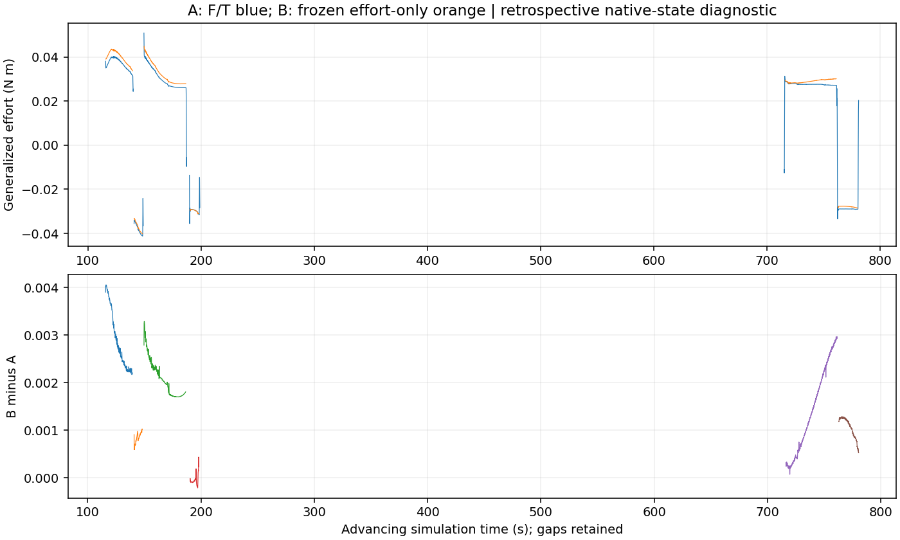
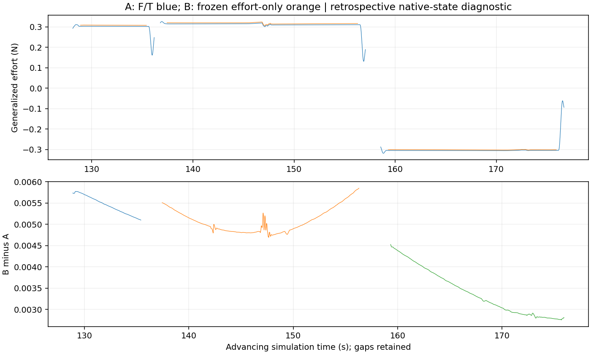

# V8.5 — Sensorless Physics-ID

**结论：在当前已知机器人模型、已知目标几何和理想物体状态反馈的仿真回放中，七轴投影 effort 可以恢复粗略广义力；尚不能可靠恢复全部物理参数，也没有证明 effort-only + RGB-D 系统的独立预测能力。** 不把较小力矩误差、拟合误差或一次操作成功当作参数准确恢复。

本轮完成P0安全终态修复、信号来源审计、无接触本体补偿、虚功重建、两组固定A/B对照、C的不可辨识性检查和模型冻结后的独立GT误差评估。**没有新增物理实验**。历史硬停止场景未取得停车证明，安全待处置记录保留；所有辨识工作均离线，原F/T硬安全保护没有关闭。

| 研究问题 | 本轮证据 | 结论边界 |
|---|---|---|
|effort能恢复多准的广义力？|旋转B对设定动力学参考的RMSE **0.002024 N·m**；平移 **0.004583 N**|仅本仿真、接受区间、已知模型/几何；参考由设定法则与原生运动导出，不是独立接触测力|
|能否准确恢复参数？|抽屉常模型B质量误差 **−7.81%**、阻尼 **+49.36%**；旋转B惯量退化近零|当前不能称可靠参数恢复；更复杂模型没有稳定改善|
|比F/T差多少？|同区间F/T参考误差约 **0.0000472 N·m / 0.0000169 N**；抽屉F/T质量、阻尼误差 **+0.126% / +0.027%**|虚拟F/T很理想，不能把该差距直接外推到真实硬件|
|纯运动学能恢复绝对参数吗？|未知主动接触输入下，参数和未知输入可同时缩放，保持同一运动|C的绝对惯量/阻尼/摩擦不可唯一辨识；不给伪造参数或预测分数|

## P0：硬停止与安全停车分别核查

审计对象为 `v84_prismatic_large_20261025_02`。原 `SUSTAINED_OVERLOAD` 发生在172.7125仿真秒，最终实际位置43.844294 mm，pad为5.263/0 N，末条机械臂最大关节速度 **0.092770 rad/s**。没有后续静止窗口或控制器停止确认；旧场景已关闭，不能事后补证停车。

| 状态 | 历史证据 |
|---|---|
|保护发现故障并中止执行|是，硬停止锁存及故障记录存在|
|控制器已完成安全制动|**未确认**；末条非零速度不能证明停止完成|
|Agent已到达停车位|否；`safe_exit=false`、`HARD_STOP_NO_AUTOMATIC_CONTINUATION`|
|进程正常退出|是，returncode=0；不代表物理成功|
|实际卸载/安全停车|**未完成、未确认**；没有在锁存后发卸载/停车续动|

最小共享修复：锁存后ABC释放入口直接返回禁止续动，不调用运动owner；捕获硬安全异常后暂停仿真推进，记录独立 `TERMINAL_SAFETY.json`。仿真pause与真实控制器停止确认仍是两个字段，绝不把pause称为真机制动。launcher分别记录进程退出和物理终态；缺失、损坏、过期或矛盾的终态均按未确认处理并持久化待处置。启动前与取得actor锁后复查待处置，禁止自动清锁存或继续运动。

[终态实现](../../../agentic_interaction_v81/terminal_safety.py)与[故障注入测试](../../../tests/test_terminal_safety_v85.py)覆盖旧停车标记、rc=0、缺失记录、损坏/过期记录、保持原安全异常、无驱动暂停和launcher在创建Actor前拒绝。实际待处置入口检查也已确认拒绝。它是修复版launcher的软件防线，不是PLC、硬件制动或OS隔离；旧版本入口不能被视作同样受保护。

历史事件没有被改写成安全成功，见[P0审计](P0_HARD_STOP_AUDIT.json)。本轮未清除该待处置，也未新建物理Actor。安全出口修复后ABC的A/B/C分工、参考时钟、轨迹跟踪、抓取、恢复和硬保护架构保持，辨识模块不进入控制许可链。

## P1：effort真实来源与有效信号

这些episode直接调用Isaac原生API，没有经过ROS2 JointState、ROS2 Bridge或真实xArm驱动。实际安装版本为Isaac Sim **6.0.1.0**，实现源码哈希记录于[信号审计](EFFORT_SIGNAL_AUDIT.json)。

| 通道 | 实际含义 | 本轮用途 |
|---|---|---|
|`get_applied_joint_efforts`|`get_dof_actuation_forces`，显式命令buffer|七轴全为0，**不能当作实际驱动力矩**|
|`get_measured_joint_efforts`|`get_dof_projected_joint_forces`，incoming joint反力沿运动轴的投影|B的仿真反馈proxy；不是独立电流/电机输出传感器|
|完整incoming reaction / wrist F/T|空间反力与固定腕部接口反力|B不读取；A及独立评估可读取腕部F/T|
|position target、gravity bias、effort cap|控制目标/补偿命令/权限上限|不能替代实测effort|

[NVIDIA原生tensor API](https://docs.omniverse.nvidia.com/kit/docs/omni_physics/108.0/extensions/runtime/source/omni.physics.tensors/docs/api/python.html)说明投影反力与显式actuation buffer的区别；本轮还核对了安装源码的实际返回调用。全原生DOF有15个，七轴索引为 **2–8**，不能错误取前7个而混入移动底座。七个旋转轴单位N·m，正方向沿URDF关节轴；通过无接触重力核对选择+1，未用F/T选符号。

R02、抽屉第一轮、硬停轮分别保存62362、42087、8400条记录。两个effort通道valid比例均1，step无重复/倒退，时间戳与step差对应误差不超过约9.1e−14秒；运动阶段保留240 Hz，卸载段通常10 Hz，切换边界存在不同step间隔。没有插值伪造高频激励。记录在同一原生step后采集q/dq和反力，无独立硬件时钟或实测通信延迟证明。原生值未作本研究的在线滤波；离线SG121是需要未来支持的居中过滤，不能当作零延迟在线观测。

饱和审计仅比较投影值与标称drive cap；没有独立隐式驱动输出，因此不能据此证明驱动从未饱和。重复值也不能单凭数值相同判为丢帧；本批七轴完整向量没有连续完全重复。电机电流、传动损耗、温漂和真实电流—输出力矩标定均未测得。

真实硬件的语义不同：[UFACTORY ROS2官方说明](https://github.com/xArm-Developer/xarm_ros2/blob/humble/xarm_api/ReadMe.md)将effort描述为基于电流的估算，并列出normal/rich默认5 Hz、dev为100 Hz。未来应优先核验设备实际高频报告与标定，不把低频插值当作激励信息，也不能把本仿真proxy精度当作硬件指标。

## P2：先扣除机器人本体动力学

B使用保存的机器人URDF与13个本体/原生G1运动关节的q、dq和分段局部加速度，计算完整刚体RNEA。然后用无接触完整轨迹块校准七轴常偏置：前2块1347个接受点训练、最后1块665点留出；抽屉的无接触状态作为跨episode检查。未使用腕部F/T、物体原生角度、隐藏物体参数或加载数据调补偿。

| 轴 | 仅重力，留出RMSE mN·m | RNEA+冻结偏置，留出RMSE mN·m |
|---|---:|---:|
|1|52.840|2.122|
|2|61.042|4.047|
|3|35.347|2.467|
|4|42.366|2.552|
|5|0.723|0.383|
|6|4.028|0.384|
|7|1.190|0.667|

动态补偿明显优于仅重力，但常偏置并非每轴改善：第2轴RNEA单独为3.792 mN·m，加偏置后4.047。该负结果保留，不根据F/T对照重调。抽屉跨episode无接触RMS约0.813–2.815 mN·m；R02全无接触摘要包含训练点，不能冒称全部留出结果。

这是已知仿真机器人模型下的有限检查，不是完整机器人惯量/摩擦/传动辨识。没有独立空夹爪—固定载荷实验，也未将本体摩擦等误差唯一分离。剩余残差含姿态/动态模型、测量与可能传动误差，不能直接解释为门或抽屉阻尼。模型及完整条件数见[冻结补偿](replay_02/ROBOT_COMPENSATION_FROZEN.json)。

## P3：用虚功恢复目标广义力

令七轴残差 `r = tau_projected − tau_robot_RNEA − bias`。用已知机器人Jacobian J与当前可信关节几何构造目标单位运动twist S：旋转为 `[axis × (TCP−hinge); axis]`，平移为 `[axis; 0]`。求满足 `J v = S` 的最小范数关节虚速度，取 **`u_object = vᵀ r`**。不声称完整六维接触wrench已被唯一、可靠恢复。

J平移行以0.3 m长度作量纲归一化；SVD相对阈值1e−6只是数值秩检查，不是新安全阈值。秩不足拒绝给合格广义力。已重建点条件数约6.1–15.8，当前主要问题不像机器人Jacobian近奇异。原生接触状态、抓姿迁移、未知多接触、几何误差和本体补偿残差仍会破坏单一等效wrench解释；不能从一个残差范数唯一归因。

传播留出本体RMS得到的广义力RMS proxy，旋转中位约0.0042 N·m、平移约0.0064 N，既不是硬界也不是已标定置信区间。B与A共享物理求解器，传感器误差可能相关；二者相近不能独立证明真实力矩准确。

| 接受区间汇总 | 点数 | B−F/T RMSE | MAE | 偏差 |
|---|---:|---:|---:|---:|
|旋转，N·m|31019|0.001995|0.001788|+0.001788|
|平移，N|10079|0.004581|0.004479|+0.004479|

独立评估器在所有模型密封后读取隐藏设定，用设定惯性/阻尼/位置阻力与同一原生运动导出诊断参考；它没有把GT输入估计器。结果：

| 设定法则诊断参考 | A F/T RMSE | B effort RMSE | B MAE / 偏差 |
|---|---:|---:|---:|
|旋转，N·m|0.00004720|0.00202419|0.00181025 / +0.00181025|
|平移，N|0.00001688|0.00458298|0.00448144 / +0.00448144|

这不是独立接触力传感器GT或真机精度。F/T的理想性、设定刚体惯性与导数近似的限制均保留。旋转初始正向/反向/后续正向B参考误差分别约0.00298/0.000814/0.00214 N·m，高角正向/反向约0.00171/0.00104 N·m。平移三段约0.00546/0.00510/0.00345 N。完整位置、方向、速度、加速度分层含空区间均在各COMPARISON中。

旧低角反向虽然物理完成，其原数据质量遮罩没有合格力矩比较点，故该力矩指标N/A；预测的共同支持时域仍单独报告。数据准入没有改成操作许可门控。

两图已实际查看，卸载/分段间隙保留。连续偏差随状态改变，不支持把全部残差直接叫作随机噪声或物体摩擦；本体补偿、参考对齐和接触几何的贡献尚未唯一分离。

## P4–P5：统一模型对照与参数准确度

数据是已关闭的V84 R02完整episode与抽屉第一轮，各自FIT1–3；关节模型、参数与单位分别保存。硬停第二轮只用于P0/P1，不用于拟合。B广义力阶段严格只读允许字段；纯几何取自不含F/T校准的运动学接口。A使用完全相同几何。

物体参数对照**使用仿真原生物体q/dq的理想反馈**，不是连续RGB-D估计。旧共同数据质量遮罩还包含F/T可用性标记（本批均有效），这是受控回放限制；B拟合的数值目标来自自己的冻结effort缓存，不用F/T目标或GT选系数。不能将这一回放称为完整视觉Sensorless验证。

先固定相同的惯性+阻尼+常摩擦三参数模型，A/B分别使用同样668个旋转FIT bins、421个平移bins、原尺度和求解预算。旋转两者均把惯量压到近零，不替换成GT/先验来强行预测。随后只做一次预先固定的原生产FIT-only选择器对照：原2/4/8区间、原三档平滑度、完整轨迹留一CV和原10%提升条件，没有新增模型结构或用旧验证分数调参。A/B候选预算相同，但赢家维数不同，不能把后者当作固定复杂度的纯传感器因果比较。

下表为**对设定参考的有符号相对误差**，而非预测RMSE推断的参数准确度。隐藏参考由独立评估组件在冻结后读取；没有额外未随机化移动体。惯性参考仍是设定刚体组合，不是另做有效质量/惯性实验。

| 关节 / 模型 | A 惯性或质量误差 | B 惯性或质量误差 | A 阻尼误差 | B 阻尼误差 |
|---|---:|---:|---:|---:|
|旋转，常模型|约−100%|约−100%|+319.98%|+279.22%|
|旋转，原FIT-only CV|−15.76%|约−100%|−6.81%|约−100%|
|平移，常模型|+0.126%|−7.813%|+0.027%|+49.355%|
|平移，原FIT-only CV|+0.126%|−12.230%|+0.027%|+77.740%|

旋转CV选择A为8区间、B为4区间；平移A仍为常模型、B为4区间。B新增位置项没有稳定改善参数准确度，停止在该方向叠加补丁。此前某些F/T版本确实可以很准，本次抽屉F/T参数对照也支持这一点；不能把问题统称为“所有版本都估不准”。

| 阻力曲线RMSE | A FIT支持内 | B FIT支持内 | A 全声明域 | B 全声明域 |
|---|---:|---:|---:|---:|
|旋转常模型，N·m|0.009420|0.006940|0.005482|0.004042|
|旋转CV，N·m|0.000499|0.005320|0.017042|0.013267|
|平移常模型，N|0.00000949|0.015347|0.00000949|0.015347|
|平移CV，N|0.00000949|0.022707|0.00000949|0.115126|

声明域列**包含无FIT支持的外推**，不能叫合格有效域；个别较小数值也不能掩盖惯性/阻尼退化。静摩擦与反向启动阻力没有被独立辨识，不给虚构GT误差。

为何小力误差仍造成大参数误差：合格旋转FIT的实际速度RMS约0.0108–0.0186 rad/s、加速度RMS仅0.000873–0.001071 rad/s²；平移对应0.00529–0.00705 m/s、0.0000378–0.000766 m/s²。用A估计量级看，旋转惯性项约1e−4 N·m，明显小于B约2e−3 N·m误差；平移惯性项也可能低于B误差。标称TCP速度/加速度不能代替这些实测激励。

旋转常模型条件数58.1不代表惯性已可辨识，其惯性条件标准差约0.245/0.319 kg·m²而估计接近0。旋转CV条件数A约324.5、B约2515.3，B惯性/阻尼仍在零边界。平移常模型条件数约400.5；质量条件标准差A0.00432 kg、B0.34983 kg。完整参数、条件协方差、秩和支持区间在MODELS_FROZEN；这些条件区间不含模型选择、接触、视觉或系统补偿误差，也没有多次独立试验验证覆盖率。

C不输入力或effort。在主动受控运动中，若输入未知，将惯性、阻尼、摩擦及未知输入一起乘正数可保持同一q(t)；甚至不同输入也可补偿其他参数差异。已知零输入的自由衰减可提供参数比值，但本数据没有这样的已确认自由运动条件，绝对尺度仍需额外信息。不以运动学AR预测替代物理参数恢复。

## P7：预测时域、数据隔离与独立性

原有V84验证轨迹已经用于错误诊断，本轮全部标为**开发回放**，不是新的最终独立验证。参数FIT始终只用原FIT1–3。失败的旋转段5、所有未完成抽屉再开均排除完整预测，不拼前缀，不用零分冒充未执行结果。

A/B在相同共同支持起点初始化一次q/dq，使用同一原生步长与被测输入，之后不纠正状态。下表为CV模型开发回放；B惯性不受支持，无法生成可信滚动，保留N/A。

| 旋转轨迹 | 共同预测时域 | A RMSE ° | A终点误差 ° | B |
|---|---:|---:|---:|---|
|低角反向|7.6833 s|0.271732|−0.452689|惯性不受支持|
|恢复后高角正向|45.1958 s|预测离开声明域，无完整RMSE|N/A|惯性不受支持|
|高角反向|17.4375 s|35.222101|−41.320613|惯性不受支持|

A的0.5/2/5 s RMSE：低角约0.0064/0.0276/0.1132°，高角正向约0.3107/3.3745/13.6508°，高角反向约0.5591/5.0819/16.2678°；精确SI结果与空时域都在COMPARISON。常模型下A/B旋转惯性均退化，所有这些滚动均N/A。抽屉没有完成的再开验证，不能给独立轨迹精度。

共同支持比V84原报告短，因此35.222°**不能**与35.56°直接解释为模型改善。数值半步实验保持同一测量输入零阶保持，未制造更高频激励；A高角反向RMSE仅改变约0.0029°，远小于35°级误差。本案例的时间步细化不是主要补救，B则因惯性退化连该检查都不适用。

旋转参数支持约0.0128–0.5455 rad（约0.73–31.26°），不覆盖高角反向；平移支持约3.61–37.40及44.97–176.75 mm。广义力接受点覆盖高角动作，并不意味着物体参数曲线已覆盖这些位置。V83候选高角改善、全域退化的原结论及原冻结文件均保留，没有用它替换本轮或全局模型。

所有四个模型先密封并写入[模型清单](ALL_MODELS_SEALED_BEFORE_GT.json)，之后登记[独立评估](INDEPENDENT_EVALUATION_REGISTRATION.json)，才由独立进程读取隐藏参考。评估后模型哈希再次匹配，没有回流拟合。此为代码/研究协议隔离，不是OS安全沙箱。B缓存不读取腕部F/T或物体原生q；共同物体参数诊断显式使用原生状态，真实RGB-D连续运动估计与新独立holdout仍缺失。

## P6：最有价值的下一轮 probing 与本轮停止依据

本轮新probing数量为 **0**。原因是P0没有历史停车/停止完成凭据，并且现有数据缺连续RGB-D物体运动流。没有为了取得新评分而清锁存、重置场景或运行新长程任务。

当前证据支持的后续信息缺口：

1. 优先用无接触、不同姿态、正反速度及可分辨加速度检查本体残差的状态依赖；增加空夹爪/已知固定载荷对照，避免把本体误差拟合成物体阻力。
2. R02需要新的高角正反向FIT，包含分开的速度平台和实际可分辨加速度；高角旧验证不能同时变为新独立证明。抽屉需要补齐真正完成的再开holdout。
3. 记录独立RGB-D物体跟踪及其延迟/不确定性，原生状态只供评估，不能换名为视觉观测。
4. 只有安全前提确认后，Agent才按B自己的FIT信息矩阵/补偿不确定性预测候选信息增益和风险，选择原生可行的长段；执行后用实际加速度、速度和进展验收。当前没有已认证新候选，故不编造信息增益或实验结果。

保持ABC：A建立接触，B连续执行并记录，C评价真实进展和信息是否增加。辨识准入不返回操作许可门控。真实硬安全、未知控制器状态与不可信传感器仍走原安全流程。本轮停止扩大模型，依据是既定候选的退化和数据/安全边界，不是追逐任意低RMSE或预算耗尽。

## 源码、回归与完整实验索引

分支 `codex/v85-sensorless`。辨识/评分方法冻结源码 **`0a5eeec20c491fcac0736c1a7693086265cc00fd`**；最终P0共享出口源码 **`20e58dd05baaac954f587696558f09260f6711ec`**。后者不修改已评分的 `agentic_interaction_v85` 源文件。原792fa3b、V84运行78b8352与报告90b391d及V83报告、模型保持，原始数据不覆盖。

服务器原有223项回归和V85新增25项回归通过，冻结606物理源、71旋转依赖、956release源审计通过。新测试包括力/虚功与坐标不变性、奇异拒绝、F/T与原生物体q污染防护、采样间隙、参数尺度歧义、GT读取前的在线/哈希门控、共同特征时域和数值积分。没有把单元测试称作新的物理安全认证或硬件验收。

主要代码：[B信号与虚功](../../../agentic_interaction_v85/effort.py)、[本体补偿回放](../../../agentic_interaction_v85/replay.py)、[统一诊断](../../../agentic_interaction_v85/diagnostic.py)、[唯一GT读取组件](../../../agentic_interaction_v85/independent_parameter_evaluator.py)。模型文件、配置、数据划分、全部失败与输出索引见[EXPERIMENT_INDEX](EXPERIMENT_INDEX.json)，测试和哈希见[FINAL_AUDIT](FINAL_AUDIT.json)。

原始腕部图、视频、完整effort/F/T时序、重建缓存与隐藏参考均留在私有目录；公开材料只含派生统计、估计模型、误差与图。没有新增Actor，原拥有进程已退出；历史硬停未停车与未确认制动状态仍明确保留。
