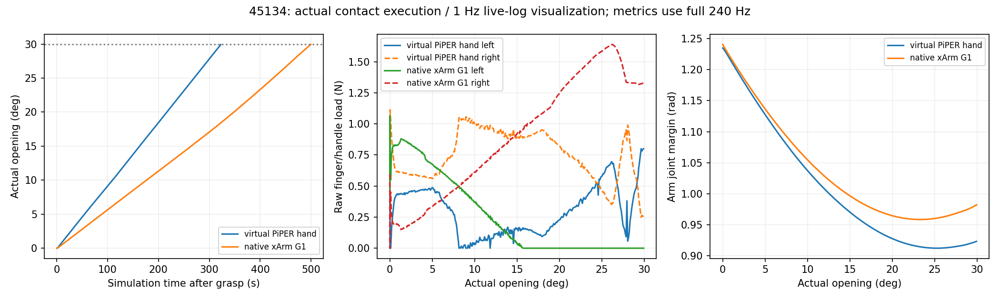

# Native xArm Gripper: one physical 30° success, mixed transfer results

**The official G1 gripper is mechanically integrated and physically opens 45134 to 30.000061°. Cross-object reliability is not established:** 45249 grasps the intended handle but stops at 0.053795° under the unchanged temporal force protection; 45443 crashes during simulator initialization and has no physical result. Exactly one launch per registered case, no retries or per-case controller tuning.

**XARM7 / NATIVE_XARM_GRIPPER / ORACLE_HANDLE / KNOWN_MODEL / APPROXIMATE_ACTUATOR_SIMULATION.** Reference `5ced3f5`; isolated implementation commit `20cd23b`. All prior tracked virtual-gripper/PiPER files remain unchanged. No object physics changes, object actuation, attachments, state stitching, releases or regrasps.

| Asset / registered handle | Automatic planning | Initial correct-handle grasp | Maximum actual after valid grasp | ≥30° | Stop / limitation |
|---|---|---|---:|---|---|
| 45134 / original-32 | 30°; 204.48 s | bilateral, 0.499 / 0.532 N | **30.000061°** | PASS | actual task target |
| 45443 / original-38 | 30°; 252.51 s | not evaluated | — | not completed | RTX allocation failures and initialization crash, exit 139 |
| 45249 / original-32 | 30°; 233.32 s | bilateral, 0.553 / 0.472 N | **0.053795°** | FAIL | existing `HARD_FORCE_STOP_SUSTAINED` |

Planning coverage is **3/3**. Operational task completion is **1/3**; among the two scenes that actually reached contact, grasp acquisition is **2/2** and 30° completion is **1/2**. This small development batch is not a robust population success-rate estimate. The unseen 45249 was selected from closed geometry and a protruding vertical handle before planning; it was not substituted after failure.

## Native versus frozen virtual PiPER hand

| Metric | 45134 virtual hand, frozen | 45134 native G1 | 45249 native G1 |
|---|---:|---:|---:|
| Actual maximum | 30.000040° | 30.000061° | 0.053795° |
| Maximum handle-relative translation | 1.112 mm | **1.121 mm** | **0.489 mm** |
| Maximum relative rotation | 0.290° | 0.260° | 0.131° |
| Maximum loaded world TCP speed | 2.206 mm/s | **2.112 mm/s** | **1.137 mm/s** |
| Maximum TCP speed, all phases | 25.576 mm/s | 30.368 mm/s | 31.251 mm/s |
| Minimum arm joint margin | 0.9123 rad | **0.9585 rad** | **0.6731 rad** |
| Maximum nominal arm tracking error | 0.004694 rad | 0.004595 rad | 0.004679 rad |
| Peak raw finger/handle load | 1.127 N | **1.640 N** | **2.063 N** |
| Simulation duration, excluding startup | 478.838 s | **662.879 s** | **242.992 s** |
| Wall duration, including startup/export | 2247.02 s | **4208.67 s** | **1560.14 s** |
| Main observations / native physics records | 114,921 each | **159,091 each** | **58,318 each** |
| Original video | unavailable in old run | **19,886 frames** | **7,289 frames** |

The original **5 mm/s loaded-TCP** and **0.05 rad arm-margin** protections remain unchanged. The frozen pre-contact trajectory retains its existing 30 mm/s cruise; all-phase peaks are reported separately rather than presented as compliance with a 5 mm/s all-phase limit. No motion is filtered to hide these values.

The native hand acquires bilateral contact but later has sustained left-finger unloading on 45134; actual opening continues with small drift. Both contact executions have **zero intervals with both filtered loads below 0.05 N after acquisition**. Constant bilateral loading is not claimed. Native coupling error under contact reaches 0.000756 rad on 45134 and 0.001559 rad on 45249; actual six-joint finger states and poses remain in the raw data.

The same shared approach, closure-continuity repair, Pink controller and opening/contact policy execute both physical cases. New geometry changes the selected grasp, tool length, payload and drive/contact response; this comparison does not isolate gripper geometry alone. Native opening is slower on 45134. No timing optimization is performed.

## First physical divergence on 45249

At simulation t=240.0125 s the existing contact window confirms bilateral acquisition on **original-32**, near 0°. During the first opening probe the left finger unloads, right-hand reaction grows, and actual progress remains small. The retained guard records three completed overload windows:

| Time (s) | Consecutive windows | Window mean (N) |
|---:|---:|---:|
| 242.879167 | 1 | 2.020483 |
| 242.933333 | 2 | 2.014782 |
| 242.987500 | 3 | 2.021719 |

The last event stops at 0.053795°. This is **not a single 2.017 N sample**, contact-symmetry gate, missing telemetry field, IK failure, collision stop or TCP-speed stop. No opening local correction occurs before that safety event. Maximum drift is only 0.489 mm; the frozen >3 mm / >2° tracking diagnostic remains null and does not govern execution.

The actual loader verifies the sole active object DOF against the case manifest, and raw contact collider IDs identify the registered handle. This rules out the descriptive header being used as a wrong joint or wrong-handle controller input. The evidence supports **ineffective initial motion transmission with rising asymmetric reaction under this plan/controller**, not a discovered mechanical limit or proof that the physical gripper cannot handle this asset. Contact directions, grasp support and authored hinge resistance should be investigated from the saved evidence in a separately bounded round; no limits are relaxed here. [Force-window evidence](45249/physical_01/FIRST_DIVERGENCE_FORCE.json).

45443 was launched while 45134 was active and failed in RTX initialization before robot/object scene creation. That concurrent launch was an avoidable execution-arrangement error. Allocation failures and an inotify-watch warning are preserved; the exact crash mechanism is not fully isolated. It provides **no evidence about physical gripper compatibility**. There is no retry. 45249 subsequently starts sequentially after 45134 exits.

## Mechanical integration and hardware assumptions

See [integration details](INTEGRATION.md), [configuration](NATIVE_CONFIG.json), [native mechanical audit](NATIVE_GEOMETRY_AUDIT.json), and [sensor/adapter definition](NATIVE_SENSOR_ADAPTER_METADATA.json).

- Pinned official G1 meshes, inertia, limits, five mimic relationships and direct `link_eef` mount replace the virtual PiPER solids. The official TCP is 172 mm from the hand base. No Gazebo grasp-fix attachment plugin is used.
- The installed converter emitted Newton mimic tags without effective PhysX coupling. Explicit internal PhysX mimic constraints repair that backend integration. Four manufacturer-listed, mechanically connected four-bar collision pairs are corrected with saved geometric overlap evidence; object/environment and other unsafe self-collisions remain enabled.
- The arm retains its validated sourced finite implicit actuator. The hand uses approximate finite **position** control with sourced simulation stiffness and bounded authority. Logical legacy preload is mapped to a latched position offset; direct external finger efforts remain zero. It does not implement or advertise native hardware PiPER-style effort-hold.
- Real gripper position/status feedback is distinguished from simulation-only contact forces. Deployment needs a compatible contact/progress sensing strategy and position/preload calibration; PhysX fingertip measurements are not a hardware sensor.
- Official CAD link masses sum to 751.430 g and the geometric maximum gap is 88.924 mm, while the manufacturer manual specifies 802 g and 84 mm. Rated opening commands are bounded at 84 mm; source masses are preserved. Resolve the actual hardware revision before treating dynamics/width conversion as hardware-calibrated.

Robot-only run 01 stops after 0.5 simulation seconds at failed recording preflight, with wrong-backend coupling and internal contacts retained. Run 02 completes gravity hold, slow seven-joint motion, actual 80→20→80 mm opening/closing and hold: 21.417 simulation seconds, 5,140 records, 0.003758 rad tracking error, 3.185 mm/s TCP peak, 1.537e-5 rad coupling error and zero self-contact records. Its original 642-frame video is decoded before door execution. Both actual contact recordings also pass camera/encoder preflight before approach.

Known dependencies remain oracle handle geometry, hinge/collision geometry, moving-body pose and articulation feedback. This is neither GT-free manipulation nor real-hardware validation.

## Evidence, provenance and cleanup

Both contact runs preserve complete lossless 240 Hz observations and native physics streams, joint efforts/reactions, finger poses, raw impulses/contact points/normals/collider IDs, references, phases and events. All 30 optional telemetry fields counted by the analysis are present in every main observation; telemetry issues are empty. The separate normal startup also has 240 Hz records.

Original 1280×960 continuous videos decode to 662.8667 s / 19,886 frames and 242.9667 s / 7,289 frames. 45443 has no physics stream/video because initialization never completed. There is no replay or image montage substituted for either actual contact video.

[Source audit](CONTACT_BATCH_SOURCE_AUDIT.json) reports **zero changed shared files** across outcomes. [Effective input audit](EFFECTIVE_INPUT_AUDIT.json) distinguishes inherited descriptive headers from the actual case manifest, URDF, handle and plan. Legacy `Piper`/pad aliases, inherited virtual-mount captions and prismatic sensor labels are compatibility metadata; the native configuration, actual model, angular joint mapping and native sensor adapter definition are authoritative. Early erroneous world-frame aperture metadata is retained in the raw archive and explicitly superseded by [correct gripper-frame samples](OFFICIAL_GEOMETRY_CORRECTED_FRAMES.json). Neither metadata correction changes physical execution.

Full original evidence archive: **683,067,291 bytes**, SHA-256 **a60c9209362acbdaa5eb56ee0ee0272c940f272e3eac4c93196d82d7ecbd3d65**. [Digest](ARCHIVE_SUMMARY.json), [all-file manifest](EVIDENCE_SHA256.json). Server preservation: `/data1/home/rangeryx/fr3_real2sim_known_whole_20261007/results/xarm7_native_gripper_20261012.zip`; local preservation: `engineering_artifacts_20261012/xarm7_native_gripper/full_evidence.zip`.

All owned robot-only and door actors, analysis workers and batch sequencer have exited. Exactly three door launches, two physical contact episodes, zero retries. The experiments stop here.

