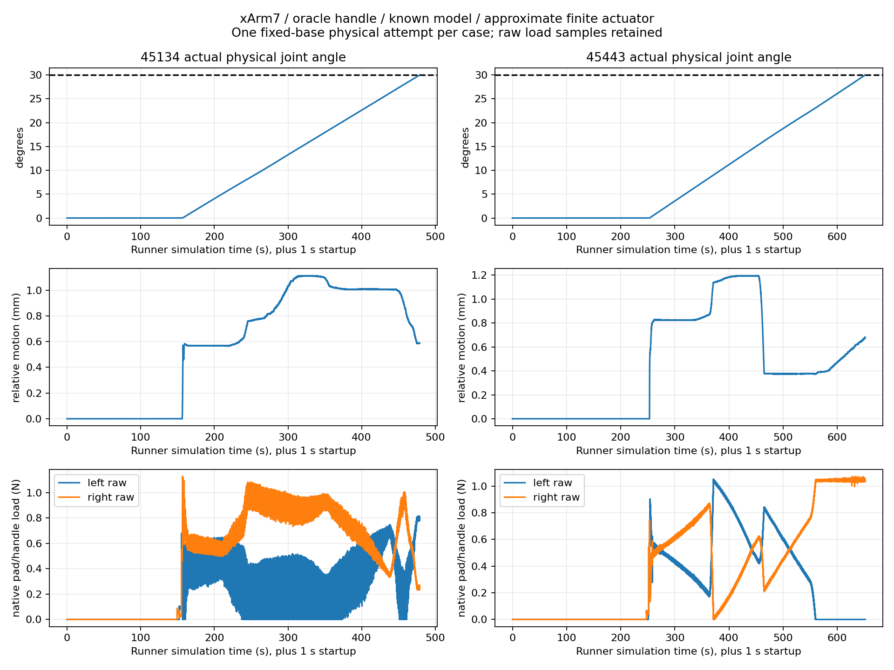

# xArm7 shared door skill: two physical 30° successes

**Physical milestone PASS: 2/2 predeclared doors, one closed-start attempt per object.** Both establish correct-handle bilateral contact and open the actual simulated joint to ≥30° using the same shared execution mechanism, with a fixed base and zero releases/regrasps. The continuous-door-video deliverable is incomplete because an ffmpeg PATH error prevented both encoders from starting; this is explicitly separated from the verified physical outcomes.

**XARM7 / ORACLE_HANDLE / KNOWN_MODEL / APPROXIMATE_ACTUATOR_SIMULATION.** Offline inputs are reused from `4b73580`. No NERO development, new objects, perception, hardware deployment, physics fitting or planner redesign is performed. Frozen PiPER experiments remain unchanged.

| Object | PiPER actual, preserved prior run | xArm7 offline plan | xArm7 maximum actual after valid grasp | Correct handle / initial bilateral grasp | Actual ≥30° |
|---|---:|---:|---:|---|---|
| 45134 | 20.91° | 30° | **30.000040°** | original-32 / yes | PASS |
| 45443 | 17.53° | 30° | **30.000013°** | original-38 / yes | PASS |

This is a two-case functional demonstration, not a robust population success-rate estimate. Different reach, joint limits, chosen stations, grasp configurations and approximate arm dynamics confound any redundancy-only interpretation.

## Actual contact and execution metrics

| Metric | 45134 | 45443 |
|---|---:|---:|
| Initial actual angle | 0° | ~0° |
| Angle at valid grasp | 0.004262° | ~0° |
| Pad loads at bilateral acquisition | 0.5309 / 0.5131 N | 0.5287 / 0.5223 N |
| Peak raw pad load | 1.1269 N | 1.0728 N |
| Maximum handle-relative translation | 1.1123 mm | 1.1942 mm |
| Maximum relative rotation | 0.2902° | 0.5649° |
| Maximum nominal joint-reference tracking error | 0.004694 rad | 0.004897 rad |
| Limiting joint / minimum actual margin | joint4 / 0.912294 rad | joint6 / 0.525112 rad |
| Maximum TCP speed after valid grasp | **2.2065 mm/s** | **2.9610 mm/s** |
| Maximum TCP speed across all phases | 25.5758 mm/s | 32.3969 mm/s |
| Poststep drive-law estimated saturation duty | 0 for all seven joints | 0 for all seven joints |
| Runner simulation duration | 478.8375 s | 651.7500 s |
| Initial native setup before runner clock | +1.000 s | +1.000 s |
| Wall duration, including startup/export | 2247.02 s | 2939.20 s |
| Main observations / native physics records | 114,921 / 114,921 | 156,420 / 156,420 |
| Intentional releases / regrasps / base moves after grasp | 0 / 0 / 0 | 0 / 0 / 0 |
| Opening local correction attempts | 0 | 0 |

The loaded TCP peaks remain below the unchanged **5 mm/s** protection. Joint margin protection remains **0.05 rad**. All original collision, finger-root/contact, force, gripper effort and velocity protections remain enabled. No protection is bypassed or weakened; no new fatal quality/perfection gate is added.

Contact acquisition is bilateral, but **constant bilateral loading is not claimed**. 45134 reports left-pad unloading in 725 intervals, longest 1.875 s. 45443 reports a sustained left-pad unloading interval of 92.654 s and shorter right-pad intervals. For both episodes, the recorded raw and filtered streams show **zero intervals with both pads below the existing 0.05 N threshold**. Door progress and small relative motion continue. This demonstrates maintained motion transmission, while the sustained one-sided report remains a contact-quality limitation to investigate separately. No force symmetry or extra sample requirement was introduced.

The frozen diagnostic first-divergence definition (>3 mm TCP reference discrepancy or >2° object/reference discrepancy) reports `null` in both episodes. That is not a new PASS criterion or proof of a certified trajectory. See each case's [raw result](45134/physical_01/report.json), [analysis](45134/physical_01/ANALYSIS.json), and corresponding [45443 result](45443/physical_01/report.json), [analysis](45443/physical_01/ANALYSIS.json).

## Runtime model and actuator

Official UFACTORY source is pinned to `xarm_ros` **aad7e1611c9c46eb719045414394bfdd42dcb0f8**. Arm geometry, mass, COM, inertia and authored joint limits are reused. The importer-only URDF folds the existing massless PiPER opening command into the physical sliders, retaining their coupling. Official continuous-joint controller workspace limits are not described as newly found mechanical stops.

The active native order is joint1…joint7, gripper_joint1, gripper_joint2; arm indices 0…6 and jaw indices 7/8. Runtime TCP FK discrepancy is below 0.494 μm / 0.929 μrad in the robot-only tests. Native body mass and **body-frame** inertia tensor readback match the explicitly restored official tensors (maximum tensor discrepancy 1.58e-9 kg·m²). The tensor getter already returns body-frame matrices; applying the COM principal-axis rotation a second time is incorrect. Both the native readback and authoritative stage tensors are preserved.

The controller is an **approximate finite-effort PhysX implicit force drive**, not hardware servo identification:

- P = **[1200, 1400, 1200, 850, 500, 500, 300]**; D = **[10, 10, 5, 5, 1, 1, 1]**, sourced from the pinned [manufacturer simulation position-controller configuration](https://github.com/xArm-Developer/xarm_ros/blob/aad7e1611c9c46eb719045414394bfdd42dcb0f8/xarm_controller/config/xarm7/xarm7_controllers.yaml). PiPER arm gains are not copied.
- Finite arm effort ceilings = **[50, 50, 30, 30, 30, 20, 20] N·m**, and 3.14 rad/s authored arm speed ceilings; the inherited task command/speed protections also remain active.
- Integral action is omitted. Gravity compensation shifts the same implicit drive equilibrium: `q_drive = q_reference + g_URDF(q_reference)/Kp`. External arm effort commands are explicitly cleared; no explicit torque servo or unlimited actuator is used.
- URDF joint friction/damping is mapped as modern effort/viscous terms rather than treating an effort-valued friction field as a dimensionless legacy load ratio. Values are retained. Mechanical same-cluster/adjacent-cluster filters derive from the actual xArm URDF, not PiPER adjacency lists; no extra nonadjacent `Never` exclusion is introduced.
- Native PiPER jaw position/effort control, gain transitions, closure-continuity fix, contact confirmation and clamp commands remain unchanged. The arm adapter prevents those jaw mode changes from replacing the sourced xArm arm gains.
- Reported saturation uses a **poststep drive-law estimate**, not an isolated native motor-force sensor. Native projected reactions, external effort commands and joint reactions are preserved as separate channels.

[Configuration](XARM7_CONFIG.json), [stage/mass audit](robot_02/XARM7_STAGE_AUDIT.json), [actuator definition](robot_02/APPROXIMATE_ACTUATOR.json), and [native tensor readback](robot_02/NATIVE_MASS_TENSOR_READBACK.json) make the assumptions explicit.

## Exactly two short robot-only runs

| Check | Run 01, 45134 representative pose | Run 02, 45443 representative pose |
|---|---:|---:|
| Simulation duration | 20.1667 s | 20.5042 s |
| Maximum joint tracking error | 0.004152 rad | 0.004371 rad |
| Peak measured TCP velocity | 4.2135 mm/s | 3.1207 mm/s |
| Native self-contact records | 0 | 0 |
| Jaw open/close | 80→20→80 mm | 80→20→80 mm |
| Completion | yes | yes |

The first run shows native-versus-full-step velocity disagreement under constraints/friction despite stable measured positions. The single evidence-based correction switches TGS to PGS, retaining gains, effort limits, geometry and friction values. Native velocity offsets are **not fully eliminated** (joint7 RMSE approximately 0.1333 → 0.0740 rad/s across different representative poses); both native and full-step channels remain raw. Actual TCP/joint positions track smoothly, effort remains finite and no physical position oscillation is observed. This diagnostic was not turned into an arbitrary new gate. The existing speed protection continues consuming its original measurements.

PGS ignores the TGS-only external-force-per-iteration flag; after run 02 the ignored flag is explicitly disabled, without changing effective PGS behavior. No third robot-only run is launched. Native gripper opening/closing, collision mapping, finite effort readback and tool FK are verified before contact.

## Shared skill and virtual gripper adapter

The shared execution mechanism remains:

`automatic oracle-handle plan → fixed initial station → smooth approach → repaired continuous closure → actual bilateral contact → acquired moving-body/TCP transform → Pink/contact-aware opening → actual 30°`.

New files are only the xArm plant/drive adapter, joint-count/scene adapter and thin shared entry point. The existing Pink solver/costs, grasp planner, closure source, pre-contact trajectory and opening policy are reused. No per-object controller or manually tuned pose is written. Both existing automatically selected plans from the reference commit are loaded. The [batch source freeze](CONTACT_BATCH_SOURCE_FREEZE.json) and [audit](CONTACT_BATCH_SOURCE_AUDIT.json) confirm no shared source changes between outcomes.

The exact frozen PiPER contact hand is mounted with the existing virtual 4.5 mm coaxial transform. Tool payload is **0.500 kg**, with matching collision origins and inertia. The simulated tool FK is validated; mechanical bolt pattern, physical adapter, wiring and hardware compatibility are **not** validated. The future standard [UFACTORY xArm Gripper manual](https://www.ufactory.cc/wp-content/uploads/2023/08/xArm-Gripper-User-Manual-V1.11.0.pdf) specifies 0–84 mm travel, 802 g mass, 30 N maximum clamp force and RS-485/Modbus RTU position/speed interface. That differs from the current two-slider PiPER effort-hold hand. Future physical-gripper deployment requires its actual tool/mass/contact model, aperture/feedback adapter and new validation. No gripper is silently swapped during these two comparisons. [Tool compatibility audit](TOOL_COMPATIBILITY.json).

## Evidence defects and explicit delivery limitations

1. **Both original door video encoders failed** because `shutil.which('ffmpeg')` returned `None` in the launch PATH. Manipulation continued and all raw physics buffers exported, but the continuous native-door-video requirement is unmet. No extra physical trial is used to conceal this failure. Robot-only original videos exist; 45443 later actual progress images are captured beginning around 15.34° and a clearly watermarked partial image clip is provided. It is approximately 1 Hz progress imagery, not a full/native-rate video, not state replay, and not evidence of the unrecorded prefix. Non-atomic unreadable copied images are preserved and listed in its metadata.
2. **Descriptive header copy error:** the 45443 job's `skill_inputs.handle_region` header erroneously repeats 45134/original-32. Execution actually reads the case-specific manifest/plan and original-38 collider selection; that effective selection is recorded in `frozen_proxy.json`, allowed-collider mapping and raw contact IDs. The header is not a grasp-generation input in this entry point. The exact original job is preserved; [effective input audit](EFFECTIVE_HANDLE_INPUT_AUDIT.json) separates the wrong description from the real geometry. The old proxy-description caption is also stale; actual unchanged authored mesh URDF/hash is the geometric authority.
3. After both actors close, only the **launch I/O environment** and future job-header generator are corrected. No physics/controller/pose parameter changes or retests occur. [Tested entry source](tested_run_xarm7_shared_door.py) retains the exact tested bytes; [post-batch I/O repair](POST_BATCH_IO_REPAIR.json) distinguishes the published PATH fallback from physical validation.
4. Native velocities retain solver/constraint offsets, actuator assumptions are approximate, contact loading is sometimes one-sided, and these two cases are not a hardware/general reliability certificate.

## Preserved data, source and cleanup

Main raw observations/native physics contain **271,341 records each**; separate 240 Hz startup buffers preserve both 1 s initializations. Robot-only sessions add 9,761 samples. Sensor definitions, transforms, raw impulses/contact points/normals/collider IDs, filtered and raw loads, joint positions/velocities/reactions, command aperture/effort/mode, articulation states, references and phase events are preserved in lossless chunked storage.

Full raw archive: `/data1/home/rangeryx/fr3_real2sim_known_whole_20261007/results/xarm7_shared_doors_20261012.zip`. See [archive digest](ARCHIVE_SUMMARY.json) and [all-file manifest](EVIDENCE_SHA256.json). Local raw preservation is under `engineering_artifacts_20261012/xarm7_shared_doors` in the repository workspace. The GitHub report retains results, source/configuration hashes and metadata; full raw storage locations remain explicit.

All four owned Isaac actors and the passive image observer are closed. Exactly **two robot-only initializations and one contact attempt per predeclared object** are used; no retry, replacement asset or extra simulation session is launched. All 3,842 previously tracked inputs, including frozen PiPER/NERO sources, are unchanged. No NERO work continues.

**Conclusion:** xArm7 is now a functional primary **7DoF approximate simulation backend** for this shared known-axis/oracle-handle skill on the two tested doors. The actual 30° task passes twice; complete native video delivery does not. Do not attribute the improvement solely to redundancy or extrapolate it to real hardware.

